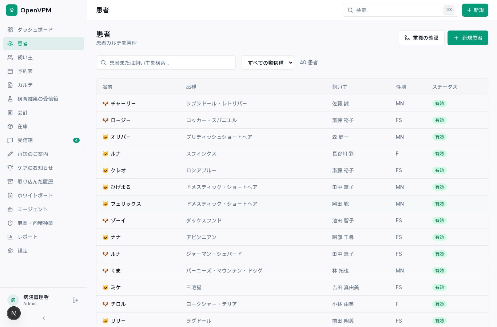
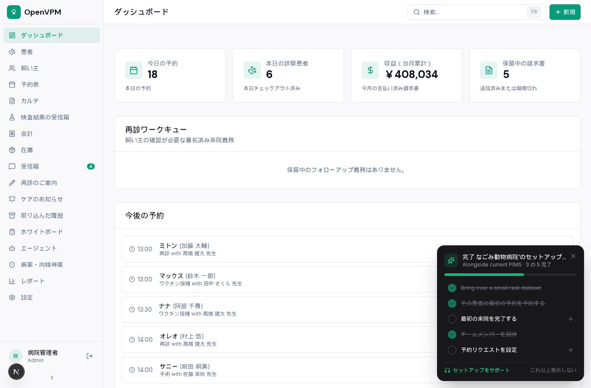

動物病院の電子カルテには、**OpenVPM** というオープンソースのシステムがあります。カルテ、予約、会計、在庫を1つの画面で扱い、自院のサーバーで動かせます。

当社は2026年9月に、このシステムを日本語にした「OpenVPM 日本語版」を公開しました。そのとき本家に送った日本向けの変更が、11月12日に本家の本体へ取り込まれました。この記事では、OpenVPM がどんなシステムか、日本で使うときに何に気をつけるか、当社が何をしたかをまとめます。

結論を先に書きます。

- **OpenVPM は動物病院の業務をまとめて扱うシステム**です。カルテ、予約表、会計、在庫、飼い主への連絡が入っています
- **ライセンスは GNU AGPLv3**。自院のサーバーに入れて使えます。月額の利用料はかかりません
- **本家は英語だけ**です。画面を日本語にする仕組みは、まだ本家にありません
- **当社が送った「日本を選べるようにする変更」が本家に入りました**。国に日本を選ぶと、円・消費税10%・東京の時刻が初期値になります
- **円のカード決済は、本家では止めてあります**。金額の単位の扱いが円に合っていないためです。会計の記録には使えます
- 日本語の画面で使いたい動物病院向けに、当社は **OpenVPM 日本語版** と、その導入キットを出しています

## OpenVPM とは

[OpenVPM](https://github.com/evangauer/openvpm) は、2026年3月に開発が始まった動物病院向けの管理システムです。開発元は「動物病院のソフトウェアは、それを使う人たちのものであるべきだ」と掲げています。

特徴は次の4つです。

- **覚えやすい画面**：受付のスタッフが、何週間もの研修なしに1回の勤務で使えるようになることを目標にしています
- **API が先にある作り**：画面で行う操作と同じことを、外部のシステムから REST API で行えます。予約サイトや検査機器とつなぐ土台になります
- **クラウドでも自院のサーバーでも動く**：Docker Compose で自院のサーバーに入れられます
- **オープンソース**：獣医師の人数に応じた課金はなく、データは病院のものです

執筆時点で GitHub のスターは64、フォークは34です。規模はまだ小さいですが、開発は毎日のように動いています。

## 何ができるか

下は、当社の日本語版の患者一覧の画面です。左の列に、機能が並んでいます。

主な機能は次のとおりです。

- **患者と飼い主**：動物ごとのカルテと、飼い主の連絡先。重複の確認もできます
- **カルテ**：SOAP 形式の診療記録、ワクチン接種、処方、検査結果
- **予約表**：獣医師ごとの予約
- **会計**：請求書の作成と、入金の記録
- **在庫**：薬や消耗品の数
- **飼い主への連絡**：再診の案内、ケアのお知らせ、受信箱
- **ホワイトボード**：院内にいる動物の状況
- **麻薬・向精神薬**：管理の記録
- **飼い主ポータル**：飼い主が自分で見られる画面
- **AI エージェント**：設定した AI モデルに、院内のデータをもとに作業をさせる機能

メールや SMS の送信、AI の機能は、それぞれ外部のサービスの設定が要ります。入れただけで動くのは、カルテ・予約・会計・在庫の部分です。

## 使われている技術

- 画面：Next.js 15、React 19、TypeScript
- データベース：PostgreSQL 16
- 認証：役割ごとの権限（管理者・獣医師・動物看護師・受付・閲覧のみ）、2段階認証
- ファイルの保存：S3 互換のストレージ
- 決済：Stripe
- 配置：Docker Compose

医院ごとのデータは、アプリの側とデータベースの側の両方で分けています。データベースの行単位の制限を使っているので、設定を誤っても別の医院のデータが見える事故が起きにくい作りです。

## 日本で使うときに気をつけること

### 画面は英語

本家の画面は英語だけです。当社が9月に調べたとき、画面の文言は約2,400種類あり、すべてソースコードに直接書かれていました。翻訳を差し替える仕組みはありません。

本家には、多言語化の方針を書いた文書があります。「英語を正とする」「欠けた訳は英語で出す」「国ごとの分岐で別のコードを作らない」「小さな変更で少しずつ進める」という内容で、どの仕組みを使うかはまだ決まっていません。

### 円のカード決済は止めてある

これは、今回の本家とのやり取りで分かったことです。

OpenVPM の決済は、どの通貨も「100分の1の単位」で金額を扱う作りでした。ドルなら 45.00ドルを 4500 として送ります。ところが円には、100分の1の単位がありません。同じ作りのまま円を通すと、**4,500円の請求が、決済サービスには450,000円として届くおそれ**がありました。

本家の開発者は、当社の変更を取り込む前の点検でこれを見つけ、対応を足しました。

- 窓口での決済、飼い主ポータルでの決済、決済サービスへ送る部分の3か所で、ドル・ポンド・ユーロ・カナダドル・豪ドル以外の通貨を受け付けない
- 設定の画面に、その制限を表示する
- ほかの方法で受け取った支払いは、これまでどおり手で記録できる

日本の動物病院で使う場合、**会計の記録には使えますが、OpenVPM からのカード決済は使えません**。いまは、院内のカード端末や現金で受け取り、OpenVPM に入金を記録する使い方になります。

当社の日本語版は、この対応が入る前の本家をもとにしています。日本語版でカード決済の連携を設定するのは避けてください。

### データの保存先

ファイルの保存には S3 互換のストレージが要ります。本家が使っている MinIO は、当社が9月に確かめたとき、公式のコンテナイメージを取得できなくなっていました。当社の日本語版では、同じ S3 互換の SeaweedFS に替えています。

## 当社が本家に送った変更

日本語版を作る途中で、医院の国に日本を選べないことに気づきました。選べたのは米国・カナダ・英国・アイルランド・豪州の5つです。

そこで9月29日に、次の変更を本家に送りました。

- 医院の国に**日本**を足す
- 日本を選ぶと、通貨は**円**、消費税は**10%**、時刻は**東京**、日付と金額の書式は日本のものになる
- 登録・初期設定・設定の各画面の選択肢に、東京の時刻と円を足す

変更は6ファイル、足した行は27行の小さなものです。

これが11月12日に、本家の本体に取り込まれました。開発者からは、次の連絡がありました。

- 当社が書いた2つの変更は、**作者の名前を残したまま**入っている
- 本家の README の貢献者の欄に、当社のアカウントの名前を載せた
- 上で書いた、円の金額の安全装置を本家の側で足した
- 本番環境へのリリースは、まだこれから

送ってから取り込まれるまで、1か月半かかりました。そのあいだに本家のコードが進んでいたので、開発者が最新のコードに載せ直してくれています。小さな変更でしたが、「円の決済が危ない」という点検につながったのは、送ってよかったと思える結果でした。

## OpenVPM 日本語版

当社は、本家をもとに画面を日本語にした **OpenVPM 日本語版** を公開しています。本家とは提携していない、非公式の日本語版です。

日本語版で足したものは次のとおりです。

- **画面の日本語化**：約3,800件の文言を日本語にしています。訳が無いところは英語で出ます（本家の方針と同じ）
- **日本の地域設定**：円、消費税10%、東京の時刻、姓・名の順の表示
- **紙カルテからの移行**：表計算ソフトに打ち込んだ一覧を CSV で取り込めます。日本語の列名、犬・猫・ウサギ・去勢オス・避妊メスといった書き方、和暦の日付、Excel が出す Shift_JIS の CSV に対応しています。試しに読み込んで結果を確かめてから、確定できます

まだ日本語になっていないところもあります。飼い主に送るメールや PDF の文面と、サーバーの側で作る一部の文です。

当社のサーバーで本番と同じ構成を動かしたときのメモリは、画面のプログラムが約170MB、データベースが約60MB、ファイルの保存が約120MB でした。メモリだけを見れば、院内の小型のサーバー1台に収まる大きさです。

## 導入キット

日本語版を自院のサーバーで動かすための手順をまとめた、[動物病院の電子カルテ OpenVPM 日本語版 導入キット](https://kappstore.exbridge.jp/app.php?id=302ada8100bb954f#ref=vwork-openvpm)を Kurage App Store に出しています。税込5,500円です。

入っているものは次のとおりです。

- はじめに（全体の流れと、必要なサーバー）
- 構築手順書（サーバーの用意から本番の起動まで）
- 紙カルテからの移行（CSV の作り方と取り込み）
- バックアップと更新（毎日のバックアップと、別のサーバーへの復元）
- 使いはじめの設定
- 設定ファイル一式とバックアップ用のスクリプト

手順は、当社のサーバーで実際に通したものです。医院の登録で日本を選び、Shift_JIS の CSV を4本取り込み、バックアップを取って別のデータベースに復元し、件数が合うところまで確かめています。

本体のソースコードは GitHub で公開しています。キットは、それを自院で動かすための手順書と設定をまとめたものです。

動物病院の業務とシステムについては、[動物病院向けのページ](https://exbridge.jp/solution/doubutsu.html#ref=vwork-openvpm)にもまとめています。

## まとめ

- OpenVPM は、動物病院のカルテ・予約・会計・在庫を1つにまとめたオープンソースのシステムです
- 自院のサーバーで動かせて、月額の利用料はかかりません
- 本家は英語だけで、円のカード決済は止めてあります
- 当社が送った日本向けの変更は、11月12日に本家に取り込まれました
- 日本語の画面で使うなら、OpenVPM 日本語版と導入キットがあります

紙カルテから電子カルテへ移るとき、いちばん手間がかかるのは、これまでの記録を移す作業です。そこを CSV で取り込めるようにしたのが、日本語版でいちばん力を入れた部分です。
