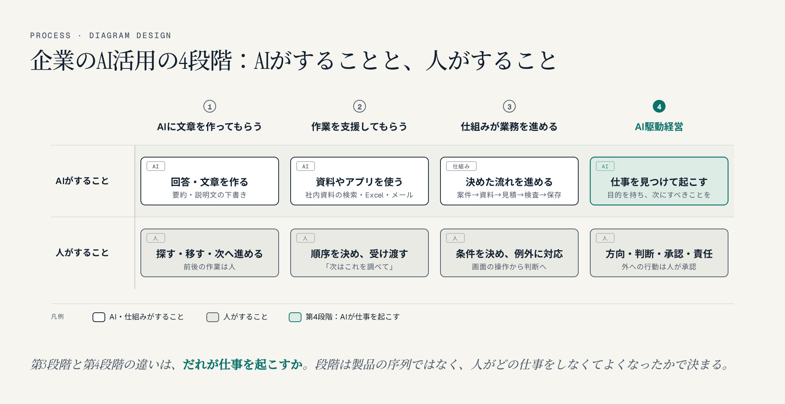
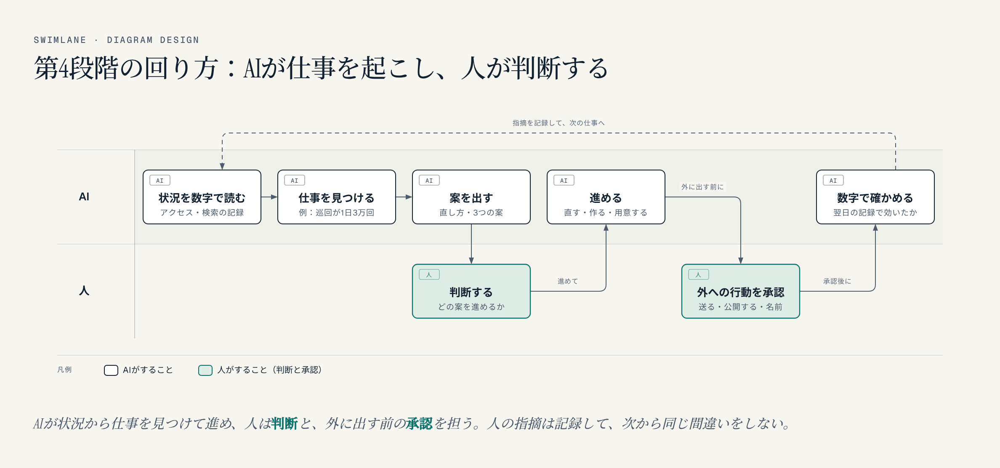

名古屋でAIシステム開発の会社をやっています。これまで、企業のAI活用を3つの段階で説明してきました。最近、その先にもう一つ、第4段階があると感じています。AIが目的を持って仕事を起こし続け、人は方向を決め、判断し、責任を持つ段階です。ここでは「AI駆動経営」と呼びます。

## 1. これまでの3段階

- **第1段階：AIに回答や文章を作ってもらう**。資料の要約や、説明文の下書き。前後の作業（資料を探す、書式に移す、次の工程へ進める）は人が担います
- **第2段階：AIが社内の資料やアプリを使って、作業を支援する**。社内の資料を検索し、Excelやメールを読む。ただ、「次はこれを調べて」と仕事の順序を決め、受け渡すのは人です
- **第3段階：仕組みが業務を進め、人は例外と判断を担う**。新しい案件が来たら、過去の資料を探し、見積案を作り、検査して保存する。人の役割は、画面を操作することから、条件を決め、例外に対応することへ移ります

この3段階は製品の序列ではありません。何のAIを契約したかではなく、利用者がどの仕事をしなくてよくなったかで決まります。

## 2. 第4段階：AIが仕事を起こし続け、人が判断する

第3段階と第4段階の違いは、**だれが仕事を起こすか**です。

第3段階では、人が前もって決めた業務の流れを、仕組みが自動で進めます。何をきっかけに動くかも人が決めていて、仕組みはその道を走ります。

第4段階では、AIが目的（売上、問い合わせ、認知など）を持ち、いまの状況を見て「次に何をすべきか」を自分で見つけ、仕事を起こし続けます。人は、次の4つを担います。

1. **方向を決める**：何を目指すか、何をしないか
2. **判断する**：AIが出した案のうち、どれを進めるか
3. **外への行動を承認する**：送る、公開する、お金を使う、名前を出す
4. **責任を持つ**：結果を引き受ける

第3段階が「業務の自動化」なら、第4段階は「経営の動きそのものをAIが回し、人が舵を取る」段階です。

## 3. 当社で実際に起きていること

当社では、AIエージェント（Claude Code）に、日々の仕事を流れごと任せています。この数日で起きたことを、3つ挙げます。

### 例1：問い合わせのページに、巡回が1日3万回来ていた

AIが毎日のアクセスの記録を読み、考察を書いています。その中で、「会社のサイトの訪問者が前日の3倍になったが、増えたのは問い合わせのページで、ほとんどが巡回ロボットだ。1日に3万2千回来ていて、本物の問い合わせは0件」と見つけ、直し方（巡回を止める設定、リンクの印）を出してきました。

人がしたのは、「進めて」と言うことだけです。直したあと、ボタンに「無料」と書かれていて方針に合わない、ということもAIが見つけ、人は「『相談する』に直して」と判断しました。

### 例2：国会トラッカーに、検索から人が来ていなかった

当社は、国会の質疑と答弁をテーマごとに集めるシステムを公開しています。AIがGoogleの検索の数字を読み、「Xからは1日数百人来ているのに、検索からは13日で7人。原因は、狙っている言葉が『年収の壁』（月11万回）のように大きすぎて、ニュースや省庁と競っていること」と分析しました。そのうえで、競合の少ない「国会 答弁」の側に題名を寄せる、検索に強いブログから送る、という3つの案を出しました。

人は「1、2、3進めて」と答えました。題名の変更、一覧ページの作り直し、会議録のデータから作った5本の記事の公開までを、AIが進めました。

### 例3：市長にフォローされたら、市の避難所のデータのずれが見つかった

ある市の市長に、Xでフォローしていただきました。お礼の前に、AIがその市のデータを調べ、「国の避難場所のデータには、その市の土砂災害のときの避難所が1か所も入っていない。一方、市報では2つの集会所を土砂災害の避難所としている」と見つけました。

AIは、その2か所を当社の地図に「市の発表」として加え、市長へのお礼のメッセージと、国会議員への報告の文面まで用意しました。人がしたのは、伝え方を直すこと（「角が立つかは言い方だよ」）と、送ることです。

3つとも、人が「これをやって」と指示したのではありません。AIが状況から仕事を見つけ、人は判断と、外に出す前の言い方と、送ることを担っています。

## 4. 第4段階に欠かせない4つのこと

AIに仕事を起こさせると聞くと、勝手なことをされそうで怖い、と感じるかもしれません。当社で回してみて、次の4つがあれば、怖いものではないと分かりました。

1. **外に出る行動は、人が承認する**。送る、公開する、お金を使う、名前を出す、といったことは、AIが勝手にしません。名前を勝手に決めて外に出してしまい、取り返しがつかなくなった失敗があったので、決まりにしています
2. **数字で結果を確かめる**。「やりました」ではなく、アクセスの記録や検索の数字で、効いたかどうかを見ます。問い合わせのページの件も、直したあと翌日の記録で減ったかを確かめます
3. **人の指摘を記録して、同じ間違いをしない**。人に言われたこと（「無料と書くな」「DMは案を出したら送ったものとして扱って」など）を、AIが記録して次から守ります。これがないと、毎回同じことを言うはめになります
4. **うまくいかないときは止めて、人に返す**。自動で送ろうとして2回失敗したら、それ以上試さずに人に任せます。議員の問い合わせフォームに自動で送ろうとして、迷惑メールと判定されたときも、そこで止めて人が送りました

## 5. 人の仕事は、なくならない。変わる

第4段階でも、人の仕事はなくなりません。変わるのは中身です。

- 画面を操作する、資料を探す、転記する、といった作業は、AIが担う
- 何を目指すか、どの案を進めるか、どう伝えるか、何を引き受けるか、は人が担う

当社の例でも、AIが一番苦手なのは「言い方」と「相手との関係」でした。市長に送るメッセージで、何を先に書き、何を書かないか。そこは人の判断で大きく変わりました。

## 6. 第4段階に進むには、経営者が先に理解する

第4段階は、担当者やエンジニアだけでは始められません。AIにどこまで任せ、どこで人が判断し、何を外に出してよいかは、経営の判断だからです。

私が経営者向けのAIエージェント・バイブコーディングのセミナーを行っているのは、経営者自身に、AIが仕事を見つけ、進め、人に判断を求める流れを体験していただくためです。そのうえで、自社のどの仕事を任せ、何を人の判断として残すかを考えていただきたいと思っています。

- [経営者向けセミナーの内容・ご相談](https://exbridge.jp/seminar.html#ref=vibeblog-ai-kudo)
- [AIエージェントで業務を自動化する事例（相談から開発・出品・ブログ・動画・SNS告知まで）](https://exbridge.jp/ai-agent-automation.html#ref=vibeblog-ai-kudo)
- [前回の記事：企業のAI活用を3段階で考える（note）](https://note.com/tokoname/n/nd28a26d22519)

## よくある質問

### AI駆動経営とは何ですか？

AIが会社の目的を持ち、状況を見て次にすべき仕事を見つけ、起こし続ける経営のやり方です。人は、方向を決め、AIの案を判断し、外に出る行動を承認し、結果に責任を持ちます。当社では、企業のAI活用の第4段階と位置づけています。

### 業務自動化（第3段階）とAI駆動経営（第4段階）は何が違いますか？

第3段階は、人が前もって決めた業務の流れを、仕組みが自動で進めます。第4段階は、AIが目的と状況から、決まっていない仕事も見つけて起こします。違いは、だれが仕事を起こすかです。

### AIに仕事を任せて、勝手なことをされませんか？

外に出る行動（送る、公開する、お金を使う、名前を出す）は人が承認する、結果を数字で確かめる、人の指摘を記録して守らせる、うまくいかないときは止めて人に返す、という決まりを置けば、勝手なことはされません。

### 第4段階でも人の仕事は残りますか？

残ります。作業はAIが担いますが、何を目指すか、どの案を進めるか、どう伝えるか、何を引き受けるかは人が担います。
