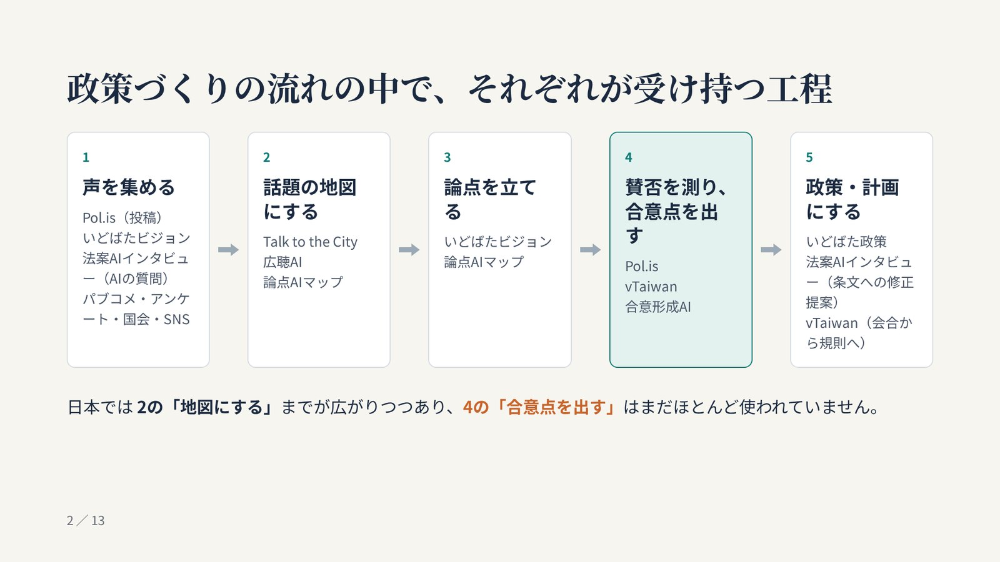
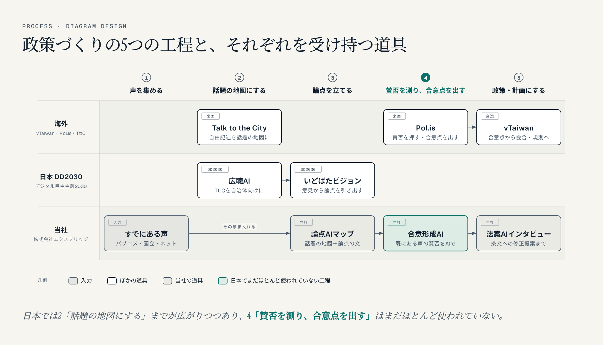
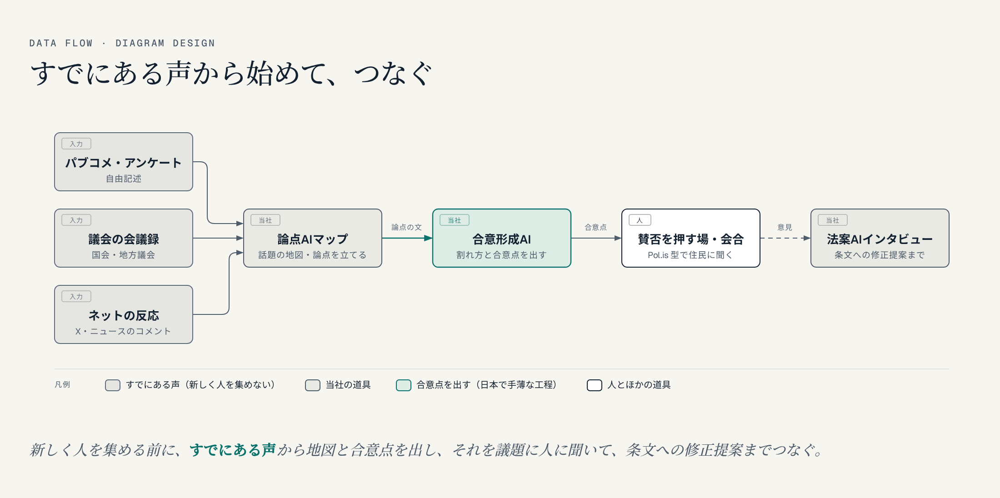

名古屋でAIシステム開発の会社をやっています。今週、GitHubのトレンドに **diagram-design** というスキルが入っていました。AIエージェント（Claude Code など）に、説明用の図をきれいに描かせるためのもので、スターは5万を超えています。ライセンスは MIT です。

ちょうど、議員事務所や自治体の方に見せている「ブロードリスニングから合意形成までの見取り図」の図を、もう少し見やすくしたいと思っていました。そこで、この図を diagram-design で描き直してみました。

- [diagram-design（当社のOSSカタログ）](https://kurage.exbridge.jp/oss/diagram-design/#ref=vibeblog-diagram-design)
- [元の見取り図の記事（12枚のスライド）](https://exbridge.jp/vibeblog/2026-10-10-broad-listening-consensus-tools-map.html#ref=vibeblog-diagram-design)

## 1. diagram-design は何をするものか

diagram-design は、構成図・工程図・データの流れ・時系列・2軸の図など45種類の図を、**1つのHTMLファイル（中にSVGの図）**として描くためのスキルです。AIエージェントがスキルの説明を読み、図の種類を選び、決まりに沿って描きます。外部の画像やライブラリに頼らないので、ファイル1つをブラウザで開けば見られます。

特徴は、見た目の決まりがとても細かいことです。

- 1つの図の要素は**9個まで**。超えたら2枚に分ける
- 強調色は1つの図で**2か所まで**
- 線は**直角に曲げる**（角は丸める）。斜めの線は使わない
- 影は付けない。箱の角の丸みは小さく
- 矢印のラベルは、紙色の板の上に置き、線から**6〜10px離す**
- 凡例は図の中ではなく、**下に横一列**
- 座標や大きさは4の倍数

さらに、図の決まり（読み上げ用のタイトルと説明など）と、線とラベルの重なりを確かめる**検査スクリプト**が付いています。「AIに図を描かせると、それっぽいけれど雑になる」ところを、決まりと検査で止める作りです。

## 2. 最初にすること：配色とフォントを自社のものに

初めて使うときは、配色とフォントを自社のものに合わせる手順があります。初期の配色（オレンジの強調色）のまま、自社の資料に図を出さないための決まりです。

当社は次のようにしました。

- 紙色：真っ白ではなく、少し温かみのある #f6f5f0（決まりで「真っ白は避ける」とされています）
- 文字色：#12202f
- 強調色：当社のティールのうち、文字に使っても読める濃さの #0a726b

フォントは、見出しが明朝系（Instrument Serif）、名前がゴシック系（Geist）、補足が等幅（Geist Mono）という3つの組み合わせです。どれも日本語の字を持っていないので、**英字のフォントのあとに Noto Sans JP（見出しは Noto Serif JP）を続けて**指定しました。スキルの説明に韓国語・中国語の例があり、同じやり方で日本語も出せました。

## 3. 描き直す前と後

元のスライドは、政策づくりの5つの工程を横に並べ、それぞれを受け持つ道具の名前を箱の中に書いたものでした。

diagram-design では、これを「工程（process）」の型で描き直しました。横に5つの工程、縦に「海外」「日本のDD2030」「当社」の3つの列を置き、その交わりに道具の箱を置く形です。

変わったところは次のとおりです。

- **どこの道具か**が列で分かるようになりました（海外・DD2030・当社）。
- 強調は「4. 賛否を測り、合意点を出す」の見出しと、合意形成AIの箱の**2か所だけ**です。元のスライドでは4つ目の箱全体を色付けしていましたが、決まりに合わせて絞りました。
- 当社の列は、すでにある声から論点AIマップ、合意形成AI、[法案AIインタビュー](https://kurage.exbridge.jp/khouan.php/#ref=vibeblog-diagram-design)まで、**1本の線でつながる**ようになりました。元のスライドでは最後の「政策・計画にする」をDD2030のいどばた政策に任せていましたが、今日、法案AIインタビューに**法案の条文への修正提案**の機能を足したので、当社の道具で最後の工程まで受け持てます（このあとの節）。
- 箱は9個です。元のスライドにあった「パブコメ・アンケート・国会・SNS」は、「すでにある声」という1つの入力の箱にまとめました。要素は9個までの決まりがあるので、法案AIインタビューを足したかわりに、いどばた政策の箱は外しています。

## 4. 2枚目：すでにある声から始めて、つなぐ

元の資料の「ご提案」のスライド（4行の箇条書き）は、「データの流れ」の図にしました。パブコメ・会議録・ネットの反応の3つが論点AIマップに集まり、合意形成AI、住民に賛否を押してもらう場を通って、法案AIインタビューで条文への修正提案にまとめる形です。

1つの箱の同じ辺に3本の線が入るときは、**入る点をずらす**決まりがあります（辺の長さを4等分した位置に1本ずつ）。曲がり角の位置も12pxずつずらして、線が重ならないようにしました。

### 法案AIインタビューに「条文への修正提案」を足しました

いどばた政策は、政策案の文に市民が「ここをこう直す」と提案できる道具です。当社の法案AIインタビューは、これまで法案の解説と、AIの質問に答えて意見を伝えるところまででした。そこで今日、**国会で審議中の法案の条文に、修正を提案できる**機能を足しました。

- 衆議院の議案本文情報から、法案の本文を条ごとに取り込みました（審議中22本のうち21本。残る1本は本文が縦書きのPDFしかないため、PDFを案内しています）。
- 条のページで「どう直してほしいか」を自由に書くと、AIが「第十三条中「講ずるものとする」を「講じなければならない」に改める。」のような**修正の形に整える手伝い**をします。
- 「直す前の語句」は、**条文に実際にある語句だけ**を使います。AIが条文に無い語句を出したときは、修正の形にしません。修正の文はAIに書かせず、プログラムで組み立てています。
- 保存は本人が同意したときだけ。公開するかも本人が選び、個人情報や悪口・宣伝と判定されたものは公開しません。

- [法案AIインタビュー（条文への修正提案）](https://kurage.exbridge.jp/khouan.php/#ref=vibeblog-diagram-design)

## 5. 日本語で使うときのコツ

実際に描いて分かったことです。

- **箱の幅は、全角1文字＝1文字分の幅で計算する。** スキルの説明にある韓国語の例と同じで、文字の種類ごとではなく1文字ずつ幅を足します。「パブコメ・アンケート」は最初の幅（136px）では箱の縁ぎりぎりになったので、152pxに広げました。
- **隣り合う箱の間は、ラベルを置けるほど空いていない。** 工程の型では箱の間が16pxしかありません。「会合の議題に」というラベルを置こうとしたら箱にかぶるので、外しました。ラベルは、間に空きの列がある線だけに付けています。
- **矢印のラベルは全角で短く。** 英語では「14文字以内・大文字」という決まりです。日本語では「合意点を渡す」「そのまま入れる」程度の長さに収めました。

## 6. 検査スクリプトの結果

付属の検査スクリプト2つ（図の決まりの検査、線とラベルの重なりの検査）を、2枚とも通しました。

- 図の決まり：2枚とも指摘0件
- 線とラベルの重なり：2枚とも指摘0件

なお、当社ではプラグインとして入れず、リポジトリを取ってきて、Claude Code にスキルの説明を読ませて描かせました。図の座標は、あとで作り直せるように、配置を計算で決めるスクリプトにしています。取ってきたコードは、作業中のフォルダのファイルを読み込まない設定（Python の `-I`）で動かしました。

## 7. 使ってみての感想

いちばん効いたのは、**「削る」ことを決まりで強いられる**点でした。元のスライドは、伝えたいことを全部箱に入れていました。diagram-design は「要素は9個まで」「強調は2か所まで」なので、何を目立たせるかを先に決めないと描けません。結果として、「日本では4つ目の工程がまだ手薄」という一番言いたいことが、図の中で一番目立つようになりました。

一方で、日本語の長い名前が多い図には、箱の幅とラベルの置き場所で少し工夫が要ります。提案資料やブログの図を、毎回同じ見た目でそろえたいときには十分使えると感じました。

当社では、議員事務所や自治体向けに、ブロードリスニングと合意形成の道具を組み合わせるご提案をしています。

- [論点AIマップ](https://kurage.exbridge.jp/kronten.php/#ref=vibeblog-diagram-design)
- [合意形成AI（合意点マップ）](https://kurage.exbridge.jp/kconsensus.php/#ref=vibeblog-diagram-design)
- [政党・政治団体・議員事務所のAI活用](https://exbridge.jp/solution/seito.html#ref=vibeblog-diagram-design)

## よくある質問

### diagram-design は日本語の図も描けますか？

描けます。フォントの指定で、英字のフォントのあとに Noto Sans JP（見出しは Noto Serif JP）を続ければ日本語が出ます。箱の幅は、全角1文字を1文字分の幅として計算すると決まりどおりに収まりました。

### 何種類の図が描けますか？

構成図、工程図、データの流れ、時系列、2軸の図、組織図、ガントチャートなど45種類です。図の種類ごとに、配置の決まりを書いた説明が付いています。

### 商用で使えますか？

ライセンスは MIT なので、商用でも使えます。著作権表示とライセンス文を残す必要があります。

### 描いた図はどんな形式になりますか？

1つのHTMLファイル（中にSVGの図）です。ブラウザで開けばそのまま見られます。ブログに載せる画像は、そのHTMLを画面に出して撮ったPNGを使いました。
