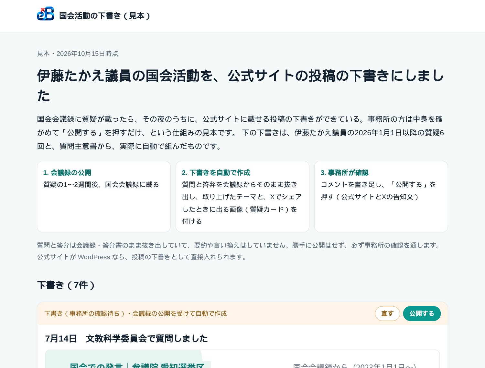
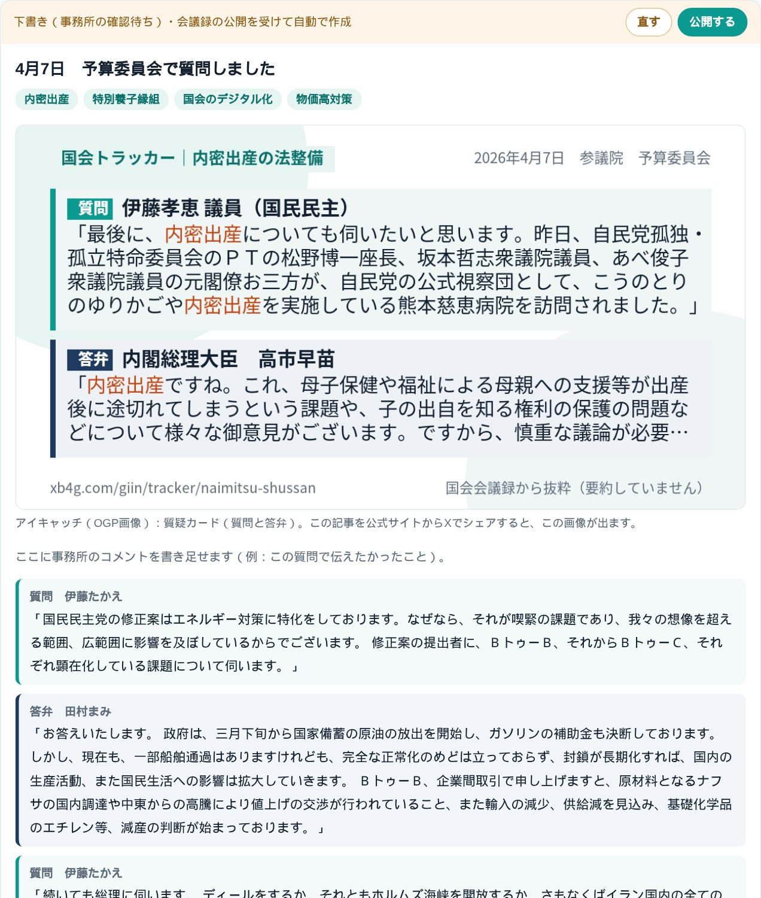
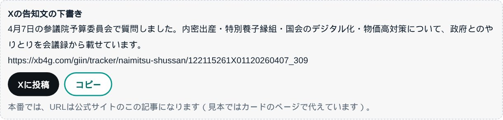
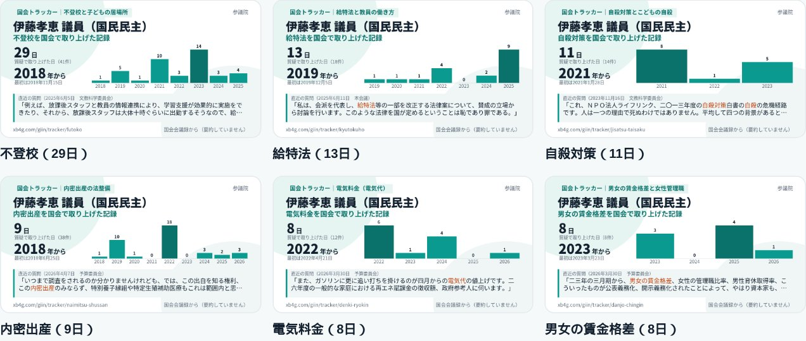

名古屋でAIシステム開発の会社をやっています。国会の会議録をテーマごとに集める「国会トラッカー」や、全国の国会議員が国会で何を話したかを引ける「国会議員 発言ログ」を作ってきました。今日はその材料を使って、議員事務所の仕事を1つ減らす仕組みの見本を作ったので、その話を書きます。

- [見本：伊藤たかえ議員の国会活動の下書き](https://proto.exbridge.jp/giin-hp-b89151937353/#ref=vibeblog-hp-draft)

## 1. 議員の公式サイトの「活動報告」は、手で書いている

議員の公式サイトを見ると、多くの事務所が「◯月◯日 ◯◯委員会で質問しました」という報告を載せています。中身は、事務所の方がまとめた説明と、会議録のPDFや動画へのリンクです。質問主意書を出したときは、質問と政府の答弁書をPDFにして載せている事務所もあります。

これを毎回手で作るのは大変です。会議録は会議の1〜2週間あとに公開されるので、そこから質問の部分を探し、PDFにして、投稿を書いて、Xでも告知する。委員会で質問に立つ回数が多い議員ほど、報告が追いつかなくなります。

国会の会議録は、国立国会図書館の国会会議録検索システムからAPIで取れます。質問主意書と答弁書も、衆議院・参議院のサイトに載ります。当社はすでに、全国の国会議員711人の国会での発言を毎晩取り込み、質問主意書も毎日取り込み直しています。それなら、事務所が手で書く前に、下書きまで作っておけるはずだと考えました。

## 2. 作った見本：伊藤たかえ議員の2026年の国会活動

伊藤たかえ議員（参議院・愛知県選挙区・国民民主党）の、2026年の質疑6回と質問主意書1件で、公式サイトに載せる投稿の下書きを自動で組みました。

下書き1件ごとに入っているのは、次のものです。

- **題名**：「4月7日　予算委員会で質問しました」のように、日付と委員会名から作ります。
- **テーマの札**：その日の質疑に出てくる語を、国会トラッカーのテーマと照らして付けます（4月7日なら内密出産・特別養子縁組など）。
- **アイキャッチ（OGP画像）**：その日の質疑が国会トラッカーにあれば、質問と答弁を1枚にした質疑カードを付けます。無ければ議員カードです。公式サイトの記事をXでシェアすると、この画像が出ます。
- **質問と答弁**：議員の質問と、それに対する大臣や政府参考人の答弁を、会議録からそのまま抜き出して組にします。要約や言い換えはしていません。
- **事務所のコメント欄**：「この質問で伝えたかったこと」を書き足す場所です。
- **出典**：会議録へのリンクを必ず付けます。

質問主意書は、答弁書が届いたら、質問と答弁書の冒頭を並べた下書きを作ります。

## 3. Xの告知文と、投稿・コピーのボタン

下書きごとに、Xの告知文も作っています。「Xに投稿」を押すと告知文とURLが入った投稿画面が開き、「コピー」を押すと告知文とURLをまとめてコピーできます。

本番では、告知文のURLは公式サイトのその記事になります。記事のアイキャッチが質疑カードなので、Xに流れたときに、質問と答弁が1枚の画像で目に入ります。当社が議員の投稿に返信するときに使ってきた質疑カードと同じものを、議員ご本人の記事でも使える形です。

## 4. 公式サイトに貼れるカード

見本の最後には、伊藤議員が国会で取り上げてきたテーマごとに「何日・いつから取り上げてきたか」を1枚にしたカードを並べました。不登校（29日・2018年から）、給特法（13日）、自殺対策（11日）、内密出産（9日）などです。

政策紹介のページや、テーマごとの記事に貼れます。数字は会議録が増えるたびに新しくなるので、貼り替える手間もありません。カードの種類は[OGP画像のカード8種類の一覧](https://exbridge.jp/vibeblog/2026-10-15-ogp-card-ichiran.html#ref=vibeblog-hp-draft)にまとめています。

## 5. 作るときに決めたこと

- **勝手に公開しない。** できるのは下書きまでです。公開するかどうかは、必ず事務所が決めます。
- **要約しない。** 会議録と答弁書は、そのまま抜き出します。議員の言葉を当社やAIが言い換えると、意図と違う形で残るおそれがあるからです。説明は事務所が自分の言葉で書き足します。
- **出典を必ず付ける。** 抜き出しには、会議録や答弁書へのリンクを付けます。
- **答弁した人を取り違えない。** 答弁した官僚の方は国会議員の名簿にいないので、会議ごとに会議録の全文を取り直し、質問の直後の答弁を組にしています。委員長の進行の発言は飛ばします。

## 6. 議員事務所にご提案できること

見本は、いまは見るためのページです。実際にお使いいただくときは、事務所の公式サイトにつなげる形で作ります。

- **公式サイトへの下書き**：公式サイトが WordPress なら、投稿の下書きとして直接入れる形にできます。会議録が公開された夜に下書きができていて、事務所は確かめて公開を押すだけです。
- **テーマのトラッカー**：議員が追っているテーマで、国会でだれが取り上げ、政府が何と答えてきたかを集め、毎晩新しくします。
- **質問主意書**：衆参の質問主意書と答弁書を本文まで探せる[質問主意書アシスト](https://kurage.exbridge.jp/kshuisho.php/#ref=vibeblog-hp-draft)とつなげ、答弁書が届いたら下書きにします。
- **発信用のカード**：質疑カードや議員×テーマのカードを、Xや公式サイトにそのまま使えます。

当社では、議員事務所の住民相談や意見の集約など、日々の事務をAIで減らすご提案もしています。

- [政党・政治団体・議員事務所のAI活用](https://exbridge.jp/solution/seito.html#ref=vibeblog-hp-draft)
- [国会議員 発言ログ（全国の国会議員の国会での発言）](https://xb4g.com/giin/#ref=vibeblog-hp-draft)
- [国会トラッカー（テーマごとの国会の質疑と答弁）](https://xb4g.com/giin/tracker#ref=vibeblog-hp-draft)

ご自身の事務所でも見本を見てみたい、というご相談があれば、議員のお名前を教えていただければ同じ形で作ります。

- [お問い合わせ](https://exbridge.jp/contact.php#ref=vibeblog-hp-draft)

## よくある質問

### どの議員でも作れますか？

いまの衆議院・参議院の議員全員（711人）について、2023年からの国会での発言を取り込んでいるので、どの議員でも同じ形の下書きを作れます。会議録に載っていない発言（会議録が未公開の会議など）は入りません。

### 公式サイトに勝手に投稿されることはありますか？

ありません。作るのは下書きまでで、公開は事務所が確かめてから行います。

### 質問や答弁を要約してくれますか？

しません。会議録と答弁書からそのまま抜き出します。議員の言葉を言い換えると意図と違う形で残るおそれがあるので、説明は事務所の方が書き足す形にしています。

### 公式サイトが WordPress でなくても使えますか？

WordPress なら投稿の下書きとして直接入れられます。ほかの仕組みの場合は、下書きを事務所の方がコピーして貼る形や、別の画面で確かめる形など、サイトに合わせてご相談します。
