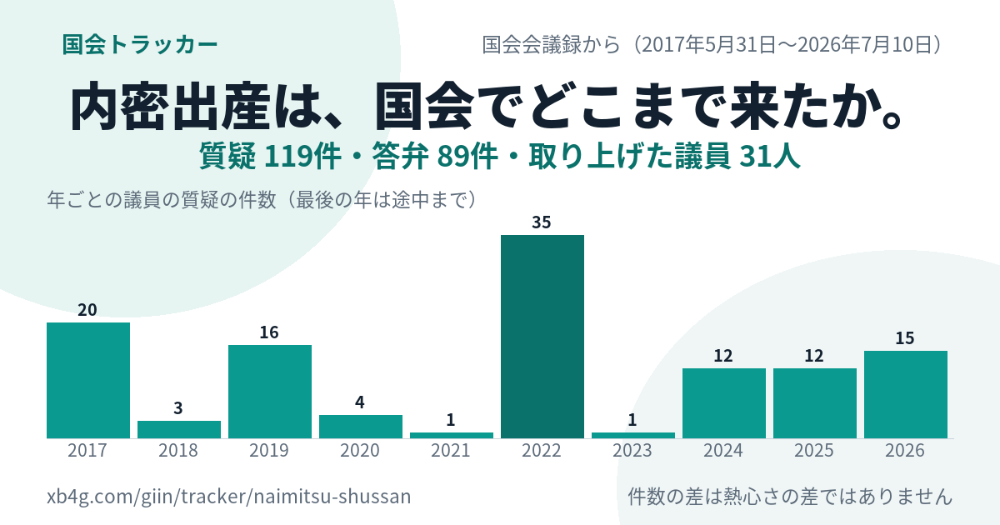
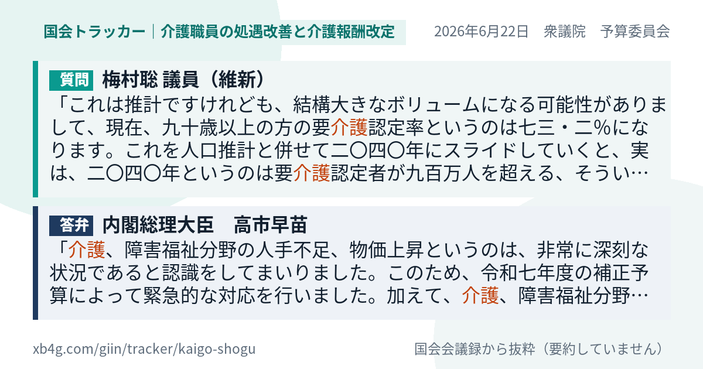
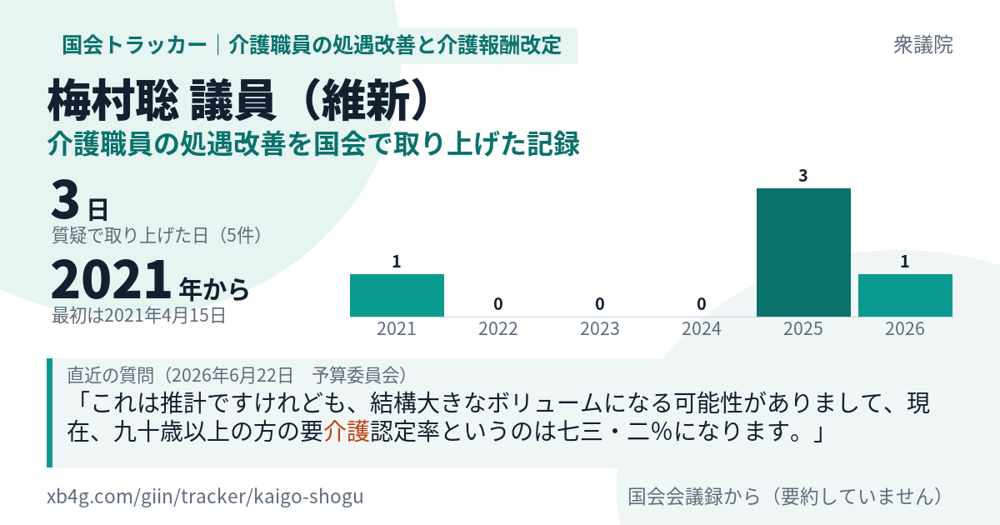
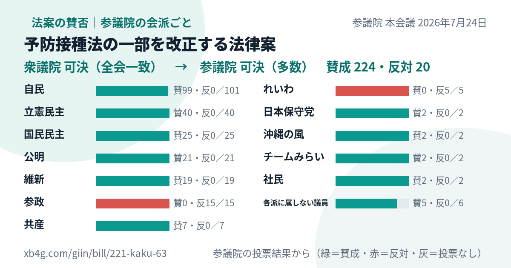
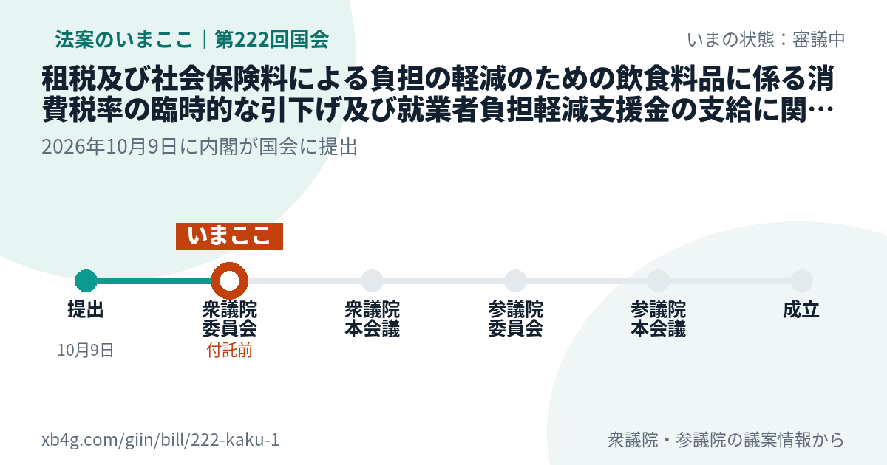
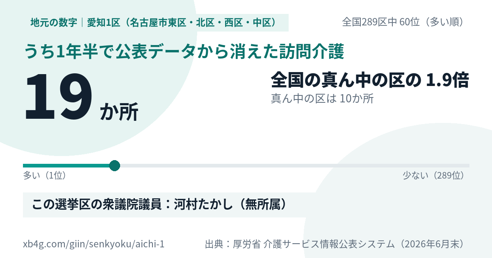
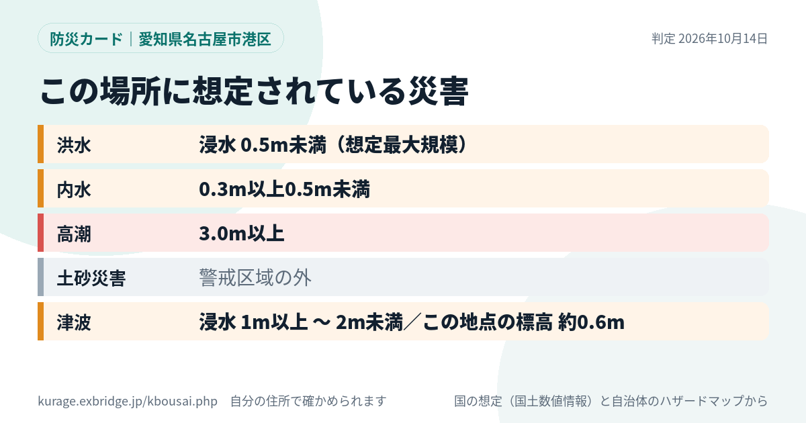
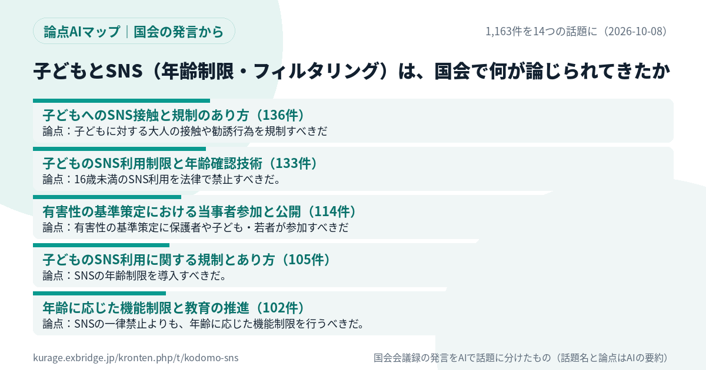

名古屋でAIシステム開発の会社をやっています。この半月ほど、議員さんや報道のXの投稿に、うちのページのURLを付けて返信してきました。そのとき、URLを貼ると出る画像（OGP画像）に、ページの中身そのものが入るようにしたところ、反応がはっきり変わりました。質問と答弁を1枚にした画像を付けた返信には、議員さん本人から返事をいただくこともありました。

作っているうちに、画像の種類が8つになりました。どのページのURLを貼るとどんな画像が出るのかを、自分でも一覧で見たかったので、ここにまとめます。どれもURLを貼るだけで出ます。画像を自分で作って添付する必要はありません。

- [国会トラッカー（デモ）](https://xb4g.com/giin/tracker#ref=vibeblog-ogp-kinds)
- [議員発言ログ（デモ）](https://xb4g.com/giin/#ref=vibeblog-ogp-kinds)

8種類を20秒で順に見られる動画です（音はありません）。

  <video src="https://kurage.exbridge.jp/pv/ogp-cards-slideshow.mp4" poster="https://kurage.exbridge.jp/pv/ogp-cards-slideshow-poster.jpg" controls muted playsinline loop preload="metadata" style="display:block;width:100%;height:auto"></video>

## 一覧

| カード | 何が出るか |
|---|---|
| 1. テーマの推移グラフ | そのテーマが国会で年に何回取り上げられたか |
| 2. 質疑カード | 1つの質問と、それへの政府の答弁 |
| 3. 議員×テーマ | ある議員がそのテーマを何回、いつから取り上げたか |
| 4. 法案の賛否 | 参議院の本会議で、会派ごとに賛成・反対が何人か |
| 5. 法案のいまここ | 提出から成立までのどの段階にいるか |
| 6. 地元の数字 | 小選挙区ごとの数字と、全国289区の中の順位 |
| 7. 防災カード | 住所の場所に想定されている洪水・内水・高潮・土砂・津波 |
| 8. 論点AIマップ | 国会の発言を話題ごとに分けた件数と論点 |

1〜3は国会トラッカー、4〜6は議員発言ログ、7は防災AIチャット、8は論点AIマップのページです。

## 1. テーマの推移グラフ

URLの形：`xb4g.com/giin/tracker/<テーマ>`

「内密出産」「OTC類似薬」のようなテーマのページに付く画像です。質疑・答弁の件数、取り上げた議員の人数、年ごとの質疑の件数を棒グラフで出します。「このテーマは国会で何年も前から言われてきた」と伝えたいときに使います。件数は熱心さの差ではないので、画像の右下にそう書いてあります。

[見本：内密出産のページ](https://xb4g.com/giin/tracker/naimitsu-shussan#ref=vibeblog-ogp-kinds)

## 2. 質疑カード

URLの形：`xb4g.com/giin/tracker/<テーマ>/<発言の番号>`

1人の議員の質問と、それに対する政府の答弁を、会議録からそのまま抜き出して1枚にします。要約はしていません。議員さんの投稿に「この件、前にこう質問されていましたね」と返すときに一番使っています。答弁は、質問と同じ論点に答えているものだけを組にします（別の話をしている答弁は出しません）。

[見本：介護報酬改定についての質問と答弁](https://xb4g.com/giin/tracker/kaigo-shogu/122105261X01520260622_099#ref=vibeblog-ogp-kinds)

## 3. 議員×テーマ

URLの形：`xb4g.com/giin/tracker/<テーマ>/m/<議員の番号>`

1人の議員が、そのテーマを何日取り上げたか、最初はいつだったか、年ごとの回数、直近の一言を出します。「この議員はこのテーマをずっと追っている」を、本人の発言の記録で見せたいときに使います。

[見本：介護職員の処遇改善を取り上げた記録](https://xb4g.com/giin/tracker/kaigo-shogu/m/55aceff8#ref=vibeblog-ogp-kinds)

## 4. 法案の賛否

URLの形：`xb4g.com/giin/bill/<法案の番号>`

参議院は本会議の押しボタン投票で、会派ごとの賛成・反対の人数を公表しています。それを横棒にしました。法案がニュースになった日に「どの党がどう投票したか」を1枚で見せられます。衆議院は会派ごとの人数を公表していないので、結果（可決・全会一致など）だけを出します。賛否の良し悪しは書きません。

[見本：予防接種法の一部を改正する法律案](https://xb4g.com/giin/bill/221-kaku-63#ref=vibeblog-ogp-kinds)

## 5. 法案のいまここ

URLの形：`xb4g.com/giin/bill/<法案の番号>`（まだ参議院で採決されていない法案）

提出 → 先の院の委員会 → 本会議 → 後の院の委員会 → 本会議 → 成立、の6つの段を1本の線にして、いまどこにいるかに印を付けます。審議中の法案の話題に「いまここまで来ています」と返すときに使います。会期の終わりで止まった法案は、止まった段に「ここで終了」と出ます。参議院で採決が終わると、同じURLの画像が4の賛否のカードに切り替わります。

[見本：飲食料品の消費税率の臨時的な引下げと就業者負担軽減支援金の法律案](https://xb4g.com/giin/bill/222-kaku-1#ref=vibeblog-ogp-kinds)

## 6. 地元の数字

URLの形：`xb4g.com/giin/senkyoku/<選挙区>/<指標>`

衆議院の小選挙区289区ごとに、人口・高齢化率・出生数、土砂災害警戒区域や避難場所、訪問介護や放課後等デイサービス、待機児童などの数字を、国と県の公開データから足し上げています。カードには、その区の数字、全国289区の中の順位、真ん中の区と比べて何倍か、その区の衆議院議員を出します。地元の議員さんの投稿に、その地域の数字で返すときに使います。

[見本：愛知1区の、1年半で消えた訪問介護](https://xb4g.com/giin/senkyoku/aichi-1/houmon_gone#ref=vibeblog-ogp-kinds)

## 7. 防災カード

URLの形：`kurage.exbridge.jp/kbousai.php/c/<番号>`

防災AIチャットで住所を調べたあと、「この場所の防災カードを作る」を押すと作られます。洪水・内水・高潮・土砂災害・津波の想定を、深さや区域で色分けして1枚にします。住所や緯度経度は画像にもURLにも残しません。出すのは市区町村までです。大雨や地震のニュースの日に、その地域の想定を見せるときに使います。

[見本：名古屋市港区の防災カード](https://kurage.exbridge.jp/kbousai.php/c/A4G9M-AAqF4#ref=vibeblog-ogp-kinds)

## 8. 論点AIマップ

URLの形：`kurage.exbridge.jp/kronten.php/t/<テーマ>/`

国会トラッカーで集めたあるテーマの発言を、AIで話題ごとに分け、話題ごとの件数と論点を出します。話題の名前と論点はAIがまとめたものなので、画像の右下にそう書いてあります。「この件で国会では何が争点になっているか」を見せたいときに使います。

[見本：子どもとSNS（年齢制限・フィルタリング）](https://kurage.exbridge.jp/kronten.php/t/kodomo-sns/#ref=vibeblog-ogp-kinds)

## 作るときに決めたこと

8種類とも、同じ決めごとで作っています。

- **大きさは1200×630。** XやFacebookで大きく出る形にしています。
- **数字と原文だけを出し、評価は書かない。** 会議録は抜き出すだけで要約しません。AIがまとめた部分（論点AIマップ）は、そう書きます。
- **出典を画像の中に書く。** 画像だけが転載されても、どこの数字かが分かるようにしています。
- **長い題名でもはみ出さない。** 法案の題名や議員の名前が長いときは、文字を縮めるか、2行目の終わりを「…」で切ります。
- **一度作った画像は取っておく。** Xは画像を何度も取りに来るので、毎回は描き直しません。

文章が長い返信でも、URLが入っていれば画像は出ました。いまのところ、テーマや指標を足すたびに見本のURLを開いて、文字が重なっていないか、数字が正しいかを確かめています。

## よくある質問

### OGP画像とは何ですか？

XやFacebook、LINEなどにURLを貼ったときに、リンクと一緒に出る画像のことです。ページの中に「この画像を出してください」と書いておくと、その画像が出ます。ここでは、その画像をページの中身から自動で作っています。

### 画像を自分で添付するのと何が違いますか？

画像を添付すると、見た人はそこからページに行けません。URLを貼って出る画像は、押すと元のページが開くので、画像で興味を持った人がそのまま質疑の全文や数字の出典まで読めます。

### 自分の事務所や自治体でも使えますか？

国会トラッカーと議員発言ログは、自社のサーバーに置いて使う形でお渡ししています。テーマや地域を自分で決めて動かせます。

- [Kurage 国会トラッカー（Kurage App Store）](https://kappstore.exbridge.jp/app.php?id=5447675118edd258#ref=vibeblog-ogp-kinds)
- [Kurage 議員発言ログ（Kurage App Store）](https://kappstore.exbridge.jp/app.php?id=dd868beae043026b#ref=vibeblog-ogp-kinds)
