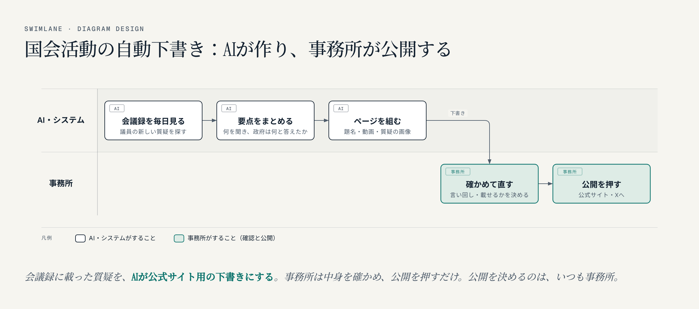
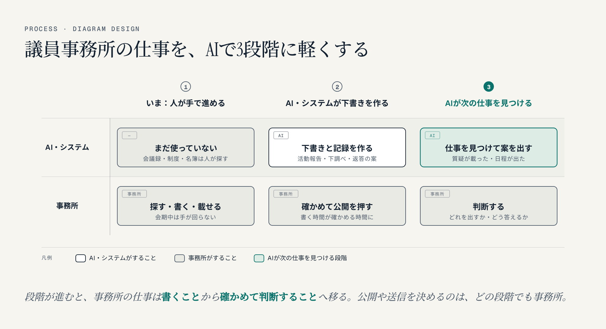

名古屋でAIシステム開発の会社をやっている小嶋です。国会議員の事務所にご提案をする機会があり、その準備で議員の公式サイトをじっくり見ました。気づいたことの多くは、その事務所だけでなく、ほかの議員のサイトでもよく見かける課題でした。議員の名前は出さずに、一般的な話として、議員のホームページが抱えやすい課題と、当社ならこう直せるという改善案を書いておきます。

## 1. 国会での仕事が、公式サイトにほとんど載っていない

いちばん大きいのはこれです。国会での質疑は、議員の仕事のなかで一番外に見せたいもののはずですが、公式サイトの「活動報告」にはごく一部しか載っていないことがよくあります。

私たちが見たある事務所では、2026年に国会で質疑に立った日が6日あり、公式サイトに載っていたのはそのうち1回でした。載っている1回のページは、要点と動画へのリンクがそろった、とても良い形でした。毎回この形で載せたいけれど、会期中は手が回らない、というのが実情だと思います。

全国で見ても、質疑に立つ日は少なくありません。当社が国会会議録から集計している現職の国会議員711人のうち、2026年（1月から10月8日まで）に一度でも質疑に立ったのは537人、10日以上立った議員は200人いました。質疑のたびに1ページを書くのは、秘書の方の手作業ではとても追いつかない量です。

## 2. ほかにもよく見かける課題

国会活動の掲載のほかに、議員の公式サイトでよく見かける点を挙げます。どれも小さく見えますが、検索やSNSで見つけてもらえるかどうかに直接効きます。

- **活動報告の題名が会議名だけ**。「〇〇委員会」「予算委員会」のように、何を質問したかが題名に入っていません。その話題で検索した人に見つけてもらえず、トップページの題名が「Index」のままのサイトもあります
- **トップの文章がほとんど画像**。デザインはきれいでも、検索エンジンやAIは画像の中の文字を読めません。議員が何に取り組んでいるかが、検索にもAIの答えにも伝わりません
- **スマホで本文が細い列になる**。パソコン向けの段組みのまま、スマホでは1行に5〜8字で折り返されて、とても読みにくくなっていることがあります。スマホで拡大できない設定になっているサイトもあります
- **共有したときの画像の指定がおかしい**。XやLINEで共有されたときに出る画像（OGP）の指定が2つあったり、場所が違っていたりして、意図しない画像が出ます
- **古いPHPやプラグインのまま**。サポートの終わった版のまま動いていると、安全面の心配があります。本文に作りかけの文字列が残っていることもあります
- **AI検索への備えがない**。GeminiやChatGPTが議員について答えるとき、材料になるのは文字で書かれた公式の情報です。議員本人を表す構造化データや、AI向けの案内（llms.txt）を置いているサイトはまだ少数です

## 3. 改善案：国会活動は、AIが公式サイトの下書きを作る

当社がご提案しているのは、**国会会議録に議員の質疑が載ったら、AIが公式サイト用の下書きを作り、事務所の方は中身を確かめて「公開」を押すだけにする**仕組みです。

AIがするのは次のことです。

- 国会会議録を毎日見て、その議員の新しい質疑を探す
- 何を質問し、政府が何と答えたかを要点にまとめる
- 題名、国会の動画へのリンク、質問と答弁を1枚にした画像をそろえて、ページの形にする

題名は「何を質問したか｜日付 会議名」の形にします。たとえば「〇〇の安全対策を、国の報告義務に｜〇年〇月〇日 〇〇委員会」のように、検索する人の言葉が先に来るようにします。

事務所の方は、言い回しを直し、載せるかどうかを決めて、公開を押します。**公開を決めるのは、いつも事務所**です。AIが勝手に公開することはありません。書く時間が、確かめる時間に変わるだけで、掲載の数は質疑の数に追いつきます。

当社はすでに、全国の国会議員711人の質疑を会議録から集めて、議員ごとのページにしています（[国会議員 発言ログ](https://xb4g.com/giin/#ref=vb-giin-hp)）。議員事務所の公式サイト向けの下書きは、このデータから作ります。

あわせて、2で挙げた点も直せます。

- トップに「いま取り組んでいること」と「最新の国会活動」を文字で載せる
- スマホで本文を1列にし、拡大できる設定にする
- 共有画像の指定と、作りかけの文字列を直す
- PHPとプラグインを更新する
- 議員本人の構造化データとllms.txtを置き、AI検索に備える

## 4. 公式サイトの外にも：事務所の仕事をAIで軽くする

公式サイトは入口で、議員事務所の仕事はもっと広くあります。当社では、企業のAI活用を段階で考えています（[AI駆動経営とは——企業のAI活用を4段階で考える](https://exbridge.jp/vibeblog/2026-10-13-ai-kudo-keiei-4-dankai.html#ref=vb-giin-hp)）。議員事務所に当てはめると、次の3段階になります。

事務所の仕事を5つに分けて、それぞれどう軽くなるかを書きます。①〜④は当社ですでに動いているシステムでできること、⑤は事務所の業務に合わせて作るものです。

### ① 国会活動の発信（公式サイト・X）

3で書いた自動下書きです。あわせて、質疑と答弁を1枚の画像にした「質疑カード」を作り、Xでの発信にも使えるようにします。その先の段階では、会議録に載った時点でAIがサイトの下書きとXの文案をそろえ、事務所は確かめて公開を押すだけになります。

### ② 国会対応（質問づくりの下調べ）

過去の質疑や質問主意書を、会議録で一つずつ探していないでしょうか。テーマごとに質疑と答弁、年ごとの件数を並べる[国会トラッカー](https://xb4g.com/giin/tracker/#ref=vb-giin-hp)、1947年からの質問主意書と答弁書23,332件を本文まで検索できる[質問主意書アシスト](https://kurage.exbridge.jp/kshuisho.php/#ref=vb-giin-hp)、審議中の法案の要約と条文から答える[法案AIインタビュー](https://kurage.exbridge.jp/khouan.php/#ref=vb-giin-hp)があります。その先は、委員会の日程が出たら、そのテーマの過去の質疑・答弁・質問主意書を集めた下調べを、AIが先に用意します。

### ③ 支援者・地元からの相談（陳情・問い合わせ）

電話・メール・LINEで受けた相談の記録と、担当窓口の調べものに時間がかかります。困りごとから使える制度と申請先・期限・書類を引き、相談記録を残す[制度ナビ](https://kurage.exbridge.jp/kseido.php/#ref=vb-giin-hp)、支援者とのやりとりを記録するLINEのCRM、よくある質問にサイトで答えるAIチャットボットがあります。その先は、相談が来たらAIが制度と窓口を調べて返答の案を作り、事務所が確かめて返します。

### ④ 選挙対応（ポスター・チラシ）

ポスター掲示場の貼り付けやチラシ配りの進み具合を、紙や連絡で集めていないでしょうか。掲示場と投票区ごとの配布を地図で記録するポスティング記録と、選挙区の数字をまとめた[選挙区ダッシュボード](https://xb4g.com/giin/senkyoku/#ref=vb-giin-hp)があります。公職選挙法の決まりがあるので、どこまでお手伝いできるかは事務所と確かめながら進めます。

### ⑤ 事務所の事務（会計・日程・礼状・名簿）

議員事務所の事務は、ほかの会社とは違う手間が多くあります。

- 政治資金の領収書の整理と仕訳
- 国会・地元の会合・陳情の日程の突き合わせ
- 礼状・お祝い・弔電の手配
- 支援者名簿の更新
- 事務所だより（会報）の原稿と発送

ここは、すでにあるシステムに無理に当てはめるより、**事務所の業務に合わせて、AI開発（バイブコーディング）で作る**ほうが早いと考えています。たとえば、領収書の写真から仕訳の下書きを作る、日程を1か所にまとめて重なりを知らせる、名簿から礼状の宛名と文案を作る、会報の原稿を下書きする、といったものです。当社はAIを使った開発で、こうしたシステムを短い期間で作っています。政治資金の会計は、AIが受け持つのは下書きと整理までで、最終確認は会計責任者が行う前提です。

## 5. 進め方：1つの事務所で試し、数字で確かめてから広げる

いきなり全部を変えるのではなく、次の順で進めるのがよいと考えています。

1. **1つの事務所で試す**。まずは国会活動の発信から。その年の質疑のうち、公式サイトに載っていない回の下書きを作るところから始めます
2. **数字で確かめる**。公式サイトに載った質疑の数と、事務所の作業時間がどう変わったかを見ます
3. **広げる**。うまくいった形を、ほかの議員事務所へ。さらに党には、国会トラッカー・質問主意書アシスト・法案AIインタビュー・合意形成AIなど、国民の声と国会の記録をつなぐデジタル民主主義のシステムをご提案します

どの段階でも、公開や送信を決めるのは事務所と党です。

## よくある質問

### AIが勝手に公式サイトやXに投稿することはありますか

ありません。AIが作るのは下書きまでで、公開や送信は事務所の方が中身を確かめてから押します。どの段階に進んでも、ここは変えません。

### 国会活動の下書きは、何をもとに作るのですか

国立国会図書館の国会会議録です。議員本人の発言と政府の答弁を、会議録の文のまま引きます。会議録に載っていないことは書きません。

### 公職選挙法や政治資金のルールは大丈夫ですか

選挙の手伝いと政治資金の会計は、法律の決まりが多い分野です。どこまでお手伝いできるかは事務所と確かめながら進め、政治資金の会計の最終確認は会計責任者が行う前提にしています。

### 事務所にまだないシステムも頼めますか

頼めます。議員事務所の事務は事務所ごとに違うので、業務に合わせてAI開発（バイブコーディング）で作ります。「この作業が楽になったら」という話から伺います。

議員事務所の方で、「国会での活動をもっと伝えたい」「この作業を楽にしたい」ということがあれば、お気軽にご相談ください。

政党・政治団体・議員事務所のAI活用のご案内
https://exbridge.jp/solution/seito.html#ref=vb-giin-hp
