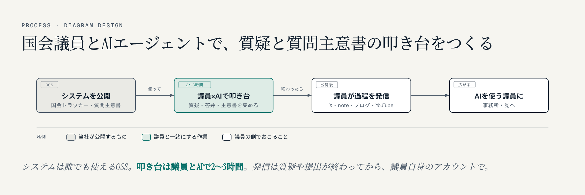
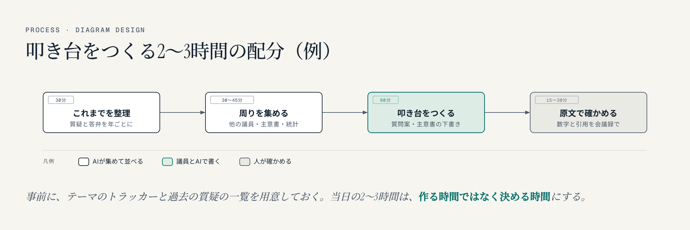

名古屋でAIシステムの開発をしている小嶋です。国会の会議録や質問主意書を扱うシステムを作ってきました。この記事は、すべての国会議員と議員事務所の方への提案です。

議員とAIエージェントで、国会の質疑や質問主意書の叩き台を一緒につくり、その過程を議員自身が発信する。国会議員がAIエージェントで国会の仕事を準備する様子を公開している例は、まだほとんどありません。

## 1. 使うシステムは、すべてオープンソース

使うのは、当社が作って公開している3つのシステムです。コードはGitHubで**MITライセンス**で公開していて、どの議員も、どの事務所も、同じ条件で使えます。

- **[国会トラッカー](https://xb4g.com/giin/tracker/#ref=vb-giin-ai)**：テーマごとに、全国の国会議員の質疑と政府の答弁を、国会会議録から集めて並べます。年ごとの件数や、議員ごとの記録、質問と答弁を1枚にした画像も出ます。いま**137テーマ**を公開しています。
- **[質問主意書アシスト](https://kurage.exbridge.jp/kshuisho.php/#ref=vb-giin-ai)**：衆参の質問主意書と政府の答弁書を、本文まで検索できます。**1947年からの23,333件**が入っています。
- **[国会議員 発言ログ](https://xb4g.com/giin/#ref=vb-giin-ai)**：全国の国会議員711人の2023年からの質疑を、日付と会議名つきで引けます。

この3つをAIエージェント（Claude Code）から使うと、「このテーマで、これまで誰が何を聞き、政府は何と答えてきたか」を、数分で並べられます。

## 2. 企画の流れ

1. **1つのテーマで試す**：議員が国会で続けて取り上げてきたテーマを1つ選び、議員と一緒に叩き台をつくります。**叩き台なら、一緒に2〜3時間の作業でできます。**
2. **終わってから公開する**：質疑や質問主意書の提出が終わったあとに、議員自身のX・note・ブログ・YouTubeで「どう作ったか」を発信します。記事の下書きは当社がお手伝いします。

## 3. 2〜3時間で、何をどこまでつくるか

たとえば次の配分で進めます。

- **30分：これまでを整理する**。その議員がこのテーマで国会で何を聞き、政府は何と答え、何が変わっていないかを、年ごとに並べます。
- **30〜45分：周りを集める**。ほかの議員の質疑、関係する質問主意書と答弁書、公表されている統計や海外の制度の資料を集めます。
- **60分：叩き台をつくる**。次の質疑の質問案と、質問主意書の下書きを、AIが案を出し、議員と一緒に直していきます。
- **15〜30分：原文で確かめる**。数字と引用を、会議録と答弁書の原文で一つずつ確かめます。

事前に、選んだテーマのトラッカーと、議員の過去の質疑の一覧を当社で用意しておきます。当日の2〜3時間は、作る時間ではなく、決める時間にします。

2〜3時間で終わらないものもあります。質問主意書の言葉を最後まで詰めることや、事務所や党の中での確認は、そのあと事務所で行います。叩き台は、あくまで出発点です。

この企画を考えたのは、この数日、議員のXの投稿に国会の記録を添えて返信するために、新しいテーマのトラッカーをその場で作ってきたからです。1つのテーマの会議録を集めて公開するまで数分、使える答弁を探すのも数分でした。議員と一緒なら、そこから叩き台まで進めます。

## 4. あらかじめ決めておくこと

1. **公開は、質疑や提出が終わったあと**。質問の中身を事前に出すことはしません。
2. **AIに渡すのは公開資料だけ**。会議録・質問主意書・公表された統計などです。陳情者の個人情報や未公表の情報は渡しません。
3. **AIは下調べと下書きまで**。数字や引用は会議録の原文で確かめ、内容の判断と責任は議員と事務所にあります。
4. **契約の形は、事務所の会計責任者とご相談のうえで決めます**。会社が議員個人に作業を無償で提供すると、政治資金規正法上の寄附にあたるおそれがあるためです。当社の作業は、顧問契約などの有償の形を想定しています。システムそのものはOSSなので、誰でも無償で使えます。

## 5. この企画にかける思い

2026年の衆院選で、チームみらいは党員2,181人ながら、比例で381万票を得ました。党員1人あたり約1,750票で、日本保守党の約27票（146万票÷5.4万人）と比べると、桁が二つ違います（数字は[チームみらいの381万票はどこから来たのか](https://exbridge.jp/vibeblog/2026-10-10-team-mirai-votes-vs-followers.html#ref=vb-giin-ai)で確かめたもの）。熱心な支持者の数を大きく超える、組織に頼らない票です。「デジタルで政治が変わる」と期待した人たちの票だと、私は考えています。

ただ、その後の国会で、デジタル民主主義が大きく前進したようには、私には見えません。期待した分、物足りなさを感じている人もいるはずです。

議員の皆さんには、何年も積み重ねてこられた仕事があります。その仕事をAIエージェントでさらに深め、過程とシステムを公開する。デジタルに期待する人たちに、法案を実現できる議員と政党でこそデジタルが生きることを、示していただきたいと思っています。名古屋で国会のシステムを作ってきた者として、それを一緒に形にしたいと願っています。

## よくある質問

### AIが質問を勝手に作って、そのまま国会で使うのですか

いいえ。AIがするのは、過去の質疑や質問主意書を集めて並べることと、叩き台の案を出すことまでです。どの質問をするか、どの言葉で聞くかを決めるのは議員と事務所です。数字や引用は、会議録の原文で確かめてから使います。

### どの党の議員でも使えますか

使えます。国会トラッカーも質問主意書アシストも、GitHubでMITライセンスで公開しているので、どの議員も同じ条件で使えます。全国の国会議員711人の発言ログも、どの議員にも同じ形で公開しています。

### 費用はかかりますか

システムそのものはOSSなので、使うのに費用はかかりません。当社が一緒に作業する場合は、政治資金規正法の決まりに合わせて有償の契約の形にし、契約の形は事務所の会計責任者とご相談のうえで決めます。

### 質問の中身が事前に外に出ることはありませんか

ありません。発信は、質疑や質問主意書の提出が終わったあとに行います。AIに渡すのも、会議録や公表された資料だけです。

議員事務所の方で、関心をお持ちいただけたら、お気軽にご相談ください。

政党・政治団体・議員事務所のAI活用のご案内
https://exbridge.jp/solution/seito.html#ref=vb-giin-ai
