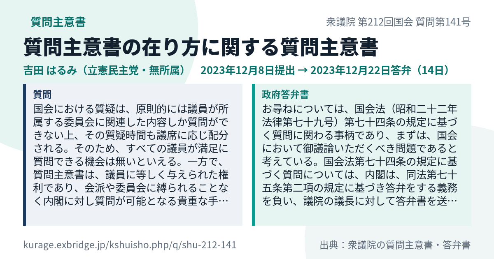
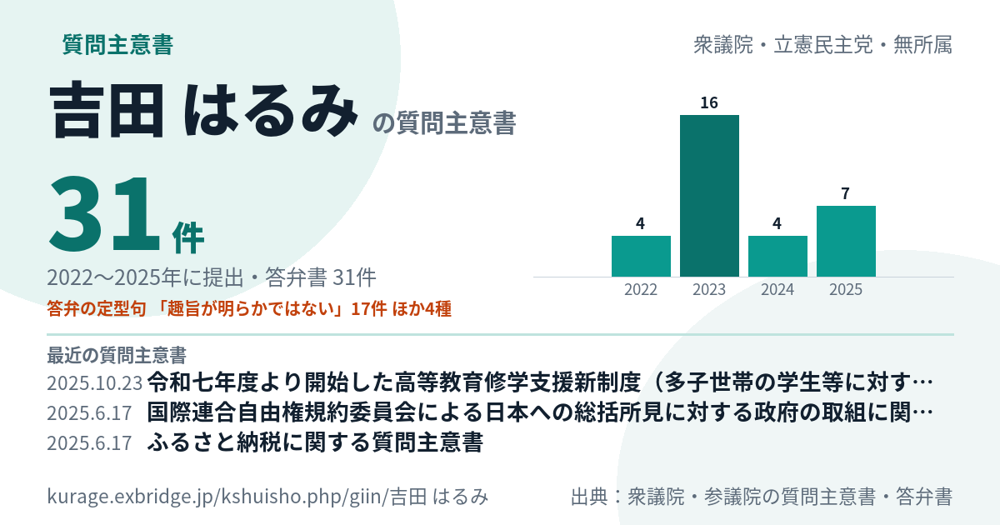
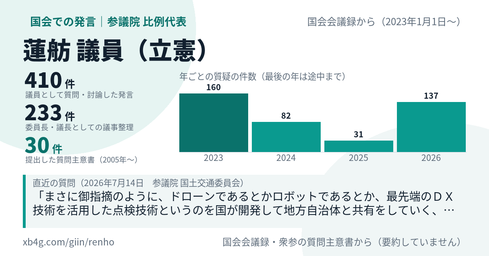
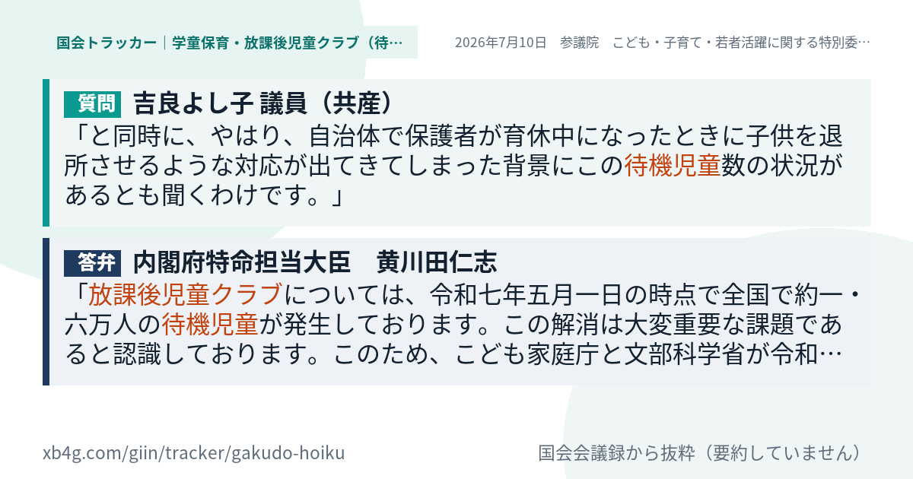
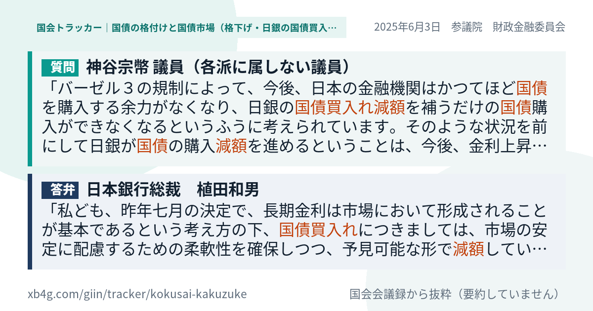

名古屋でAIシステムの開発をしている小嶋です。国会の会議録と質問主意書を扱う2つのシステム、[国会トラッカー](https://xb4g.com/giin/tracker/#ref=vb-sc-card)と[質問主意書アシスト](https://kurage.exbridge.jp/kshuisho.php/#ref=vb-sc-card)に、今日まとめて手を入れました。質問主意書を1件ずつ、Xで共有できるカードにしたのが中心です。やったことと、できたことを書いておきます。

作業はAIエージェント（Claude Code）と一緒に、1日のうちに4つを順番に進めました。

1. 質問主意書1件ごとのカード
2. 提出者ごとの質問主意書のカード
3. 国会での質疑と質問主意書を合わせた議員カード
4. いまある質疑カードの不具合2つの修正

## きっかけ：カードがあるページは、読まれ方が違った

この数週間、国会議員のXの投稿に、国会の記録を添えて返信してきました。10月1日から18日までの返信を、貼ったページの種類ごとに集計しました。

- テーマ全体のカード（国会トラッカーの一覧）：返信239本・1,338人。1本あたりの中央値は2人で、2ページ目まで読んだ人は7%
- 議員ページ：返信9本・165人。中央値3人で、2ページ目まで読んだ人は16%
- 議員×テーマのカード（その議員の質疑と答弁を1枚に）：2ページ目まで読んだ人は32%
- 質問主意書アシスト：返信3本・6人

質問主意書アシストだけ、ページごとの共有画像がありませんでした。どの質問主意書を貼っても、Xに出るのは同じサービスの画像です。何の質問主意書なのかが、押す前に分かりません。そこで、カードを作ることにしました。

## 1. 質問主意書1件ごとのカード

質問主意書のページ（/q/<番号>）をXに貼ると、このカードが出るようにしました。1枚に入れたのは次のものです。

- 件名と、衆参・国会の回・質問の番号
- 提出者と会派、提出日と答弁書の日付、その間の日数
- 質問本文と政府答弁書の抜き書きを、左右に並べたもの
- 答弁書に「お答えすることは困難」「趣旨が明らかではない」などの定型句があれば、その種類と回数

カードの文は原文のままです。要約はしていません。答弁書の「一について」のような見出しだけを外して、本文から抜き書きしています。

## 2. 提出者ごとのカード

提出者のページ（/giin/<名前>）にもカードを付けました。提出した件数、年ごとの件数、答弁書に出てきた定型句でいちばん多いもの、最近の3件の件名です。衆議院から参議院へ移った議員は、両方の院の分を数えます。

## 3. 国会の質疑と質問主意書を合わせた議員カード

国会トラッカーの議員カードには、これまで国会での発言の件数だけを出していました。そこに「提出した質問主意書 N件」を足しました。国会での質疑と質問主意書は、議員が政府に問う2つの道です。片方だけでは、その議員の仕事が半分しか見えません。

質問主意書アシストの1947年からの23,333件と、国会議員711人の名簿を突き合わせると、質問主意書の記録がある議員は189人でした。議員ページにも同じ件数を出し、押すと質問主意書アシストのその議員の一覧へ移ります。

## 4. 質疑カードの不具合を2つ直した

ひとつ目は、大臣の肩書きが長いと、カードの右端から名前がはみ出す不具合です。兼務の多い大臣は、肩書きが60字を超えます。括弧の中の担当の列挙を落として、名前は必ず入るようにしました。

ふたつ目は、参考人の答えが質問と組にならない不具合です。日銀総裁は、国会では「参考人」として答えます。システムが参考人を質問する側に数えていたので、カードの答弁の欄が空になっていました。参考人の答えも、直前の質問と組にするように直しました。

## どう作ったか

カードは、公開しているサーバーのPHPで、ページが最初に開かれたときに描いて置いておきます。2回目からは置いたものを返すので、重くなりません。データを入れ替えたときは、自動で描き直します。

作業は、私が「順番にこれやって」と4つを並べて渡し、AIエージェントが1つずつコードを書き、公開し、公開先の画像を取ってきて私と一緒に確かめる、という進め方でした。文字がはみ出していないか、数字が合っているかは、画像を見て直しています。たとえば提出者ごとのカードは、最初は定型句の行が途中で切れていたので、いちばん多い定型句だけを出す形に直しました。

## 使ってください

国会トラッカーも質問主意書アシストも、GitHubでMITライセンスのオープンソースとして公開しています。どの議員も、どの事務所も、報道の方も、同じ条件で使えます。

国会トラッカー（テーマごとの質疑と答弁）
https://xb4g.com/giin/tracker/#ref=vb-sc-card

質問主意書アシスト（1947年からの質問主意書と答弁書）
https://kurage.exbridge.jp/kshuisho.php/#ref=vb-sc-card

国会議員の発言ログ（711人）
https://xb4g.com/giin/#ref=vb-sc-card

議員とAIエージェントで、国会の質疑や質問主意書の叩き台を2〜3時間でつくる企画も、すべての国会議員にご提案しています。

国会議員のAI活用の提案
https://exbridge.jp/vibeblog/2026-10-18-kokkai-giin-ai-agent-shitsugi.html#ref=vb-sc-card

## よくある質問

### カードの文は要約ですか

いいえ。質問本文と答弁書の原文から、冒頭を抜き書きしています。言い換えや要約はしていません。

### 定型句が出ているのは、答弁の評価ですか

いいえ。「お答えすることは困難」などの言葉が答弁書にあるかを、語の一致で数えたものです。答弁の良し悪しを判断したものではありません。

### 質問主意書の件数は、いつの分ですか

質問主意書アシストに入っている1947年6月から2026年10月までの、衆参の質問主意書です。国会での発言の件数（2023年から）とは、数えている期間が違います。カードにはそれぞれの期間を書いています。

議員事務所の方で、国会の記録の使い方やAIの活用に関心をお持ちいただけたら、お気軽にご相談ください。

政党・政治団体・議員事務所のAI活用のご案内
https://exbridge.jp/solution/seito.html#ref=vb-sc-card
