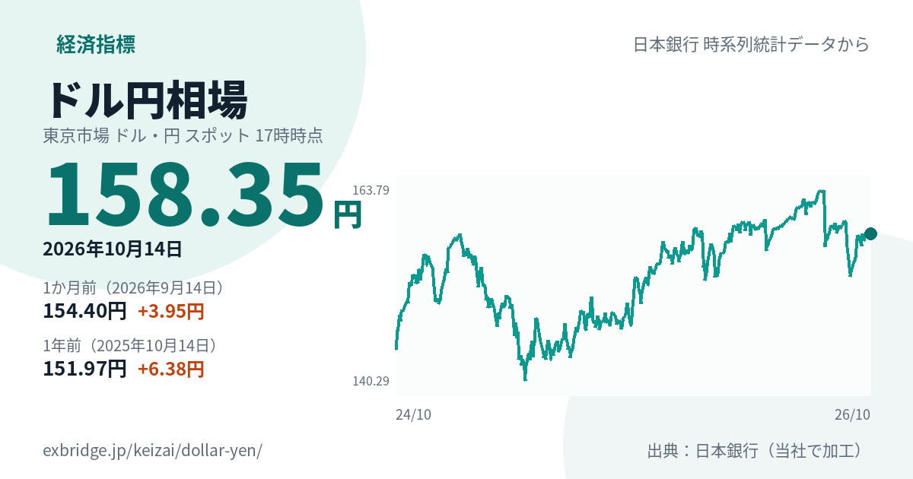
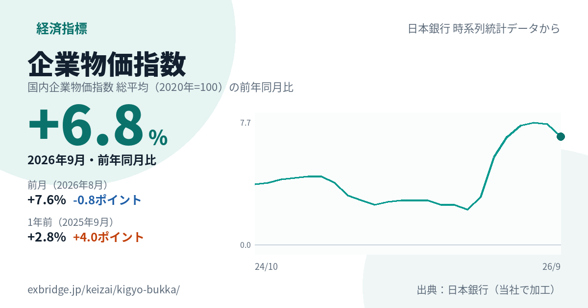
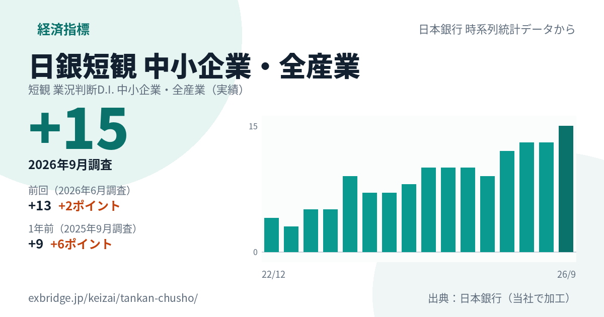

名古屋でAIシステムの開発をしている小嶋です。経営者の方と話していると、円安、仕入れ値、借入れの金利、景気の話がよく出ます。そのとき、手元に数字が1枚あると話が早い。そこで、主な経済指標を日本銀行のデータから毎日まとめるページを作りました。

経済指標のいま（為替・金利・物価・短観）
https://exbridge.jp/keizai/#ref=vb-keizai

## 1枚で、最新の値と推移が分かる

指標ごとに、1枚の画像にしています。入っているのは次のものです。

- 最新の値と、その日付（月・調査の回）
- 1か月前（月の指標は前月、短観は前回）と1年前の値、その差
- 2年分の推移のグラフ（短観は16回分の棒グラフ）
- 出典

ページのURLをXなどに貼ると、この画像がそのまま出ます。返信やコメントに数字を添えるときに使えるように作りました。

## いま入っている7つの指標

- **ドル円相場**（東京市場 17時時点）：輸入する原材料・燃料・仕入れの値段に直接かかわります
- **無担保コールレート**：日本銀行が金融政策の目標にしている金利です。銀行の貸出金利や預金金利の土台になります
- **貸出金利（新規）**：国内の銀行がその月に新しく貸し出したお金の平均金利です
- **企業物価指数**（前年同月比）：企業どうしが売り買いする商品の値段の動きです
- **企業向けサービス価格指数**（前年同月比）：運輸・広告・リース・人材派遣など、企業向けのサービスの値段の動きです
- **日銀短観 大企業・製造業**、**日銀短観 中小企業・全産業**：業況が「良い」と答えた企業の割合から「悪い」の割合を引いた数字です

## いまの数字から見えること

いくつか、ページの数字を並べてみます。

- ドル円は、2026年10月14日に158.35円。1年前（2025年10月14日）は151.97円でした
- 企業物価指数の前年同月比は、2026年9月に+6.8%。1年前（2025年9月）は+2.8%でした
- 銀行の新規の貸出金利は、2026年8月に1.782%。1年前（2025年8月）は1.149%でした
- 日銀短観の中小企業・全産業は、2026年9月調査で+15。1年前は+9でした

仕入れの値段と借入れの金利がどちらも1年前より上がっている一方で、短観では「業況が良い」と答える中小企業が増えています。数字の良し悪しをここで決めるつもりはありません。自社の仕入れや借入れ、値決めを見直すときに、世の中の数字と並べて見るための材料です。

## 仕組み

- データは、日本銀行の「時系列統計データ検索サイト」のAPIから取っています。毎日1回、指標ごとに1回ずつ取り直します
- 前年同月比は、日本銀行が公表している前年比の系列をそのまま使っています。自分で計算し直した値ではありません
- ページとグラフの画像は、毎日の取り直しのあとに作り直して置きます。古い画像がSNSに残らないよう、画像のURLには日付を入れています
- 作業はAIエージェント（Claude Code）と一緒に、データの取り方の確認から公開まで1日の中で進めました。日本銀行のAPIの利用条件にある表示を各ページに入れ、公開したことも日本銀行に連絡しています

このページは、日本銀行時系列統計データ検索サイトの API 機能を使用しています。サービスの内容は日本銀行によって保証されたものではありません。

## これから

消費者物価指数、実質賃金、失業率も足したいと考えています。これらは政府統計の窓口（e-Stat）から取る予定です。

## よくある質問

### 数字はいつの時点のものですか

指標ごとに、ページとカードに日付を書いています。ドル円と無担保コールレートは日ごと、貸出金利と物価は月ごと、短観は3か月ごとの数字です。日本銀行が公表したあとの、次の毎日の更新で反映されます。

### グラフの画像を使ってもいいですか

ページのURLを貼っていただければ、SNSではその画像が出ます。画像には出典と、元のページのURLを入れています。

### 自社の数字と並べて見られますか

このページでは扱っていません。仕入れ値や借入れの金利など自社の数字と、為替・物価・金利を並べて見る仕組みは、個別にお作りしています。

為替・金利・物価の動きを、自社の仕入れ・借入れ・価格の見直しにつなげる仕組みづくりのご相談は、こちらから。

名古屋のAI-IT顧問契約
https://exbridge.jp/ai-it-komon.html#ref=vb-keizai
