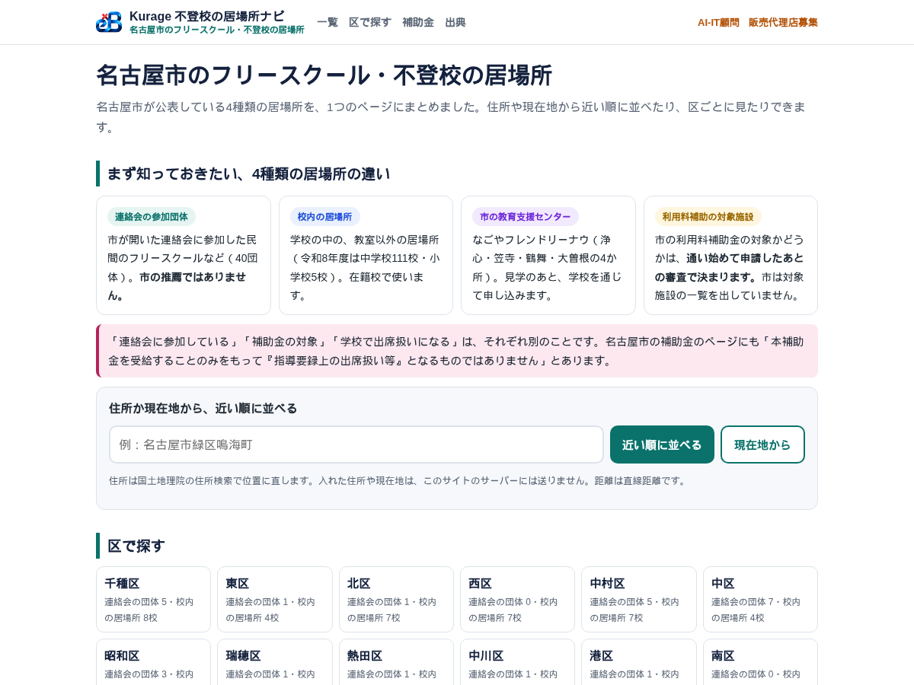
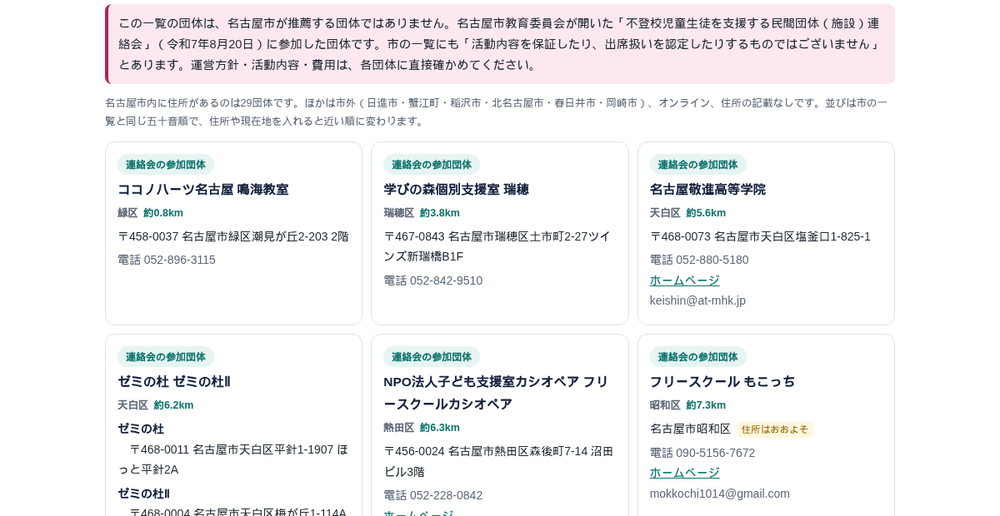
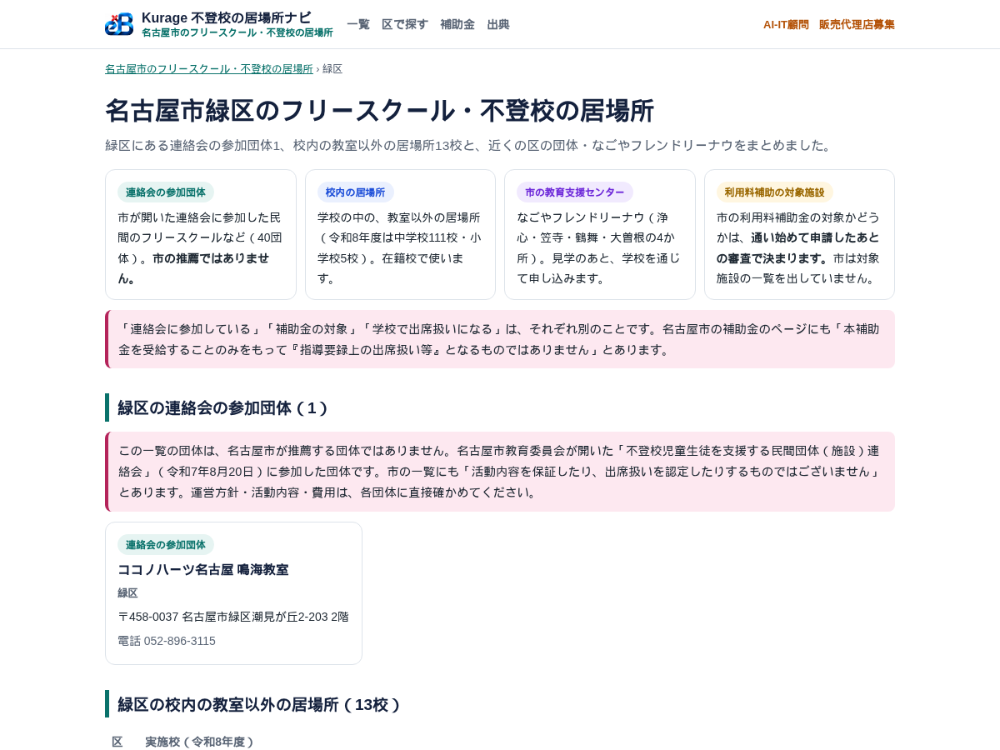

名古屋でAIシステムの開発をしている小嶋です。名古屋市のフリースクールと、不登校の子どもの居場所を、1つのページにまとめました。

名古屋市のフリースクール・不登校の居場所（Kurage 不登校の居場所ナビ）
https://kurage.exbridge.jp/kibasho.php/#ref=vb-kibasho

## 居場所は4種類あるのに、公表のされ方がばらばら

名古屋市が公表している不登校の子どもの居場所は、大きく4種類あります。

- **連絡会に参加した民間の団体**：市が開いた「不登校児童生徒を支援する民間団体（施設）連絡会」に参加したフリースクールなど。令和7年8月20日の連絡会には40団体が参加しました。一覧はPDFで公表されています
- **校内の教室以外の居場所**：学校の中にある、教室以外の居場所。令和8年度は中学校111校と小学校5校で実施されています
- **市の教育支援センター（なごやフレンドリーナウ）**：浄心・笠寺・鶴舞・大曽根の4か所
- **名古屋市フリースクール等利用料補助金**：フリースクールなどの利用料を、市が一部補助する制度

この4つは、別々のページで、別々の形で公表されています。保護者から見ると、どれがどう違うのかが分かりにくい。しかも「連絡会に参加している」「補助金の対象」「学校で出席扱いになる」は、それぞれ別のことです。市の補助金のページにも「本補助金を受給することのみをもって『指導要録上の出席扱い等』となるものではありません」と書かれています。

そこで、4種類を違いが分かる形で並べ、住所から近い順や区ごとに引けるページを作りました。

## 市に問い合わせて、再掲してよいかを確かめた

作る前に、名古屋市教育委員会の新しい学校づくり推進課に、公表資料の扱いについて問い合わせました。10月19日に回答をいただいています。

- 連絡会の団体一覧は、**出典を明示したうえで再掲してよい**。ただし、掲載している団体は名古屋市が推薦する団体ではなく、連絡会に参加した団体なので、その旨が分かる形で使うこと
- CSVやExcelの形で公開する予定はない
- 校内の居場所の実施校は、小学校5校も含めて市のページに載っている

ページでは、団体の一覧のすぐ上に「名古屋市が推薦する団体ではなく、連絡会に参加した団体です」と書き、ページの下に出典をすべて並べています。一覧はPDFだったので、1件ずつ目で書き写しました。

## 住所から近い順に並べられる

住所か現在地を入れると、40団体が近い順に並びます。住所は、見ている人のブラウザから国土地理院の住所検索で位置に直していて、入れた住所はこのサイトのサーバーには送りません。距離は直線距離です。住所が区までしか書かれていない団体は「住所はおおよそ」と表示しています。

区ごとのページも16区すべて作りました。その区の団体と校内の居場所、近くの区の団体、近いフレンドリーナウが1枚で分かります。

## 校内の居場所は、小学校5校の校名も分かった

校内の教室以外の居場所は、中学校は全111校（夜間中学校を除く）ですが、小学校は5校だけです。宮根小（千種区）、大手小（港区）、天子田小（守山区）、小坂小（緑区）、原小（天白区）。自分の子の学校にあるかどうかを、区ごとに確かめられるようにしました。

## 補助金は「通う前に、対象かどうか分からない」

名古屋市フリースクール等利用料補助金は、令和8年度は次のとおりです。

- 就学援助を受けている世帯など：利用料の2分の1（子ども1人あたり月22,000円まで）
- それ以外：利用料の4分の1（月11,000円まで）

ただ、**その施設が補助の対象かどうかは、通い始めて交付申請をしたあとの審査で決まります。**市の回答でも、通所の前に施設が要件を満たすか確認できる窓口や手順はない、とのことでした。交付決定を受けた施設の一覧は公表を検討中で、公表する場合は令和8年度事業の終了後の予定だそうです。

対象外だった場合、利用料は全額自己負担になります。ページには、市が示している施設の要件をそのまま書き写しました。気になる施設には、これらに当てはまるかを直接たずねてもらうためです。

## ほかの市町村でも使えます

このページの一式は、ほかの市町村でも使えるように作っています。団体の一覧・校内の居場所の実施校・教育支援センター・補助金の要件を、その自治体の公表資料から同じ形のデータに書き写して差し替えます。PHPのファイル1つとデータのファイルで動き、データベースは要りません。

- ソースコード: https://github.com/katsushi2441/kibasho
- 商品ページ（自治体・議員事務所・フリースクール・NPOのサイトに置く一式）: https://kappstore.exbridge.jp/app.php?id=a2f1706ca3edff6b#ref=vb-kibasho

## よくある質問

### 名古屋市のフリースクールはいくつありますか

名古屋市教育委員会の連絡会（令和7年8月20日）に参加したのは40団体で、そのうち名古屋市内に住所があるのは29団体です。連絡会に参加していない施設もあるので、市内のフリースクールの総数ではありません。

### 連絡会に参加している団体は、補助金の対象ですか

別のことです。補助金の対象かどうかは、保護者が交付申請をしたあとの審査で決まります。

### フリースクールに通うと、学校の出席扱いになりますか

在籍校の校長が判断します。まず在籍校に相談してください。

不登校の子どもと家族を支える仕組みを、地域でどう見える形にするか。自治体や議員事務所、支援団体の方で関心をお持ちいただけたら、お気軽にご相談ください。

名古屋市のフリースクール・不登校の居場所（Kurage 不登校の居場所ナビ）
https://kurage.exbridge.jp/kibasho.php/#ref=vb-kibasho
