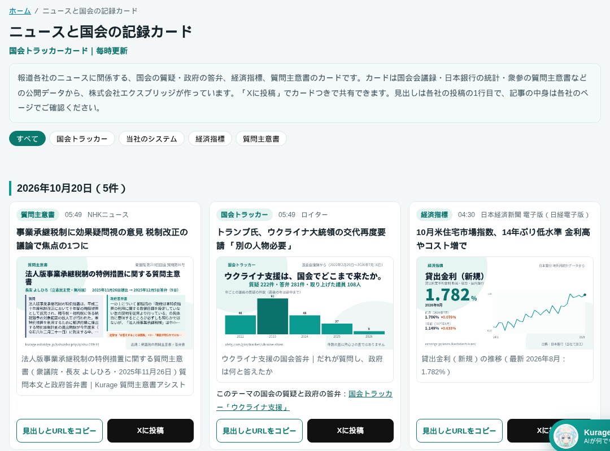
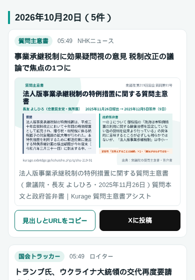

名古屋でAIシステムの開発をしている小嶋です。報道各社のニュースに、関係する国会の質疑・政府の答弁、経済指標、質問主意書のカードを付けて並べるページを公開しました。

ニュースと国会の記録カード｜国会トラッカーカード
https://exbridge.jp/news/

## 何のページか

1件ごとに、ニュースの見出し（報道機関のXの投稿の1行目）と、そのニュースに関係する当社のカードを並べています。カードは次の4種類です。

- **国会トラッカー**：テーマごとに、全国の国会議員の質疑と政府の答弁を国会会議録から集めたもの。答弁1件のカードと、テーマ全体の年ごとの件数のカードがあります
- **質問主意書**：衆議院・参議院の質問主意書と政府の答弁書（第1回国会から23,333件）
- **経済指標**：日本銀行の統計から、為替・金利・物価・短観の最新の値と2年分の推移
- **議員の記録**：議員ごと・国会の回ごとの質疑の回数など

各カードには「見出しとURLをコピー」と「Xに投稿」のボタンがあり、押すとカードの画像つきでそのまま共有できます。毎時更新で、トップは直近7日分、日ごとのページは7日を過ぎても残ります。10月2日から20日朝までの18日間で、日経・NHK・ロイター・産経など17の報道機関のニュースに692件のカードが付きました（国会トラッカー494件、当社のシステム172件、質問主意書11件、経済指標11件、議員の記録4件）。

## どこから生まれたか——毎時のXの返信候補

このページは、もともと自社のために作っていた仕組みの「副産物」を、だれでも使える形にしたものです。

当社は毎時、国会議員と報道機関のXの投稿を集め、政策の話題なら、国会の答弁や公的な統計の事実を添えた返信の文案を作っています。文案には、話題に合うカードのURLを1枚付けます。返信の文と投稿は人が決めますが、「このニュースにはこのカードが合う」という組み合わせは、毎時たまっていきます。

それを議員あての文案を外して、ニュースとカードの組み合わせだけを並べたのが、このページです。

## 使っている技術

流れは次の5段です。

1. **投稿を集める**：報道機関20アカウントと国会議員の投稿を、毎時、直近30分ぶん集めます（ログインを使わない公開の読み取り口）
2. **分野を判定する**：小さな判断モデルに「どの分野の話か」を13択（どれでもない、を含む）で選ばせます。当社のサーバーで動くモデルで、1件あたり0.1秒ほどです
3. **カードを当てる**：分野が決まったら、国会トラッカーの語（テーマごとに決めた言葉）や経済指標の語で、合うカードを規則で選びます。答弁1件のカードは、ニュースの本文といちばん近い政府答弁を選びます
4. **データを書き出す**：報道機関の投稿に付いたカードだけを、日付・見出し・カードの題名と画像の形で書き出します
5. **ページを作って置く**：当社のブログや業務OSSカタログと同じ静的サイト生成の仕組み（TypeScript）で、トップと日ごとのページ、サイトマップを作り、変わったファイルだけをサーバーに送ります

カードの中身は、国会会議録検索システムのAPI（国立国会図書館）、衆議院・参議院の質問主意書の公開ページ、日本銀行の時系列統計データの公開API から作っています。要約や言い換えはしていません。答弁は会議録の文言そのままです。

## こう使ってほしい

### 議員の方：ニュースに合わせて、ご自身の質問主意書や質疑を紹介する

たとえば10月20日朝、NHKが「事業承継税制に効果疑問視の意見 税制改正の議論で焦点の1つに」と報じました。このページでは、そのニュースに、長友よしひろ議員が2025年11月26日に提出した「法人版事業承継税制の特例措置に関する質問主意書」のカードが付いています。

ご自身が以前に出した質問主意書や、委員会での質疑が、いまのニュースとつながることはよくあります。「Xに投稿」を押せば、ニュースの見出しとカードの付いた投稿画面が開くので、「このニュースについては、以前こう質問していました」と一言添えるだけで、記録つきの発信になります。

### 記者・解説をする方：ニュースの背景になる国会のやりとりを、すぐ示す

カードの先の国会トラッカーには、そのテーマでだれが質問し、政府が何と答えてきたかが、日付つきで並んでいます。ニュースの背景を説明するときの材料になります。

### 支援者・関心のある方：数字と出典のある形で、話題を共有する

カードは公開データからそのまま作っているので、出典をたどれます。感想だけの投稿より、話が具体的になります。

## 国会トラッカーについて

カードの多くは、当社の「国会トラッカー」から出ています。全国の国会議員711人の発言を国会会議録から集め、143のテーマごとに、だれが質問し、政府が何と答えたかを並べています。

国会トラッカー（テーマごとの国会の質疑と政府の答弁）
https://xb4g.com/giin/tracker/

## 気をつけていること

- **見出しは各社の投稿の1行目だけ**を載せています。記事の中身は、見出しのリンクから各社のページで確かめてください
- カードは言葉の一致で当てているので、**話題と少しずれるカードが付くこともあります**。気づいた組み合わせは直していきます
- どの政党にも寄らないよう、カードは会議録や答弁書の原文から作り、論評はしません

## よくある質問

### カードを自由にXに投稿してもよいですか

どうぞお使いください。カードは国会会議録・質問主意書・日本銀行の統計などの公開データから当社が作ったもので、投稿するとカードの画像と題名が表示されます。

### 議員事務所で、自分の質疑や質問主意書だけのカードを作れますか

作れます。議員ごとの国会の記録のページや、テーマごとの質疑のカードは、いまもすべての国会議員について公開しています。事務所の発信に合わせた形がほしい場合は、ご相談ください。

ニュースと国会の記録カード｜国会トラッカーカード
https://exbridge.jp/news/
