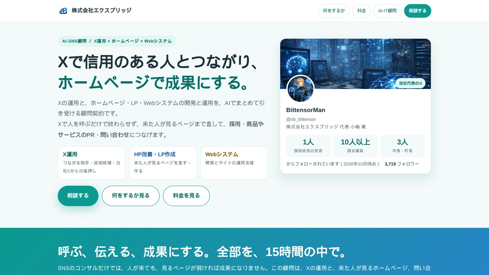
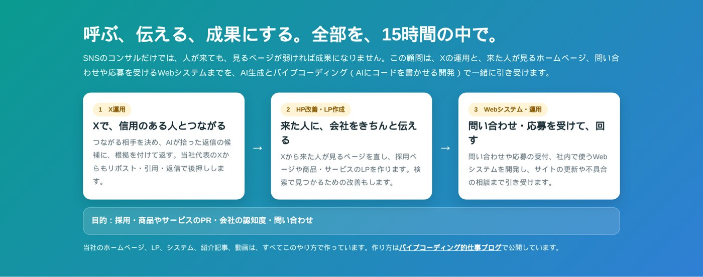

名古屋でAIシステムの開発をしている小嶋です。新しく「AI-SNS顧問」という顧問契約を始めました。

AI-SNS顧問（X運用 × ホームページ × Webシステム）
https://exbridge.jp/ai-sns-komon.html

ひとことで言うと、**Xの運用と、ホームページの改善・LPの作成・Webシステムの開発と運用を、AIでまとめて引き受ける**顧問契約です。SNSコンサルとして始めるつもりでしたが、考えるほど、SNSだけでは足りないと分かりました。その理由を書きます。

## SNSコンサルだけでは、成果にならない

当社のXは、この秋、国政政党の党首1人、国会議員10人以上、市長と町長3人にフォローしていただくようになりました。Xから当社の国会トラッカーのページに来た人は、10月13日〜19日の1週間で717人です。

ただ、人が来ることと、成果になることは別です。Xで知ってもらっても、来た人が見るページが弱ければ、問い合わせにも応募にもなりません。逆に言えば、**Xで人を呼ぶ人と、来た人が見るページを直す人が同じ**なら、話が早いのです。

当社は、国会トラッカーやニュースのカードなど、Xから来た人が見るページを自分たちで作り続けてきました。Xで反応があれば、その日のうちにページを直せます。この「呼ぶ」と「伝える」が一体になっていることが、いちばん効いたと感じています。

## 顧問先の悩みは「採用」だった

もう一つのきっかけは、顧問先です。当社は、名古屋の創業50年を超える化学分析の会社で、AI-IT顧問として業務のシステム化やWebサイトの改善を担当しています。

この会社の顧客はメーカーや行政で、技術はしっかりしています。それでも悩みは採用でした。理系の学生や、大学の研究室に、会社のことを知ってもらう機会が少ないのです。

そこで、同じ会社でSNSの顧問も始めました。つながる相手は、分析化学や環境化学の教授と研究室、理系の学生、学会、業界の経営者、環境の行政です。PFAS（有機フッ素化合物）やマイクロプラスチックのように、分析の会社が詳しく語れて、国会でも繰り返し取り上げられている話題がたくさんあります。

ここでも同じことが言えます。教授や学生がXで会社を知っても、会社のページに「どんな装置で、何を測っているか」が書かれていなければ、興味はそこで止まります。**Xとホームページは、一緒に直さないと意味がない**のです。

## 3つを、15時間の中で

そこで、AI-SNS顧問は次の3つを1つの契約にしました。

1. **X運用**：つながる相手を決め、AIが拾った返信の候補に、根拠を付けて返す。当社代表のXからもリポスト・引用・返信で後押しする
2. **HP改善・LP作成**：Xから来た人が見るページを直し、採用ページや商品・サービスのLPを作る。検索で見つかるための改善もする
3. **Webシステム・運用**：問い合わせや応募の受付、社内で使うWebシステムを開発し、サイトの更新や不具合の相談まで引き受ける

毎月の時間配分は打ち合わせで決めます。Xに時間を寄せる月もあれば、ホームページに寄せる月もあります。報告書は作らず、Xのアナリティクスと Google Search Console を御社で見られるようにして、打ち合わせで一緒に見ます。

## AIを使うから、15時間で回る

この3つを月15時間で回せるのは、手間のかかる作業をAIにさせているからです。

- 返信できる投稿を探して、話題に合う材料を付けるのはAI
- 文案に引いた数字や言葉が、原文と同じかを確かめるのはプログラム
- ページやシステムのコードを書くのはAI（バイブコーディング）

人は、だれとつながるか、何を伝えるか、という判断に時間を使います。当社のホームページ、LP、システム、紹介記事、動画も、すべてこのやり方で作っています。このブログの記事も同じです。

今だけ、SEO診断の Kurage SEO と、アクセス解析とAIクローラーの訪問を測る Kurage Track & GEO を、顧問の中で無料で導入しています。Xから来た人がサイトのどこを見たか、検索やAI検索でどう見つかっているかを、最初から測れるようにするためです。

## SNSは、Xに絞る

SNSはXだけを扱います。Instagram・Facebook・YouTubeも使ってきましたが、つながりを広げるならXがいちばんやりやすい、というのが実感です。

フォロワーの多い人がリポストや引用をしてくれると、その人のフォロワーにまで投稿が届きます。有名な人の投稿への返信も、その投稿を見に来た人の目に入ります。自分のフォロワーが少なくても、自分より拡散力のある人の力で広がる。国会議員や首長、大学の教授、企業の社長が、ご本人の名前で書いている場所でもあります。

国会議員にフォローしていただいた具体的な方法は、公開していません。顧問の中で、業界に合わせて実際にやりながらお伝えします。

## 料金と、お試し

料金は、AI-IT顧問契約と同じにしました。

- 月15時間・150,000円（税別）。月次契約で、縛りはありません
- 最初の1か月だけ、15時間を100,000円（税別・先払い）でお試しできます
- 通常の顧問料は、月初に請求書をお送りし、その月の分をその月の末日までにお支払いいただきます

20秒で分かるPVも作りました。

AI-SNS顧問のPV（約20秒）
https://kurage.exbridge.jp/kpv/ai-sns-komon-pv

採用・商品やサービスのPR・会社の認知度・問い合わせのどれかで悩んでいる会社さまに、使っていただけたらうれしいです。

AI-SNS顧問（X運用 × ホームページ × Webシステム）
https://exbridge.jp/ai-sns-komon.html

## よくある質問

### SNSコンサルとは、何が違いますか

SNSの運用だけでなく、ホームページの改善、LPの作成、Webシステムの開発と運用まで、同じ月15時間の中で引き受けるところです。Xで来た人が見るページまで直せるので、つながりが問い合わせや応募につながります。

### 投稿は代わりにしてもらえますか

投稿は、ご担当者さまご本人にしていただきます。当社は、返信の候補と根拠の材料をお届けし、文面に手を入れます。本人の言葉で返すことが、信用につながるからです。

### 政治の話をしないといけませんか

いいえ。当社の実績は国会議員ですが、つながる相手は業界ごとに決めます。化学分析の会社なら、大学の教授や研究室、理系の学生、業界の経営者、環境の行政などです。
