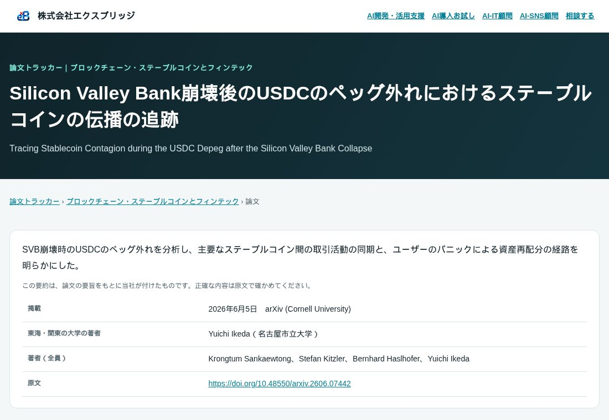
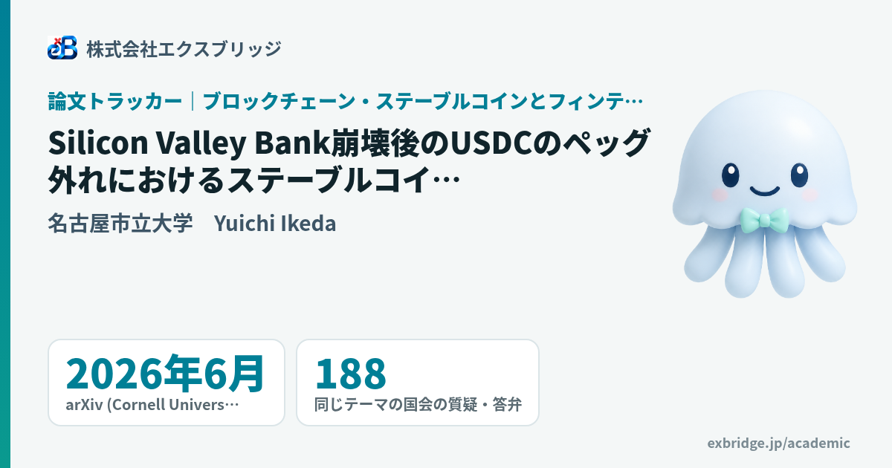
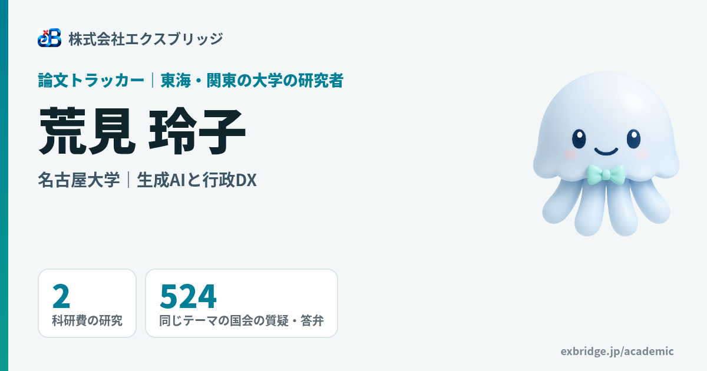

名古屋でAIシステムの開発をしている小嶋です。大学の研究と国会の議論をテーマごとに並べる「論文トラッカー」を作りました。この記事は、その作り方の記録です。

論文トラッカー（東海・関東の大学の研究 × 国会の議論）
https://exbridge.jp/academic/



## 全体の形

テーマ1つにつき、3つの公開データを集めて、静的なHTMLを作ります。

1. **論文**：OpenAlex（世界の論文のデータベース・CC0・鍵なし）
2. **研究者と研究課題**：KAKEN（科研費の研究課題）を CiNii Research の API で
3. **国会の議論**：当社の国会トラッカーが持っている会議録データ（国会会議録検索システムのAPIから集めたもの）

処理は4本のスクリプトに分けました。

1. `academic-fetch.py`：3つのデータを集め、テーマごとのJSONにする
2. `academic-summarize.py`：英語の論文に、日本語の題名と1文の要約を付ける（ローカルの gemma4）
3. `build-academic.ts`：テーマ・論文・研究者・一覧のページと、サイトマップを作る
4. `make_academic_ogp.py`：ページごとのOGP画像を Chromium で描く

テーマの定義は `themes.json` に、検索の語と、結び付ける国会トラッカーと、絞り込みの正規表現を書くだけです。テーマを1つ足すのにかかる時間は、要約を含めて30分ほどです。

## 1. 論文を大学の機関IDで絞る

OpenAlex は、著者の所属を機関IDで持っています。東海三県の31大学と関東の主な10大学のIDを、OpenAlex の institutions 検索で1つずつ確かめて、表にしました。

```
https://api.openalex.org/works?filter=
  institutions.id:I60134161|I197274945|...,      ← 大学の機関ID（OR）
  from_publication_date:2023-01-01,
  title_and_abstract.search:"generative AI"|"large language model"|ChatGPT,
  primary_topic.field.id:33|18|14|32
```

`primary_topic.field.id` で分野も絞れます。生成AIの論文は、絞らないと東海だけで336本あり、医学が40本混ざっていました。社会科学・意思決定・経営・心理などに絞って取っています。

要旨（abstract）は `abstract_inverted_index` という「語→出てくる位置」の形で返るので、位置の順に並べ直して文に戻します。

関東は返信の材料を増やすために足したもので、1テーマ100本までにしています。東海の研究を先に並べるため、論文ごとに `region` を持たせています。

## 2. 科研費の研究は、CiNii Research で引いて詳細で所属を確かめる

研究者の日本語の名前と所属は、OpenAlex では取れません（ローマ字です）。そこで科研費の研究課題を使いました。

- 検索：`https://cir.nii.ac.jp/opensearch/projects?q=<語> <大学名>&format=json`
- 詳細：`https://cir.nii.ac.jp/crid/<crid>.json` に、研究者の名前・所属（`jpcoar:affiliationName`）・役割（代表者か分担者か）・研究の概要が入っている

検索は「語＋大学名」で大学ごとに引き、詳細を1件ずつ開いて、所属が対象の大学の研究者がいる課題だけを残します。研究者のページのURLには、CiNii の研究者IDをそのまま使いました。名前をローマ字にしてURLにすると、読み違いが起きるからです。

## 3. 関係のない研究を除く（ここがいちばん手間だった）

公開データの検索は、語の一致がゆるいです。実際に混ざったものと、直し方です。

1. **科研費の検索が広すぎる。** 「生成AI」で学校の心臓検診の研究（「所見生成」に当たる）まで出た。→ 題名か概要にテーマの語がある課題だけ残す正規表現（`kaken_must`）をテーマごとに書いた。189件→117件
2. **「AI」が英単語の途中に当たる。** 「行政のデジタル化」の論文を「AI を含むもの」で絞ったら、mainly の ai に当たって、森林の年齢や建物の解体の論文が入った。→ `\b` で単語の区切りを見る。127本→103本
3. **論文ではないものが混ざる。** Zenodo に置かれたソフトウェアやデータ、arXiv 版と学会版の重複。→ 種類（article・review・conference-paper・preprint・book-chapter・book）で絞り、題名を正規化して重複を1本にまとめる（学術誌・学会版を残す）
4. **略語が別の意味で当たる。** PFAS で検索したら、心臓のカテーテル治療（Pulsed Field Ablation＝PFA）や数学の論文が入った。→ テーマの語が単語として要旨にあるかを確かめる。131本→101本

## 4. 生成AIに要約させるときの決まり

英語の論文の日本語の題名と1文の要約は、当社のサーバーの gemma4（12B）に作らせています。`think: false`・`format: json`・`temperature: 0.2` で、題名と要旨だけを渡します。

最初の版では、2つの失敗がありました。

- **地名を推測で漢字にする。** 愛知県の「Fuso」を「豊素町」と書いた（正しくは扶桑町）。
- **直しすぎる。** 「固有名詞は原文のまま」と指示したら、「Medical Office Staff」「Large Language Model」まで英語のまま残った。

最終的な指示はこうです。

1. 一般の言葉は日本語に訳す（large language model→大規模言語モデル）
2. 人名・製品名・略称は原文のまま
3. 地名は、都道府県と政令指定都市だけ漢字。それ以外の市町村名はローマ字のまま
4. 要旨に書いていないこと・数字は書かない。要旨が無い論文は題名の訳だけ

要約はキャッシュして、論文IDが同じなら作り直しません。437本で、1本あたり7〜10秒でした。

## 5. ページとOGP画像

ページは TypeScript で静的に作り、FTP で「中身が変わったファイルだけ」を1回の接続で送ります。ページの最終更新日だけが変わったファイルは送りません。

OGP画像は、ページを作るときに「画像に描く中身」（題名・大学・件数）を JSON に書き出し、Chromium で 1200×630 に描きます。画像のURLには中身のハッシュを `?v=` で付けました。数字が変わればURLも変わるので、Xが古い画像を出し続けることがありません。



途中で、題名が3行になると下の行（大学と著者）に重なる不具合が出ました。要素を絶対位置で置いていたためで、縦に流れる配置に変え、題名は3行で切るようにしました。



## 6. 投稿とページを結び付ける

論文トラッカーのページを、Xの投稿の話題と結び付ける仕組みも作りました。ここは2段に分けています。

1. **文字の近さで候補を絞る。** 投稿と、論文の題名・要約・研究課題の概要を2文字ずつに区切り、珍しい組ほど重く数えるコサイン類似度で、近い論文と研究者を数件選ぶ
2. **最後は生成AIが判断する。** 候補の中に投稿と同じ話題のものがあれば選び、無ければ選ばない

文字の近さだけで決めようとして、うまくいきませんでした。正しい組（人の肺のマイクロプラスチックの投稿→その研究の論文）が0.32、関係のない組（自治体のAIの投稿→データセンターの論文）が0.19で、間に線を引けなかったからです。地名や大学名（「名古屋」など）は、どこにでも出るので近さの計算から外しています。

## 数字のまとめ

- テーマ：3（生成AIと行政DX／PFAS・マイクロプラスチック／ブロックチェーン・ステーブルコインとフィンテック）
- 対象の大学：東海三県31・関東10
- 論文：408本（生成AI 173・PFAS 181・フィンテック 54）。日本語の要約は437本作った（絞り込みで外した論文の分も含む）
- 科研費の研究：534件、研究者のページ：748人
- ページ：1,160、OGP画像：1,160枚

## よくある質問

### OpenAlex で大学の論文を集めるには、どうすればよいですか？
大学の機関IDを institutions 検索で確かめ、works の filter に `institutions.id:` で並べます。テーマの語は `title_and_abstract.search:` で、分野は `primary_topic.field.id:` で絞れます。API に鍵は要りません。

### 科研費の研究者の日本語の名前と所属は、どこで取れますか？
CiNii Research の projects 検索で研究課題を引き、`/crid/<id>.json` の詳細を開くと、研究者の名前・所属・役割・研究の概要が入っています。

### 生成AIの要約で、事実と違うことを書かせないには？
要旨だけを渡し、要旨に無いことと数字は書かないよう指示します。地名や人名は推測で直させないことと、日本語に訳す一般の言葉の例を指示に入れることが効きました。
