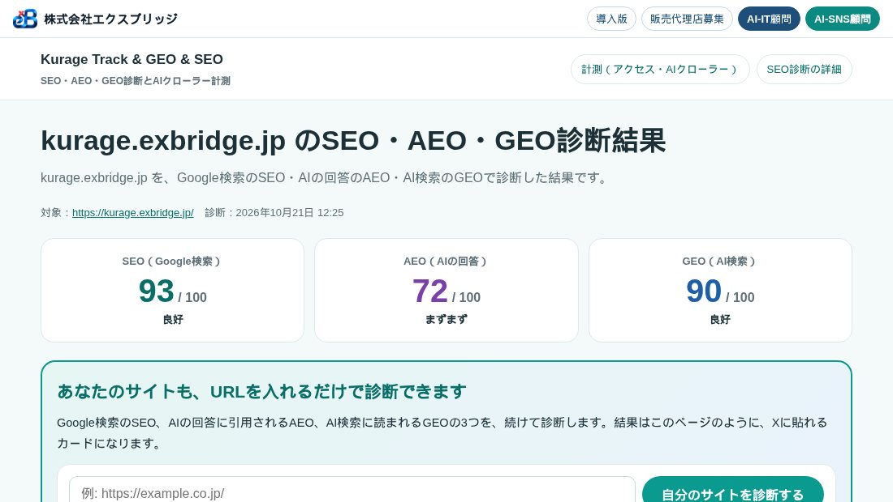
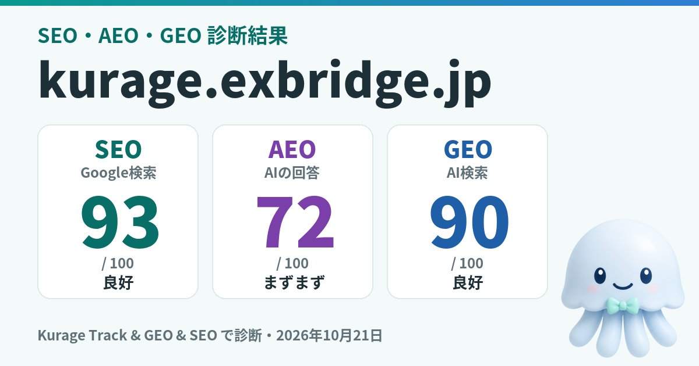
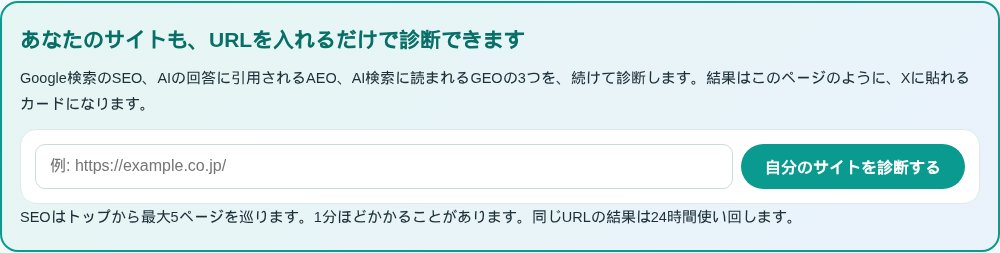
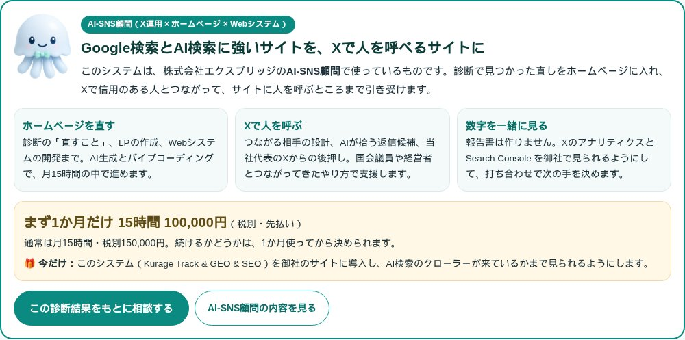

名古屋でAIシステムの開発をしている小嶋です。今日1日で、サイトの診断システムを1つ作り、デモを公開して、Kurage App Store に出品しました。

Kurage Track & GEO & SEO（デモ）
https://proto.exbridge.jp/ktrackgeoseo/

上の画面は、当社の kurage.exbridge.jp を診断した結果です。SEO 93点、AEO 72点、GEO 90点でした。

## 何を診断するシステムか

URLを1回入れると、次の3つを続けて診断して、1枚の結果にまとめます。

1. **SEO（Google検索）**：題名や説明文、見出しの組み方、内部リンク、表示の速さなど10のカテゴリ。トップから最大5ページを巡って調べます
2. **AEO（AIの回答）**：ChatGPTやGoogleのAIによる概要が、答えとして引用しやすい書き方になっているか。「○○とは〜です」という定義の文、質問と答えの形、更新日が機械で読めるかなど7つの観点です
3. **GEO（AI検索）**：AI検索のクローラーがページを読めるか。robots.txt で AIのクローラーを止めていないか、llms.txt、構造化データ、出典や会社の情報が書かれているかなど8つの観点です

**判定に生成AIは使っていません。** 決まったチェックだけで点を付けるので、同じページなら何度測っても同じ点になります。生成AIに採点させると、測るたびに点がぶれて「直したのに下がった」が起きます。直した結果を点数で確かめるには、ぶれないことがいちばん大事です。

kurage.exbridge.jp の AEO が72点だったのは、「重要な言葉に定義の文が無い」「更新日が機械で読める形になっていない」の2つが原因でした。どちらも直し方が結果に書かれているので、あとは直して測り直すだけです。

## もともと3つに分かれていた

当社には、すでに SEO診断の「Kurage SEO」と、アクセス解析と AIクローラー計測の「Kurage Track & GEO」がありました。AEO は、Cloud Run で動かしている「Kurage GEO」の中にありました。

お客様のサイトを見るとき、この3つを別々に開いて、別々の結果を見比べていました。それなら1つにまとめよう、というのが今回の始まりです。

まとめ方は単純で、入口のページが3つの診断を順に呼び、結果を1枚に並べるだけです。**診断の中身は元のまま変えていません。** AEO は Python で書かれていたので PHP に移し、同じページを両方で測って、7ページ中6ページで同じ点になることを確かめました。

その結果、**PHPを置くだけで動き、データベースも要りません。** 一般的なレンタルサーバーで、そのまま使えます。

## 結果を、Xに貼りたくなる形に

診断の結果は、自分だけで見て終わりになりがちです。そこで、**結果をXに貼れるカード**にしました。

結果のページには「Xに投稿」と「投稿文をコピー」のボタンがあります。押すと、点数の入った投稿文と結果のページのURLが入り、Xにはこのカードが表示されます。3つとも80点以上のサイトには「3つとも80点以上」の印が付くので、良い結果が出たサイトの持ち主は、つい貼りたくなるはずです。

作っていて、1つつまずきました。投稿文に「exbridge.jp」とドメイン名を書くと、Xがそれを自動でリンクにして、**結果のカードではなく、そのサイトのカードを出してしまう**のです。そこで、投稿文ではドメインの点を全角の「．」にして、リンクにならないようにしました。こうすると、カードは結果のページのものだけが出ます。

## 見た人も、自分のサイトを診断できるように

Xで結果を見た人が来たとき、そのページが「誰かの結果」で終わっていたら、そこで帰ってしまいます。そこで、結果のページの点数のすぐ下に、**「あなたのサイトも、URLを入れるだけで診断できます」**の案内と入力欄を置きました。

診断には1分ほどかかることがあるので、ボタンを押したら「診断しています」と秒数を出し、ボタンを押せなくしました。押したのに何も起きないように見えると、2回押されてしまうからです。

## 診断のあとに、直す人がいる

点数が出ても、直す人がいなければサイトは変わりません。当社のデモでは、結果の下に、当社の「AI-SNS顧問」の案内を出しています。

見つかった「直すこと」の件数を出して、その直しを顧問の時間の中でAIを使って行い、直したらこの診断で測り直す、という流れです。3つとも80点以上のサイトには、「次は、Xから人を呼ぶ番です」と出します。この案内は当社のデモにだけ出るようにしていて、お客様が自社に入れたシステムには出ません。

AI-SNS顧問（X運用 × ホームページ × Webシステム）
https://exbridge.jp/ai-sns-komon.html

## 1日でやったこと

今日やったことを並べると、次のとおりです。

1. Kurage SEO と Kurage Track & GEO を1つにまとめた入口を作る
2. Kurage GEO の AEO の判定を PHP に移し、同じ点になるか確かめる
3. デモを proto.exbridge.jp に公開する
4. Kurage App Store に出品する（2製品の合計と同じ値段にしました）
5. 結果のページ、Xに貼れるカード画像、Xに投稿とコピーのボタンを作る
6. 見た人向けの案内と、診断中の表示を足す
7. 当社のデモ全部の上に出る共通のヘッダーを見直し、右上に「AI-IT顧問」「AI-SNS顧問」を並べる

どれも、Claude Code に作らせて、私は画面を見て直す点を伝える、いわゆるバイブコーディングで進めました。たとえば「投稿文だと、exbridge.jp のOGP画像が出てしまう」「診断を押しても、反応がわからない」と伝えると、その場で直ります。1日でここまで進んだのは、この往復の速さのおかげです。

Kurage Track & GEO & SEO（Kurage App Store）
https://kappstore.exbridge.jp/app.php?id=85d96326308722b1

## よくある質問

### AEOとGEOは何が違うのですか？
AEO（Answer Engine Optimization）は、AIが質問に答えるとき、自社のページの文章が答えとして引用されやすい書き方になっているかを見ます。GEO（Generative Engine Optimization）は、AI検索のクローラーがそもそもページを読みに来られるか、読んだときに会社や出典が分かるかを見ます。書き方の問題と、読める状態かの問題、という違いです。

### 診断に生成AIを使っていないのはなぜですか？
生成AIに採点させると、同じページでも測るたびに点が変わるからです。直したのに点が下がった、ということが起きると、直した効果が確かめられません。このシステムは決まったチェックだけで点を付けるので、同じページなら同じ点になります。

### 自社のサーバーで使えますか？
使えます。PHPが動くレンタルサーバーに置くだけで動き、データベースは要りません。AIのクローラーが実際に来ているかを記録する計測も入っていて、Google Analytics では見えない GPTBot や ClaudeBot の訪問も数えられます。
