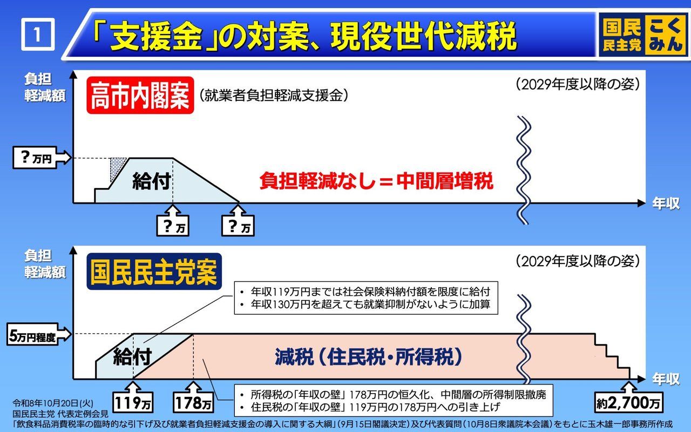
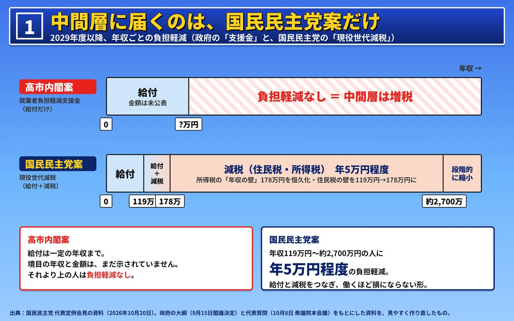
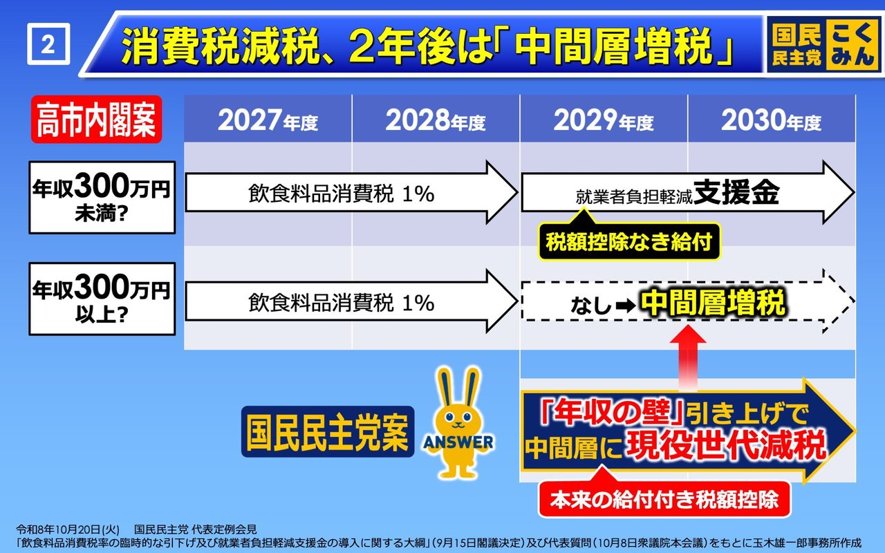
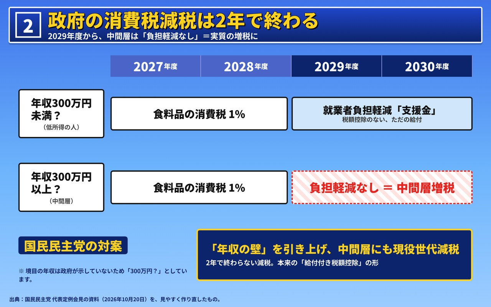
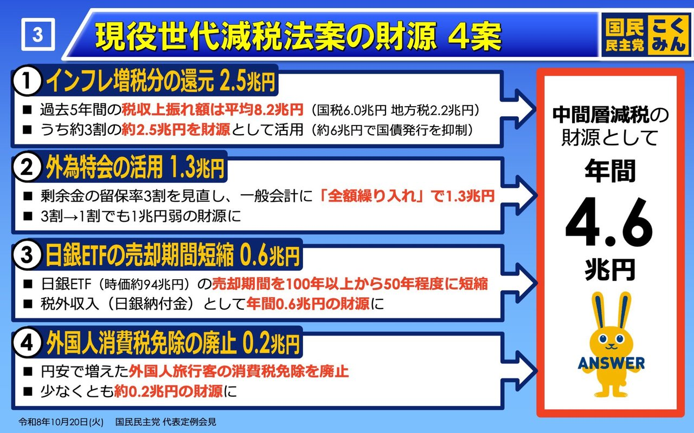
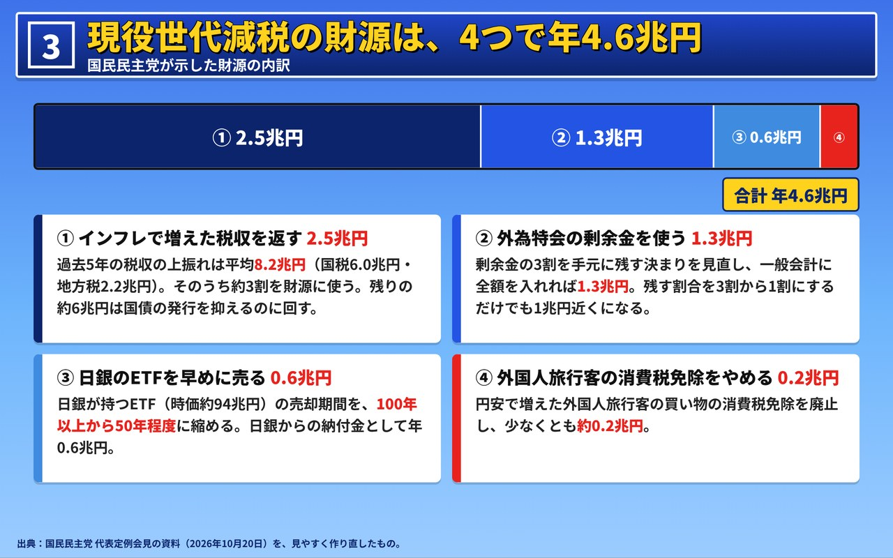

名古屋でAIシステムの開発をしている小嶋です。「わかりやすい資料の作り方」は、一般論で読むより、実物を1枚ずつ直してみるほうが身につきます。

今回の題材は、国民民主党が2026年10月20日の代表定例会見で使った、減税についてのフリップ3枚です。色使いがはっきりしていて、テレビやXで何度も見かける形のものです。これを**同じ色使いのまま**作り直し、どこをどう変えたかを、作り直す前と後の画像で並べます。

政党の主張に賛成か反対かを書く記事ではありません。資料の伝え方の例として扱っています。同じやり方は、どの党の資料にも、会社の提案書にも使えます。

## 元の3枚の良いところ

まず、元の資料はよくできています。作り直しでも、次の4つはそのまま残しました。

- **色に役割がある。** 自分たちの案は紺の札に黄色の文字、比べる相手の案は赤の札に白の文字。3枚とも同じなので、続けて見ても迷いません
- **1枚に1つの主張。** 「対案」「2年後」「財源」と、1枚ごとに話が1つです
- **数字が大きい。** 「119万」「178万」「4.6兆円」が、スマホで縮んでも読めます
- **右下に出典がある。** どの閣議決定と、どの国会答弁をもとにしたかが1行で書いてあります

色は、背景が青のグラデーション（明るい水色から濃い青）、見出しの帯が濃い紺、本文の箱が白です。

## 1枚目：山形のグラフを「年収の帯」に

（元の資料：国民民主党 代表定例会見 2026年10月20日）

元の1枚目は、横軸が年収、縦軸が負担軽減額のグラフを上下に2つ並べています。グラフの形を見比べれば違いは分かりますが、「結局、自分の年収だとどうなるのか」を読み取るには少し時間がかかります。

直したのは3つです。

1. **見出しを結論にした。** 元の「「支援金」の対案、現役世代減税」は、何の図かを説明する題です。作り直しでは「中間層に届くのは、国民民主党案だけ」と、図が言いたいことを先に書き、何の図かは小さい副題に回しました
2. **グラフを帯にした。** 縦軸の高さを読む代わりに、年収の帯を「給付」「減税」「負担軽減なし」で色分けしました。自分の年収のところを指でたどるだけで、どちらの案で何が起きるかが分かります
3. **言葉のまとめを足した。** 下に、両案を1行ずつ言葉で書いた箱を置きました。図を読まない人にも、ここだけで伝わります

帯の幅は見やすさのための目安で、年収の比率どおりではありません。正確な形を見せたいなら元のグラフ、ひと目で違いを伝えたいなら帯、と使い分けるのがよいと思います。

## 2枚目：「？」に理由を書く

（元の資料：国民民主党 代表定例会見 2026年10月20日）

2枚目は年表で、もともと分かりやすい形です。気になったのは、「年収300万円未満？」の「？」でした。見る人には、資料を作った人が自信がないのか、政府が決めていないのかが分かりません。

- **「？」の理由を注に書いた。** 「境目の年収は政府が示していないため「300万円？」としています」。これで「？」が、資料の弱みではなく、政府案の分からなさを示す印に変わります
- **見出しを結論にした。** 「消費税減税、2年後は「中間層増税」」を、「政府の消費税減税は2年で終わる」とし、副題で「2029年度から、中間層は負担軽減なし＝実質の増税に」と補いました
- **対案の箱を言い切った。** 「2年で終わらない減税」と、2枚目の主張に対する答えを一言で置きました

## 3枚目：4つの数字を1本の帯に

（元の資料：国民民主党 代表定例会見 2026年10月20日）

3枚目は財源の4案です。4つの箱が同じ大きさで並んでいるので、2.5兆円と0.2兆円の大きさの違いが見えません。

- **帯の長さで大きさを見せた。** 一番上に、4つの財源を足した1本の帯を置きました。①の2.5兆円が半分以上を占めることが、ひと目で分かります
- **説明を短い文にした。** 「剰余金の留保率3割を見直し、一般会計に全額繰り入れ」を「剰余金の3割を手元に残す決まりを見直し、一般会計に全額を入れれば1.3兆円」のように、話し言葉に近づけました

## 作り直しで守ったこと

- **数字と主張は元のまま。** 私が足した数字はありません。見え方だけを変えています
- **ロゴとマスコットは入れない。** 元の資料にある党のロゴとマスコットは、作り直しには入れていません。当社が作ったものを、党の公式の資料のように見せないためです
- **出典を変えた。** 元の「玉木雄一郎事務所作成」は外し、「代表定例会見の資料を、見やすく作り直したもの」と書きました

## どうやって作ったか

フリップは、HTMLとCSSで1枚1600×1000の大きさに組み、ブラウザを自動で動かすPlaywrightで、元と同じ2048×1280の画像に書き出しました。文字を画像に焼き込むのではなく、HTMLで組むので、言葉や数字を直すのが速いです。

1回目に書き出したときは、「国民民主党案」の札が2行に折り返す、「119万」と「178万」の目盛りが重なる、対案の箱から文字がはみ出す、という崩れがありました。書き出した画像を目で見て、札の折り返しを止め、目盛りの位置と箱の大きさを直して、2回目で仕上げています。**作った画像は、必ず書き出したものを見て確かめる**のが大事です。

## わかりやすい資料の作り方：5つのこと

今回の作り直しで分かったことを、5つにまとめます。

1. **見出しは「何の図か」ではなく「何が言いたいか」にする。** 何の図かは副題に回す
2. **グラフの形を読ませるより、帯や長さで比べさせる。** 見る人に、自分の場所を指でたどってもらう
3. **分からない数字には、分からない理由を書く。** 「？」だけにしない
4. **色に役割を決めて、全部の資料で守る。** 今回なら、紺と黄が自分たち、赤が比べる相手
5. **図の下に、言葉のまとめを1行置く。** 図を読まない人にも届く

当社は、国会の記録や公的なデータを、カードやページにして見せるシステムを作っています。データの見せ方を考えるときにも、この5つをいつも使っています。

ニュースと国会の記録カード（報道各社のニュースに、関係する国会の答弁のカードを付けたページ）
https://exbridge.jp/news/

## よくある質問

### わかりやすい資料を作るとき、最初に何を直せばよいですか

見出しです。「〇〇について」「〇〇の比較」のような、何の図かを説明する題を、「〇〇は〇〇だけ」「〇〇は2年で終わる」のように、その1枚が言いたい結論に変えてください。何の図かは、小さい副題で補えば十分です。

### 資料の色使いは、何色にすればよいですか

色の数より、色ごとの役割を決めることが大事です。今回の資料では、紺と黄色が自分たちの案、赤が比べる相手の案、水色が給付、薄いピンクが減税と、役割が決まっています。役割を決めたら、全部のページで同じにしてください。
