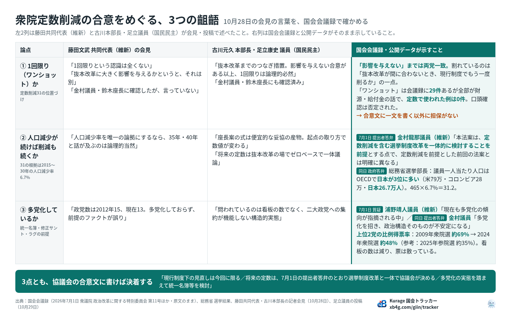

名古屋でAIシステム開発の会社をやっています。10月28日、衆議院の定数削減（31減）をめぐって、日本維新の会の藤田文武共同代表と、国民民主党の古川元久政治改革推進本部長の記者会見が食い違いました。翌29日、国民民主党の足立康史参議院議員が、その食い違いを3点に整理して投稿しています。

私はこの3点を、当社の国会トラッカーと国会会議録で一つずつ確かめました。結論から言うと、国民民主党の主張を支える材料は、相手の党である維新の議員が国会で述べた言葉の中にありました。3点を1枚の表にまとめたのがこの図です。

- [国会トラッカー「議員定数削減」（テーマごとの質疑と政府の答弁）](https://xb4g.com/giin/tracker/giin-teisu-sakugen#ref=vibeblog-teisu-3sogo)
- [会議録で「多党化」を含む発言12件（発言者と日付つき）](https://xb4g.com/giin/search?q=%E5%A4%9A%E5%85%9A%E5%8C%96#ref=vibeblog-teisu-3sogo)

## 1. 3つの齟齬とは何か

足立議員の整理は次の3点です。

1. **今回の31減は「1回限り（ワンショット）」か。** 古川本部長は「抜本改革までのつなぎ措置で、1回限り」と言い、藤田共同代表は「1回限りという認識は全くない。人口減少が続けば削減も続く」と言う。
2. **人口減少に伴って削減が続くのか。** 31の根拠は、座長案の「2015年から2030年の人口減少率6.7%」です。藤田共同代表は「それを唯一の論拠にするなら、2035年、2040年と続くのは論理的当然」と言い、古川本部長は「式は便宜的な妥協の産物で、将来はゼロベースで一体議論」と言う。
3. **政治は「多党化」しているのか。** 古川本部長は多党化を前提に統一名簿方式や修正サント・ラグ方式を提案し、藤田共同代表は「政党数は2012年の15から現在13に減っており、多党化していない」と言う。

会見の言葉どうしを比べているだけでは、どちらが正しいか決まりません。そこで、国会会議録に当たりました。

## 2. 会議録で分かったこと

### ①「ワンショット」は、定数の話で使われたことがない

当社の国会トラッカーで、2023年以降の全議員の発言から「ワンショット」を引くと29件あります。すべて財源や給付金の話で、議員定数について使われた例は1件もありません。つまりこの言葉に合意上の意味を持たせるなら、協議会の文書に書く以外に担保がありません。

藤田共同代表も「今回の制度変更が抜本改革に大きく影響を与えるかというと、それは別」とは認めています。両党が割れているのは「抜本改革が間に合わなかったとき、現行制度の下でもう一度削るのか」という一点だけです。しかも「金村議員と鈴木座長に確認した」に対して藤田共同代表が「私も確認したが言っていない」と返した時点で、口頭の確認は担保として消えています。

### ② 維新の提出者が「一体的に検討することを前提」と答弁していた

2026年7月1日の衆議院 政治改革に関する特別委員会（第11号）で、議題は加藤勝信議員ほか11名が提出した「衆議院議員の選挙制度改革及び定数削減に関する法律案」でした。維新の浦野靖人議員の質問に、法案提出者として維新の金村龍那議員がこう答えています。

> 本法案は、定数削減を含む選挙制度改革を一体的に検討することを前提とする点において、定数削減を前提としていた前回の法案とは明確に異なるものであり、本法案の名称においてもその点を明確にしたところであります。

さらに「あくまでも協議会における議論を前提としているものであります」とも述べています。「将来の定数は抜本改革の場でゼロベースで一体議論」という古川本部長の主張は、国民民主党だけの言い分ではなく、維新の提出者が国会で述べた公党の見解と同じ趣旨です。

この日は、国民民主党や中道改革連合など野党の委員が出席しないまま議事が進んだ回でした。だからこそ、会議録でしか拾えない答弁です。

同じ日に、総務省の選挙部長が政府参考人として答えた数字もあります。OECD 加盟国で議員一人当たりの人口が多い順に、1位がアメリカ（定数435・約79万人）、2位がコロンビア（187・約28万人）、3位が日本（465・約26万7千人）です。人口減少率で機械的に削るという論拠に対して、政府のデータで「日本はすでに議員の少ない側」と示せます。その直後に浦野議員自身が「議員一人当たり人口といった単純な指標だけで、日本の国会議員が多い少ないと評価すべきではない」と述べているのも、覚えておいてよい点です。単純な指標で評価するなと言った党が、人口減少率という単純な指標で31を出した形になっています。

### ③ 維新自身が「多党化」を前提に法案を説明していた

政党数の比較は、2025年12月10日の衆議院予算委員会で維新の阿部圭史議員が「2012年は15政党、現在は12政党」とパネルで示した、維新の持ちネタです。ところが同じ7月1日の委員会で、浦野議員は「現在も多党化の傾向が指摘される中」と前置きし、金村議員は比例削減への批判に対して「多党化を招き、政治構造そのものが不安定になる」と答えています。多党化を前提に法案を説明した当事者が、いまは「多党化していない」と言っている形です。

構造を見るなら、上位2党の比例得票率が分かりやすい指標です。2009年の衆院選は民主党と自民党で約69%、2024年の衆院選は自民党と立憲民主党で約48%でした。参考までに2025年の参院選は自民党と国民民主党で約35%ですが、参院の比例は全国1区で票が散りやすい制度なので、本線は同じ衆院選どうしの比較です。看板の数は減り、票は散っています。

## 3. 読み違いやすい点を2つ

足立議員は浦野議員の言葉を「国会答弁」と書いていましたが、会議録では浦野議員は質問する側で、「お答えいたします」と答えたのは提出者の金村議員です。公党の見解として重いのは提出者答弁のほうなので、根拠として使うなら金村議員の言葉を引くのが正確です。

もう一つは、衆院選と参院選の得票率を同列に並べないことです。相手に突かれる余地を先に消しておくと、議論が長持ちします。

## 4. 合意文に書く一文

3点とも、相手の言葉を根拠にして協議会の合意文に一文ずつ書けば決着します。たとえば次の形です。

- 現行制度の下での定数の見直しは、今回に限る。
- 将来の定数は、7月1日の提出者答弁のとおり、選挙制度改革と一体で協議会が決める。
- 多党化の実態を踏まえ、統一名簿方式などの検討を協議会の議題に含める。

自党の提出者答弁と同じ趣旨であれば、維新も拒みにくいはずです。

## 5. どうやって調べたか

使ったのは、当社の国会トラッカーの全文検索と、国立国会図書館の会議録APIです。トラッカーで「ワンショット」「多党化」「中選挙区」「議員一人当たり人口」を引いて、だれがいつ言ったかの一覧を出し、7月1日の委員会は会議録APIで全発言を読み直して、質問と答弁の別と議題を確かめました。図は、その結果を論点ごとに3列に並べたものです。

- [国会トラッカー「議員定数削減」](https://xb4g.com/giin/tracker/giin-teisu-sakugen#ref=vibeblog-teisu-3sogo)
- [会議録で「議員一人当たり人口」を含む発言](https://xb4g.com/giin/search?q=%E8%AD%B0%E5%93%A1%E4%B8%80%E4%BA%BA%E5%BD%93%E3%81%9F%E3%82%8A%E4%BA%BA%E5%8F%A3#ref=vibeblog-teisu-3sogo)
- [国会トラッカーを自社に置く（Kurage App Store）](https://kappstore.exbridge.jp/#ref=vibeblog-teisu-3sogo)

議員事務所や政党の政策スタッフで、こうした突き合わせを日常の作業にしたい方は、[AI-IT顧問契約](https://exbridge.jp/ai-it-komon.html#ref=vibeblog-teisu-3sogo)の形でお手伝いしています。

## よくある質問

### 今回の定数削減31は「1回限り」なのですか？

会見の言葉では両党が食い違っています。国会会議録では「ワンショット」が定数について使われた例はなく、口頭の確認も否定されたので、協議会の合意文に書く以外に担保はありません。

### 維新は「定数削減ありき」なのですか？

2026年7月1日の衆議院政治改革特別委員会で、維新の金村龍那議員は法案提出者として「定数削減を含む選挙制度改革を一体的に検討することを前提とする」と答弁しています。

### 日本の国会議員は多いのですか？

2026年7月1日の総務省選挙部長の答弁では、OECD 加盟国で議員一人当たりの人口が多い順に、アメリカ、コロンビア、日本の順でした。人口当たりでは日本は議員の少ない側です。

出典：国会会議録（2026年7月1日 衆議院 政治改革に関する特別委員会 第11号、2025年12月10日 衆議院 予算委員会 第7号ほか・原文のまま）、総務省 選挙結果、藤田共同代表・古川本部長の記者会見（2026年10月28日）、足立康史議員の投稿（2026年10月29日）。
