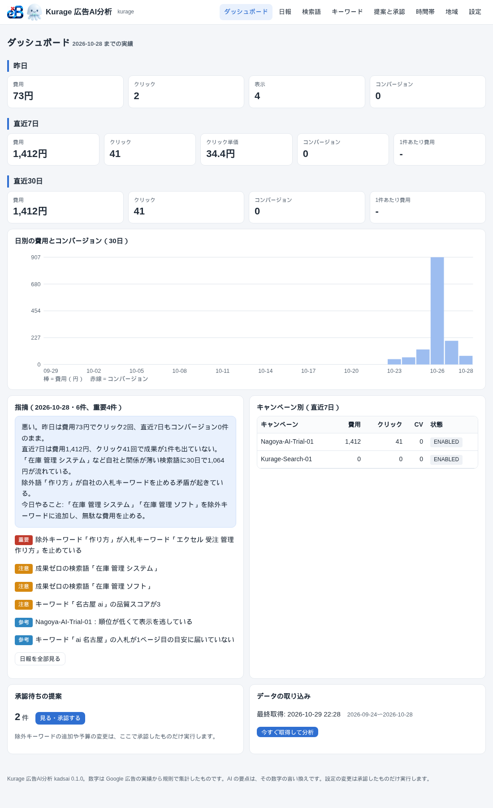
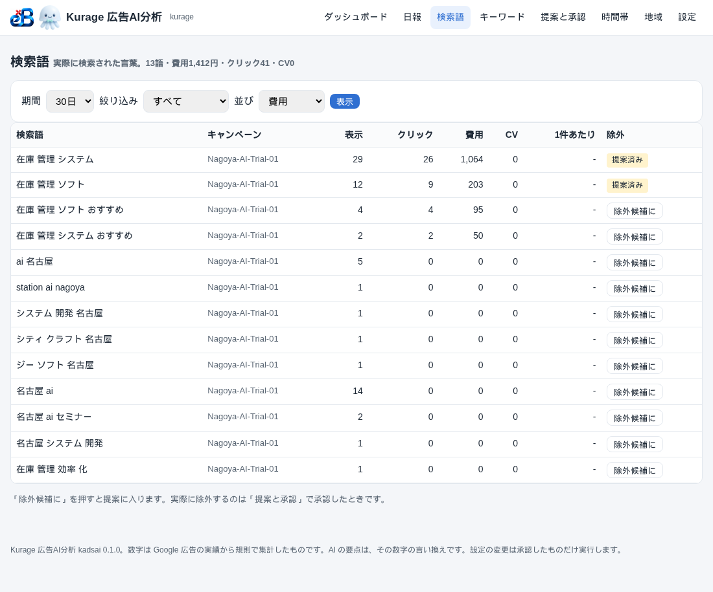

小さな会社の Google 広告は、代理店から月1回のレポートが来て終わり、ということが多いです。昨日いくら使って、どの検索語に流れたかは、管理画面を自分で開かないと分かりません。名古屋の水道修理会社から「広告と電話と売上をまとめて分析して、毎朝 LINE に送ってほしい」という相談があり、まず広告の部分だけを切り出して、1本のシステムにしました。**Kurage 広告AI分析**（kadsai）です。

## 毎朝やること

cron で1回動き、Google Ads API から日別のキャンペーン・広告グループ・キーワード・検索語・広告・時間帯・地域・除外キーワードを SQLite に取り込みます。そのあと規則で分析して、Markdown と HTML と LINE 用の短文の3つを書きます。AI はその後ろの1段で、数字を経営者向けに「3行と今日やること1つ」に言い換えるだけです。

規則で出す指摘は次の9種類です。

1. 昨日の費用・クリック・コンバージョンを、過去4週の同じ曜日の平均と比べて、±50%を超えたら「急な増減」
2. 直近30日で費用1,000円かクリック5回を超えて成果ゼロの検索語を「除外候補」に
3. 語（n-gram）単位で集めて「この語を含む検索はすべて成果ゼロ」
4. 除外キーワードが、入札しているキーワードを止めていないか（除外の衝突）
5. インプレッションシェアの「予算が理由で逃した」「順位が理由で逃した」割合
6. 1ページ目の目安に届いていない入札
7. 品質スコア4以下のキーワード
8. 同じ広告グループでクリック率が半分以下の広告文
9. 費用は使うのにコンバージョンが0の時間帯

## 自社の口座で最初に出た指摘

作ってすぐ自社の口座を通したら、重要1件が出ました。除外キーワード「作り方」（部分一致）が、入札キーワード「エクセル 受注 管理 作り方」を止めていました。自分で入れた除外が自分の広告を消していたわけで、管理画面を眺めているだけでは気づかない種類のミスです。ほかに、成果ゼロで費用が流れていた検索語が2つ、品質スコア3のキーワードが1つ、順位負けでインプレッションシェアの83%を逃しているキャンペーンが1つ。

## 似た OSS に無かったもの

参考にしたのは Google 公式の gaarf（レポート取得）、Account Anomaly Detector と Campaign Anomaly Detector（同じ曜日との比較）、negative-keyword-miner（n-gram）、Fivetran の dbt パッケージ（4粒度の日次表）です。どれも「コンバージョンまで」で止まっていて、画面と承認の仕組みがありません。このシステムで足したのは3つです。

- 画面。ダッシュボード、日報、検索語、キーワード、提案と承認、時間帯、地域、設定の8ページ。標準ライブラリの HTTP サーバーで、リンクは全部相対パスなので中継の下でも動きます
- 承認制の変更。除外キーワードの追加や日予算の変更は、画面で「承認して実行」したものだけ API で反映します。自動では何も変えません
- AI の差し替え。設定に `claude -p` と書けば Claude Code、`codex exec` なら Codex、OpenAI 互換の API なら DeepSeek や Qwen やローカル LLM。無ければ規則の日報だけが出ます

## 通話や売上とは、つながない

最初の相談は「広告×電話×売上」でしたが、1つのシステムにはしませんでした。広告分析、通話分析、売上分析は別の商品にして、必要なら日別の CSV を出して突き合わせる。どれか1つだけ買っても動き、後から足せる形の方が、小さな会社には合います。

## 動かす場所

社内の Linux 1台で動き、公開サーバーは要りません。LINE の通知は Messaging API の push で、外向きの通信だけです。Google Ads API の開発者トークンが取れない口座（代理店運用）は、管理画面から出した CSV を取り込めます。

- 画面のデモ（ログインが要ります）: [proto.exbridge.jp/kadsai/](https://proto.exbridge.jp/kadsai/#ref=vibeblog-kadsai)
- 商品ページ: [Kurage App Store](https://kappstore.exbridge.jp/app.php?id=12ae317340f91d51#ref=vibeblog-kadsai)
- ソースコード: GitHub の katsushi2441/kadsai（MIT）

## よくある質問

### AI は必須ですか

必須ではありません。数字はすべて規則が作ります。AI は要約の1段だけで、設定しなければ規則の日報が出ます。

### 代理店が運用していて API が使えません

Google 広告の管理画面から検索語レポートなどを CSV で出して取り込めます。日本語の見出しと Shift_JIS も読みます。

### 設定変更を勝手にされませんか

されません。除外キーワードの追加も予算の変更も、画面で承認したものだけを実行します。承認待ちの一覧と実行結果が残ります。

## 出典

- [Google Ads API Report Fetcher (gaarf)](https://github.com/google/ads-api-report-fetcher)
- [Campaign Anomaly Detector](https://github.com/google/cad_campaign_anomaly_detector)
- [negative-keyword-miner](https://github.com/ghazanfar111212/negative-keyword-miner)
