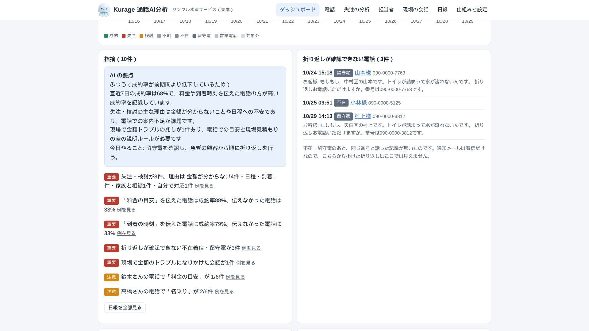
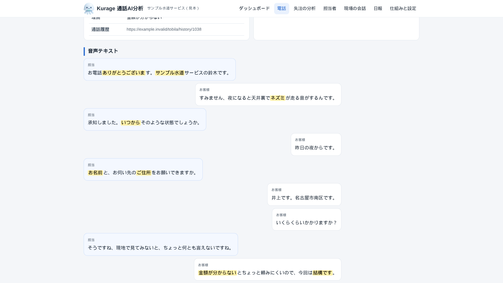
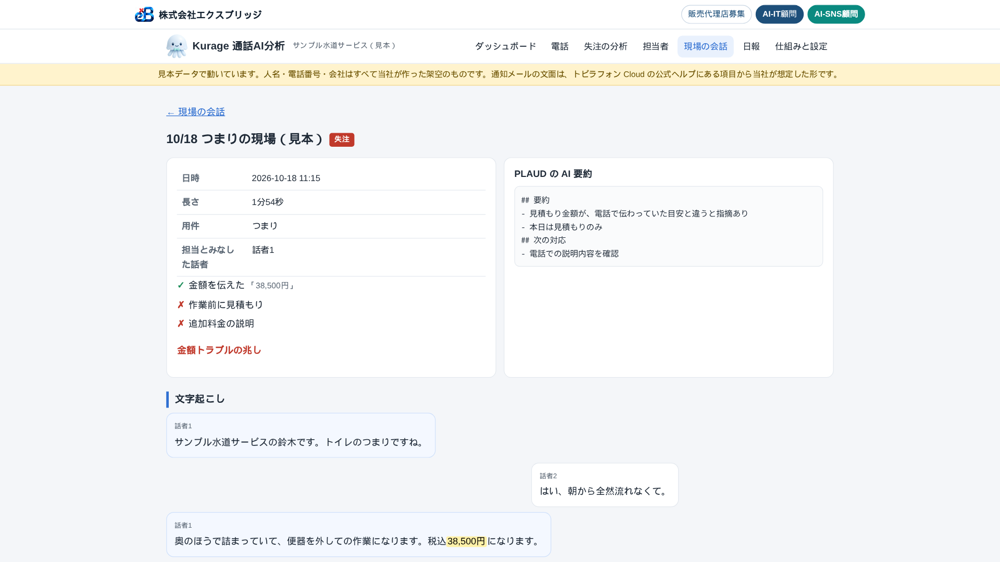

トビラフォン Cloud を入れると、電話は自動で文字起こしされます。PLAUD を使えば、現場の会話も文字になります。ところが、その文字を毎日読み返している会社はほとんどありません。名古屋の水まわり修理の会社から「電話の文字起こしで失注の理由を分析して、毎朝 LINE に送ってほしい」という相談があり、そのためのシステムを作りました。**Kurage 通話AI分析**（kcallai）です。広告の分析は前日に出した [Kurage 広告AI分析](2026-10-29-google-ads-bunseki-jidouka-kadsai.html) が受け持ち、こちらは電話と現場の会話だけを扱います。

## トビラフォン Cloud と PLAUD から、どう取り出すか

最初に調べたのは、両方とも外から文字起こしを取り出せるかです。

- **トビラフォン Cloud**: 外部向けの API は公開されていません。ただ、外線番号ごとの「着信を通知」をメールにすると、着信のたびに相手先名称・相手先電話番号・応答者・通話時間・通話履歴の URL・**音声テキスト内容**が入ったメールが届きます。通知は着信方式が「コールフロー（IVR）」の番号で使えて、発信は通知されません。
- **トビラフォン Cloud の一括ダウンロード**: 通話履歴の「一括操作」で落とせる録音データには、mp3 のほかに音声テキストと要約のテキストファイルが入ります。発信や過去の分はこちらで補えます。
- **PLAUD**: 公式の MCP と CLI があり、録音の一覧、話者と時刻つきの文字起こし、AI 要約を取り出せます。法人向けの規約は画面からの抜き出し（scraping）を禁じているので、画面の自動操作は使いません。

どちらも Zapier や Make のような、つなぎのサービスは要りません。通知用のメールボックスを IMAP で読みに行き、PLAUD は公式の CLI を呼ぶだけです。受け口のサーバーを外へ公開しないので、社内の Linux 1台で動きます。

## 毎朝、何を数えるか

判定は決まった言葉で行います。AI が無くても全部動きます。

1. **成約・失注・検討**: 会話の最後に出た言葉で決めます。「じゃあお願いします」なら成約、「今回はやめておきます」なら失注、「家族と相談して、また連絡します」なら検討
2. **失注の理由**: 金額が分からない・価格・日程や到着・他社と比較・自分で対応・不安・家族と相談。お客様の言葉に出た語で分けます
3. **言ったか、言わなかったか**: 名乗り・用件の確認・お名前・住所・料金の目安・到着の時刻・復唱・お礼
4. **言った電話と言わなかった電話の成約率の差**: 料金の目安・到着の時刻・名乗りについて比べます
5. **担当者ごとの抜け**
6. **折り返しが確認できない不在着信と留守電**: 同じ番号と、あとで話した記録が無いもの
7. **営業電話**の件数と合計時間
8. **現場の会話**: 「電話で聞いた金額と違う」「聞いていない」などの金額トラブルの兆し、作業前に見積もりを伝えたか、追加料金の説明

1件ごとの画面では、判定に使った言葉を黄色で示します。なぜ「失注」で、なぜ「金額が分からない」なのかを、元の会話で確かめられます。

## 比べる項目を「決まる前に言うこと」に絞った

最初は「復唱」も比べていました。見本データで出た結果は、復唱した電話の成約率100%、しなかった電話43%。いかにも効きそうな差ですが、復唱は「お願いします」と言われてから住所や番号を確かめるものです。成約した電話にしか出てこないので、差は結果を言い直しているだけでした。比べるのは、お客様が決める前に言うこと（料金の目安・到着の時刻・名乗り）だけにしました。

同じ見本データで、料金の目安を伝えた電話の成約率は88%、伝えなかった電話は33%でした。見本は当社が作った架空のデータで、担当者ごとに「料金の目安を言わない」「名乗らない」といった癖を持たせてあります。規則がその癖を拾えるかを確かめるためのもので、実際の会社の数字ではありません。

## 現場の会話は、電話とつながっている

PLAUD の録音で拾いたかったのは、電話で伝えた目安と現場の見積もりの差です。水まわりの修理は、高額請求の苦情が多い業界です。「電話では1万円くらいって」と現場で言われたら、そこで信用を落とします。この言葉が出た現場を毎朝の指摘に出し、作業前に見積もりを伝えたか、追加料金の説明をしたかも並べます。

## AI は言い換えだけ

数字と判定は規則が作り、AI は「経営者向けに3行と今日やること1つ」に言い換えるだけです。設定に `claude -p` と書けば Claude Code、`codex exec` なら Codex、OpenAI 互換の API や社内の Ollama も使えます。デモは社内の gemma4 で動かしていて、要点は4秒弱で返ってきます。AI を設定しなければ、規則の日報だけが LINE に届きます。

## 正直な範囲

- トビラフォン Cloud の通知メールの実物の文面と、PLAUD CLI の出力の細かい形は、まだ本物で確かめていません。項目名は公式ヘルプから作り、表記ゆれは読めるようにしてあります。導入時に実物1通で合わせます。
- 判定は言葉の規則なので、言い回しが違えば「不明」になります。御社の会話を見て言葉を足します。
- 通知は着信だけなので、こちらから掛けた折り返しは、一括ダウンロードを取り込むまで見えません。

デモ（見本データ・ログイン不要）: [proto.exbridge.jp/kcallai/](https://proto.exbridge.jp/kcallai/#ref=vibeblog-kcallai)。「見本の新着を1通受信して分析」を押すと、新しい電話が届いて分析されるところを見られます。ソフトウェア一式は [Kurage App Store](https://kappstore.exbridge.jp/app.php?id=040964c27c153ec2#ref=vibeblog-kcallai) で、税込220,000円の買い切りです。

## よくある質問

### トビラフォン Cloud の API が無くても取り込めますか

取り込めます。公式の「着信を通知」をメールにすれば、音声テキストの入ったメールが着信ごとに届きます。そのメールボックスを読みに行きます。

### PLAUD のデータはどう取りますか

PLAUD 公式の CLI か MCP で取り出します。最初に1回、ブラウザで連携を許可します。画面の自動操作はしません。

### Zapier や Make は要りますか

要りません。メールボックスを読みに行くのと、PLAUD の CLI を呼ぶだけです。つなぎのサービスの月額はかかりません。

### AI の費用はかかりますか

必須ではありません。判定は規則で行います。AI を使う場合は、Claude Code・Codex・OpenAI 互換の API・社内の LLM から選べます。

## 出典

- [着信／不在着信の通知を受け取る（トビラフォン Cloud よくある質問）](https://cloud-faq.tobilaphone.com/pages/217)
- [通話履歴と録音データのダウンロード／削除について（トビラフォン Cloud よくある質問）](https://cloud-faq.tobilaphone.com/pages/17631)
- [Plaud MCP](https://docs.plaud.ai/plaud-mcp-cli/mcp.md)・[Plaud CLI](https://docs.plaud.ai/plaud-mcp-cli/cli.md)
- [Plaud Commercial Terms of Service](https://www.plaud.ai/pages/commercial-terms-of-service)
