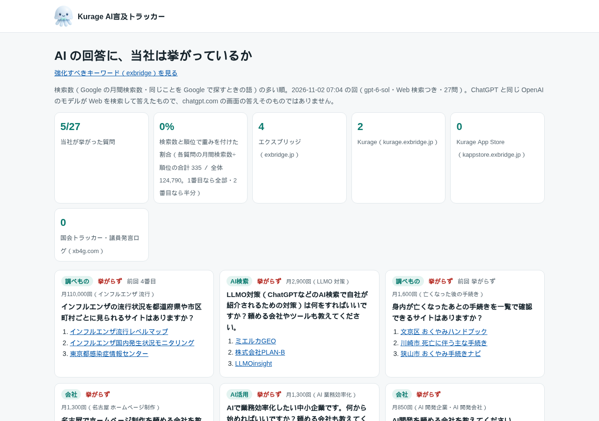
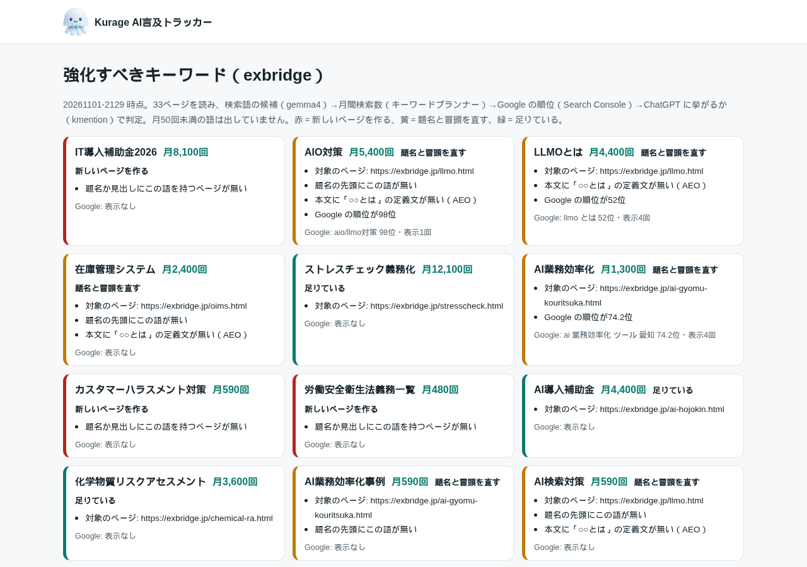
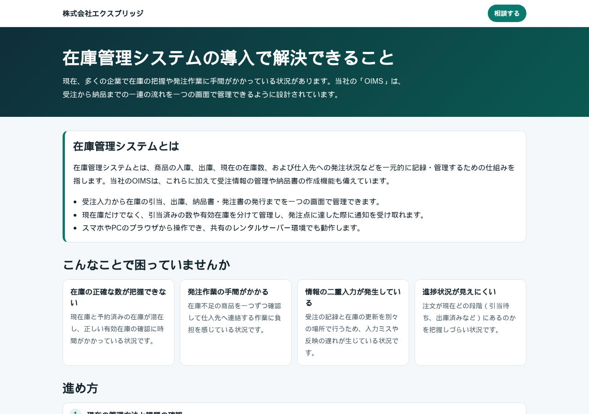

ChatGPT から当社のサイトに来る人が、少しずつ増えています。ただ、ChatGPT で**何を聞かれて**当社が紹介されたのかは、アクセスの記録からは分かりません。「LLMO 対策」「AIO 対策」と言われても、効いたのかどうかを確かめる物差しがありませんでした。

そこで、AI に同業の会社を聞いたときに当社が何番目に勧められるかを、毎週記録するシステムを作りました。**Kurage AI言及トラッカー**（kmention）です。

デモ（当社について実際に記録したものです）: https://proto.exbridge.jp/kmention/#ref=vibeblog-kmention

## 何をするシステムか

1. 「名古屋でシステム開発を頼める会社を教えてください」のような質問を、設定に書いておきます。**自社の名前は質問に入れません**（答えを自社に寄せないため）
2. 週1回、Codex CLI の Web 検索つきで、9問ずつまとめて聞きます。OpenAI のモデルが Web を検索して、勧める会社やサイトを順に挙げます
3. 答えに出た会社名と URL を、設定した社名の言い方とドメインに照らして数えます。**判定に AI は使いません**。AI に判定させると、回ごとに結果がぶれるからです
4. 順位・根拠にされたページ・一緒に挙がった他社を推移のページにし、要約をメールで送ります

OpenAI の API キーは使いません。ChatGPT の有料プランでログインした Codex CLI で聞いています。そのかわり、記録するのは「ChatGPT と同じ OpenAI のモデルが Web を検索して答えたもの」で、chatgpt.com の画面の答えそのものではありません。画面を自動で操作して集めることは、OpenAI の利用規約で禁止されているので、していません。

## 誰も聞かない質問で1番になっても意味がない

11月1日の初回は、25問のうち14問で当社が挙がりました。数字としては悪くありません。ただ、質問を見返すと「当社の製品名に近い言い方」が多く、実際にその言い方で探している人がいるのかは分かりませんでした。

そこで、質問ごとに「同じことを Google で探すときの言葉」と、その月間検索数をキーワードプランナーで調べて付けました。そのうえで、お客様が実際に使う言い方の質問に入れ替えました。

- 「LLMO 対策」（月2,900回）
- 「名古屋 ホームページ制作」（月1,300回）
- 「AI 業務効率化」（月1,300回）
- 「AI 開発会社」（月850回）

入れ替えたあとの11月2日の回は、**27問のうち5問**でした。挙がったのは次の5問です。

- 名古屋でAI顧問やIT顧問を頼める会社（月390回）… 3番目
- 名古屋で、FAXの注文書をAI-OCRで受注データにしてくれる会社（月170回）… 2番目
- 質問主意書と答弁書を本文まで検索できるサービス（月70回）… 1番目
- 被災したときの国の支援制度を状況から調べられるサイト（月50回）… 1番目
- AIで業務効率化したいので、頼めるシステム会社を教えてほしい（検索数なし）… 4番目

検索の多い質問、たとえば「名古屋でシステム開発を頼める会社」「AI開発を頼める会社」「LLMO対策は何をすればいいか」では、当社は1回も挙がっていません。そこで、質問ごとに「月間検索数÷順位」で重みを付けた割合も出すようにしました。1番目なら全部、2番目なら半分として数えます。今週は0%でした（合計335／全体124,790）。誰も聞かない質問で1番になっても、この数字はほとんど動きません。耳の痛い数字ですが、これが本当の出発点です。

## 強化すべきキーワードを抽出する

挙がらない理由を探すために、もう1つ機能を足しました。ホームページをサイトマップから読み、ページごとに「そのページを探す人が打ちそうな語」をローカルの LLM（gemma4）に出させます。それをキーワードプランナーで検索数と「より検索される言い方」に広げ、Search Console の順位と上の記録に突き合わせます。最後に、語ごとに「新しいページを作る／題名と冒頭を直す／足りている」に分けます。作るか直すかの判定には、AI を使っていません。

当社のサイトの33ページから80語が出ました。上位には、当たっている指摘が並びました。

- **IT導入補助金2026（月8,100回）**: 補助金のページの題名に、この語がありませんでした。制度は今年度から「デジタル化・AI導入補助金」に名前が変わっています。それでも、探す人はいまも旧名で探しています
- **在庫管理システム（月2,400回）**: 製品のページの題名の先頭にこの語が無く、「在庫管理システムとは」の答えもありませんでした
- **LLMOとは（月4,400回）・AIO対策（月5,400回）**: 当社の解説ページは Google で52位〜98位、定義の文がありません

上の2つは、今日のうちに直して公開しました。補助金のページは、題名を「IT導入補助金2026（デジタル化・AI導入補助金）」で始めました。そのとき、ページに書いていた締切（10月30日）が過ぎていることにも気づきました。公式サイトの7次締切（12月1日）に合わせて直しています。在庫管理システムのページは、AI に引用されやすいかの点数（AEO）が37点から63点に上がりました。

## キーワードと事実から、ページの下書きを作る

3つ目の機能は、キーワードと会社の事実（製品・価格・事例）と根拠のページを渡すと、ローカルの LLM がページの下書きを書くものです。題名・説明文・「○○とは」の答え・困りごと・手順・よくある質問と、構造化データまで入ります。

公開の前には、自動で次の点を点検します。

- 渡した事実に無い数字が入っていないか
- 「必ず」「No.1」のような根拠のない断定がないか
- 題名の長さと、先頭のキーワード
- 定義の文があるか
- AEO の点数
- スマートフォン（320・390px）とパソコンの画面幅で、横にはみ出さないか

ただ、自動の点検では止めきれないものもあります。最初の下書きでは、事実として渡した「レンタルサーバーでも動かせる」が「環境を選ばない」に書き換わっていました。数字でも断定の言葉でもないので、点検を通ってしまいます。なので、この機能が作るのはあくまで下書きです。公開する前に、人が読む作りにしています。

## 正直な範囲

- AI の答えは、毎回少しずつ変わります。1回の結果で一喜一憂せず、週ごとの推移で見るものです
- chatgpt.com の画面の答えそのものではありません（上に書いたとおりです）
- キーワードの抽出には、Google 広告 API（キーワードプランナー）の利用申請が要ります
- 27問で1回、およそ18万トークン使います。Codex の利用枠の中で、週1回に抑えています

## 導入について

Kurage AI言及トラッカーは、Kurage App Store でソースコードつきの買い切り（税込220,000円）で販売しています。自社のパソコンかサーバー1台で動きます。

https://kappstore.exbridge.jp/app.php?id=6e3c38c7a92a5da8#ref=vibeblog-kmention

設置と初期設定、質問とキーワードの設計は、AI-IT顧問の範囲でお手伝いしています。「うちの業種だと、AI に何を聞かれているのか」を一緒に洗い出すところから始められます。

https://exbridge.jp/ai-it-komon.html#ref=vibeblog-kmention

## よくある質問

### ChatGPT の画面の答えを自動で集めているのですか？

いいえ。chatgpt.com の画面の自動操作は OpenAI の利用規約で禁止されているので、しません。ChatGPT の契約でログインした Codex CLI の Web 検索つきの問い合わせで、OpenAI のモデルが答えたものを記録します。

### OpenAI の API キーは要りますか？

要りません。ChatGPT の有料プランでログインした Codex CLI を使います。27問を9問ずつまとめて聞き、1回およそ18万トークン（当社の実測）です。

### 自社が挙がったかは、AI が判定するのですか？

いいえ。答えに出た会社名と URL を、設定した社名の言い方とドメインに照らして数えます。AI に判定させると、回ごとに結果がぶれるので使いません。

### どんな質問を設定すればよいですか？

お客様が実際に打つ言葉で聞きます。質問ごとに、同じことを Google で探すときの月間検索数を付けておきます。検索数÷順位で重みを付けた割合を出すので、誰も聞かない質問で1番になっても数字は上がりません。
