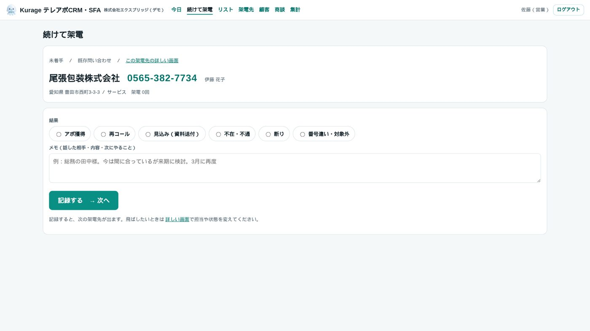
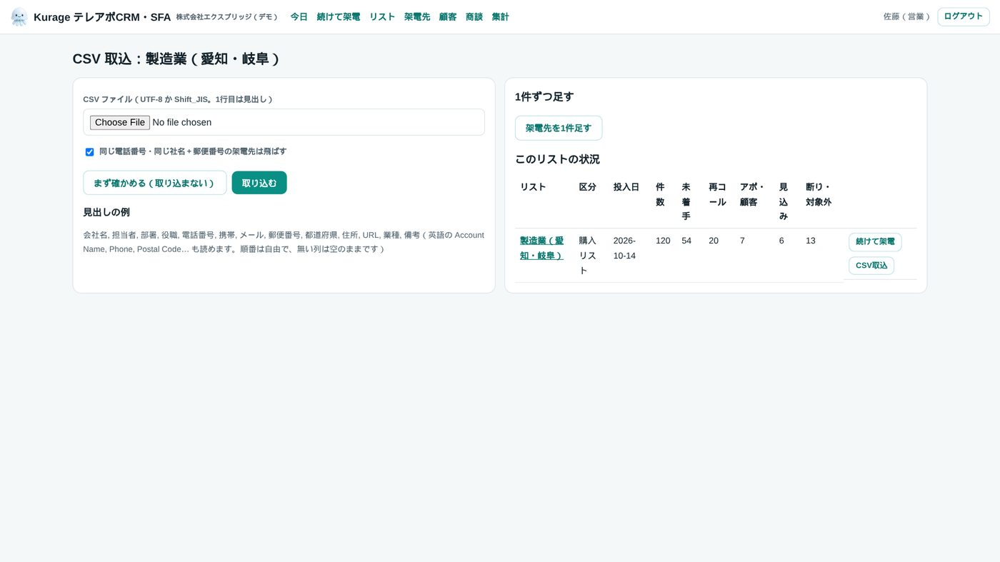
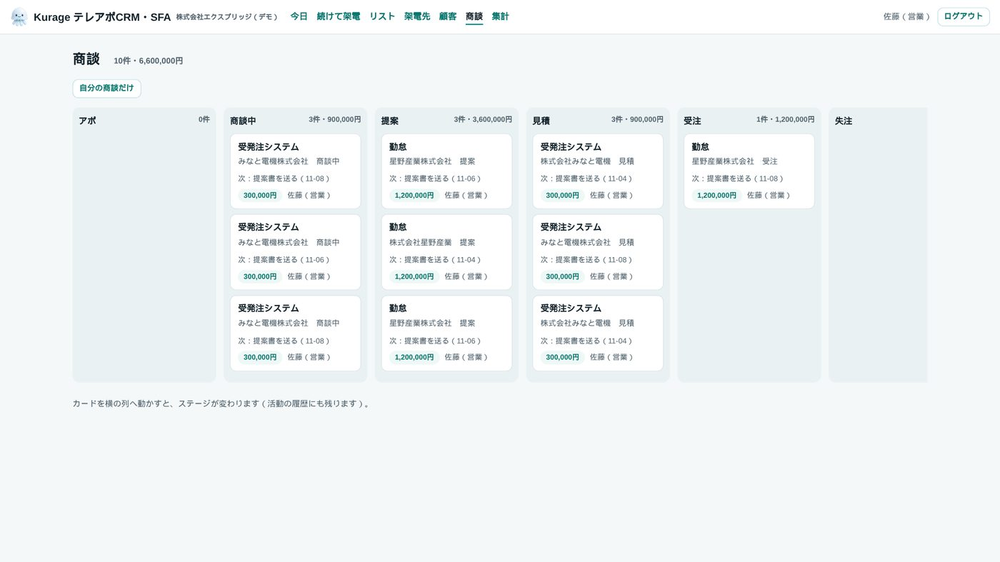

名古屋でAIシステムの開発をしている小嶋です。

テレアポ営業の「誰に・いつ・何を話して・次はいつかけるか」を、エクセルと付箋で追っている会社は、まだ多いと思います。リストが1万件を超えるとエクセルは開くだけで待たされ、担当が変わると前回の会話が分からなくなり、同じ会社に2人が別々にかけてしまう。クラウドのCRMを入れると担当者1人あたり月額がかかり、人が増えるほど固定費が重くなります。

そこで、テレアポ営業に絞ったCRM・SFAを、買い切りで作りました。[Kurage テレアポCRM・SFA](https://kappstore.exbridge.jp/app.php?id=0931d2dfecffc022#ref=vibeblog-kcallcrm) です。PHP 8 と SQLite だけで動き、レンタルサーバーにフォルダごと置けば動きます。税込220,000円で、月額も保守契約もありません。

## 流れは4つだけ

1. **架電リストを CSV で取り込む。** UTF-8 でも Shift_JIS でも、1行目の見出しから「会社名」「電話番号」「郵便番号」などの列を探します。順番は自由で、無い列は空のままです。
2. **「続けて架電」を押す。** 期限の来た再コール、次に未着手の順で、架電先が1件ずつ出ます。結果（アポ獲得・再コール・見込み・不在・断り・対象外）とメモ、次回コールの日時を残すと、次の1件に進みます。
3. **アポが取れたら、自動で顧客になります。** 活動の記録と商談（かんばん）で、その後を追います。
4. **集計**で、担当ごと・日ごと・リストごとの架電数、通話数、アポ数、アポ率を見ます。

架電の結果の選択肢は、設定で名前と扱いを変えられます。「扱い」は再コール・アポ・見込み・不通・断り・対象外の6つで、これが架電先の状態を決めます。

## 重複をどう見つけるか

購入したリストと展示会の名刺を別々に取り込むと、同じ会社が2回入ります。取り込むときに次の2つを「同じ」とみなして飛ばし、一覧に出します。

- **同じ電話番号。** 数字だけにして比べます。携帯番号（070・080・090）は、同じ人が複数の会社で使うことがあるので、重複の判定には使いません。
- **同じ社名＋郵便番号。** 社名は「株式会社」「（株）」を外し、全角と半角、カタカナとひらがな（「ミナト工業」と「みなと工業」）をそろえます。住所は「三丁目４番５号」と「3-4-5」をそろえます。

「まず確かめる」を押すと、追加・重複・空の件数と、重複とみなした相手の一覧が出ます。確かめてから取り込めます。1件ずつ足すときも同じ判定が働きます。

## 1リスト9万件でも軽い

架電リストは1リスト9万件、全体で数十万件になることがあります。一覧の絞り込み・並べ替え・ページ送りをすべてサーバー側で行い、画面に全件を持ちません。元になった仕組み（アイテックス様向けに作った CRM・SFA の土台）の実測では、架電先40万件で一覧を開くのに0.7秒、絞り込みが0.6秒でした。レンタルサーバーで十分に動く速さです。

## できないこと

- **電話はかけません。** 電話機・CTI・自動発信（オートコール）はついていません。スマートフォンなら、画面の電話番号を押してそのまま発信できます。
- **メールの配信はしません。** 資料送付の約束をメモに残すところまでです。
- **回線・割賦・粗利のような業種ごとの管理は入っていません。** 架電→顧客→商談に絞ってあります。業種ごとの項目は、御社に合わせて作ります。
- **AI はついていません。** AI から使う口（MCP）はありますが、AI そのものはお使いの Claude Code などを設定します。

## オープンソースの CRM に「寄せた」理由

テレアポ営業向けの機能を持つオープンソースの CRM は、調べた範囲ではありませんでした。EspoCRM・Krayin・Twenty のどれも Lead／Account／Call の一般的な表は持っていますが、「架電リスト→架電→結果→次回コール」の型はなく、MySQL か PostgreSQL が要るので、レンタルサーバーに置くという当社の売りとも合いません。

そこで土台にはせず、**項目の名前と CSV の形だけを寄せました。** 書き出す CSV の列名を EspoCRM／Krayin の Lead・Account・Call に合わせてあるので、担当者が増えて本格的な CRM に移るときは、そのまま取り込めます。小さく始めて、大きくなったら移れます。

## 守っていること

- 権限はサーバーで決めます。管理者だけの操作（設定・担当者・リストの削除・CSV 書き出し）は、画面でボタンを隠すだけにしていません。
- 消すのは論理削除で、消した・変えた・取り込んだ・書き出したは操作の記録に残ります。
- 毎日その日の最初の操作でバックアップを取り、30日ぶん残します。cron は要りません。
- ログインは5回失敗すると15分止まります。
- 自己テスト36件と、ブラウザでの通しの試験（320px・390px で横にはみ出さないことを含む）を通してから出しています。

## 動く見本と導入版

会社も人も架空のデータで、実際に触れるデモを置いています。「佐藤（営業）として試す」を押して、「続けて架電」から試してみてください。データは1日で元に戻ります。

- デモ：[Kurage テレアポCRM・SFA（デモ）](https://proto.exbridge.jp/kcallcrm/#ref=vibeblog-kcallcrm)
- 導入版（税込220,000円・買い切り）：[Kurage App Store の商品ページ](https://kappstore.exbridge.jp/app.php?id=0931d2dfecffc022#ref=vibeblog-kcallcrm)
- ソースコード（MIT）：[GitHub](https://github.com/katsushi2441/kcallcrm)

納品物は、ソースコード一式、置き方・CSV・API・MCP を書いた README、自己テスト、開発の決まり（AGENTS.md）です。お客様の AI エージェントが AGENTS.md を読んで、御社向けのカスタマイズを続けられます。

御社のリストの形や、架電の結果の分け方に合わせて整えてから納品することもできます。「このリストで動くか」「この業種の項目を足せるか」を一緒に確かめて進めるなら、[AI-IT顧問](https://exbridge.jp/ai-it-komon.html#ref=vibeblog-kcallcrm)（愛知県内・月15時間・税別150,000円）で引き受けます。
