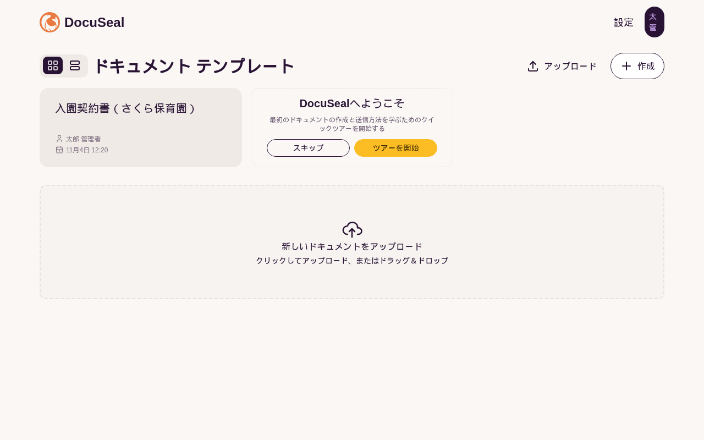
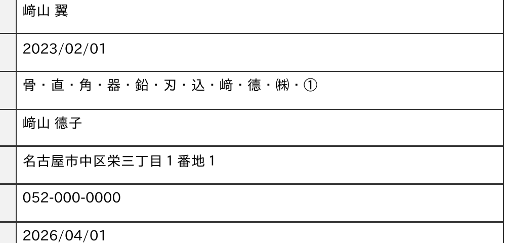
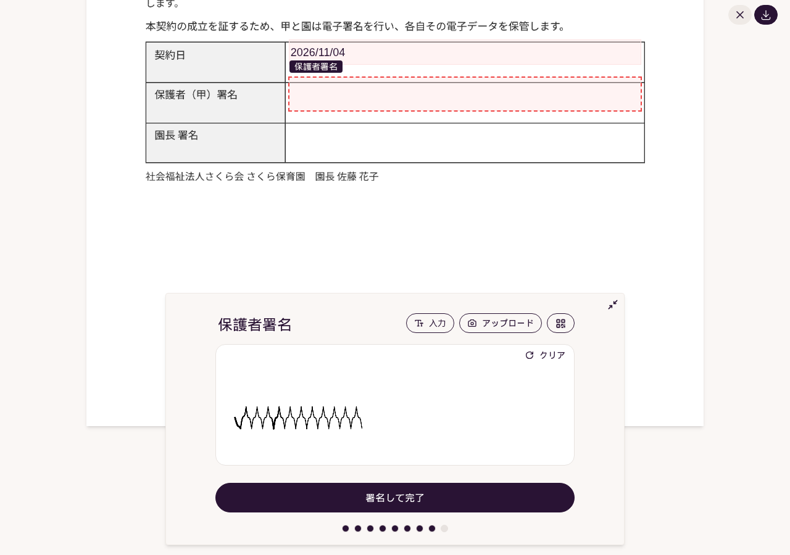

名古屋でAIシステムの開発をしている小嶋です。

当社のサイトには「電子契約システム 保育園」「電子契約システム 派遣」という検索で来る人が、この秋から毎週います。契約書を郵送して、押印を待って、返送された原本を棚に入れる。入園の時期や入社日の前に、その往復で1週間が消える。そういう現場が探している言葉です。ところが当社には電子契約の売り物がありませんでした。そこで電子契約のオープンソースを実機で立てて、何が日本語で動き、何が動かないかを確かめ、足りないところを塞いだ状態を導入キットにしました。

## 結論：署名画面は日本語、管理画面は英語、PDFは「﨑」が消える

対象は DocuSeal です。AGPL-3.0 のオープンソースで、GitHub のスターは約19,000、Ruby on Rails 製。PDF をアップロードして記入欄と署名欄をドラッグで置き、相手にメールで送ると、相手はスマホから入力して手書きで署名できます。完成した PDF には電子署名（PKCS#7・SHA-256）と監査ログが付きます。2026年11月4日に v3.3.5 を Docker で立てて、入園契約書（自作の1枚）で保護者が入力・手書き署名、園長が署名、という2者の流れを通しました。

| 確かめたこと | 結果 |
|---|---|
| 起動 | docker compose up から初回画面まで 10秒。再起動は 5秒 |
| 管理者の作成とログイン | 入力込みで約3分 |
| 相手が見る署名画面 | 最初から日本語（JS の117語が全部訳されている） |
| 管理画面 | 本体の日本語訳は 1,109項目中 108項目（10%）。「言語」の選択肢に日本語が無い |
| 完成PDFの日本語 | 氏名・住所は化けない。ただし「﨑」（たつさき）と「𠮷」（つちよし）が空白になる |
| 待機時のメモリ | 本体 184MB＋PostgreSQL 48MB |

署名画面が日本語なのは、相手に見せる画面としては合格です。問題は自分たちが毎日触る管理画面と、完成PDFの字でした。

## 管理画面の日本語化：本体に無い1,001項目を差し込む

DocuSeal の文言は3か所に分かれています。相手が見る署名画面の JS（117語・日本語あり）、Rails 側の管理画面・メール・監査ログ（1,109項目・日本語108項目）、テンプレート編集画面の JS（289語・日本語なし）。

Rails 側は、翻訳ファイルを1枚と「言語」に日本語を足す初期化ファイルを1枚、コンテナにマウントして再起動すれば入ります。本体の再ビルドは要りません。本体に無い1,001項目は、ローカルの gemma4 で下訳してから主要な語を手で直し、`%{name}` のような差し込み変数と HTML タグが原文と一致していることを機械で確かめました。

差し込み前後の日本語の割合を画面ごとに実測すると、ダッシュボードが 1%→81〜89%、送信一覧が 1%→93〜94%、通知 79%、カスタマイズ 82%、電子署名の設定 64〜66%、ユーザー管理 59〜60%。監査ログも「監査ログ／エンベロープID／生成日時: 2026年11月4日 12:30 JST」と日本語になります。残るのはテンプレート編集画面の289語（JS に埋め込まれていて差し込みでは変えられない）と、設定画面のタイムゾーン一覧やコード例です。ここは正直に「未訳」として対応表を付けました。

## 日本語PDF：氏名・住所は出る。「﨑」と「𠮷」が黙って空白になる

電子契約のオープンソースで一番怖いのは、完成PDFの日本語が □ になることです。DocuSeal は GoNotoKurrent という37,478字形のフォントを同梱していて、「山田 太郎」「名古屋市中区栄三丁目１番地１ 栄ビル５階」は化けずに出ました。テキスト層も正常で、pdftotext で文字が取れます。監査ログにも日本語の値と署名画像が載ります。

ところが、人名でよく使う「﨑」（U+FA11）と「𠮷」（U+20BB7）は、同梱フォントに字形が無く、エラーも出ずに空白になります。「髙」「德」「瀨」「㈱」「①」は出ます。契約書で保護者や取引先の氏名が空白になるのは、気づかないまま成立してしまうので、□ になるより始末が悪い。

直し方は、フォントのパスがコンテナ内に決め打ちされているので、IPAexゴシックを bind mount で上書きすることでした。差し替え後は pdffonts の埋め込みフォントが IPAexGothic になり、「﨑」が出ることを実測しています（「𠮷」は IPAex にも無いので、別のフォントが要ります）。差し替えのときに zip から展開したフォントの権限が 700 のままだと、コンテナ内で Permission denied になって PDF 生成のジョブが落ち、API が 500 を返します。chmod 644 で直ります。これも手順書に書きました。

## 保育園・人材紹介派遣・小売の契約書の組み方

電子契約は「誰が、どの順で、何を入れるか」を先に決めるとテンプレートが素直に組めます。キットでは3つの業種について、フィールドの種類・署名者の順番・送付の仕方をチェックリストにしました。

1. 保育園・幼稚園：入園契約書と重要事項説明書の同意。保護者→園長の順で署名。延長保育や一時保育の同意は別テンプレートにして、入園時期の件数集中に備える
2. 人材紹介・派遣：求職者と企業の2者署名、3者合意、労働条件通知の電子交付の希望欄。どちらかの署名待ちで全体が止まる業務なので、署名順と催促の仕組みを先に決める
3. 小売・卸：取引基本契約。乙（仕入先）→甲の順。法令に触れる箇所は e-Gov 法令検索と省庁ページの事実だけを引き、法律の助言は書いていません

## 踏んだ穴（6つ）

1. 差し込みの翻訳 YAML が空だと I18n::InvalidLocaleData で起動ループに入る
2. 差し替えフォントの権限が 700 だと PDF 生成が落ちて API が 500
3. Webhook は URL だけ登録しても、イベントにチェックを入れないと1件も飛ばない
4. API で「完了」を送ると、必須の署名欄が空でも完了扱いになる（基幹とつなぐときは必ず署名欄の有無を確認してから送る）
5. 画面からのテンプレート登録は CSRF トークンが要る。PDF からのテンプレート作成 API は有料版の機能だが、画面でアップロードしたあと PUT /api/templates/:id でフィールドを配置するのはオープンソース版で可
6. LibreOffice の PDF 変換が白紙を吐く。契約書の見本は headless Chrome の印刷で作った

バックアップは pg_dump とデータボリュームと .env を30日分残すスクリプトを付け、別の compose プロジェクトで復元して、同じ SECRET_KEY_BASE なら API トークンが有効で完成PDF（290KB）が落とせることまで確かめました。

## 導入キットとして出しました

ここまでの手順書（00〜06）、1,001項目の訳と「言語」の差し込み、IPAexゴシックの設定入り compose、業種別の型4点と試せる入園契約書、バックアップのスクリプト、API と Webhook の実測ペイロードを1つにして、Kurage App Store に出しました。

[電子契約を自社サーバーで — DocuSeal 日本語導入キット（保育園・派遣・小売の契約書の型つき）](https://kappstore.exbridge.jp/app.php?id=f543c9cbd613871b#ref=vibeblog-docuseal-kit)

オープンソース版でできることと有料版（Pro）の境界も手順書に書きました。自動リマインド・CSV の一括送信・SSO・PDF からの API テンプレート作成・埋め込みフォームは Pro です。署名順の指定・API・Webhook・監査ログ・電子署名はオープンソース版でできます。

保育園・派遣・小売の電子契約のページには、このキットを「土台にできる当社の製品」として載せています。自社の契約書でどう組むかを決めるところから手伝ってほしい場合は、[業務システムの相談](https://exbridge.jp/contact.php?topic=system&kw=%E9%9B%BB%E5%AD%90%E5%A5%91%E7%B4%84&ref=vibeblog-docuseal-kit#form)からどうぞ。
