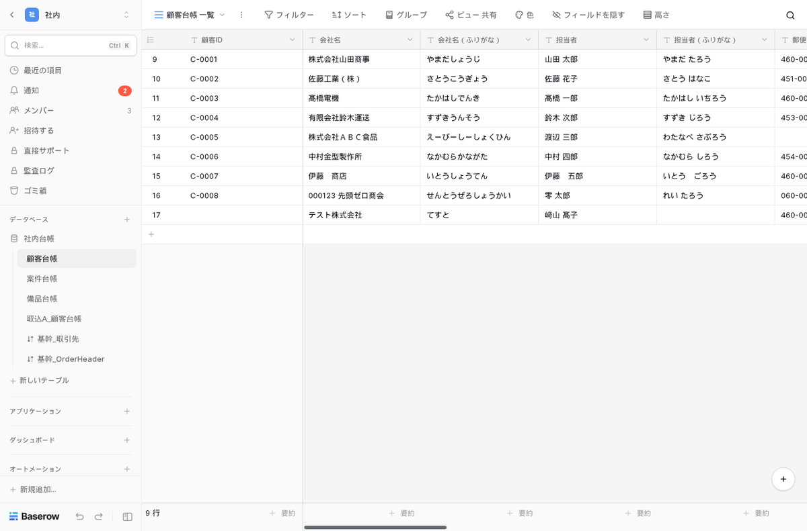
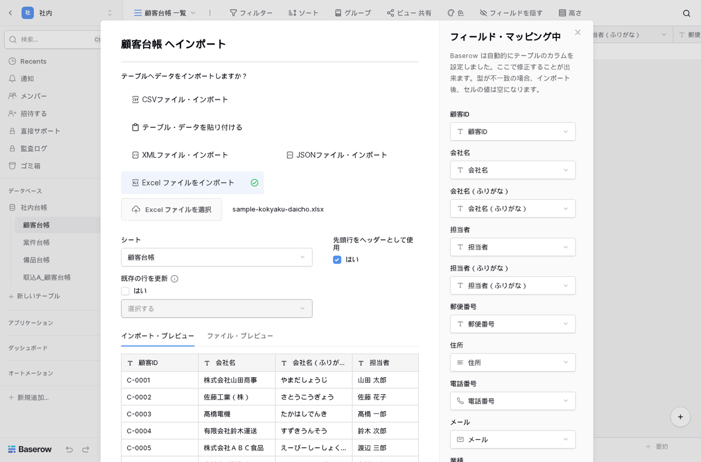
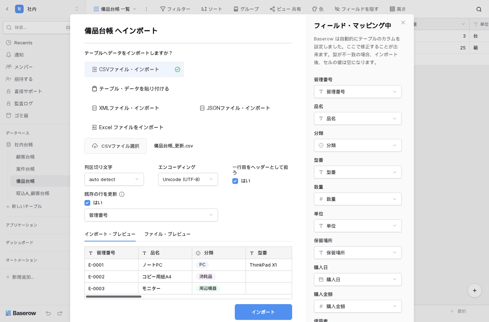

名古屋でAIシステムの開発をしている小嶋です。

当社のサイトには「baserow 日本語」という検索で来る人がいます。この3か月で15回、検索結果に当社のページが出ていました。Excel で回している台帳を社内の Web データベースに移したい、その候補に Baserow を見つけた、でも日本語で使えるのかが分からない。検索の言葉からはそういう状況が読み取れます。実際に立ててみると、その心配は当たっていました。画面の言語に日本語がありません。そこで、日本語にするところから、Excel の台帳を入れて毎日回すところまでを実機で確かめ、足りない部分を塞いで導入キットにしました。

## 結論：そのままでは英語。差し込めば98.4%が日本語になり、言語はアカウントに付く

対象は Baserow 2.4.1 です。表を作ってグリッド・フォーム・ギャラリーで使えるデータベースで、中核の部分は MIT ライセンスです。2026年11月5日に、公式の all-in-one イメージと外の PostgreSQL 16 の構成で立てて、顧客・案件・備品の台帳を作り、日本の会社の Excel でよくある値を入れたファイルを取り込みました。

| 確かめたこと | 結果 |
|---|---|
| 起動 | 初回は使える状態まで 129〜137秒（データベースの初期設定）。再起動は 25〜32秒 |
| 管理者の作成・ログイン | 作成 0.4秒、ログインからワークスペース一覧まで 0.3〜0.4秒 |
| 本体の画面の日本語 | 無い。言語の一覧は9つで、日本語を選べない |
| キットの差し込み後 | 画面の文言 5,146項目中 5,064項目（98.4%）が日本語 |
| 型を決めた台帳へ Excel を入れる | 8行すべて入るが、全角数字・令和の日付・全角の電話番号の値だけが空になる |
| 整えてから CSV で入れる | 8行すべてが正しい型で入った |
| バックアップと復元 | バックアップ 0.7〜9秒、別の場所への復元 46秒 |
| 待機時のメモリ | 本体 1.9〜2.3GB（省メモリの設定で 1.16GB）、PostgreSQL 54〜200MB |

初回の起動に2分以上かかり、その間に画面を開くと 502 が出ます。壊れているわけではないので、待ってから開いてください。メモリは 2GB のサーバーでは足りず、4GB 以上を見ておく必要があります。

## 日本語の実態：訳はあるのに、画面に入っていない

ログイン画面の言語の一覧は、English・Français・Nederlands・Deutsch・Español・Italiano・Polski・한국어・Українська の9つでした。ブラウザを日本語にしても英語で出ます。サーバー側も日本語を受け付けず、アカウントの言語に `ja` を保存しようとすると「en,fr,nl,de,es,it,pl,ko,uk のどれかにしてください」という応答で断られました。

調べてみると、本家のリポジトリには有志の日本語訳が置かれていました。画面に組み込む言語の一覧に日本語が入っていないために、ビルドされた画面に日本語の文言が1つも入っていない、という状態です。この訳を画面の文言と突き合わせると 85.6% がそろっていましたが、オートメーションとダッシュボードは訳のファイル自体がなく、ワークスペースを旧名の「グループ」と訳したものが41件残っていました。そのうち多くは差し込み変数まで旧名のままで、そのまま使うとワークスペースの名前が正しく入りません。

キットの差し込みは、本家の訳のうち差し込み変数が英語と一致するものだけを使い、足りない分と誤りのある分を当社の訳707項目で埋めます。下訳はローカルの gemma4 で行い、差し込み変数と HTML タグが原文と一致することを機械で確かめてから、画面に出る主な語を手で直しました。差し込むと 5,064項目、98.4% が日本語になります。英語で残るのは、OpenAI や Slack などの製品名、URL や JSON のような技術用語、入力例の82項目です。

運用の面で助かるのは、差し込んだ後の言語が社員のアカウントに保存されることです。英語設定のブラウザで開くとログイン画面は英語でしたが、日本語のアカウントでログインすると日本語に切り替わりました。ブラウザが日本語設定なら、ログイン前の画面も最初から日本語です。社員がどのパソコンから入っても同じ画面になるので、配るときの説明が短くて済みます。

英語が残る画面もあります。管理者設定の稼働状況は点検項目の名前がサーバーから英語で来るので 51%、API の説明ページはコード例が多いので 59% でした。公開フォームの一番下の「Powered by Baserow」も、外の人のブラウザが英語なら英語で出ます。招待メールは件名が英語で、本文も英語が混じります。

## Excel 台帳を入れるときの落とし穴：値だけが黙って空になる

試したのは、Excel の日付、令和の日付、全角の数字とカンマ、全角のハイフンの電話番号、〒付きの郵便番号、先頭が 0 の郵便番号、セル内の改行、﨑・髙を入れた8行の顧客台帳です。

Baserow は Excel をそのまま読めて、日本語のシート名も選べます。型を決めた台帳へ取り込むと、8行すべてが入りました。ところが中を見ると、全角数字の金額、令和の日付、全角の電話番号のセルだけが空になっていました。行は全部入っているので、件数を数えても気づけません。取り込みの画面には「型が不一致の場合、インポート後、セルの値は空になります」と小さく書かれていますが、どの行のどの値が空になったかは出ません。

キットには、Excel をシートごとに整えて CSV にするスクリプトを入れています。和暦やシリアル値の日付を `2023-01-10` の形にそろえ、全角数字・カンマ・円記号を外し、ハイフンの種類をそろえ、7桁の郵便番号に `-` を入れます。直せなかった値は、Excel の行番号つきで「要確認」のファイルに出します。これを通すと顧客台帳の8行すべてが、令和の日付も全角の金額も、060-0001 の先頭の 0 も、4600002 → 460-0002 も含めて正しく入りました。

もう一つ運用で効くのが、取り込みの「既存の行を更新」です。管理番号の列を選んでおくと、同じ番号の行は上書きされ、新しい番号だけが足されます。これは有料版のライセンスが無くても使えました。部署から月に一度 Excel で届く一覧を入れ直すような運用でも、二重に入る心配をしなくて済みます。

Baserow には通貨やパーセントの型がありません。金額や確度は数値型にして、末尾に円や % を付け、3桁区切りを選ぶ形で作りました。キットの台帳作成スクリプトはこの形で、3テーブル・40フィールド・9ビュー（各台帳に一覧のグリッド・フォーム・ギャラリー）を 4.9秒で作ります。

## 有料版のライセンスを入れずに運用を決める

Baserow の画面には、ライセンスが無いと使えない機能に鍵の印が付いています。台帳の運用に関わるものを画面と API の両方で確かめました。カンバン・カレンダー・タイムラインのビュー、行の色分け、閲覧者や編集者といった役割、フィールド単位の権限、Excel や JSON での書き出しは有料版の機能でした。グリッド・フォーム・ギャラリー、公開フォーム、パスワード付きの共有ビュー、CSV の書き出し、Excel と CSV の取り込み、API と Webhook は、ライセンス無しで使えます。

気をつけたいのは役割です。API では「閲覧者」として招待できてしまうのに、その人は行の追加もフィールドの作成もできました。画面の表示も「メンバー」でした。そこでキットでは、台帳を直す人だけをワークスペースに入れ、見るだけの人にはパスワード付きの共有ビューを渡す、という決め方にしています。共有ビューからの書き出しは有料版の機能なので、渡した一覧から相手がファイルを持ち出すボタンは既定で出ません。

もう一つ、有料版のコードを本番で読み込むこと自体を避けたい場合の設定もあります。`.env` に `BASEROW_OSS_ONLY=1` を入れて最初から立てると、初回の起動は 78秒、待機時の本体は 973MB で動きました。ただし、一度ふつうに立てた構成に後から入れると、データベースの外部キー違反で起動を繰り返し、画面が開かなくなりました。これは最初に立てるときに決めることです。

## 踏んだ穴（7つ）

1. 日本語を差し込んだら画面が真っ白になった。Web サーバーの配信表が元のファイルの大きさを覚えていて、差し込んだファイルを途中で切って返していた（組み立ての仕組みで配信表も直すようにした）
2. 起動のたびに本家のテンプレート集158個を取り込み、データベースが 24MB から 276MB に増えた（キットの設定で止めてある）
3. `localhost` やサーバーの IP で開くと 404。本体は `BASEROW_PUBLIC_URL` と違うホスト名には応答しない
4. 単一選択の項目を選択肢の文字で絞り込むと、エラーにならず全件が返った（13件中13件）。消す・書き換える前に必ず件数を見る
5. 社内の宛先への Webhook は「Invalid URL」で断られる。許可の設定に `false` と書くと、文字が入っていれば有効になる作りなので許してしまう。許さないなら空にする
6. 削除の Webhook には消えた行の ID しか入らない。受け取る側で ID と中身の対応を持つ
7. メールの送信設定が無いと、招待やパスワード再設定のリンクがログにそのまま残る。ログを社外に渡さない

バックアップは DB・添付・設定の3点を30日分残すスクリプトで取り、別の構成へ46秒で戻しました。元の管理者でログインでき、台帳の行数、添付ファイル（1バイトも違わなかった）、Webhook、データベーストークン、公開フォームとパスワード付き共有ビューの URL がそのまま使えることを確かめています。

## 導入・運用キットとして出しました

ここまでの手順書（00〜06）、訳707項目と購入者のサーバーで日本語を組み立てる仕組み、台帳3つの設計と作成スクリプト、Excel を整えるスクリプトと試せる見本の Excel、公開フォーム・共有ビュー・役割の設計シート、バックアップと復元のスクリプト、実測で踏んだ穴41件の対処表を1つにして、Kurage App Store に出しました。

[Excel台帳のWebデータベース化 Baserow日本語導入・運用キット](https://kappstore.exbridge.jp/app.php?id=db3bf74ddbe29835#ref=vibeblog-baserow-kit)

Baserow のライセンスは二層の作りで、`premium/` と `enterprise/` の下は有料版のライセンス、それ以外は MIT です。キットの手順で使う機能はすべて MIT の部分の機能で、その線引きも手順書の最初に書きました。日本語の差し込みは 2.4.1 で確かめたもので、本体の版を上げたときは手順書のとおり組み立て直します。

いま使っている Excel の台帳をどう分けて、どの列を何の型にするかから一緒に決めたい場合は、[業務システムの相談](https://exbridge.jp/contact.php?topic=system&kw=Excel%E5%8F%B0%E5%B8%B3%E3%81%AEWeb%E5%8C%96&ref=vibeblog-baserow-kit#form)からどうぞ。
