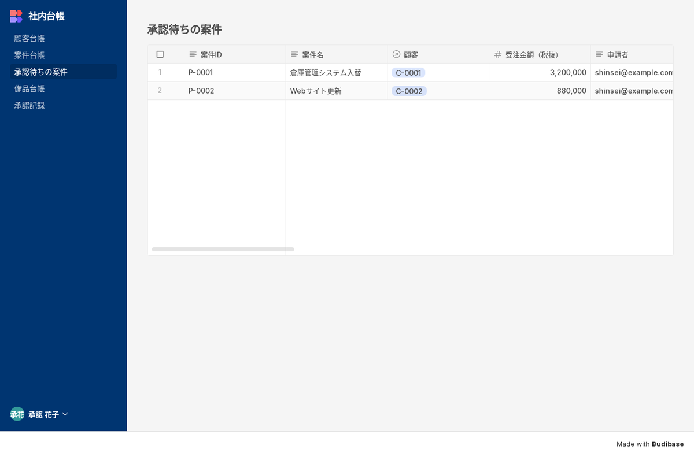
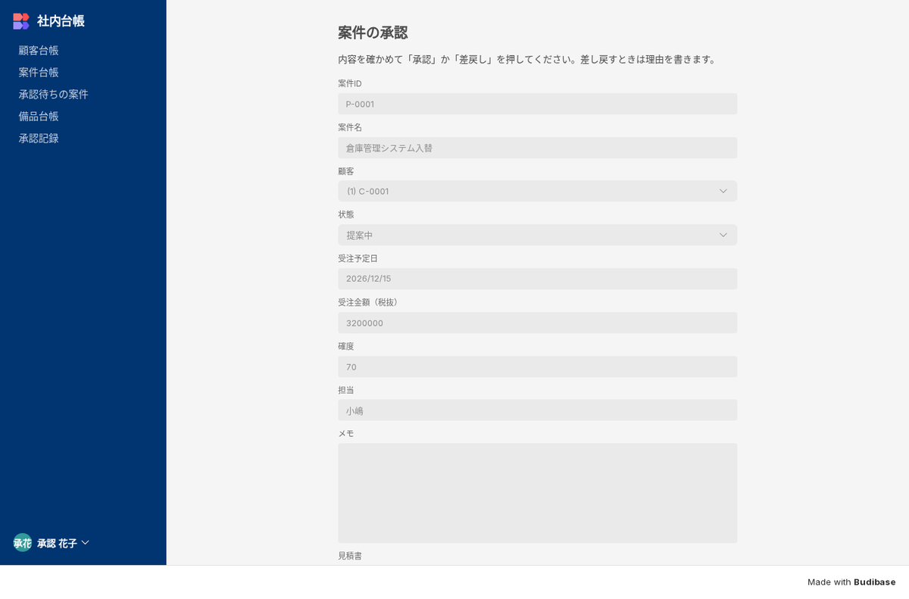
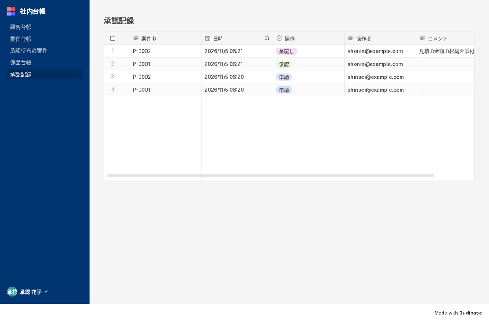

名古屋でAIシステムの開発をしている小嶋です。

当社のサイトには「budibase 日本語」「オープンソース ローコード」「ワークフロー oss」といった検索で来る人がいます。案件の社内承認や備品の貸出、各種の申請を、紙やメールや Excel の回覧で回していて、誰の承認で止まっているか分からない、差し戻しの理由がどこにも残らない。そういう困りごとを、自社のサーバーで動く仕組みで片付けたい人の言葉だと受け取っています。Budibase は表を作って、その上に社員が使う画面を組み立てられる道具なので、申請と承認の流れを実際に組んで、日本の会社で使える形になるかを確かめました。

## 結論：社員の画面は日本語で組める。承認・差戻しも画面とボタンの動きで作れた

対象は Budibase v3.50.0 の公式の単一コンテナ版です。表をみんなで直接さわる道具というより、表の上に「一覧 → 詳細 → 入力フォーム → 承認」の画面を作る道具です。2026年11月5日に立てて、顧客・案件・備品の台帳と承認記録の4つの表を作り、12画面のアプリを組んで、管理者・申請者・承認者の3つのアカウントでブラウザから操作しました。

| 確かめたこと | 結果 |
|---|---|
| 起動 | docker compose up から API が応答するまで初回 48秒、再起動 48〜50秒 |
| 台帳4つを作る | スクリプトで1秒前後 |
| 12画面・メニュー・役割・表の権限を作る | スクリプトで3〜5秒。公開（Publish）は 0.3〜0.5秒 |
| 申請 → 承認 → 差戻し → 再申請 | 実機で通った。承認記録に申請2・承認1・差戻し1の4行 |
| 作る人の画面の日本語 | 無い（言語の切り替えも言語ファイルも無い） |
| 社員が見る画面の日本語 | 作り手が書く文言は日本語にでき、12画面すべて日本語で表示。ログイン画面などは英語のまま |
| 行の追加 → Webhook が届くまで | 4.3秒 |
| バックアップと復元 | 別の名前・別のポートへ 48〜50秒で戻し、行数・画面12・利用者・自動化・接続が元と一致 |
| 待機時のメモリ | 3.2〜3.4GB |

メモリは思ったより使います。中に CouchDB、MinIO、Redis、AI 機能用の LiteLLM までが入っていて、LiteLLM だけで 0.89GB ありました。AI 機能を使わなくても止められないので、サーバーは 8GB 以上を用意してください。

## 承認の流れを実機で通した

画面は一覧・詳細・入力フォーム・承認の4種類の型で、顧客・案件・備品の台帳にそれぞれ付けて12画面です。案件の詳細には「承認を申請」のボタンがあり、承認者にだけ「承認待ちの案件」と「承認記録」のメニューが見えます。

申請者が案件 P-0001 で「承認を申請」を押すと、「承認を申請しました」と通知が出て、案件の行に承認状態＝申請中・申請者・申請日時が入り、承認記録に「申請」の1行が残りました。申請後はボタンが消えます。申請者が承認待ちの画面の URL を直接打ち込んでも、承認の画面は出ずに案件台帳の一覧に戻されました。

承認者が承認待ちから P-0001 を開くと、案件の項目はすべて灰色の読むだけの欄で、書けるのは差戻し理由だけです。「承認」を押すと、案件の承認状態が承認になり、承認者と承認日時が入り、承認記録に1行増えます。案件名や金額などほかの列はそのままでした。

差戻しは、理由が空のまま押すと何も起きないように作りました。ボタンの動きの最初に「理由が空なら止める」を置いています。理由に「見積の金額の根拠を添付してください。」と書いて押すと、案件と承認記録の両方に理由が残り、申請者の詳細の画面でその理由が読めて、「承認を申請」をもう一度押せるようになりました。

無料のプランでの承認の作りには限界もあり、手順書にそのまま書きました。承認状態を書き換えられるのは画面のボタンだけではなく、表の書く権限を持つ人は API などから直接書けます。行や列ごとの権限は有料のプランの機能です。申請者の詳細の画面では承認の列を読むだけにしてありますが、厳密な職務分離が要る業務では、この点を踏まえて設計してください。金額で承認者を変える、2段階で承認する、といった形は作れるはずですが、今回は試していません。

## 日本語の実態：作る人は英語、社員は日本語

作る画面（ビルダー）と設定には、言語の切り替えがありません。すべて英語です。一方で、社員が使うアプリの見出し・ボタン・項目名・メニュー・通知・入力の案内・必須のメッセージは、作り手が日本語で書けます。作る人のために、ビルダーで毎日見る英語の読み替え表を付けました。

社員の画面で英語が残ったのは、ログイン画面（Log in to Budibase など）、右下の利用者メニュー（My profile・Log out）、画面下の「Made with Budibase」、添付ファイルの欄の案内でした。これを変える Translations の機能は有料のプランで、無料のままでは保存できませんでした（`License does not allow translations`）。有料のプランに上げたとき用に、その95件の日本語もキットに入れています。

日本語にするには少し工夫が要る所もありました。表の側で必須にした列を空で保存すると「Required」と英語で出るので、表では必須にせず、画面の側で必須にして「案件名を入れてください」と書くと日本語になりました。保存したときの「Row saved」も、既定の通知を止めて「保存しました」を出すようにしています。キットのスクリプトで作る画面には、どちらも最初から入れてあります。

名前に日本語が使えない所もあります。ワークスペースの名前、独自の役割の ID（表示名の「承認者」は日本語にできる）、リンクの逆向きの列の名前、外部 DB の表の名前は英数字にしました。

## 台帳の取り込みで「3,000,000」が「3」になる

台帳には、全角数字・〒付きの郵便番号・令和の日付・改行の入った住所・先頭が 0 の郵便番号・髙や﨑を入れた8行の Excel を取り込みました。Excel の「CSV（コンマ区切り）」で保存したものは Shift_JIS なので、列の名前も値も全部化けました。列の名前が日本語だと、ビルダーの取り込み画面は全列が `Failure` になり、ボタンが押せません。

API で入れると、今度は金額の「3,000,000」が何のエラーも出ずに「3」として入りました。カンマの前までが数値として読まれます。全角の「３，０００，０００」や「令和5年6月1日」の行は `500` で入りません。キットの整形スクリプトと取り込みスクリプトを通すと、8行すべてが日付・金額・郵便番号の先頭の 0・改行・髙・﨑まで正しい型で入りました。

もう一つ戸惑ったのが、作る人が見るデータと社員が使うデータが別に保存される仕組みです。開発の側に8行を入れて公開しても、本番は0行のままでした。取り込みは本番に向けて行います。

## 踏んだ穴（7つ）

1. 公式の構成をそのまま起動すると、本体が18秒ごとに落ち続けた。中の MinIO を呼ぶ部品がリージョンの設定を必要としていた（compose に1行足して、2分で再起動0回に）
2. ログインの回数制限は同じ IP から15分に10回で、単一コンテナ版では全員が同じ IP として数えられる。朝のログインで回数を超えると、全員が15分ログインできなくなる。キットでは上限を300に上げてある。復元した直後にも同じ症状が出た（回数がバックアップに入っているため）
3. 内部の CouchDB のパスワードが既定の `admin` のまま残る。`.env` で必ず渡す
4. 招待メールのボタンが `localhost` の URL になる。設定画面で Platform URL を入れる
5. メモリを減らす `DISABLE_THREADING=1` を入れると 2.2GB まで下がるが、自動化の中の JavaScript が動かなくなった。使わない
6. 社内の宛先への Webhook は既定で遮断される。遮断の一覧を compose で書き換えて開けるが、ループバック（127.0.0.0/8）と 169.254.0.0/16 は遮断したまま残す
7. 入力の誤りも 500 で返るので、外形監視で API を見ると「止まった」と誤って判定される。監視は稼働状況の URL だけを見る

無料のプランの上限は、実際に当たって応答を確かめました。利用者は37人まで作って上限なし、作り手も無制限ですが、ワークスペースは1つだけです（1つの中にアプリは複数作れました）。利用者のグループ、組み込みの文言の翻訳、メールの文面の変更、ビルダーのアプリのバックアップは有料のプランの機能でした。アプリのバックアップが使えない分、キットではコンテナのデータを丸ごと取るスクリプトを付け、別の場所に戻して本番と開発の行数・画面・自動化・接続・利用者の数が元と一致することを確かめています。

## 構築キットとして出しました

ここまでの手順書（00〜06）、台帳4つの設計と作成スクリプト、12画面・メニュー・役割・表の権限を一度に作るスクリプト、Excel を整えるスクリプトと日本語の列名の台帳へ取り込むスクリプト、行が追加されたら Webhook とメールを送る自動化の作り方と届いた中身、外部の PostgreSQL・MySQL の接続手順、バックアップと復元のスクリプトを1つにして、Kurage App Store に出しました。

[申請・承認アプリ 自社サーバー構築キット（Budibase 日本語導入・運用）](https://kappstore.exbridge.jp/app.php?id=d5227ad09ccf969e#ref=vibeblog-budibase-kit)

Budibase 全体は GPL v3、出来上がったアプリに入る部品は MPL 2.0、有料機能のコードは Business Source License です。自社の業務アプリを自社のサーバーで動かす使い方は問題ありませんが、有料機能の制限を外す改変はできません。要点を手順書の最初に書いています。

自社の申請・承認の流れ（誰が申請して、誰がどの順で承認するか）を整理するところから手伝ってほしい場合は、[業務システムの相談](https://exbridge.jp/contact.php?topic=system&kw=%E7%94%B3%E8%AB%8B%E6%89%BF%E8%AA%8D&ref=vibeblog-budibase-kit#form)からどうぞ。
