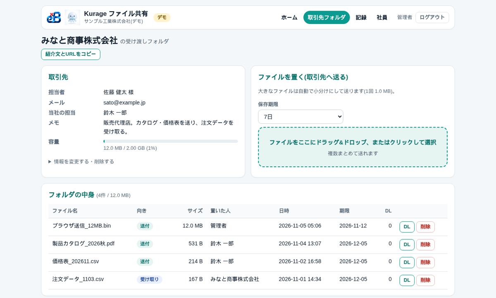
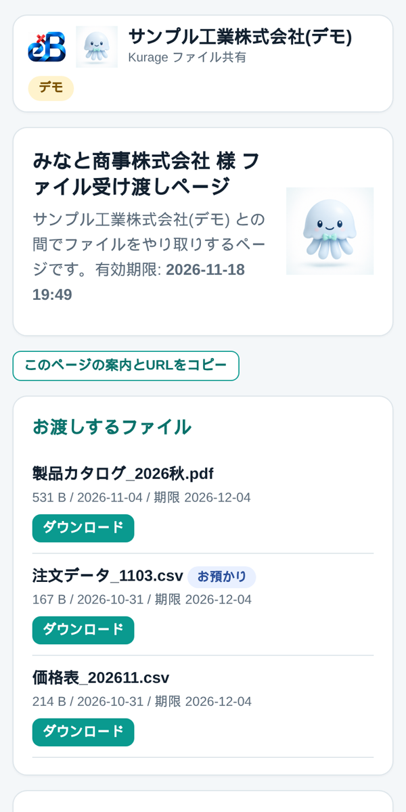

名古屋でAIシステムの開発をしている小嶋です。

当社のサイトには「ファイルサーバ オープンソース」「大容量ファイル 送信 自社サーバー」という検索で来る人がいます。図面やカタログ、動画の素材を取引先と受け渡しするのに、無料の転送サービスに上げるのは社内の決まりで止められている。メールに付けると容量で弾かれる。社内のファイルサーバーを外に開けるのは怖い。そういう会社が探している言葉です。そこで、取引先とのやり取りだけに絞ったファイル共有を作り、契約中のレンタルサーバーにそのまま置ける形にして、実際の回線で確かめました。

## 結論：取引先には「期限つきのリンク」だけを渡す

Kurage ファイル共有は、1ファイルの PHP と SQLite で動くファイル受け渡しのシステムです。取引先の会社名と担当者を登録すると専用のフォルダができ、取引先にはログイン不要の共有リンクだけを渡します。リンクごとに「送る（ダウンロードのみ）」「受け取る」「両方」を選べ、有効期限・ダウンロード回数・パスワードを付けられます。取引先は届いたリンクを開いて、ファイルを落とすか、「ここにファイルを置いてください」に置くだけです。

| 確かめたこと | 結果 |
|---|---|
| 大きなファイル（社内の検証環境） | 1,024MB を 1MB×1,024回に分けて 13.2秒（77.4MB/秒） |
| 本番のレンタルサーバー（当社のデモ環境） | 20MB を 4.9秒、100MB を 21.3秒。どちらも WAF に止められたあと自動で切り替えて完走 |
| WAF に止められたチャンク | ランダムに近い1MB で 80本中15本（19%）、64KB でも 150本中20本（13%） |
| 同じ中身を base64 にしたとき | 1MB 80本・64KB 150本すべて通過 |
| 自己テスト | 86件すべて合格（関門・無害化・チャンク結合・容量・リンク・掃除・通知・記録・画面） |
| HTTP での一連の操作 | 51件の検査を通過 |
| スマホ表示 | 320・360・390px の全画面で横はみ出し 0 |

## 取引先ごとのフォルダと、取引先が見る画面

管理画面では取引先ごとに担当者・メール・当社の担当・メモ・容量の上限を持ち、そのフォルダの中身に「送付」と「受け取り」の向き、置いた人、日時、保存期限、ダウンロード回数が並びます。ファイルの保存期限（既定30日）が来たら自動で消えるので、古い図面がいつまでも残ることがありません。

取引先が開くのは、自社名の入った受け渡しページだけです。「お渡しするファイル」と「ここにファイルを置いてください」が1画面にあり、スマホでも崩れません。誰がいつどのファイルを落としたか・置いたかは記録に残り、そのたびに管理者と担当の社員にメールで知らせます。取引先の担当者への案内メールは1クリックで送れます。

ファイルの実体はランダムな名前の `.bin` で保存するので、PHP のファイルを上げられても実行されません。データのフォルダは外から開けないようにしてあり、ログインとリンクのパスワードには回数の制限を付けています。

## レンタルサーバーの WAF が、ランダムなバイナリだけを止めた

大きなファイルは、ブラウザが小分け（チャンク）にして送ります。レンタルサーバーの1回のアップロードの上限が 2MB のままでも 1GB 級が通るのはこのためで、チャンクの大きさはサーバーの設定から自動で決めます。社内の検証環境ではこれで 1,024MB が 13.2秒でした。

ところが、デモを置いている本番のレンタルサーバー（heteml）で送ると、途中のチャンクが「403 閲覧できません」で止まりました。レンタルサーバーに入っている WAF（不正な通信を止める仕組み）です。2026年11月5日に条件を変えて送り比べると、止まるのは圧縮ファイルや暗号化ファイル、画像や動画の中身のようなランダムに近いバイナリだけで、テキストやゼロ埋め、PDF の見本は止まりませんでした。ランダムな1MB のチャンクで 80本中15本、64KB に小さくしても 150本中20本が止まります。しかも同じ中身は時間を空けて何度送っても止まるので、連投や回数ではなく中身で判定されていることになります。

試しに同じ中身を base64（文字だけの表現）にして送ると、1MB の80本も 64KB の150本もすべて通りました。そこで本体は、チャンクが WAF の 403（システムからの応答ではない画面）で返ってきたら、そのファイルの残りのチャンクを base64 で送り直すようにしました。送る量は約1.34倍に増えますが、取引先は何もしなくて済みます。通信エラーやサーバーのエラーは 1・2・4・8・16秒待って最大5回やり直し、base64 にしてもサーバーの上限に収まるよう、チャンクの大きさも自動で決め直します。本番のレンタルサーバーで 100MB を送った実測では、途中で1回切り替わり、21.3秒で完走しました。

WAF をこのフォルダだけ外せば速くはなりますが、ほかの守りも弱くなります。外すかどうかはお客様の判断として、外さなくても送れる作りを既定にしました。

## 踏んだ穴（6つ）

1. レンタルサーバーの WAF がランダムに近いバイナリのチャンクを止める。同じ中身は何度送っても止まる
2. WAF の 403 はシステムの JSON ではなくサーバーの画面で返ってくる。応答の形で WAF かどうかを見分ける
3. base64 にすると約1.34倍に膨らむので、チャンクの大きさを決め直さないとサーバーの上限を超える
4. 期限切れの掃除をアクセスの時だけにすると、誰も来ない時間帯に古いファイルが残る。アクセス時に10分ごと＋cron で消す
5. PHP がファイルを書くので、レンタルサーバーの PHP の動かし方によってはデータのフォルダに書けなくなる。設置の手順で動かし方を指定している
6. 配信を PHP 経由にしないと直リンクで落とせてしまう。ストリームで返し、途中からの再開（Range）にも対応した

## 出品しました

デモは [Kurage ファイル共有 デモ](https://proto.exbridge.jp/kfileshare/) で、管理画面と取引先の受け渡しページの両方を触れます。

本体に加えて、SMTP の設定、容量と期限の決め方、取引先への案内文、カスタマイズ用の AI プロンプトを入れた構築・運用の手順書を付けて、Kurage App Store に出しました。

[取引先とのファイル受け渡しを自社サーバーで — Kurage ファイル共有（期限つきリンク・大容量・取引先ごとのフォルダ）](https://kappstore.exbridge.jp/app.php?id=4003999985c45854#ref=vibeblog-kfileshare)

自社のサーバーに合わせた設置や、社内のファイルサーバーとどう分けるかの相談は、[業務システムの相談](https://exbridge.jp/contact.php?topic=system&kw=%E3%83%95%E3%82%A1%E3%82%A4%E3%83%AB%E5%85%B1%E6%9C%89&ref=vibeblog-kfileshare#form)からどうぞ。
