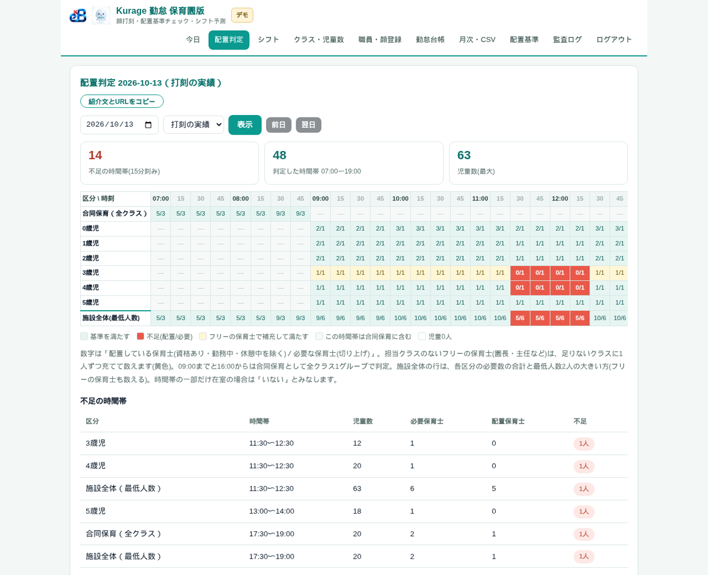
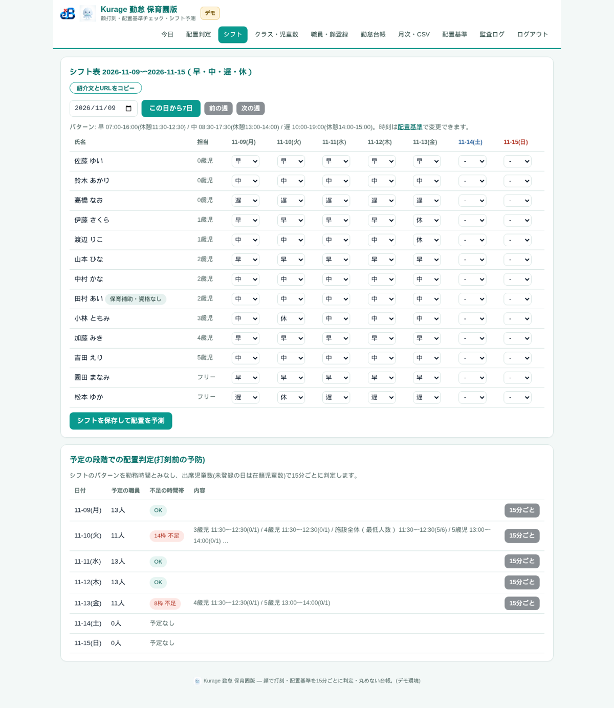

名古屋でAIシステムの開発をしている小嶋です。

当社のサイトには「保育園 勤怠管理」「保育士 配置基準 計算」という検索で来る人がいます。保育園の勤怠は、ただ出勤と退勤を記録すれば済むものではありません。お昼の休憩が重なる時間や、夕方の延長保育の時間に、そのクラスに保育士が何人いるかを毎日気にしている。ところが勤怠のシステムと配置の計算は別々で、計算は紙や Excel で後からやっている。そういう園が探している言葉です。当社には顔で打刻する勤怠のシステム（Kurage 勤怠）があったので、そこに配置基準のチェックを組み込んだ保育園版を作りました。

## 結論：打刻の実績で、15分ごとに「足りているか」を出す

Kurage 勤怠 保育園版は、1ファイルの PHP と SQLite で動く勤怠のシステムです。入口のタブレットやパソコンのブラウザで顔を映して出勤・退勤・休憩を打刻し、その打刻から、クラスごとに保育士が足りているかを15分ごとに判定します。

| 確かめたこと | 結果 |
|---|---|
| 配置の判定 | 07:00〜19:00 を15分刻みの48枠で判定。見本の日（2026年10月13日・児童最大63人）で不足14枠を検出 |
| シフト段階の予測 | 見本の週で、11月10日に14枠・11月13日に8枠の不足を打刻前に表示。ほかの平日は不足なし |
| 自己テスト | 99件すべて合格（勤怠の本体と同じ38件＋保育園版の61件。配置判定・切り上げ・最低2人・合同保育・シフト予測・出席 CSV） |
| スマホ・タブレット表示 | 11画面×320・360・390・1280px で横はみ出し 0 |
| 見本データ | クラス6・職員13人・前月と当月の打刻・出席・シフト（不足が出る日を含む） |

## 配置基準の既定値と、自治体ごとの違い

保育士の配置基準は、児童福祉施設の設備及び運営に関する基準（昭和23年厚生省令第63号）第33条第2項に定められています。2026年11月4日に e-Gov 法令検索で条文を確かめ、その数字を既定値にしました。乳児はおおむね3人につき1人、満1歳以上満3歳未満はおおむね6人につき1人、満3歳以上満4歳未満はおおむね15人につき1人、満4歳以上はおおむね25人につき1人で、ただし保育所1か所につき2人を下ることはできない、という内容です。

ただ、自治体によっては条例で基準を上乗せしています。そのため既定値は設定画面で全部変えられるようにし、設置の手順でも最初に「配置基準を自治体の条例に合わせる」ところから始める順番にしました。システムがやっているのは、設定された数字どおりの算数です。法律の助言ではありませんし、基準を満たしているかの最終的な判断は園と自治体の確認に任せます。同じ条の第3項（特定の専門職を1人に限り保育士とみなす規定）は自動計算に入れておらず、設定画面にそう注記しています。

## 判定の中身：どのクラスに、資格のある人が何人いるか

判定は次のように数えます。職員マスタに区分（保育士・保育補助・看護師・調理・事務）と保育士資格の有無、担当クラスを持たせ、打刻の出勤から退勤まで（休憩を除く）をその人の在室とみなします。15分の枠ごとに、各クラスにいる資格のある職員の数と、その日の出席児童数から求めた必要な保育士数（切り上げ）を比べます。園長や主任のような担当クラスのない保育士は、足りないクラスに1人ずつ充てて数え、その場合は黄色で示します。朝夕の合同保育の時間は全クラスを1つのグループとして判定し、施設全体の最低人数も別の行で確かめます。

見本の日では、お昼の休憩が重なる 11:30〜12:30 に3歳児・4歳児・施設全体が1人ずつ足りず、夕方の合同保育 17:30〜19:00 でも1人足りない、という形で不足が出ました。紙で後から計算すると見落としやすい「休憩の重なり」が、打刻から機械的に出てきます。月次では不足が出た日と時間帯の一覧、クラスごとの充足率を CSV で出せます。

## シフトの段階で、打刻の前に不足を知る

打刻の実績で分かるのは「その日に足りていたか」です。本当に知りたいのは「来週の配置で足りるか」なので、簡易のシフト表を付けました。職員ごとに日ごとの予定を早・中・遅・休で入れて保存すると、シフトのパターンを勤務時間とみなして、同じ判定を予定の段階で走らせます。出席児童数をまだ入れていない日は、在籍児童数で判定します。

見本の週では、保育士が2人休む11月10日に14枠、2人休む11月13日に8枠の不足が出ました。シフトを組んだその場で分かるので、休みの入れ替えや応援の手配を前の週のうちにできます。

## 勤怠としての作りは Kurage 勤怠と同じ

顔の照合はサーバー側のコードで行い、ブラウザは顔の特徴量を計算するだけです。照合できないときは名前をタップして打刻でき、そのときもカメラの画像を証跡として残します。打刻は丸めずに生のまま残し、修正はすべて管理者の操作として監査ログに記録します。顔の特徴データは個人を識別するデータとして扱い、本人の同意の記録と削除の機能を入れました。カメラを使う都合で HTTPS が必要です。給与ソフト向けの CSV は Kurage 勤怠と同じ列です。

## 作りながら決めたこと（5つ）

1. 児童の年齢区分は、年度の区分（4月1日時点の年齢＝クラス）で数える。誕生日で月の途中に区分が変わる数え方にはしない
2. 必要な保育士数はクラスごとに切り上げる。施設全体は「各区分の必要数の合計」と「最低人数2人」の大きい方
3. 15分の枠の一部だけ在室している職員は「いない」とみなす。甘く数えて不足を見逃すより、厳しく出す
4. 保育補助（資格なし）は在室していても保育士の数に入れない。シフト表には「保育補助・資格なし」の印を出す
5. 法令の数字は既定値にとどめ、全部を設定で変えられるようにした。条文の確認日と版を記録に残している

## 出品しました

デモは [Kurage 勤怠 保育園版 デモ](https://proto.exbridge.jp/kkintai-hoiku/) で、打刻の画面と管理画面（配置判定・シフト・月次）を触れます。デモのデータは定期的に初期化されるので、実在の個人の情報は入れないでください。

本体に加えて、顔認証の注意点としきい値の調整、配置基準の自治体別の設定、給与ソフトとのつなぎ方、カスタマイズ用の AI プロンプトを入れた構築・運用の手順書を付けて、Kurage App Store に出しました。

[保育園の勤怠管理と配置基準チェックを自社サーバーで — Kurage 勤怠 保育園版（顔打刻・シフト予測つき）](https://kappstore.exbridge.jp/app.php?id=b7e010bb0869cbde#ref=vibeblog-kkintai-hoiku)

園の条例の基準に合わせた設定や、いま使っている給与ソフトとのつなぎ方から相談したい場合は、[業務システムの相談](https://exbridge.jp/contact.php?topic=system&kw=%E4%BF%9D%E8%82%B2%E5%9C%92%20%E5%8B%A4%E6%80%A0%E7%AE%A1%E7%90%86&ref=vibeblog-kkintai-hoiku#form)からどうぞ。
