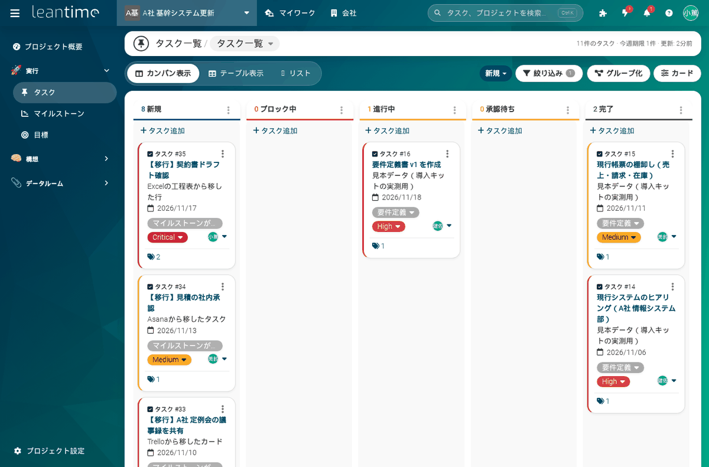
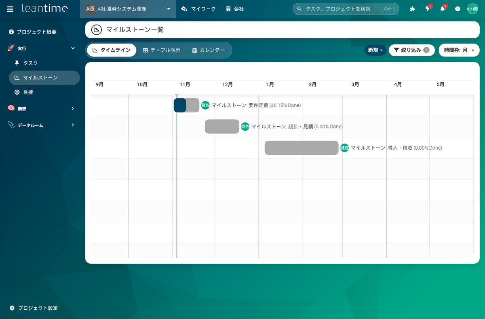
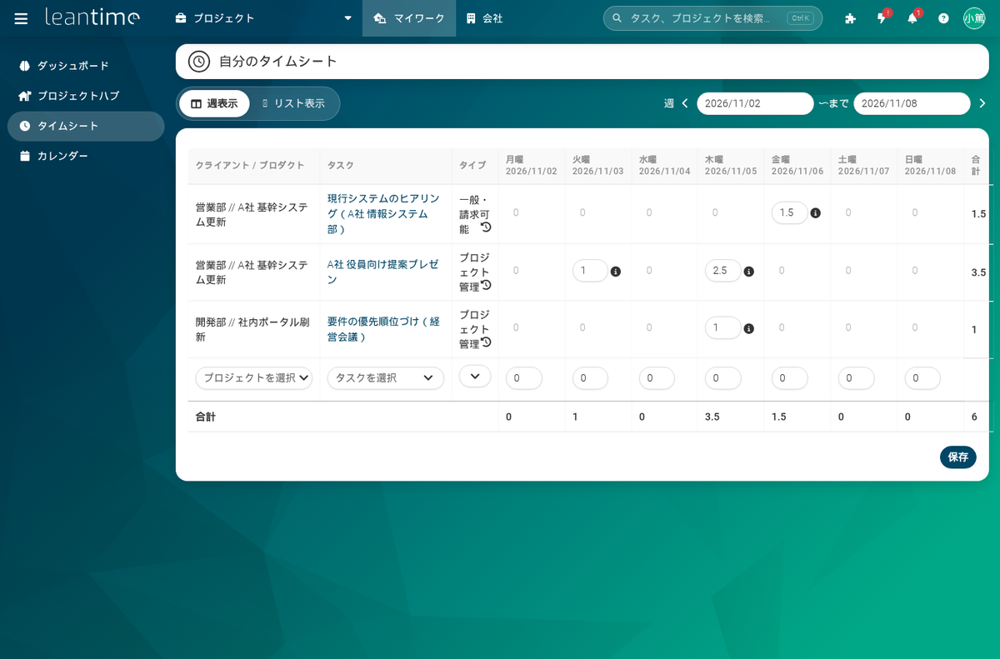

名古屋でAIシステムの開発をしている小嶋です。

当社のサイトには「タスク管理 oss」「案件管理 オープンソース」という検索で来る人がいます。案件ごとの工程を Excel の工程表で回していて、誰がどの案件にどれだけ時間を使ったかが分からない。クラウドのタスク管理は人数で月額が増えていく。そういう10〜30人の会社が、自社で持てる案件管理を探している言葉です。候補はいくつもありますが、日本語でどこまで使えるかを確かめた記録が少なかったので、Leantime を実機で立てて、部署・案件・担当・期限・工数が回るところまで確かめました。

## 結論：日本語は97.6%と高い。残りは差し込みで埋まり、優先度だけは読み替える

対象は Leantime です。AGPL-3.0 のオープンソースで、PHP 製。プロジェクトごとのカンバン・表・リスト、マイルストーンのタイムライン（ガント）、スプリント、タイムシート、ステータスレポート、Wiki とファイル、役割と見せる範囲の設定があります。2026年11月4〜5日に、公式 docker イメージの v3.13.2 と MySQL 8.4 で立てて測りました。

| 確かめたこと | 結果 |
|---|---|
| 起動 | `up -d` から画面が開くまで 50秒（MySQL の初期化 30秒を含む） |
| 管理者の作成 | インストール画面から4段階。入力込みで約5分 |
| 待機時のメモリ | 本体 130〜230MB、MySQL 430〜480MB。2GB の VPS で足りる |
| 本家の日本語訳 | 翻訳対象 3,627項目中 3,539項目（97.6%） |
| 主要18画面の日本語の行 | 差し込み前 94.6% → 差し込み後 96.3% |
| CSV からのタスク取り込み | 3件を約10秒。担当・期限・優先度・タグが一致 |
| バックアップと復元 | スクリプト 1.4秒。別の環境に復元してログイン画面まで 19秒 |

## 日本語の実態：訳は揃っているのに、目立つ所が英語

Leantime の日本語訳は、当社がこれまで試したオープンソースの中でも揃っている方でした。ただ、残っている英語が目立つ所にあります。上部メニューの「Projects」が英語のまま、設定画面の「The shortest wait between…」も英語。3.13 で足されたプッシュ通知・メール要約・工数モジュールのキー26項目は日本語ファイルにありません。訳そのものの誤りもあって、アカウントを作った後の通知が「ロッグ員をしてください」、挨拶が「ヤッホー」、全タスクのメニューには HTML のタグ崩れが出ていました。

Leantime は自社用の言語ファイルを本家のファイルの後に読み、同じキーだけ上書きします。キットではここに71項目（無い26・英語のまま39・誤り6）だけを入れたファイルを最初からマウントしています。差し込みの変数と HTML タグの数が英語と一致していることを機械で確かめました。置いた後は言語ファイルのキャッシュを消すコマンドが要ります（消さないと変わりません）。

それでも残る英語があります。優先度（Critical / High / Medium / Low / Lowest）と労力（XS〜XXL）、タスクの種別（task / bug など）はプログラムに直書きで、言語ファイルでは変わりません。カレンダーの曜日とレポートの期間も JavaScript の部品なので英語です。優先度は「Critical＝至急、High＝高、Medium＝普通、Low＝低」と読み替え表を社内に配ればすむので、キットではソースを直すことは勧めず、読み替え表を付けました。ソースを直すと更新のたびに当て直すことになるからです。

## 業務としてどう組むか：部署→案件の2階層、マイルストーンは3〜5個

Leantime の入れ物は「クライアント → プロジェクト」の2段です。上にさらに「プログラム」「戦略」という入れ物もありますが、30人以下の会社では増やさない方が定着すると考えて、クライアント＝部署、プロジェクト＝案件の2階層にしました。見本では営業部と開発部の2部署、案件2つ、マイルストーン6個、タスク16件、工数9件18時間を入れて画面を確かめています。

気をつけるのは、タイムライン（ガント）に出るのはマイルストーンだけで、タスクは出ないことです。タスクは必ずマイルストーンに紐づけて、マイルストーンの進捗率で見ます。見本の「要件定義」はタスク4件中2件が完了で、残り時間の重み付きで48%と出ました。

役割は会社全体とプロジェクトの2段です。協力会社の人は会社の役割を「コメント可能」か「編集者」にして、担当する案件にだけ入れます。編集者でログインすると上部に「会社」メニューが出ず、自分の仕事と自分のプロジェクトだけが見えることを確かめました。担当者は金曜にタイムシートの週表示で、案件×タスクごとに時間を入れて保存します。責任者は会社全体のタイムカードで部署×案件の工数を見て、CSV で書き出して請求や原価に使います。

移行は、Trello・Asana・Jira からの直接の取り込みはありません。あるのは CSV の取り込みだけなので、「相手側で CSV に書き出す → 列を整える → Leantime に取り込む」の3段階になります。必須はタイトルとプロジェクト名の列で、担当者はメールアドレスで書きます。列名は日本語でかまわず、Excel の「CSV UTF-8」で保存したファイル（BOM 付き）で取り込めました。

## 踏んだ穴（トラブル表21件のうち7つ）

1. CSV の取り込みが「You must have a column matching to a valid Project」で止まる。プロジェクト名の列が無いか、Leantime 側に同じ名前のプロジェクトを先に作っていない
2. CSV の担当者が全部自分になる。メールアドレスのユーザーを先に作っていない
3. 同じ CSV を2回取り込むと、同じタスクが2組できる
4. 更新やコンテナの作り直しのたびに全員ログアウトする。セッションがコンテナの中にあるため。業務時間外に行うか、Redis に外出しする
5. 公式の compose はコンテナ名が固定で、2つ目の環境（復元テスト用など）を立てると名前がぶつかる。キットの compose は固定名を外した
6. `/install` にパスワードの欄が無い。所有者のパスワードはインストール後の初期設定の画面で決める
7. API で作ったタスクの作成者が API キーの名前になる。キーは「連携用」「移行用」のような用途名で作る

バックアップは、MySQL のダンプと3つのデータ領域と設定ファイルを30日分残すスクリプトを付けました。別の compose プロジェクトに復元して、19秒でログイン画面が出て、プロジェクト3・タスク14・ユーザー5が元と一致し、日本語の差し込みも効いていることを確かめています。

## 導入キットとして出しました

手順書8章（00 全体像〜07 トラブル21件）、71項目の日本語の差し込み、プロジェクト設計表・マイルストーンとスプリントの決め方・タグ規約と優先度の読み替え表・週次運用・移行チェックリスト・障害記録・取り込み用 CSV、compose 一式と HTTPS の例（nginx／Caddy）、バックアップと復元のスクリプトを1つにして、Kurage App Store に出しました。

[案件管理を自社サーバーで — Leantime 日本語導入・運用キット（部署→案件・マイルストーン・タイムシート）](https://kappstore.exbridge.jp/app.php?id=b3654ce58ec539b3#ref=vibeblog-leantime-kit)

Leantime 本体は AGPL-3.0 のオープンソースで、社内で使うだけなら公開の義務はありません。キットは手順書・テンプレート・日本語の差し込みの購入で、購入者の社内利用に限ります。

自社の部署と案件の分け方や、Excel の工程表からの移し方を一緒に決めてほしい場合は、[業務システムの相談](https://exbridge.jp/contact.php?topic=system&kw=%E6%A1%88%E4%BB%B6%E7%AE%A1%E7%90%86&ref=vibeblog-leantime-kit#form)からどうぞ。
