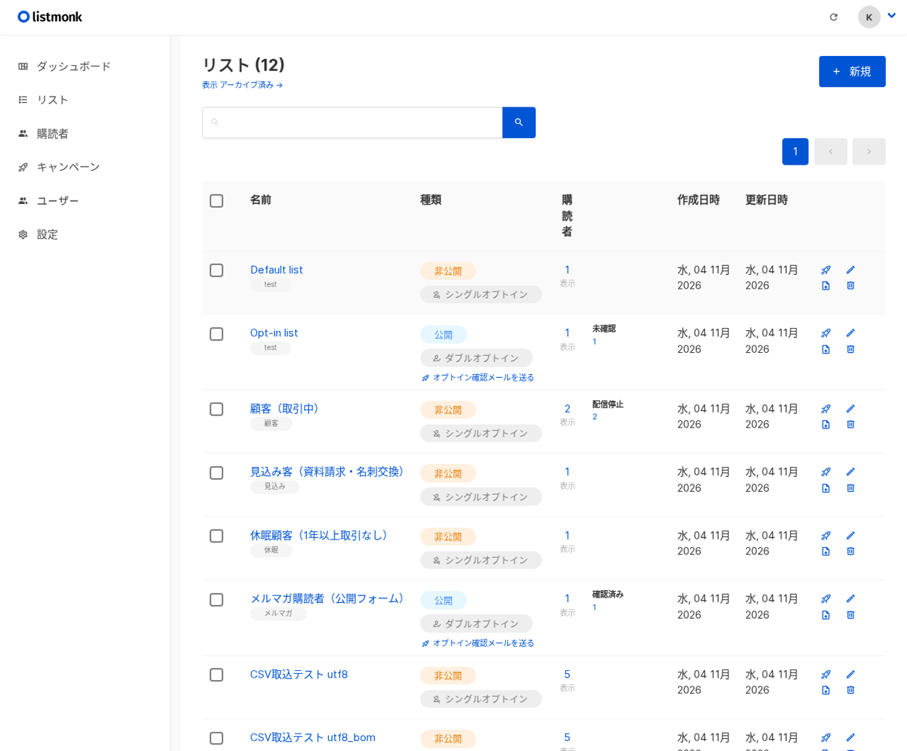
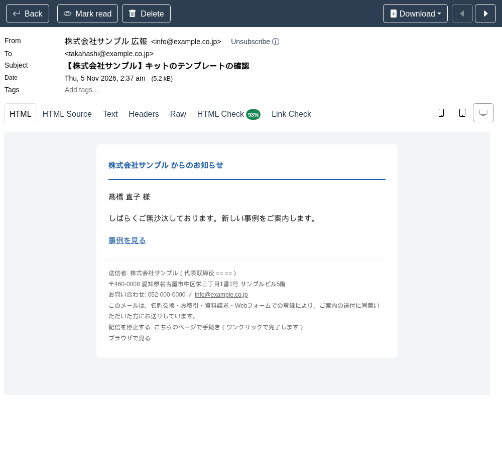
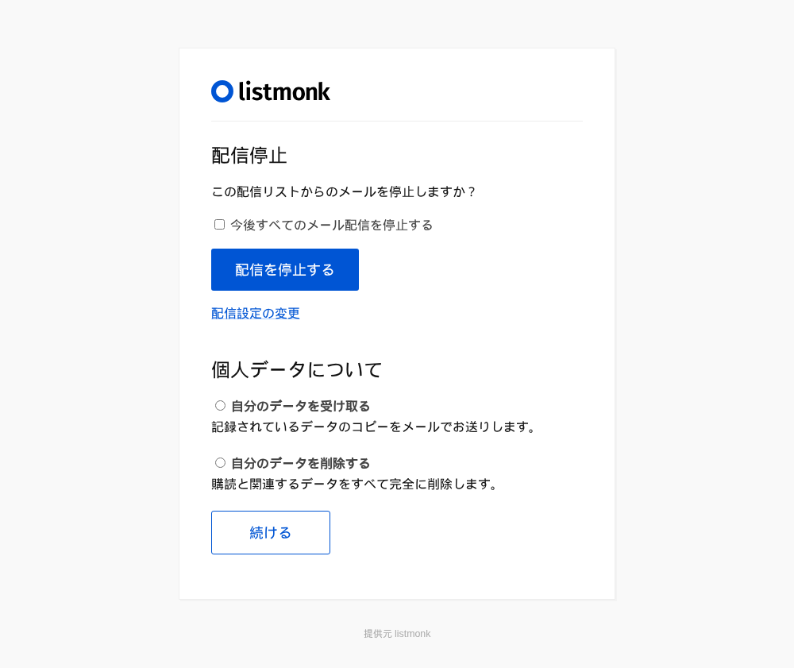

名古屋でAIシステムの開発をしている小嶋です。

当社のサイトには「メール配信システム オープンソース」「メルマガ 自社サーバー」という検索で来る人がいます。取引先へのお知らせや年末年始の案内を Outlook の BCC で送っていて、宛先が見えてしまう事故が怖い。かといって配信サービスの月額は通数が増えるほど上がっていく。そういう会社が探している言葉です。そこでメール配信のオープンソースを実機で立てて、日本語でどこまで使えるかを確かめ、足りないところを塞いだ状態を導入キットにしました。

## 結論：訳は全部ある。でも画面で読むと業務の言葉になっていない

対象は listmonk です。AGPL-3.0 のオープンソースで Go 製、有料版が無く全機能がそのまま使えます。購読者とリストを持ち、HTML やテキストのメールを配信し、開封・クリック・配信停止・バウンス（届かなかったメール）を記録します。2026年11月4日に v6.2.0 を Docker で立て、送信そのものは外部の SMTP（会社のメールサーバーや Amazon SES など）に任せる型で、テスト用の受け口（Mailpit）に配信して確かめました。

| 確かめたこと | 結果 |
|---|---|
| 起動 | `up -d` からログイン画面まで 11.6秒（初回・DB作成込み）。再起動は 0.8秒 |
| 管理者の作成 | 画面1枚。入力込みで約2分 |
| 待機時のメモリ | 本体 42〜46MB＋PostgreSQL 34〜44MB。1GB の VPS で動く |
| 本体の日本語訳 | 713項目すべてに訳がある。ただし「加入者」「ドラフト」「都市（Year）」など機械的 |
| 直した訳 | 411項目。管理画面の主要な画面は日本語100% |
| メールの日本語 | 件名・差出人名・本文とも髙・﨑・德・〒・㈱・①・〜まで化けない |
| 配信の速さ | キャンペーン作成→配信開始→受信まで 3秒 |
| Gmail のワンクリック配信停止 | List-Unsubscribe-Post に POST すると画面を出さずに停止（実測 200） |
| 復元テスト | 別の compose プロジェクトで 11秒。購読者12・リスト12・キャンペーン7・テンプレート5が元と一致 |

## 日本語の実態：「訳が無い」ではなく「訳の質」の問題

listmonk の文言は全部、言語ごとの訳ファイルにあり、設定の「言語」で切り替わります。本体の日本語訳は 713項目すべてに訳が入っていて、英語のまま残っていたのは1項目だけでした。ここまでは優秀です。

ところが画面で読むと、Subscriber が「加入者」、Subscription が「サブスクリプション」、Draft が「ドラフト」、Views が「ビュー」、New が「新」。Year は「都市」と誤訳されていて、送信レートは「通信速度」、バウンスの対応は「作用」。購読者が開く配信停止ページのボタンは「登録を解除する。」と句点付きでした。社内の担当者が毎日触る画面としても、取引先が開くページとしても、これでは使いにくい。

キットでは 411項目を業務の言葉に直した訳ファイルを同梱しました。購読者・購読・配信停止・下書き・予約済み・開封にそろえ、設定画面の説明文は「契約している SMTP の上限（例: 1時間○通）を超えないよう…」のように、日本の会社の担当者が読んで意味が取れる文にしています。差し込みは起動の設定に入れてあるので、言語を「日本語」にするだけです。長い文の下訳はローカルの gemma4 で作り（10本・262秒）、そこから手で直しました。差し込み変数が原文と一致していることは機械で確かめています。

直したあとに画面ごとの日本語の割合を数えると、ダッシュボード・リスト・購読者・キャンペーン・テンプレート・分析・バウンス・ユーザー・役割・メンテナンスが 100%、キャンペーン作成が 99% でした。英語で残るのは、言語の選択肢（各言語の自称）、本体のログ行、CSV の例の行、送信手段の識別名「email」だけです。

## メールそのものの日本語：化けない。ただしテキスト配信に落とし穴

件名に「【株式会社サンプル】年末年始の営業と11月のお知らせ ― 山田様へ」、本文に 髙・﨑・德・〒・㈱・①・〜 を入れて配信し、受信した生のメールを開いて確かめました。件名と差出人名は規格どおりに符号化され、本文も UTF-8 で一字も化けません。HTML とテキストの両方を持たせると、テキストが先・HTML が後の順で入り、メールソフトがどちらかを選んで表示します。日本語のファイル名の添付も、ファイル名のまま届きました。

困ったのはテキスト形式で配信したときです。テキストを選んでも既定のテンプレート（HTML）がそのまま付き、受信者には `<!doctype html>` から始まる HTML の枠が生で見えてしまいます。キットではテキスト用に本文だけを差し込むテンプレートを付けて塞ぎました。

## 業務としてどう組むか：リストは「誰に・どの同意で」の箱

listmonk は購読者が1人1行で、会社名や部署、登録の経路は属性として持ちます。リストは「誰に送るか」の箱で、1人が複数のリストに入れます。キットでは日本の会社でよくある形として、顧客（取引中）・見込み客（資料請求・名刺交換）・休眠顧客（1年以上取引なし）・メルマガ購読者（公開フォーム）の4つに分け、それぞれの入る人・送る物と頻度・出る条件を設計表にしました。公開フォームから来る人だけは、確認メールのリンクを押した人にだけ届くダブルオプトインにしています。

「どこで同意を得たか」を後から答えられるよう、名刺交換・展示会・Web フォーム・契約といった経路を必ず属性に残す決め方にしました。特定電子メール法の表示（送信者の名称・住所・問い合わせ先・配信停止の方法）は、テンプレートのフッターに固定で入れて、キャンペーンごとに書き忘れない作りです。条文は手順書で示していますが、法律の助言ではありません。自社の運用は顧問に確かめてください。

配信停止はリスト単位で自動に受け付けられます。購読者が開くと日本語のページで「配信を停止する」を押すだけで、「今後すべてのメール配信を停止する」にチェックを入れればどのリストからも送られなくなります。Gmail の「配信停止」ボタンからのワンクリック停止も実測で動きました。

listmonk には「登録7日後に2通目」のような自動シナリオの機能がありません。キットでは、条件でリストを動かす API を毎日 cron で叩き（実測で1回0.1秒）、2通目用のリストに向けた予約配信を週に1本作る組み方を、設計表とスクリプトで載せました。

## 踏んだ穴（7つ）

1. Excel で普通に保存した CSV（Shift_JIS）は1件も取り込めない。「CSV UTF-8」で保存すれば BOM 付きでも入る
2. CSV の見出し行が `Email`（大文字）や「メール」だと「email の列が無い」で失敗する。小文字の `email,name,attributes` に完全一致させる
3. 全角のメールアドレスの行は、その行だけ黙って飛ばされて残りは続く。取り込みのログで飛んだ行を確かめる
4. テキスト形式の配信で、既定テンプレートの HTML の枠が受信者にそのまま見える
5. 本文の普通のリンクはクリックが計測されない。計測用の書き方（`@TrackLink`）を付けると転送されて件数が増える
6. 配信停止した人を取り込みで「購読状態を上書き」にすると購読中に戻る。配信停止の人はリストから外さない
7. 訳ファイルの置き場を指定するとき、日本語だけ置くと起動しない（本体は全言語を読む）。キットには全言語を置いてある

## 導入キットとして出しました

ここまでの手順書（00〜06）、411項目を直した訳ファイルと作り直しのスクリプト、テスト用の受け口を入れた compose、特定電子メール法の表示を入れた日本語のテンプレート（HTML とテキスト）、リスト設計表・ステップ配信の設計表・週次点検表・障害記録表、取り込み用 CSV の雛形、30日分を残すバックアップのスクリプト、API の実測ペイロードを1つにして、Kurage App Store に出しました。

[メール配信システムを自社サーバーで — listmonk 日本語導入キット（特定電子メール法の表示・配信停止の型つき）](https://kappstore.exbridge.jp/app.php?id=1cc9b2d4ba1a853f#ref=vibeblog-listmonk-kit)

送信は外部の SMTP に任せる型なので、サーバーに載るのは本体と PostgreSQL の2つだけです。自社の顧客台帳や基幹からどう流し込むか、どのリストに分けるかを決めるところから手伝ってほしい場合は、[業務システムの相談](https://exbridge.jp/contact.php?topic=system&kw=%E3%83%A1%E3%83%BC%E3%83%AB%E9%85%8D%E4%BF%A1&ref=vibeblog-listmonk-kit#form)からどうぞ。
