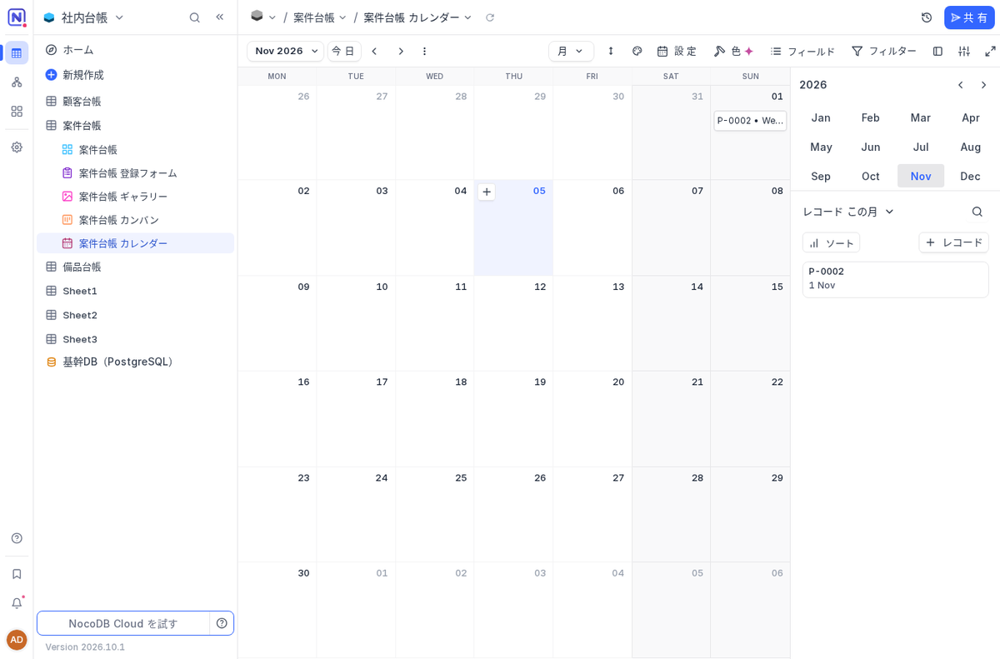
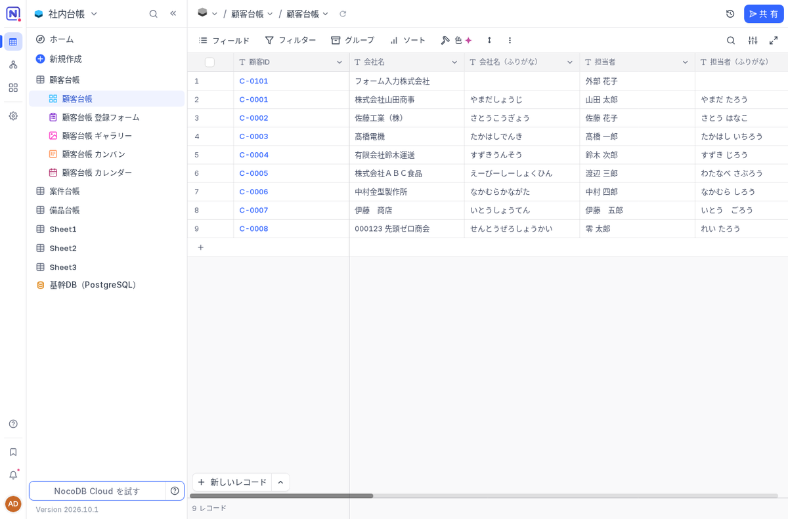
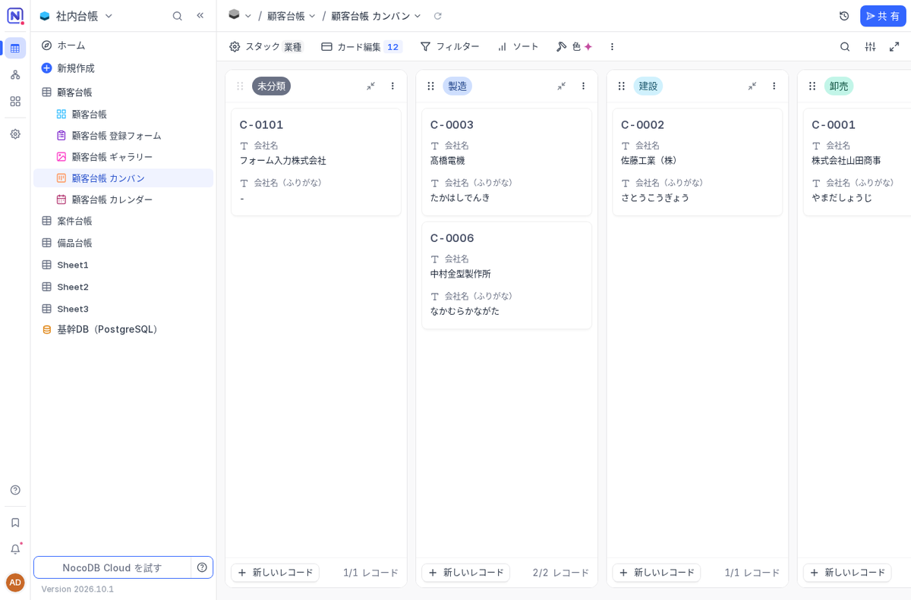

名古屋でAIシステムの開発をしている小嶋です。

当社のサイトには「nocodb 日本語」という検索で来る人がいます。この3か月で23回、検索結果に当社のページが出ていました。探しているのは、Excel で回している顧客台帳や案件台帳を、社員が同時に開いても壊れない形にしたい人だと思います。誰かが上書きして前の版が消えた、最新のファイルがどれか分からない、外出先から見られない。台帳の Excel で毎週のように起きることです。NocoDB はその受け皿の候補としてよく名前が挙がるので、実機で立てて、日本の会社の台帳がそのまま入るのかを確かめました。

## 結論：台帳の画面は日本語で使える。つまずくのは Excel の取り込み

対象は NocoDB の 2026.10.1 です。表を作って、グリッド・フォーム・ギャラリー・カンバン・カレンダーで見られるデータベースで、自社のサーバーで動かせます。2026年11月4〜5日に、本体と PostgreSQL 16 の2つを Docker で立てて、顧客・案件・備品の3つの台帳を作り、日本の会社の Excel でよくある値を入れたファイルを取り込みました。

| 確かめたこと | 結果 |
|---|---|
| 起動 | docker compose up から使える状態まで初回 18秒。再起動は 12〜15秒 |
| 管理者の作成とログイン | 送信 1.2秒、ログインからワークスペース表示まで 3.3秒 |
| 画面の日本語 | 本体で 8,799項目中 7,051項目（80.1%）。キットの訳を差し込むと 8,606項目（97.8%） |
| Excel を新しいテーブルとして取り込む | シート名が Sheet1〜3 になり、全列が文字、日付は 44287 のような数字に |
| 型を決めた台帳へ Excel を入れる | 8行中6行だけ入った。どの行が落ちたかは画面に残らない |
| 整えてから CSV で入れる | 8行すべてが日付・金額・郵便番号・電話番号・改行まで正しく入った |
| バックアップと復元 | バックアップ 0.6秒、別の場所への復元 16〜17秒。行数・添付・Webhook・APIトークンまで元と一致 |
| 待機時のメモリ | 本体 680〜892MB、PostgreSQL 68〜72MB |

台帳を毎日さわる画面（グリッド・フォーム・カンバン）は最初からほぼ日本語でした。手間がかかるのは、いま持っている Excel を入れる最初の一回です。

## 日本語の実態：毎日の画面は日本語、管理の画面に英語が残る

NocoDB には本体に日本語訳があり、ログイン画面の右上で「日本語」を選べば切り替わります。言語ファイルの中身を数えると、画面の文言 8,799項目のうち日本語になっているのは 7,051項目、80.1% でした。訳が追いついていないのは新しく足された機能で、メンバーとチームの管理、ワークスペースの設定、連携の画面で英語が目立ちます。ワークスペースの設定画面は日本語が 28% しかありませんでした。

本体に無い1,556項目は、ローカルの gemma4 で下訳し、`{name}` のような差し込み変数と HTML タグが原文と一致することを機械で確かめてから、画面に出る主な語を手で直しました。差し込むと 8,606項目、97.8% が日本語になり、ワークスペースの設定画面は 85% まで上がります。本体の再ビルドは要らず、言語ファイル1本を同じ場所に重ねて再起動（12秒）するだけです。

それでも英語で残るところがあります。カレンダーの月と曜日（Jan・MON など）は日付の部品に英語で決め打ちされていて変えられません。メール設定の説明文もプログラムに直接書かれています。外の人が開く公開フォームの送信ボタンは「Submit」のままでした。URL に `?lang=ja` を付けても変わらなかったので、フォームの案内文に「入力が終わったら Submit（送信）を押してください」と一言書いておくのが確実です。

もう一つ気をつけたいのは、言語が利用者ではなくブラウザごとに覚えられることです。日本語にした管理者が別のブラウザでログインすると英語で出ました。社員に配るときは「最初にログイン画面の右上で日本語を選ぶ」を手順に入れておきます。

## Excel の取り込みで何が壊れるか

試したのは、顧客・案件・備品の3シートを持つ Excel です。Excel の日付、`2023/1/10` という文字の日付、`令和5年6月1日`、全角の数字とカンマ（`３，０００，０００`）、全角のハイフンの電話番号、〒付きの郵便番号、先頭が 0 の郵便番号（`060-0001`）、セル内の改行、全角スペース、﨑・髙を入れておきました。

ベースのホームから Excel を新しいテーブルとして取り込むと、「顧客台帳」「案件台帳」「備品台帳」というシート名が Sheet1・Sheet2・Sheet3 になり、すべての列が1行テキストになりました。いちばん困るのは、Excel の日付のセルが 44287 のような数字の文字になることです。あとから列を日付型に変えても日付には戻りません。改行・先頭の 0・﨑・髙は崩れなかったので、この方法は「中身を眺めるため」と割り切るのがよいと思います。

型を決めた台帳へ Excel をアップロードすると、今度は日付が正しく入り、金額も通貨型に入りました。ところが全角数字の金額の行と、令和の日付の行は、行ごと入りませんでした。右下に「インポートされた 6 行、2 失敗しました」と数秒出て消えるだけで、どの行が落ちたかは分かりません。件数を数えなければ気づけない落ち方です。

キットには、Excel をシートごとに整えて CSV にするスクリプトを入れました。日付は和暦やシリアル値も `2023-01-10` の形にそろえ、全角数字・カンマ・円記号・% を外し、ハイフンの種類をそろえて、7桁の郵便番号に `-` を入れます。直せなかった値は捨てずに、Excel の行番号つきで「要確認」のファイルに出します。これを通すと、顧客台帳の8行すべてが日付・通貨・郵便番号（060-0001 の 0 も）・電話番号・改行・空欄まで正しく入りました。

## 顧客・案件・備品の台帳をどう組むか

中小企業で最初に Excel から移すと効果が出やすいのは、顧客台帳・案件（受注）台帳・備品（在庫）台帳の3つだと考えています。どれも複数の人が同時に開いて、上書きで消える事故が起きやすい表だからです。キットではこの3つの設計を表にし、その通りにテーブルとフィールドを作るスクリプトを付けました。実測で 1.7秒、3テーブル・40フィールド・12ビュー（各台帳に登録フォーム・ギャラリー・カンバン・カレンダー）ができます。同じ名前のテーブルがあれば飛ばすので、2回実行しても二重にはなりません。

型の選び方で一番効くのは、顧客ID・郵便番号・電話番号を数値にしないことです。数値にすると先頭の 0 が消えて、060-0001 が 600001 になります。金額は通貨（円）、状態や分類は単一選択にしておくと、そのままカンバンの列になり、表記の揺れも防げます。

外の人には公開フォームから入力してもらえます。ログインしていないブラウザから送信した行が、改行も含めてそのまま台帳に入りました。見せたい相手にはパスワード付きの共有ビューで一覧だけを渡せます。ただ、共有ビューにはダウンロードのボタンが出るので、渡した相手が一覧を手元に保存できる前提で使ってください。

取り込みの決まりごととして、アップロードは追加だけで重複を調べないことも書いておきます。同じ管理番号の行があっても上書きも警告もなく、実測で備品 E-0001 が2行になりました。やり直すときは先に入れた行を消してから入れます。元の Excel は取り込み後に読み取り専用の場所へ移し、「これからは NocoDB が正」と社内に告げる。両方を更新し続けるのが一番の失敗のもとです。

## 踏んだ穴（7つ）

1. compose のプロジェクト名がフォルダ名になり、同じサーバーの別システムの PostgreSQL のボリュームを共有して起動しなかった（1行目に `name:` を書いて解決。別システムのボリュームは消さない）
2. 社内の PostgreSQL・MySQL をつなぐと「Connection to internal hosts is not allowed」で断られる。`.env` の設定1行で通る
3. Webhook は本文を空のまま保存すると、中身の無い通知が届く。本文に event 全体を JSON で書き出す式（二重の波かっこで json event を囲む形。手順書に実物を載せています）を書くと、更新では変更前と変更後の両方が入る
4. ログインのトークンで連携のプログラムを書くと、同じ人が画面でログインし直した時点で 401 になる。API トークンを使う
5. API はメール型の形式を検査しない。呼ぶ側で確かめる
6. 招待した人がログインできない。メールの送信設定が無いと招待メールが届かない
7. 復元の流し込みで「database "nocodb" does not exist」。PostgreSQL の初期化中は `pg_isready` が成功しても DB がまだ無い。実際に `select 1` が通るまで待つ（復元スクリプトは対応済み）

バックアップは DB・添付・設定の3点を30日分残すスクリプトで、別の構成に戻して元の管理者でログインし、台帳の行数（9・2・2行）、添付の画像、Webhook の定義3件、API トークン、公開フォームの URL がそのまま使えることを確かめました。

## ライセンスのこと

NocoDB 本体のライセンスは、2026年1月29日から Sustainable Use License 1.0 です。以前の AGPL-3.0 ではありません。自社の社内業務のために使う・直すのは認められていて、他者へ配布・提供してよいのは無償かつ非商用の場合だけです。「自社の台帳を自社のサーバーで動かす」使い方は問題ありませんが、NocoDB を組み込んだサービスを有償で他社に提供する使い方は、このライセンスでは認められていません。キットの手順書の最初にも要点を書きました。

## 導入キットとして出しました

ここまでの手順書（00〜06）、1,556項目の訳と差し込みの仕組み、台帳3つの設計とそれを作るスクリプト、Excel を整えるスクリプトと試せる見本の Excel、公開フォームと共有ビューの設計シート、バックアップと復元のスクリプト、実測で踏んだ穴22件の対処表を1つにして、Kurage App Store に出しました。キット自体は無料で受け取れます。

[Excel の台帳を社内のWebデータベースに — NocoDB 日本語導入キット（顧客・案件・備品の台帳の型つき）](https://kappstore.exbridge.jp/app.php?id=105556250f6cfa8d#ref=vibeblog-nocodb-kit)

手順書どおりに進めれば自社で立てられるように作っていますが、サーバーの用意から、いま使っている Excel の台帳の設計の見直し、取り込み、項目や画面の自社向けの直しまでをまとめて任せたい場合は、導入支援・カスタマイズ（合計10時間・税込110,000円）をお勧めしています。設定した手順と中身は御社にお渡しします。

[導入支援・カスタマイズ（10時間・税込110,000円）の内容](https://kurage.exbridge.jp/vibe-oss.html#ref=vibeblog-nocodb-kit)

自社の台帳をどう分けるか、どの列を何の型にするかから相談したい場合は、[業務システムの相談](https://exbridge.jp/contact.php?topic=system&kw=%E5%8F%B0%E5%B8%B3%E7%AE%A1%E7%90%86&ref=vibeblog-nocodb-kit#form)からどうぞ。
