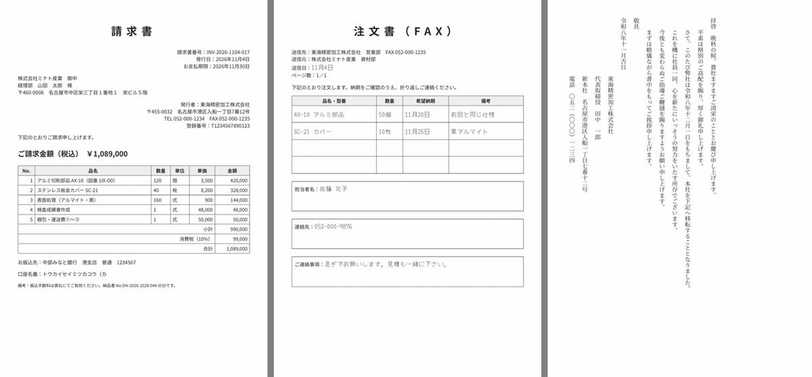
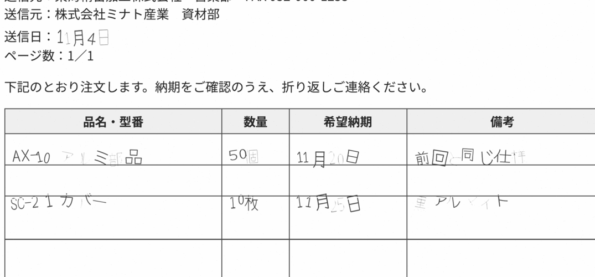
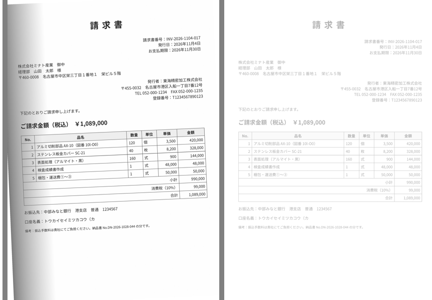

名古屋でAIシステムの開発をしている小嶋です。

当社のサイトには「ocrmypdf 日本語」「tesseract 日本語 精度」という検索で来る人がいます。複合機でスキャンした請求書や契約書が画像のままの PDF で溜まっていて、取引先名や金額で探せない。クラウドの OCR に社外の書類を送るのはためらう。そういう会社が、自社のサーバーで回せる OCR を探している言葉です。ネットには設定の例がたくさんありますが、日本語の帳票でどれだけ読めるかを数字で示したものが見当たらなかったので、見本を自作して実機で測りました。

## 結論：横書きの印字は9割強、縦書きは87%。ただし「よく勧められる設定」で表が消える

対象は OCRmyPDF（MPL-2.0）と、その中で文字を読む tesseract（Apache-2.0）です。スキャンした PDF や画像に「文字の層」を重ねて、見た目はそのまま、文字で検索・コピーできる PDF にします。GPU は使わず、CPU だけで A4 1枚2〜3秒でした。

2026年11月4日に、docker 版（OCRmyPDF 17.13.1・tesseract 5.5.0）と pip 版（16.13.0・Ubuntu 22.04 の tesseract 4.1.1）の両方で、自作の日本語見本6種を300dpi のスキャン風画像にし、オプションを変えながら96条件を測りました。正答率は正解の文字列との編集距離から出した「strict」と、全角半角や句読点を揃えて「検索で引けるか」に近づけた「lenient」の2つです。

| 確かめたこと | 結果 |
|---|---|
| 横書きの印字（請求書・納品書・契約書・A3見積） | strict 89〜94%、lenient 95〜99%（`-l jpn`・psm は既定の3） |
| 縦書きの挨拶状 | `-l jpn_vert --tesseract-pagesegmode 5` で 86.9%（docker 版） |
| 縦書きを pip 版（tesseract 4.1）で | 9.1%。1行ごとに文字の順が逆になる |
| psm 6（1ブロック扱い） | 請求書 91.3%→60.6%、A3見積 89.4%→23.8%。表の行が1字も残らない |
| `--clean`（汚れ取り） | 濃さ10%の薄い印字で 91.3%→29.1% |
| 手書き混じりの FAX | 印字部分の再現率 99.2%、手書き部分 53.3% |
| フォルダ監視 | 投入から最初の出力まで 9秒 |
| paperless-ngx の取り込み | 先に処理しておくと 2〜5倍速く、縦書きも 2.8%→86.9% |

## 日本語の実態：「違う字に読む」より「読めずに落ちる」方が多い

一番驚いたのはページ分割モード（psm）でした。日本語の OCR では「大きな見出しの先頭が落ちるので psm 6 にする」という設定がよく勧められていて、当社も paperless-ngx のキットではそう書いていました。ところが表のある帳票で測ると、psm 6 は品名・数量・金額の表を丸ごと落とします。見出しの「請求書」は読める代わりに、肝心の明細が1字も無い。逆に既定の psm 3 は表を全部読めて、ぽつんと置かれた3文字の見出しだけが別の字になるか消えます。見出しの大きさや字間を変えて追試しても、3文字の見出しは psm 3 では読めませんでした。表のある帳票が混ざるなら psm 3 にして、書類の種類は見出しではなく「請求書番号」「納品日」のような行で判定する、というのがキットの割り切りです。

請求書と契約書の文字層を1語ずつ確かめると、日本語で起きることは次のようでした。「￥」はバックスラッシュになり、インボイスの登録番号の先頭の「T」は「1」になります。丸数字と波ダッシュは読めず、全角の数字や括弧は半角になります。契約書の「乙」は17回のうち9回消えて、「甲が乙に」が「甲がに」になりました。一方で、郵便番号・電話番号・請求書番号・日付・銀行名はそのまま読めます。誤りを種類別に数えると、脱落が47〜49%で一番多く、漢字の取り違えは8%でした。金額は数字だけで、インボイス番号は末尾13桁で、契約書は社名で検索する、という検索側の工夫を表にして付けています。

`-l jpn+eng` のように英語を足すと、請求書で 91.3%→89.4% と下がりました。英字の品番や社名は `jpn` だけで読めます。高精度版の言語データ（tessdata_best）は1.5〜2.5倍遅いのに横書きでは良くならず、縦書きだけ 86.9%→92.1% に上がりました。

## 業務としてどう組むか：フォルダを書類の種類で分ける

人が毎回コマンドを打たずに回すために、フォルダ監視のスクリプトを付けました。複合機の送信先を入口のフォルダに向けておくと、2秒ごとに見て、サイズが2回続けて変わらなかったファイル（書き込みが終わったもの）だけを処理し、出口に検索できる PDF を書き、元ファイルを「済」へ移します。見本5点を一度に入れた実測では、スマホで撮った JPEG が9秒で最初に出て、5件目の請求書が18秒で出ました。中身がテキストの壊れた PDF は「失敗」フォルダに移ってログが残ります。

縦書きは横書きと同じ設定では1〜3%しか読めないので、入口を「横書き」「縦書き」「FAX」に分け、フォルダごとに違う設定で読ませます。過去の山は一括処理のスクリプトで、A4 1枚約2.5秒、1万枚なら4並列で約2時間の見当です。途中で止まっても同じコマンドを打てば未処理分だけ進みます。

手書きは読めないものとして扱います。崩した手書きでは「急ぎでお願いします」の類はほぼ残りませんでした。そこで「文字が50字未満の書類は要確認一覧に積み、件名と日付を人が入れる」運用と、そのための担当とフォルダの設計表を付けています。

paperless-ngx（書類管理のオープンソース）を使っている会社は、中で同じ OCRmyPDF が動いているので、先にこのキットの設定で処理してから取り込み口に入れると、paperless は文字層をそのまま使います。請求書の取り込みは10.4秒→6.2秒、本文の正答率は 60.0%→91.5%、縦書きは 2.8%→86.9% になりました。

## 踏んだ穴（トラブル表から7つ）

1. psm 6 にしたら表のある帳票の表が全部消えた。エラーは出ない
2. `--clean` を付けたら薄い印字（感熱紙の消えかけ）が消えた
3. 綴じ側に影のあるスキャンに `--deskew` を付けたら、角度を誤ってかえって悪くなった（67.3%→53.7%）。傾きだけなら 2.5°で 59.8%→90.7% と効く
4. 180°逆さの書類が docker 版では `--rotate-pages` でも直らない（5.9%）。`--rotate-pages-threshold 2` を足すと 91.5%
5. 文字層のある PDF を既定で通すと `PriorOcrFoundError` で止まる。監視と一括処理は `--skip-text` で通す。ただし画像は描き直すので、OCR 済みを入口に戻すとサイズが 197KB→348KB に増える
6. Chrome で作った PDF の文字層が「発⾏⽇」のような部首の字になっていて検索が当たらない
7. 古い記事に出てくる `--threshold` は今の版に無く、`--remove-background` は 16.13 でも 17.13 でも未実装

エラーが出ずに「黙って読めていない」ものは、ほかに `-l jpn` で縦書きを読んだ、`jpn+eng` にした、200dpi の白黒2値でスキャンした、があります。月1回の抜き取りで見つけるしかないので、取引先名・品番・金額を並べて10秒で確かめるスクリプトを付けました。

## 導入キットとして出しました

手順書7章（00 全体像〜06 トラブル）、docker 版と pip 版（root なしで縦書きまで）の入れ方、フォルダ監視・一括処理・paperless 連携のスクリプト、正答率を測るスクリプトと自作の日本語見本6種と正解テキスト（自社の書類で同じ表を作れます）、運用設計表・品質チェック表・障害記録、96条件の実測表を1つにして、Kurage App Store に出しました。

[紙の書類を検索できるPDFに — OCRmyPDF 日本語導入キット（請求書・契約書・FAX・縦書きの実測つき）](https://kappstore.exbridge.jp/app.php?id=38cdb7bf9e3504b9#ref=vibeblog-ocrmypdf-kit)

OCRmyPDF は MPL-2.0、tesseract は Apache-2.0 で、自社の書類を自社のサーバーで処理する用途に公開の義務はありません。キットの範囲は「検索できる PDF にする」ところまでで、手書きの読み取りや、金額を項目として取り出す仕組み、電子帳簿保存法のスキャナ保存の要件は扱っていません。

請求書や注文書の金額・取引先を項目として取り出して基幹につなぎたい、という話になると AI-OCR の仕組みを足すことになります。自社の書類で何ができるかを見てほしい場合は、[業務システムの相談](https://exbridge.jp/contact.php?topic=system&kw=%E6%9B%B8%E9%A1%9E%E3%81%AEOCR&ref=vibeblog-ocrmypdf-kit#form)からどうぞ。
