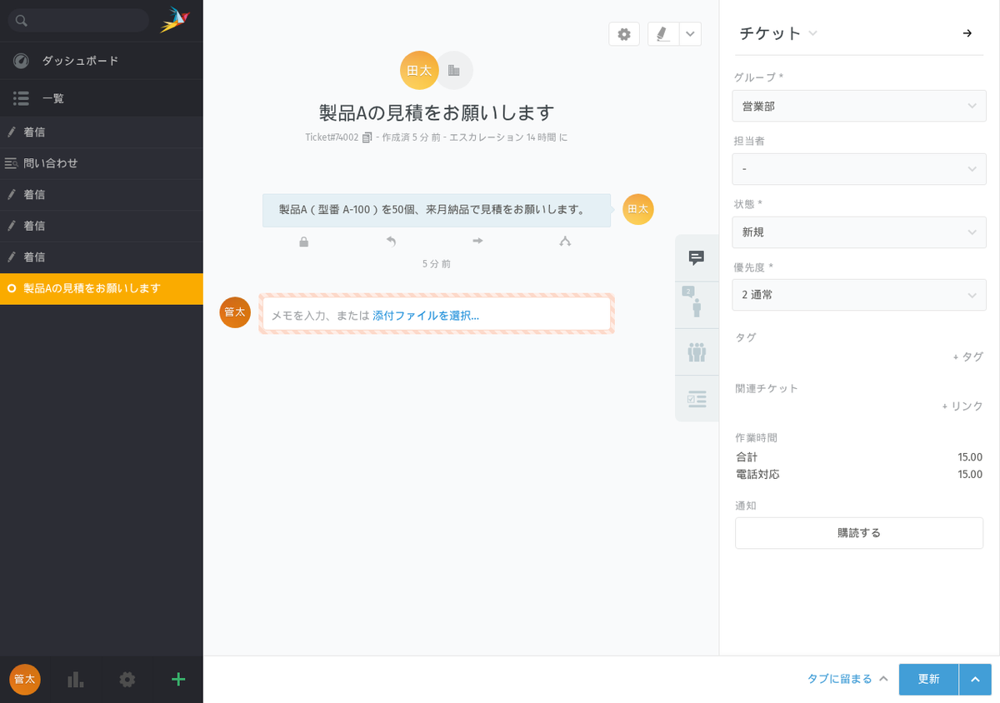
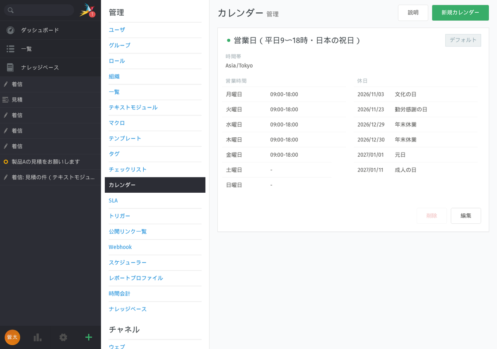
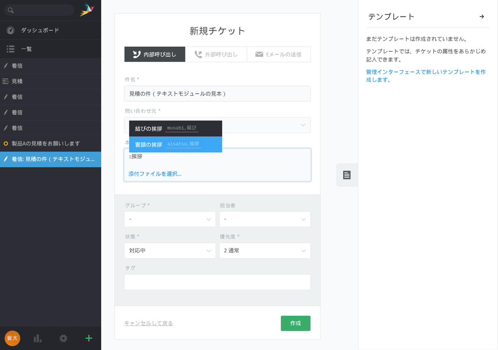

名古屋でAIシステムの開発をしている小嶋です。

当社のサイトには「zammad 日本語」「問い合わせ管理 オープンソース」という検索で来る人がいます。問い合わせのメールを共有の受信箱で回していて、誰が返事をしたのか、どれが放っておかれているのかが分からなくなった会社が、自社で持てる問い合わせ管理を探している言葉です。当社は9月に一度 Zammad の日本語化を記事にしましたが（[ヘルプデスクOSS「Zammad」の日本語化の記録](https://exbridge.jp/vibeblog/2026-09-03-zammad-japanese-guide.html)）、本体の版が進んだので、最新の安定版を実機で立て直し、会社の問い合わせ窓口として回すところまで確かめました。

## 結論：毎日の画面は半分日本語、設定する画面ほど英語、ログイン画面は英語

対象は Zammad です。AGPL-3.0 のオープンソースで、Ruby on Rails 製。メールや自社サイトのフォームから来た問い合わせが受付番号つきの「チケット」になり、部署ごとに担当者が拾って、定型文で返事をして閉じます。2026年11月4〜5日に、公式の docker compose で最新の安定版 7.2.2 を立てて測りました。

| 確かめたこと | 結果 |
|---|---|
| 起動 | `up -d` から画面が開くまで 33秒（日本語化込み）。DB の初期化が終わるまで 80秒 |
| 初回ウィザード | 画面5枚。入力込みで約5分 |
| 待機時のメモリ | Elasticsearch なしで合計約 1.1GB、ありで約 2.9GB |
| 同梱の日本語訳 | 5,153項目中 1,001項目（19.4%）。1,954項目は「要確認」扱いで実行時に使われない |
| 主要38画面の日本語の行 | 差し込み前 64% → 差し込み後 94% |
| 日本語ブラウザ（ja-JP）のログイン画面 | 差し込み前は英語。差し込み後は日本語 |
| バックアップと復元 | スクリプト 1.6秒（DB 7.4MB）。別の環境に復元して画面が開くまで 33秒 |

ログインすると「Only 19% of this language is already translated」という英語の案内が出ます。左のメニューやチケット画面は訳されているので、毎日触る画面は半分以上日本語です。ダッシュボードは89%、新規チケットは96%。ところが自動返信を作るトリガーの画面は50%、SLA は40%、定型文（テキストモジュール）は18%、Webhook は20%でした。管理者が最初に設定する画面ほど英語、という状態です。

## 日本語の実態：ja-JP のブラウザではログイン画面が英語になる

もう一つ困ったのは、日本の Chrome や Edge の既定の設定（ブラウザの言語が `ja-JP`）だと、ログイン画面と初回ウィザードが英語になることでした。Zammad はログイン前の言語をブラウザから決めますが、本体の言語一覧で日本語の別名が空になっていて、`ja-JP` を日本語と判定できません。言語を `ja` だけにしたブラウザでは日本語の「サインイン」が出て、`ja-JP` では「Sign in」が出ました。

管理画面で「システムの既定の言語」を日本語にしても、ログイン前の画面は変わりません。データベースの言語一覧を直接直しても、起動のたびに初期化のコンテナが本体のファイルから作り直すので、再起動すると英語に戻ります。直す場所はファイル側でした。

キットでは、翻訳ファイル（5,153項目すべて確定）と、日本語の別名だけを直した言語一覧の2つを、設定ファイルの1行でコンテナに差し込むようにしました。本体の再ビルドは要りません。起動のたびに自動で読み込まれ、訳の同期は34秒です。差し込みの変数と HTML タグが原文と一致していることは機械で確かめています。差し込み後に残る英語は、フォームの埋め込みコードの例、製品名、初期の見本データ、IMAP 接続エラーの原文、ログイン画面の下の Powered by です。

## 会社の問い合わせ窓口としてどう組むか

Zammad は機能が多く、全部触ろうとすると止まります。キットでは「メールと Web フォームで来た問い合わせを部署で受け、受付番号つきで自動返信し、営業時間で返事の遅れを見て、作業時間を残す」ところまでに絞り、実機で入れた順に書きました。見本に入れた構成は、部署3つ（営業部・サポート・総務経理）、担当者3人と管理者1人、取引先の組織2つ、SLA 1本、自動返信などのトリガー4本、ボタン1つの定型処理（マクロ）3本、定型文5本です。templates/ の設計表を先に埋めておけば、入れる作業は2〜3時間でした。

部署（グループ）には1つずつ受付のメールアドレスを割り当てます。取引先の組織にメールのドメインを登録しておくと、そのドメインから来たメールの送り主が自動でその会社に入ります。自動返信は既定の英語のトリガーを作り直さずに、名前と本文を日本語に書き換えます。実測では、Web から作ったチケットに「【受付】サンプルの不具合について（自動返信テスト） [Ticket#74006]」という件名で日本語の自動返信が届き、件名の末尾に受付番号が自動で付きました。顧客がこのまま返信すれば同じチケットに戻ります。

返事の遅れを見る SLA は、カレンダーで数えます。既定のカレンダーは America/Los_Angeles の9〜17時なので、Asia/Tokyo の平日9〜18時に書き換えます。19時48分に作ったチケットの初回返信の期限は、翌営業日の10時になりました。

ここで日本の祝日の落とし穴がありました。祝日を Google の日本の祝日フィードから取り込むと、七五三・クリスマス・大晦日・節分・雛祭り・母の日・七夕・銀行休業日も入り、その日は返事の期限が止まります。実測で107件中36件がこれでした。行事を外して年末年始を足すスクリプトを付けて、休日73日・外した行事36件・手で足した日5日という結果を確かめています。

定型文は返信欄で `::` に続けて語を打つと候補が出ます。キーワードをローマ字と日本語の両方で付けておくと、日本語入力の変換を挟んでも `::挨拶` で引けました。作業時間は、記事を保存するときに入力欄が出て、チケットの右に種類別に積み上がります。

検索は Elasticsearch なしでも、件名・本文の日本語の部分一致、顧客名、受付番号で引けました。引けなかったのは取引先の会社名（ありなら3件、なしなら0件）と、ひらがなや送り仮名違いの表記ゆれ（どちらの構成でも0件）です。レポートのグラフは Elasticsearch が無いと「Elasticsearchを設定する必要があります」としか出ません。担当者5人以下・月数百件で、取引先単位のグラフが要らないなら、Elasticsearch なしで 2GB の VPS に収まる、というのがキットの判断の目安です。

## 踏んだ穴（トラブル表24件のうち7つ）

1. 部署に受付メールアドレスが無いと、自動返信が黙って送られない。画面には何も出ず、ログに1行出るだけ
2. 管理者でも部署の権限を付けないと、新規チケットが 403 で作れない
3. タグ「至急」を付けても優先度が上がらない。トリガーは次にチケットが更新されたときに評価される。即時にしたいならマクロでタグと優先度を同時に変える
4. 翻訳ファイルを差し替えても訳が変わらない。1ファイルの bind mount は、ホスト側でファイルを置き換えると動いているコンテナが古い方を見続ける。`--force-recreate` で直る
5. HTTPS にしたらログインで「CSRF token verification failed!」。逆プロキシが TLS を終端しているのに Zammad が http だと思っている
6. 画面上部に「接続が切れました」が出続ける。逆プロキシが WebSocket を通していない
7. 自社サイトのフォームからの投稿が Forbidden。フォームのチャネルを有効にしていない、またはブラウザ識別子が短い

バックアップは、データベースと添付と設定ファイルを30日分残すスクリプトを付けました。別の compose プロジェクトに復元して、33秒で立ち上がり、ログインしてチケット7件・部署・トリガー4本・FAQ の公開ページ（200）が戻ることまで確かめています。

## 導入キットとして出しました

手順書7章（00 全体像〜06 トラブル24件）、全項目の翻訳ファイルと言語一覧の差し込み、部署と担当者・自動返信と定型処理と定型文・SLA の決め方・週次運用・障害記録の設計表5点、公式の compose 一式と nginx／Caddy の例、バックアップと祝日カレンダーのスクリプトを1つにして、Kurage App Store に出しました。

[問い合わせ管理を自社サーバーで — Zammad 日本語導入キット（部署・自動返信・SLAの設計表つき）](https://kappstore.exbridge.jp/app.php?id=df2e650ed0c59bae#ref=vibeblog-zammad-kit)

Zammad 本体は AGPL-3.0 のオープンソースで、キットは手順書・設計表・スクリプトの購入です。社内で使う範囲なら本体のソースを公開する義務は生じません。電話（CTI）や SNS の連携、他のヘルプデスクからの移行は扱っていません。

自社の問い合わせの流れに合わせて部署や自動返信を決めるところから手伝ってほしい場合は、[業務システムの相談](https://exbridge.jp/contact.php?topic=system&kw=%E5%95%8F%E3%81%84%E5%90%88%E3%82%8F%E3%81%9B%E7%AE%A1%E7%90%86&ref=vibeblog-zammad-kit#form)からどうぞ。
