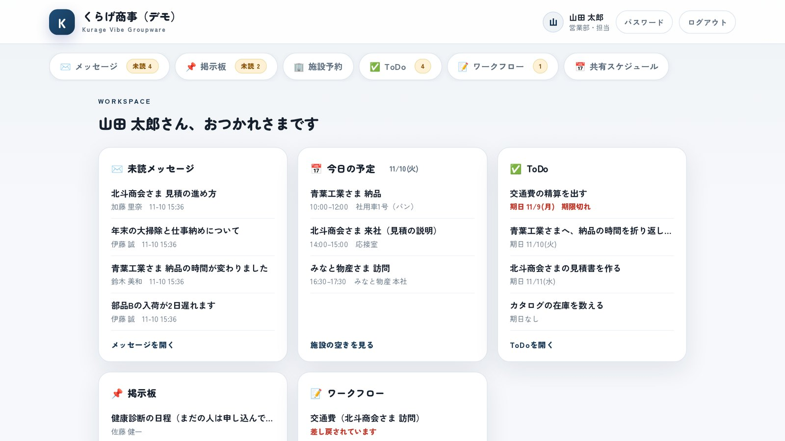
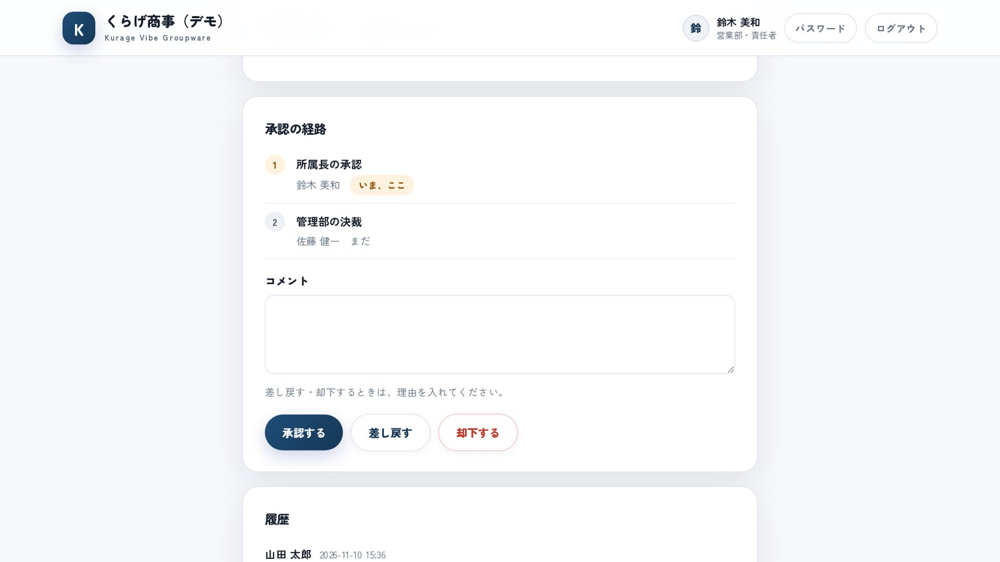
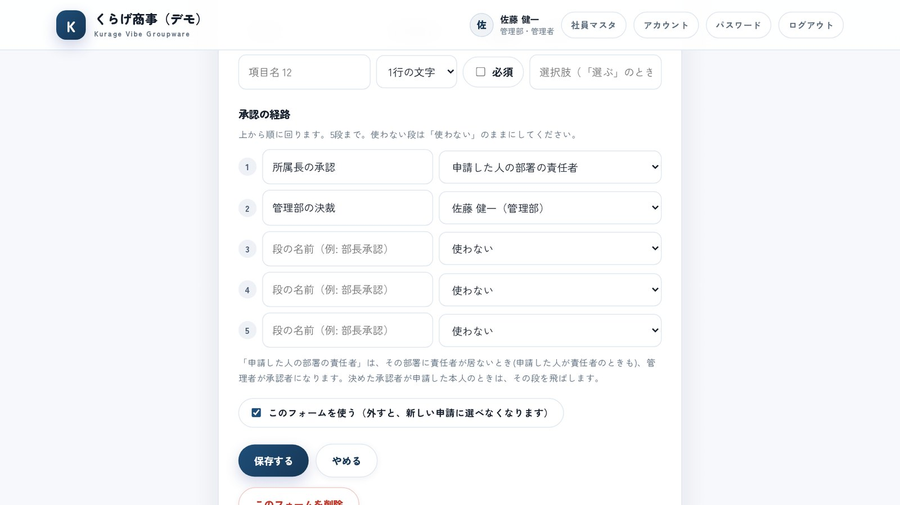
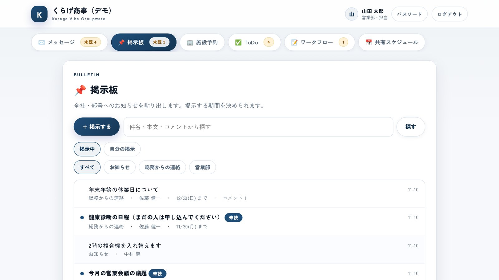
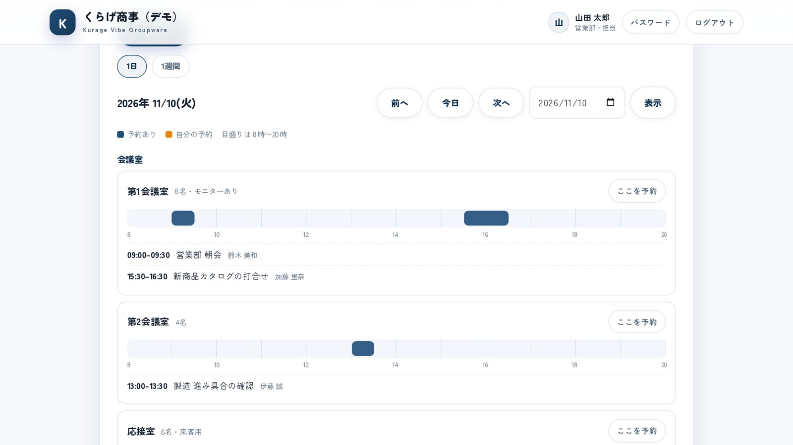

名古屋でAIシステムの開発をしている小嶋です。

社内の連絡はメール、お知らせは壁の紙、会議室は入口のホワイトボード、稟議書は紙に判子。小さな会社では、この4つが別々の場所にあります。困るのは「あの稟議書、いまだれの机にあるのか」「あの会議室、15時は空いているのか」を、席を立って聞きに行かないと分からないことです。

クラウドのグループウェアを入れれば片づく話ですが、社員の数だけ毎月の利用料がかかり、社内のやり取りを外のサービスに置くことになります。そこで、自社のサーバーに置いて使うグループウェアを開発しました。[Kurage Vibe Groupware](https://kappstore.exbridge.jp/app.php?id=fe433e5061769cba#ref=vibeblog-kvgw) です。PHP が動くサーバーにフォルダごと置けば動き、データベースの用意は要りません。税込220,000円の買い切りで、社員が増えても利用料は増えません。

## 入っている機能は6つ

1. **メッセージ。** 宛先を決めて送る社内の連絡。返事はコメントで続き、だれが読んだかが分かります。
2. **掲示板。** 全員か、部署のみんなへのお知らせ。掲示する期間を決められます。
3. **施設予約。** 会議室・社用車・備品を、1日か1週間の空き表から予約します。
4. **ToDo。** 自分のやることと、人に頼んだこと。期限切れは赤で出ます。
5. **ワークフロー。** 稟議書・休暇届・経費精算の申請を、決めた順番で承認に回します。
6. **共有スケジュール。** 全員の予定。iPhone・Android の標準カレンダーに取り込めます。

ログインすると、未読のメッセージ、今日の予定と施設の予約、期日の近い ToDo、まだ読んでいない掲示、自分の番の申請が1画面に並びます。メニューにも数が出ます。

## ワークフロー：承認の順番を飛ばせない

今回いちばん時間をかけたのは、ワークフローです。

デモには「展示会の出展（小間2つ）・385,000円」という稟議書が入っています。営業部の山田さんが申請し、経路は「所属長の承認 → 管理部の決裁」の2段。いまは1段目の鈴木さんの番で、画面に「いま、ここ」と出ます。

守っていることは3つです。

- **後の段の人には、自分の番が来るまで承認のボタンが出ません。** ボタンを隠しているだけではなく、URL を直接送ってもサーバーが断ります。
- **管理者でも、自分の番でない申請は承認できません。** 「管理者なら何でもできる」にすると、承認の記録が信用できなくなるからです。
- **差し戻しと却下には、理由が必須です。** だれが・いつ・何をしたかは、申請の履歴に残ります。

承認者が退職や長い不在で止まったときだけ、管理者が承認者を付け替えられます。付け替えたことも履歴に残ります。

## 申請フォームと経路は、画面から決める

申請フォームは、紙の様式1枚にあたります。入力する項目は、件名のほかに12個まで。種類は、1行の文字・長い文章・数字・日付・選択肢の5つです。金額は、全角やカンマ入りで書いても数字にそろえます。

承認の経路は5段まで。段ごとに、承認者を次の3つから選びます。

- **申請した人の部署の責任者**（営業部の人が出せば、営業部の責任者へ）
- **申請する人が選ぶ**（申請のたびに選ぶ）
- **社員の名前**（「管理部の佐藤さん」のように、いつも同じ人）

「部署の責任者」にしておけば、フォームは1枚で、どの部署の人が出しても自分の上長に回ります。決めた承認者が申請した本人のときは、その段を飛ばします。

フォームを後から直しても、すでに出ている申請は、出したときの項目と経路のまま進みます。途中で様式が変わって、だれの番か分からなくなることを避けるためです。

## 掲示板：見える範囲と、だれが読んだか

掲示板は、カテゴリごとに「見える範囲（全員か、1つの部署）」と「掲示できる人」を決められます。「総務からの連絡」は管理者だけが掲示でき、「営業部」は営業部の人にしか見えない、という分け方です。

掲示には期間を付けられます。「年末年始の休業日」は12月20日まで、のように決めておけば、過ぎたものは一覧から外れます。まだ読んでいない掲示には「未読」が付き、掲示した人と管理者は、だれが読んだかを見られます。

## 施設予約：同じ時間に2つ入らない

2人が同じ会議室の同じ時間を同時に押しても、通るのは先の1人だけです。もう1人には、重なった相手の時間と名前が出ます。毎週の定例のような繰り返しの予約（30回まで）は、1日でも重なる日があれば1件も入れません。半分だけ入ると、あとで消して回る手間が残るからです。

## データベースなしで、どう守っているか

このシステムはデータベースを使わず、サーバーの中のファイルに書きます。それでも承認の順番や予約の重なりが崩れないように、作りの決まりを2つ置きました。

- **権限の判定は、機能ごとに1つの関数だけ。** メッセージ・掲示板・施設予約・ToDo・ワークフローのそれぞれに「この人は、これをしてよいか」を答える関数が1つずつあり、画面も保存の処理も、必ずそこを通ります。
- **読んでから書くまでを、1つのロックの中に収める。** 「いまの段の承認者か」「この時間は空いているか」を確かめてから書き込むまでのあいだ、ほかの人の書き込みを待たせます。

手を入れたあとに壊していないかを確かめる検証スクリプトも同梱しました。この製品の5機能で221件、土台で214件です。

## 入っていないもの

- **ファイル管理・タイムカード・メールの送受信・アドレス帳・電話メモは入っていません。**
- **新着をメールやスマートフォンの通知で知らせる機能はありません。** 未読や自分の番の申請は、ログインしたときのホームとメニューの数字で気づく作りです。
- **ワークフローに、代理承認と回覧はありません。**
- **スマートフォンの専用アプリはありません。** 画面はスマートフォンのブラウザで使えます。

## 動く見本と導入版

「くらげ商事」という架空の会社のデータで、実際に触れるデモを置いています。担当の山田さん、責任者の鈴木さん、管理者の佐藤さんの3人で入れます。山田さんで稟議書を出し、鈴木さんで入り直して承認すると、流れが分かります。

- デモ：[Kurage Vibe Groupware（デモ）](https://proto.exbridge.jp/kvgw/#ref=vibeblog-kvgw)
- 導入版（税込220,000円・買い切り）：[Kurage App Store の商品ページ](https://kappstore.exbridge.jp/app.php?id=fe433e5061769cba#ref=vibeblog-kvgw)

納品物は、ソースコード一式（MIT ライセンス）、導入・運用の手順書（18ファイル・約1,900行）、検証スクリプトです。手順書の「設計」の章に、権限・台帳・拡張するときに触る場所を書いてあります。お客様の AI エージェントにこの章を読ませて、自社向けのカスタマイズを続けられます。

申請の様式を自社の紙に合わせたい、いまの社員名簿から取り込みたい、という場合は、整えてから納品することもできます。[AI-IT顧問](https://exbridge.jp/ai-it-komon.html#ref=vibeblog-kvgw)（愛知県内・月15時間・税別150,000円）で引き受けます。
