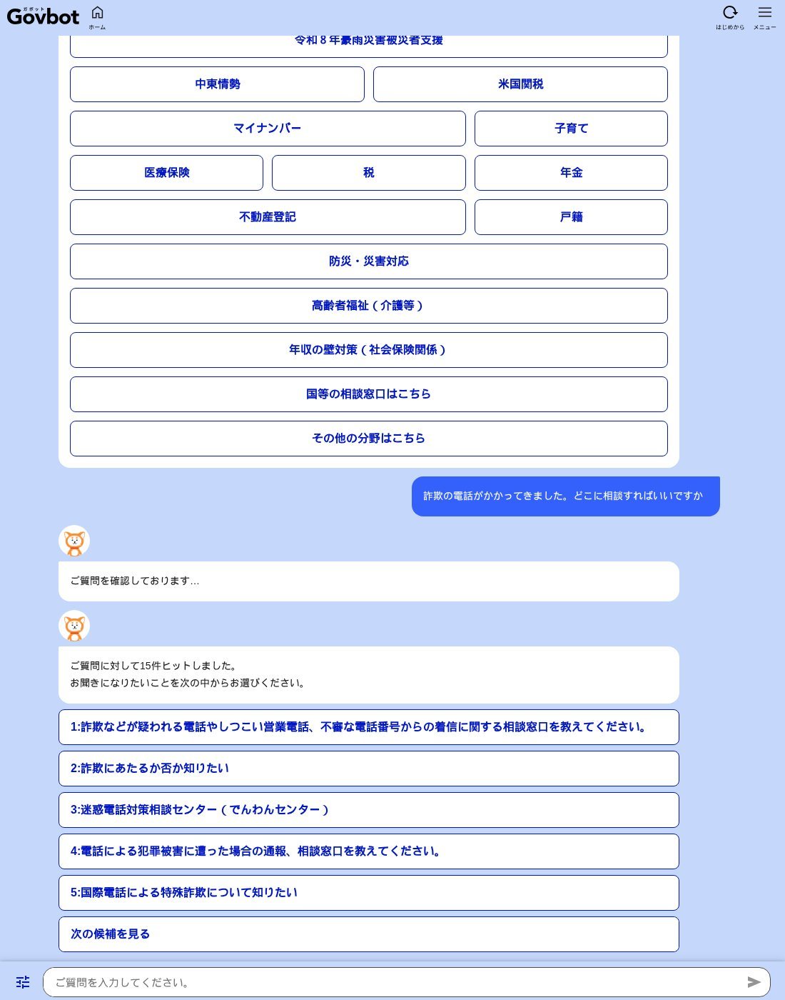
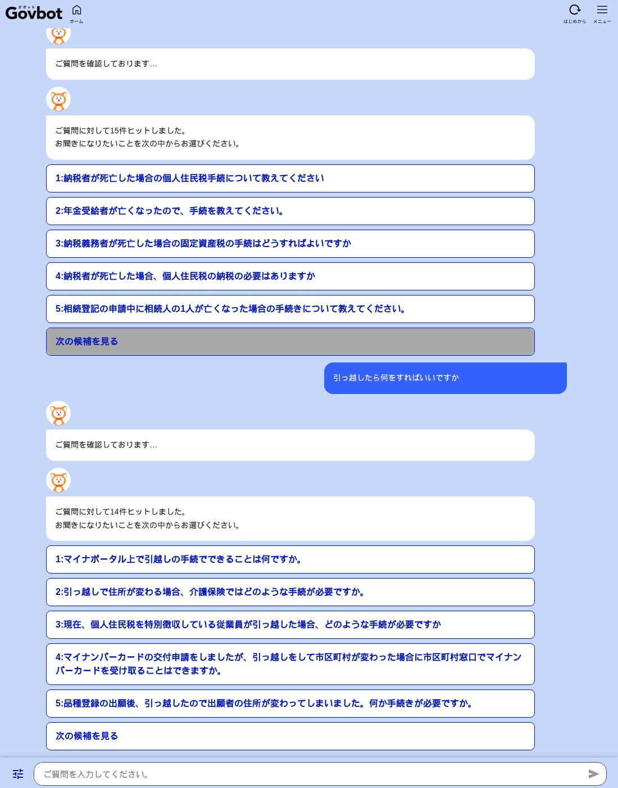

名古屋でAIシステムの開発をしている小嶋です。

役所に聞きたいことがあっても、どこに聞けばいいか分からない。電話は平日の昼間しかつながらない。そういうときのために、国は Govbot（ガボット）という相談用のチャットボットを作っています。登録もログインも要らず、24時間使えます。

ところが国会では、「知られていない」「中身が足りない」「費用に見合っていない」という指摘が、何人もの議員から出ています。

実際にどこまで答えてくれるのか、当社で試しました。あわせて、国会でだれが何を指摘し、政府がどう答えたかを、会議録から調べました。

先にまとめます。

- Govbot は、**答えを文章で返すのではなく、よくある質問の候補を並べる**作りです。そこから1つ選ぶと、用意された答えが出ます
- 制度の名前が分かっている質問には、**候補の上位に合うものが出ました**
- 「夫が亡くなった」「引っ越した」のように**状況で聞くと、関係の薄い候補が混ざりました**
- 市町村のことは答えません
- 国会では、**4人の議員が Govbot を名前を挙げて取り上げ**ています。「1回の質問あたり約2,000円から4,000円」という試算も出ました
- 2026年5月に大臣が「載っていない」と答えた相談窓口が、**11月に試すと候補に出ました**

## Govbot とは

正式な名前は「国・地方共通相談チャットボット」です。総務省とデジタル庁が、2024年3月に提供を始めました。デジタル庁がシステムの開発と運用を、総務省が各府省の「よくある質問」づくりの支援を受け持っています。

国会での政府の説明では、ねらいは2つです。国民が便利になることと、自治体の負担を軽くすることです。国が全国で同じように答えられる質問を、国がまとめて引き受ける、という考え方です。

2026年11月12日に開くと、次の分野が並んでいました。

- マイナンバー、子育て、医療保険、税、年金
- 不動産登記、戸籍
- 防災・災害対応、高齢者福祉（介護等）
- 年収の壁対策（社会保険関係）
- 地震や豪雨の被災者支援、個人情報の流出、米国の関税など、そのときどきの話題
- 国等の相談窓口

日本語のほかに15の言語を選べます。

## 9つの質問で試した結果

2026年11月12日に、ふつうの利用者と同じように画面から質問を入力しました。質問は、役所に聞きそうなことを9つ選んでいます。

### 作り：答えではなく、候補が出る

質問を入力すると、「ご質問に対して15件ヒットしました」のように件数が出て、よくある質問の題が5つずつ並びます。そこから1つ選ぶと、用意された答えが表示されます。

質問した文に合わせて文章を作って答える形ではありません。用意された質問と答えの中から、近いものを探す形です。

### 制度の名前で聞くと、合う候補が出た

- 「マイナンバーカードをなくしました」→ 2番目に「マイナンバーカードを紛失してしまった場合、どうすればよいですか。」
- 「児童手当はいくらもらえますか」→ 1番目に「児童手当の支給額について教えてください。」
- 「年金は何歳からもらえますか」→ 1番目に「年金は『いつから』『いくら』受け取れますか。」
- 「罹災証明書はどこでもらえますか」→ 1番目に「り災証明書について知りたい。」

マイナンバーカードの候補を選ぶと、利用を止めるための電話番号、警察への届け出、市区町村での再交付の流れが、まとめて出ました。知りたいことに届いています。

### 状況で聞くと、関係の薄い候補が混ざった

「引っ越したら何をすればいいですか」と聞いたときの上位5つです。

1. マイナポータル上で引越しの手続でできることは何ですか。
2. 引っ越しで住所が変わる場合、介護保険ではどのような手続が必要ですか。
3. 現在、個人住民税を特別徴収している従業員が引っ越した場合、どのような手続が必要ですか
4. マイナンバーカードの交付申請をしましたが、引っ越しをして市区町村が変わった場合に市区町村窓口でマイナンバーカードを受け取ることはできますか。
5. 品種登録の出願後、引っ越したので出願者の住所が変わってしまいました。何か手続きが必要ですか。

どれも「引っ越し」という言葉が入った質問です。けれども、引っ越した人がまず何をすればよいかの全体は、ここからは分かりません。5番目は、植物の品種を登録する人向けの質問です。

「夫が亡くなりました。何の手続きが必要ですか」でも同じでした。上位は、個人住民税、年金、固定資産税、相続登記の質問です。1つずつは正しい答えにつながりますが、何から手をつけるかは、聞いた人が自分で組み立てることになります。

### 範囲の外

- 「パスポートを更新したい」→ 上位5つは、どれもマイナポータルについての質問でした。2番目以降には「マイナポータルのパスワード変更」のように、パスポートと関係のないものが混ざりました
- 「名古屋市のごみの出し方を教えて」→「申し訳ありません。お答えできる情報を持ち合わせておりません。」

市町村のことは、Govbot の範囲の外です。画面には「自治体のチャットボットを探す」という入口が別にあります。

### 試して分かったこと

Govbot は、**何という制度のことを聞きたいかが分かっている人**には役に立ちます。**自分に起きたことは分かるが、どの制度の話かが分からない人**には、まだ届きにくい作りです。役所の窓口でいちばん多いのは、後の人のはずです。

## 国会でだれが取り上げたか

2018年1月から2026年11月までの会議録で、行政のチャットボットにふれた発言は111件ありました。そのうち Govbot を名前を挙げて取り上げた議員は4人です。日付の順に並べます。

### 山本博司さん（当時 参議院・2025年3月13日 総務委員会）

提供の開始から1年たったところで、取り組みと改善の状況を聞きました。総務省の答弁は次のとおりです。

- 2025年2月末までの累計のアクセスは約36万件
- 防災、高齢者福祉などの分野を近く足す
- 生成AIを効果的に使うための実証をしている

山本さんはこれを受けて、「大事な仕組みでも、まだまだ知られていないというような現状」だと述べ、周知を求めました。

### 石井苗子議員（参議院・2025年5月27日 総務委員会）

[石井苗子議員](https://xb4g.com/giin/ishii-mitsuko#ref=vibeblog-govbot)は、地域で相談を受ける行政相談委員の制度を取り上げました。人口が減り、ボランティアに頼る形が続かなくなることを前提に、行政相談チャットボットのような取り組みをふくめて、やり方を見直すよう求めています。

### 安野貴博議員（参議院・2025年12月16日 総務委員会）

いちばん踏み込んだ質疑です。[安野貴博議員](https://xb4g.com/giin/anno-takahiro#ref=vibeblog-govbot)は、全国の自治体が共通で使える土台を作るという Govbot の考え方を「非常に意義深く、人手不足の自治体等にとって有用」と評価したうえで、いまの姿は「あるべき姿から懸け離れている」と述べました。挙げた理由は3つです。

- **記録が取れていない**：動かして約2年たつのに、対話の件数や中身の記録が十分に取られていない
- **費用に見合っていない**：関連の支出は累計5.3億円。確かめられる回答の数から計算すると、1回の質問あたり約2,000円から4,000円。人が答えるコールセンターは1件あたり300円から1,000円くらい
- **作りが古い**：決められた質問と答えの中から近いものを返す形で、生成AIが出る前の設計にとどまっている。利用者の満足度は40%程度

提案も3つです。使われ方を見ながら直していける契約にすること、費用と効果を測る指標を置くこと、生成AIの文章を作る力を使うことです。

### 中田優子議員（参議院・2026年5月21日 総務委員会）

[中田優子議員](https://xb4g.com/giin/nakada-yuko#ref=vibeblog-govbot)は、詐欺の被害の相談窓口の質疑の中で取り上げました。

> この各省庁のＦＡＱについても内容の充実がまだされておらず、Ｇｏｖｂｏｔの存在自体も国民には周知をされておりません。

ブラウザで開く形だけなので、たどり着く前にあきらめる人がいるのではないかと述べ、アプリにできないかを聞いています。迷惑電話の相談窓口（でんわんセンター）を Govbot で案内することも求めました。

### チャットボット全体についての発言

Govbot の名前は出していませんが、同じ問題を取り上げた発言があります。

- [黒田征樹議員](https://xb4g.com/giin/kuroda-masaki#ref=vibeblog-govbot)（衆議院・2025年6月10日）：自分の状況を入力すると、合う支援が出て、そのまま申請の画面に進める仕組みを提案。「制度に自分からたどり着けない人も、制度の方からいわゆる相談者の方に寄り添ってくれる」
- 奥村政佳さん（当時 参議院・2025年5月27日）：大きな自治体はAIのチャットボットを入れ始めているが、小さな自治体には「人材もいないしシステムも入ってこない」と指摘
- [ながえ孝子議員](https://xb4g.com/giin/nagae-takako#ref=vibeblog-govbot)（参議院・2025年5月29日）：小さな自治体はITの専門の人が限られているので、仕組みはとにかく簡単に、と要望
- [加田裕之議員](https://xb4g.com/giin/kada-hiroyuki#ref=vibeblog-govbot)（参議院・2024年12月19日）：補助金の案内のサイトについて、質問と答えを重ねて探せる形にするよう提案

黒田議員の提案は、当社が試して感じた「状況で聞くと届きにくい」という点と、同じところを指しています。

## 政府の答弁と、その後

**2025年12月16日（総務大臣）**

安野議員の指摘について、林芳正 総務大臣は「課題であるというふうに認識をしております」と答えました。分野を広げること、質問と答えの中身を充実させること、生成AIの活用をふくめた機能の強化、効果を確かめる指標の見直し、記録を取って使うことを、デジタル庁と検討するとしています。

**2026年5月21日（デジタル庁、総務大臣）**

アプリにすることについて、デジタル庁は、それがいちばんよい方法かどうかもふくめて総務省と相談すると答えました。迷惑電話の相談窓口については、総務大臣が「現時点で、でんわんセンターに関する情報はこれに掲載されていない」と述べ、Govbot との連携をふくめて周知を図るとしています。

**2026年11月12日（当社が試した結果）**

「詐欺の電話がかかってきました。どこに相談すればいいですか」と入力すると、3番目の候補に「迷惑電話対策相談センター（でんわんセンター）」が出ました。選ぶと、電話番号、受付の時間、担当の部署が表示されます。

5月の国会で「載っていない」と答弁されたものが、半年後には載っていました。いつ足されたか、質疑がきっかけだったかは、当社では確かめていません。ただ、国会で指摘されたことが、実際の画面で直っているのを確かめられた例です。

一方で、候補を並べて選ばせる作りは、11月12日の時点で変わっていませんでした。生成AIを使った答え方に変わったかどうかは、画面からは分かりませんでした。

## 当社の考え

ここからは当社の考えです。

Govbot のむずかしさは、技術よりも、**答える範囲の決め方**にあると思います。

行政の答えは、間違えると人に害が出ます。生成AIに自由に文章を作らせれば、もっともらしい間違いが混ざるおそれがあります。用意した答えだけを返す今の作りは、その点では安全です。政府が慎重になる理由は分かります。

ただ、その安全は、使う人に手間を回すことで成り立っています。自分の状況を制度の名前に言いかえる作業を、聞く側がしなければなりません。

あいだの道はあります。答えの文は、用意された質問と答えからしか作らない。そのうえで、AIには2つのことだけをさせます。

- 聞かれた状況から、関係する制度を選び出す
- 選んだ答えを、何から手をつけるかの順に並べる

出どころを必ず一緒に示せば、読む人が元を確かめられます。答えの中身は役所が用意したもののまま、たどり着く手間だけを減らす形です。

当社は、この考え方でシステムを開発しています。「[Kurage 防災AIチャット](https://kurage.exbridge.jp/kbousai.php/#ref=vibeblog-govbot)」は、住所か現在地を入れると、警報、避難、川と台風の情報をまとめて答えます。もとにしているのは、国や自治体が公開しているデータです。

もう1つ、安野議員が挙げた費用の問題です。1回の質問あたり約2,000円から4,000円という試算が正しければ、これは技術の問題というより、作り方と頼み方の問題です。使われ方を見ながら小さく直していく契約にする、という提案は、開発の現場から見てもそのとおりだと思います。行政のシステムを小さい単位で頼める場については、「[IT業界の多重下請け構造と中抜き](https://exbridge.jp/vibeblog/2026-11-12-it-tajuu-shitauke-nakanuki-kokkai.html#ref=vibeblog-govbot)」に書きました。

## 調べて分かったこと

- **党を問わず、同じ指摘が続いています。** 「知られていない」という指摘は、2025年3月と2026年5月に、別の議員から出ています
- **評価と批判が一緒に出ています。** 取り上げた議員は、だれも Govbot をやめろとは言っていません。考え方は良い、今の姿が足りない、という立場です
- **指摘のあとに、変わったところがあります。** 分野は増え、5月に載っていなかった相談窓口は11月に載っていました

国会の会議録と、実際の画面を並べると、指摘がどこまで届いたかを確かめられます。

国会での議論は、当社の「[Kurage 国会トラッカー](https://xb4g.com/giin/tracker/#ref=vibeblog-govbot)」で、テーマごとに追えます。

## 調べ方

- Govbot は、2026年11月12日に、公開されている画面から、ふつうの利用者と同じように質問を入力して試しました。質問は9つ、候補を選んだあとの答えを見たのは2つです
- 9つの質問は当社が選んだものです。質問を変えれば、結果は変わります。Govbot の全体の正確さを測ったものではありません
- 国会の発言は、国立国会図書館の国会会議録検索システムで、2018年1月1日から2026年11月12日までについて、「Govbot」「ガボット」と、「チャットボット」に「行政」「相談」「自治体」「窓口」を組み合わせた7通りで探しました。チャットボットにふれた発言は111件です
- 記事の中の数字（約36万件、5.3億円、約2,000円から4,000円、満足度40%程度など）は、国会での発言と答弁によります。もとの資料は、当社では確かめていません
- 「AIチャット」「対話型AI」など、別の言い方だけで語られた発言は拾えていません

## よくある質問

### Govbot（ガボット）とは何ですか？

総務省とデジタル庁が2024年3月に提供を始めた、国と地方に共通の相談チャットボットです。マイナンバー、子育て、医療保険、税、年金などについて、国が全国で同じように答えられる質問に、24時間対応します。登録やログインは要りません。

### Govbot は生成AIで答えているのですか？

2026年11月12日に試した範囲では、質問に合わせて文章を作るのではなく、用意されたよくある質問の候補を並べ、選んだものの答えを表示する作りでした。国会では、2025年3月に生成AIの活用の実証をしていると答弁があり、2025年12月に総務大臣が機能の強化を検討すると答えています。

### Govbot は自治体のことも答えてくれますか？

市町村ごとのことは答えません。当社が「名古屋市のごみの出し方を教えて」と聞いたときは、お答えできる情報を持ち合わせていない、という答えでした。画面には、自治体のチャットボットを探す入口が別にあります。

### 国会では、Govbot についてどんな指摘が出ていますか？

知られていないこと、質問と答えの中身が足りないこと、費用に見合っていないこと、生成AIが出る前の設計にとどまっていることです。2025年12月の参議院 総務委員会では、1回の質問あたり約2,000円から4,000円かかっているという試算が示され、総務大臣が課題だと認識していると答えました。
