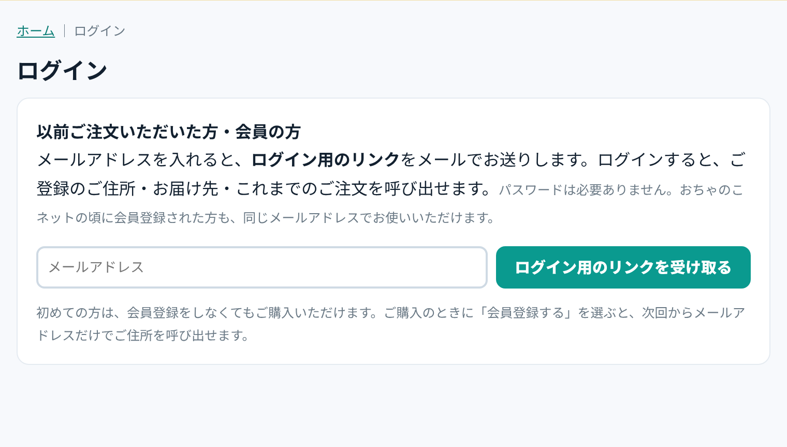

名古屋でAIシステムの開発をしている、株式会社エクスブリッジの小嶋です。

当社が運営する工具・機械の通販サイト「X-Direct」に、会員の機能を付けました。あわせて、12月31日まで「会員様は銀行振込で2%引き」のキャンペーンを始めています。

- [X-Direct（工具・機械のメーカー直送通販）](https://www.exdirect.net/#ref=vibeblog-kvcart-member)

X-Direct は、11月15日にネットショップ作成サービスの「おちゃのこネット」をやめて、自社で開発したECシステム「Kurage Vibe-Cart」に移りました。移ったときは、会員の機能をあえて入れませんでした。注文のたびにお客様情報を入れてもらう、ゲスト購入だけの店にしていました。

ところが、X-Direct には何年もくり返し買ってくださるお客様がいます。業務用の消耗品を、同じ現場に何度も送るような方です。そういう方に毎回、会社名から住所、電話番号まで入れ直してもらうのは、やはり不親切です。そこで会員の機能を作り、おちゃのこネット時代の会員の方を引き継ぐことにしました。

## 会員のログインにパスワードを使わない

いちばん大きく決めたのは、パスワードを使わないことです。

ログインの画面でメールアドレスを入れると、ログイン用のリンクがメールで届きます。そのリンクを開くとログインできます。次に買うときも、メールアドレスを入れるだけです。

パスワードをやめた理由は3つあります。

1つめは、おちゃのこネットのパスワードを引き継げないことです。会員の情報は取り出せても、パスワードは取り出せません。パスワードの仕組みにすると、引き継いだ会員の方は全員、最初に「パスワードの再設定」から始めることになります。

2つめは、業務のお客様は買う間が空くことです。半年に1回、1年に1回という注文も珍しくありません。その間にパスワードを忘れて、結局ゲストで入れ直す。これでは会員の意味がありません。

3つめは、パスワードを預からなければ、漏れたときの害が小さいことです。店がパスワードを持っていなければ、店から漏れることもありません。

## 会員管理の機能でこだわったところ

メールのリンクでログインする仕組みは、作りが甘いと、かえって不便になったり、危なくなったりします。作るときに気をつけたことを書いておきます。

### リンクは開いただけでは使われない

ログイン用のリンクは、60分の間に1回だけ使えます。ただ、会社のメールには、届いたメールのリンクを先に開いて安全か調べる仕組みが入っていることがあります。リンクを開いただけで使い切る作りだと、お客様が開く前に使い切られてしまいます。

そこで、リンクを開くと「ログインする」のボタンが出て、それを押したときに初めてログインするようにしました。

### 登録があるかどうかを外に見せない

登録されていないメールアドレスを入れても、画面には「ログイン用のリンクをお送りしました」と同じ案内を出します。誰が会員なのかを、外から調べられないようにするためです。

同じアドレスへのリンクは1時間に3通までにして、いたずらでメールを送り続けられないようにもしました。

### 別の端末でリンクを開いても、カートが消えない

パソコンでカートに商品を入れて、スマホでメールを開いてリンクを押す。こういう使い方はよくあります。カートはブラウザごとに持っているので、そのままでは、ログインしたらカートが空、ということになります。

リンクを送るときに、そのときのカートの中身を預けておき、リンクを開いたブラウザのカートに入れるようにしました。同じブラウザで開いたときに数量が2倍にならないよう、商品ごとに多いほうの数量を取ります。

### マイページで、前に買った商品をそのまま買い足せる

会員の方は、マイページで次のことができます。

- これまでに買った商品の一覧から、数量を入れてカートに入れる
- 過去の注文を開いて、「この注文と同じ商品をカートに入れる」
- よく使う届け先（現場・支店・倉庫など）を選んで注文する
- 登録の情報を直す、会員登録を削除する

おちゃのこネット時代の注文も、マイページに出るようにしました。Kurage Vibe-Cart は、おちゃのこネットと同じ商品番号を使っています。そのため、何年も前の注文からでも「同じものをもう一度」がそのまま使えます。消耗品を定期的に買う業務のお客様には、ここがいちばん便利だと思います。

### ログインしていない人には、会員の情報を書き換えさせない

ゲストで注文した人が、会員と同じメールアドレスを入れることもあります。そのときは注文を会員の履歴につなぐだけにして、登録の住所や名前は書き換えません。書き換えられるのは、本人がログインしているときだけです。

### 会員でなくても買える

会員の機能を付けても、ゲスト購入はそのまま残しました。初めての方は、注文の画面で「会員登録する」を選べば、その場で会員になれます。

このほかにも、スマホの幅で崩れないこと、ご利用規約とプライバシーポリシーの書き直しまで、まとめて済ませています。

## おちゃのこネットの会員と注文を引き継いだ

引き継いだのは、おちゃのこネットの会員の約7,900人です。登録の住所・会社名・電話番号に加えて、その方たちの過去の注文と、よく使っていた届け先も移しました。

会員の一覧は、おちゃのこネットの管理画面の【受注管理】→【登録者一覧】から CSV でダウンロードできます。ひとつ注意があります。「登録者情報をすべてダウンロードする」のボタンを押しても、画面は何も変わりません。ファイルは、ブラウザのダウンロードのフォルダに黙って保存されています。当社も最初は「ボタンが反応しない」と思いました。同じように移行を考えている方は、ダウンロードのフォルダを見てみてください。

注文の履歴と届け先は、おちゃのこネットの API から受注を読んで、会員のメールアドレスとつなぎました。会員のポイントは全員0だったので、ポイントの仕組みは作っていません。

## 会員様限定価格のキャンペーンを始めた

会員の機能を付けたのに合わせて、会員様限定のキャンペーンを始めました。

- 12月31日まで、会員様が銀行振込でご注文いただくと、商品代金（税別）から2%を値引きします
- 金額の条件はなく、1点からのご注文でも値引きします
- 値引きは、ご注文の確認画面で自動で付きます。お問い合わせは要りません
- 注文の画面で「会員登録する」を選んだ方も、その注文から対象になります
- 商品ページには、会員様・銀行振込のときのお値段を出しています

X-Direct では、税別10万円以上・銀行振込のご注文に、値引きしたお見積書をご提案するキャンペーンも続けています。こちらは問い合わせていただく形です。2つは併用できないので、大きなご注文はお見積書を、それ以外は会員様限定価格をお使いください。

- [工具・機械の通販 X-Direct で見積もり値引きキャンペーン](https://exbridge.jp/vibeblog/2026-11-19-x-direct-mitsumori-nebiki-campaign.html#ref=vibeblog-kvcart-member)

期間が終わると、帯も値引きも自動で消えます。終わる日に誰かが設定を戻しに行く必要はありません。

## 顧客データを集めて、キャンペーンをメールで案内している

キャンペーンのお知らせは、2回に分けてメールで送ります。

1回目は、会員の方へ「会員様限定価格のご案内」です。いま配信しています。2回目は、これまでに X-Direct でお買い物をいただいた方全員へ「会員登録で会員様限定価格に」というご案内を送ります。

送り先は、おちゃのこネットの登録者の一覧と、API から読んだ受注の記録を合わせて作りました。同じ方に二重に届かないようメールアドレスでまとめ、以前に配信停止を頼まれた方は除いています。

差出人は店のアドレス（info@exdirect.net）です。本番の前に試しの1通を送り、迷惑メールに入らないこと、送信元の認証（SPF・DKIM・DMARC）が通っていることを確かめました。何千通も一度に送るとレンタルサーバーの送信の上限に当たるので、5秒に1通ずつ送っています。

## ここまで、半日でできた

会員の機能、おちゃのこネットからの引き継ぎ、キャンペーン、メールの配信まで、今回の作業は1日の半分ほどで終わりました。

当社は、AIに仕事をさせる前提でシステムを作っています。今回も、作業の大半はAIが進めました。ソースコードを書き、本番のデータの写しで試験を流し、画面を撮って崩れを見つける。おちゃのこネットの管理画面から会員の CSV を落とすところまで、AIがやっています。人がしたのは、管理画面へのログインと、メールを送ってよいかの判断くらいです。

モールやネットショップ作成サービスでは、こうはいきません。会員の仕組みもキャンペーンの決まりも、サービスが用意したものの中から選ぶしかないからです。「パスワードをやめたい」「業務のお客様向けに届け先の帳面がほしい」と思っても、用意されていなければそれまでです。自社のシステムなら、思いついたその日に作れます。

## ネットショップを自社のシステムに移したい方へ

X-Direct で動いている Kurage Vibe-Cart は、Kurage App Store で販売しています。PHP が動くレンタルサーバーに置けば動き、月額のサービス料はかかりません。おちゃのこネットと同じ商品のURL のまま移せるので、検索からの流入やブックマークを落とさずに移行できます。

- [Kurage Vibe-Cart（Kurage App Store）](https://kappstore.exbridge.jp/app.php?id=754c7ddb5f1c8f26#ref=vibeblog-kvcart-member)

今回の会員の機能やキャンペーンのように、お店ごとの「こうしたい」も、AIで作り足していけます。おちゃのこネットなどからの移行や、会員データの引き継ぎのご相談もお受けしています。

おちゃのこネットから移った話と、AIで通販を回している話は、こちらに書いています。

- [おちゃのこネットをやめて、自社のネットショップへ](https://exbridge.jp/vibeblog/2026-11-15-ochanoko-net-kurage-vibe-cart.html#ref=vibeblog-kvcart-member)
- [楽天・Yahoo!ショッピング・Amazon・メルカリから撤退し、AI駆動のECサイトへ](https://exbridge.jp/vibeblog/2026-11-17-ai-kudo-ec-x-direct-kurage-vibe-cart.html#ref=vibeblog-kvcart-member)
