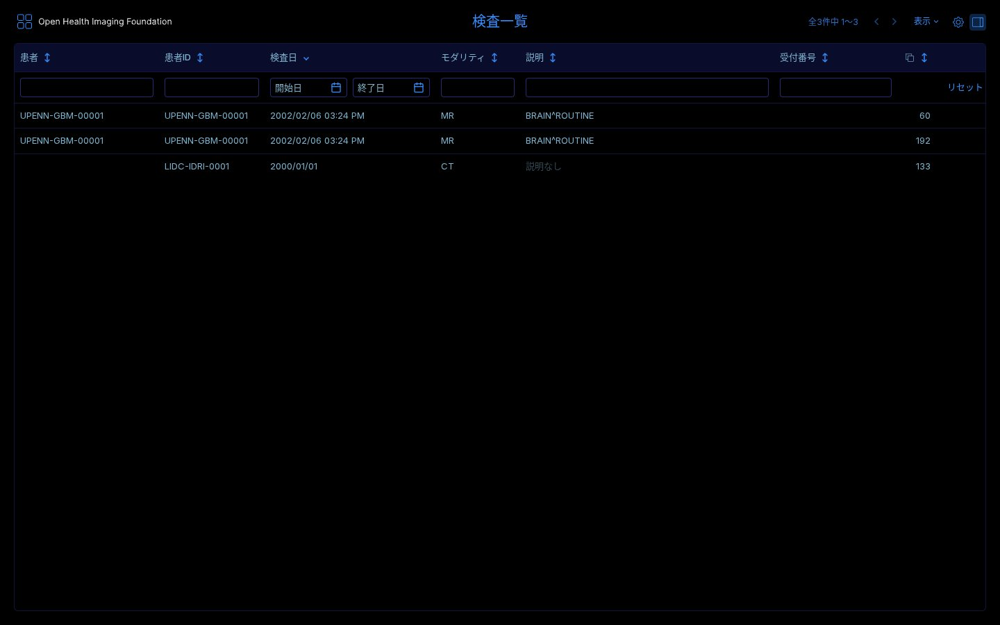
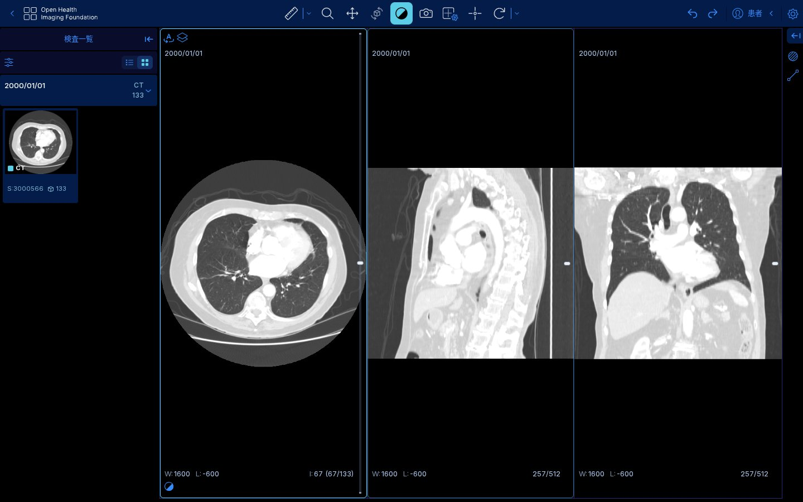
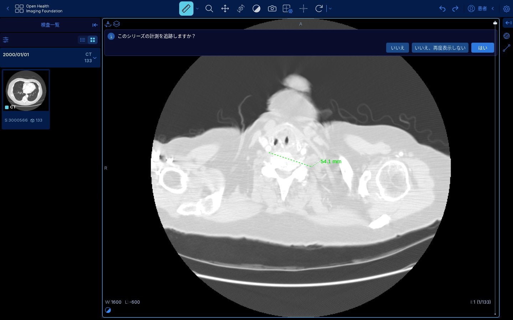

名古屋でAIシステムの開発をしている、株式会社エクスブリッジの小嶋です。

CT・MRI の医療画像を、院内のどのパソコンからでもブラウザで見られるようにする導入キットを作りました。「DICOM ビューアを院内サーバーに — OHIF Viewer＋Orthanc 日本語導入キット（CT・MRI のサンプル付き）」です。

- [DICOM ビューアを院内サーバーに — OHIF Viewer＋Orthanc 日本語導入キット（kappstore）](https://kappstore.exbridge.jp/app.php?id=0bb3640c5a9b243d#ref=vibeblog-ohif-kit)

## なぜ作ったか：Mac だけでも、Windows だけでもない画像の見方

前の記事で、Mac で CT・MRI を見る DICOM ビューア「PHORLIX」を紹介しました。Mac の医療画像ビューアには長い流れがあり、医師に愛されてきました。

- [Macで使えるDICOMビューア PHORLIX｜米国App Store医療有料1位](https://exbridge.jp/vibeblog/2026-11-23-phorlix-dicom-viewer-mac.html#ref=vibeblog-ohif-kit)

一方で、日本の診療所や病院のパソコンは、Windows が多数です。紹介先から受け取った画像の CD も、たいてい Windows 用のビューアが付いています。

そこで、パソコンの種類を問わず、院内のサーバーに画像を置いて、Windows でも Mac でもタブレットでも、ブラウザから同じように見られる形を用意しました。土台にしたのは、オープンソースの OHIF Viewer と Orthanc です。

## OHIF Viewer と Orthanc とは

- **OHIF Viewer**：ブラウザで動く DICOM ビューアです。画像を表示する部品 cornerstone3D の上に作られていて、断面の切り替え、3断面（アキシャル・サジタル・コロナル）の同時表示、長さや角度の計測ができます。ライセンスは MIT です
- **Orthanc**：DICOM の画像をためておく、軽い画像サーバー（PACS）です。OHIF Viewer はここから画像を読みます。本体は GPLv3、ブラウザから画像を読むための DICOMweb プラグインは AGPLv3 です

どちらも世界の医療・研究の現場で使われているオープンソースですが、日本語で入れて動かす手順は、ほとんどありませんでした。

- [OHIF Viewerとは｜ブラウザで動くDICOMビューア（MIT）](https://kurage.exbridge.jp/oss/ohif-viewer/#ref=vibeblog-ohif-kit)

## 本家の日本語は約9%だった

実際に入れて確かめると、OHIF Viewer の本家にも日本語の設定はありますが、画面の言葉665語のうち、訳されているのは63語（約9.5%）だけでした。誤訳もありました。さらに、新しい版（v3.13）の検査一覧は、英語がプログラムに直接書き込まれていて、翻訳の仕組みを通りません。

キットでは、次のように日本語にしました。

- 画面の言葉665語をすべて訳しました。下訳は社内のAI（gemma4）で作り、放射線科の言葉は人の手で直しています。英語のまま残したのは、略語やメーカー名など42語だけです
- 直接書き込まれた英語22語は、画面の文字を見て置き換えます。患者のデータや、画像を表示する部分には触りません
- 本体への差し込みは1行だけです。OHIF の版が上がって差し込めなくなったときは、気づけるようにビルドが止まります

## 入れて約1分で、CT・MRI の3断面と計測まで

キットは Docker Compose で、OHIF Viewer と Orthanc を一度に立てます。当社の環境で測った時間は次のとおりです。

- 部品の取得：数十秒、日本語版のビルド：10秒、起動してから応答まで：3秒
- サンプル画像（385枚）の取得：15秒、登録：12秒
- 画面が開くまで：検査一覧 約5秒、CT 約7秒、3断面 約10秒、MRI 約5秒

サンプルには、研究用に公開されている匿名化済みのデータを使います。

- 胸部CT：LIDC-IDRI-0001（CC BY 3.0）
- 頭部MRI：UPENN-GBM-00001（CC BY 4.0）

公開元に配り直しの決まりがあるため、キットに画像そのものは入れず、スクリプトで公開元から取ってくる形にしています。

## 院内に置くための守り

医療画像は、外に出してはいけない情報です。キットでは、次のように守りを固めています。

- 画像サーバー（Orthanc）は、サーバーの中からしか接続できないようにしています
- ビューアから画像サーバーへの中継は「読むだけ」にし、書き込み（画像の登録や削除）はブラウザから受け付けません
- ビューアの入口に、IDとパスワードを付けられます
- バックアップの手順も付けています

## 参考閲覧用です

このキットは、**参考閲覧用**です。診断（読影）には使わないでください。

医療画像のビューアを診断に使う場合は、国の承認を受けた医療機器（医薬品医療機器等法の「プログラム医療機器」）が必要になる場合があります。病院の読影は、承認を受けた PACS のビューアで行うのが原則です。このキットは、次のような用途を想定しています。

- 紹介状に付いてきた画像を、院内のどのパソコンからでも確かめる
- 学会や院内の勉強会の資料づくりに、画像を見る
- 医療画像を扱うシステムの試作や、研修・教育に使う

また、スマホの幅では OHIF の見出しが重なるため、PC かタブレットでの利用をおすすめしています。

## キットに入っているもの

- Docker Compose の一式（OHIF Viewer＋Orthanc）
- 日本語の言葉のファイルと、版を上げるときの直し方
- サンプル画像の取得・登録のスクリプト
- 入口の認証、読むだけの中継、バックアップの手順
- 実際に入れて測った時間と、つまずきと直し方をまとめた手順書（6本）

- [DICOM ビューアを院内サーバーに — OHIF Viewer＋Orthanc 日本語導入キット（kappstore）](https://kappstore.exbridge.jp/app.php?id=0bb3640c5a9b243d#ref=vibeblog-ohif-kit)

## AIの考察：オープンソースを「日本の現場で使える形」にする

AI で仕事をしている会社として、このキットを作って感じたことを書いておきます。

OHIF Viewer は、世界中の医療・研究機関が使い、毎週のように更新されている、とても良いソフトです。それでも、日本の現場では、言葉の壁と入れ方の壁で、ほとんど使われていません。665語の翻訳も、AIを使えば下訳は一瞬でできます。ただ、放射線科の言葉が正しいか、画面のどこに英語が直接書かれているかは、実際に入れて、画面を見て確かめないと分かりません。

当社は、こうした世界のオープンソースを、AIで日本語にし、実際に動かして確かめ、日本の現場で使える形にして届けています。医療画像の分野は、まだ日本語の情報が少ない分野です。導入やカスタマイズのご相談も受けています。

この記事は、当社が OHIF Viewer v3.13.15 と Orthanc（1.13.1）を実際に入れて確かめた結果をもとに書きました。
