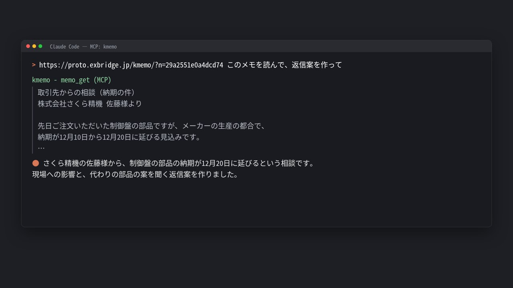
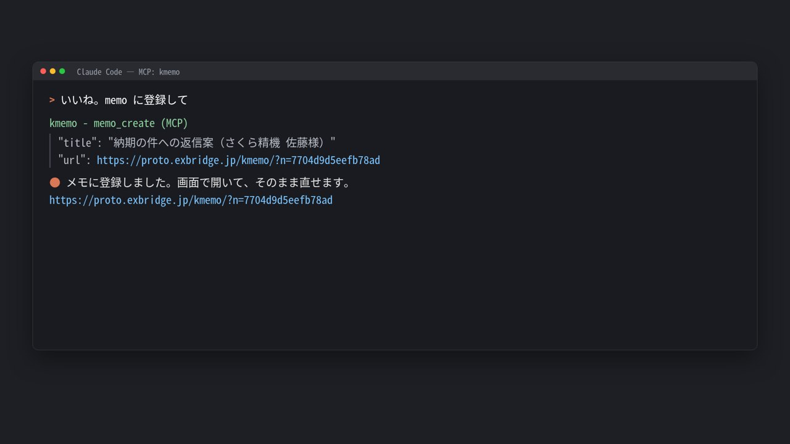
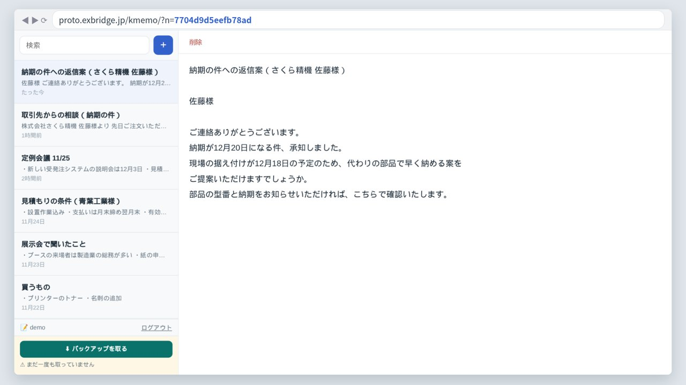

名古屋でAIシステムの開発をしている、株式会社エクスブリッジの小嶋です。自社のサーバーに置けるメモ「Kurage Memo」を、MCP（Model Context Protocol）に対応させました。Claude Code や Codex などの AI エージェントから、メモを読んだり、AI が作った下書きをメモに残したりできます。

Kurage Memo（デモ）
https://proto.exbridge.jp/kmemo/#ref=vibeblog-kmemo-mcp

どんなものかを、1分ほどの動画にまとめました（音声が出ます）。

<div style="width:100%;max-width:960px;margin:16px auto;border-radius:10px;overflow:hidden;background:#000">
  <video src="https://kurage.exbridge.jp/pv/kmemo-pv.mp4" poster="https://kurage.exbridge.jp/pv/kmemo-pv-poster.jpg" controls playsinline preload="none" style="display:block;width:100%;height:auto"></video>
</div>

## 作った理由

当社では、毎日の仕事の多くを AI エージェント（Claude Code）と一緒に進めています。メールは、Roundcube の画面の URL を AI に貼れば、AI がそのメールを読んで返信案を作ります。一方で、チャットで届いた相談や、自分で書き留めたメモは、そのたびにコピーして AI に貼り付けていました。

そこで、メールと同じように「このメモを見て」と URL で指定できるようにしました。今日、取引先からの相談をメモに入れておき、その URL を AI に渡して返信案を作ってもらい、さらに「メモに登録して」で返信案をメモに残す、という使い方を実際にしたところ、思った以上に手間が減りました。社内で使うだけでなく、製品の機能として入れることにしました。

## できること

### メモの URL を貼るだけで、AI が中身を読む

メモを開くと、ブラウザの URL がそのメモ専用（…/memo/?n=メモの番号）に変わります。この URL を AI に貼って「このメモを読んで、返信案を作って」と頼むと、AI が MCP でメモの中身を読みます。



### 「メモに登録して」で、AI の下書きをメモに残す

AI が作った返信案や議事録は、「メモに登録して」と言うだけで、新しいメモとして保存されます。AI が返す URL を開けば、画面でそのまま直して使えます。





### 探して使う

「〇〇の件のメモを探して」と頼めば、AI がメモを検索してから読みます。

## MCP の道具

AI エージェントから使える道具は、次の6つです。

- memo_list：メモの一覧・検索（タイトル・抜粋・URL）
- memo_get：1件を読む（URL かメモの番号）
- memo_create：新しいメモを足す（1行目がタイトル）
- memo_append：メモの末尾に書き足す
- memo_update：本文を書き換える
- memo_delete：削除する（設定で許したときだけ）

MCP のプログラムは kmemo_mcp.php の1ファイルで、PHP だけで動きます。Claude Code なら、次の1行で登録できます。

```
claude mcp add kmemo -e KMEMO_URL=https://（あなたのサーバー）/memo/ -e KMEMO_TOKEN=（鍵） -- php kmemo_mcp.php
```

## 安全のための決まり

メモは、いちばん私的なデータです。AI から使えるようにするにあたって、次のように決めました。

- メモは、これまでどおり自社のサーバーの中のファイルにあります。外のサービスには預けません
- AI 用の窓口は、設定ファイルに鍵（トークン）を書いたときだけ使えます。書かなければ、窓口そのものがありません
- 鍵ごとに、どのユーザーのメモを扱うかが決まります。ほかの人のメモには届きません
- 削除は、設定で許したときだけです。最初は削除できない状態で使い始められます
- 読むだけにする設定もあります
- AI 用の鍵は、画面のログインとは別のものです。鍵を設定ファイルから消せば、その鍵での読み書きはすぐに止まります

動作の確認として、画面と保存の検証26件に加えて、MCP の検証10件を同梱しています（作成・追記・検索・書き換え、削除を断ること、鍵が違う呼び出しを断ること、など）。

## Kurage Memo について

Kurage Memo は、Simplenote 型のシンプルなメモです。タイトル欄はなく本文の1行目がタイトルになり、保存ボタンもなく書いたそばから自動で保存されます。1ファイルの PHP で、データベースもいりません。PHP が動くレンタルサーバーに置けば使えます。

Kurage App Store で、ソースコードつきで販売しています。

Kurage Memo（Kurage App Store）
https://kappstore.exbridge.jp/app.php?id=2186dc017968081c#ref=vibeblog-kmemo-mcp

Kurage Memo（デモ）
https://proto.exbridge.jp/kmemo/#ref=vibeblog-kmemo-mcp
