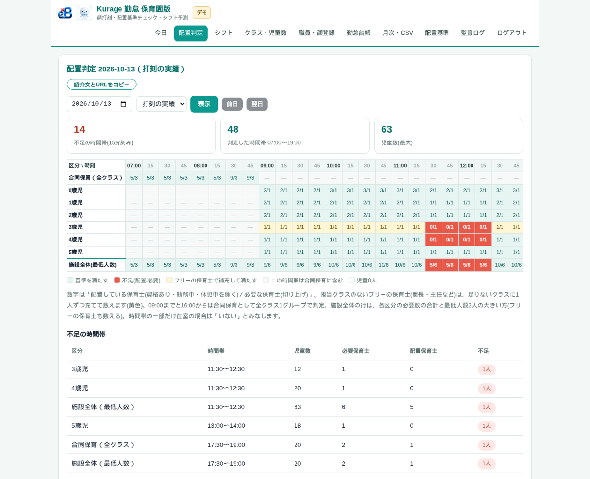

名古屋でシステム開発をしている、株式会社エクスブリッジの小嶋です。

当社では、保育園向けに、勤怠の打刻から保育士の配置が足りているかを判定する業務システムを開発しています。そのときに、配置基準の条文を読み直し、園の現場で「足りていたか」をどう確かめるのかを一つずつ整理しました。この記事では、保育士の配置基準の年齢ごとの人数と、必要な保育士の数の数え方、そして毎日の勤怠から配置が足りているかを確かめる方法をまとめます。

## 保育士の配置基準（国の基準）

保育所の保育士の数は、児童福祉施設の設備及び運営に関する基準（昭和23年厚生省令第63号）の第33条第2項に定められています。当社で2026年11月4日に条文を確かめたときの版（2026年10月1日施行）では、次のとおりです。

| 子どもの年齢 | 保育士1人あたりの子どもの数 |
|---|---|
| 乳児（0歳児） | おおむね3人につき1人以上 |
| 満1歳以上満3歳未満（1・2歳児） | おおむね6人につき1人以上 |
| 満3歳以上満4歳未満（3歳児） | おおむね15人につき1人以上 |
| 満4歳以上（4・5歳児） | おおむね25人につき1人以上 |

あわせて、ただし書きで「保育所一につき二人を下ることはできない」とされています。子どもが少ない時間帯でも、園全体で保育士が1人だけ、という状態は認められないということです。

配置基準の数字は、省令の改正で変わることがあります。インターネットの記事や、園に残っている以前の資料の数字をそのまま使うのではなく、今の条文で確かめてから使ってください。また、国の基準とは別に、自治体の条例で人数が上乗せされていることがあります。よく話に出る「1歳児は5人に1人」のような数字は、保育所の運営費（公定価格）の加算の基準で、この省令の数字とは別のものです。園のある自治体の条例や要綱も、あわせて確かめておく必要があります。

なお、同じ条の第3項には、理学療法士などの一定の専門職を、1人に限って保育士とみなすことができるという規定もあります。

## 必要な保育士の数は、どう数えるか

基準は「おおむね○人につき1人」なので、実際には子どもの数を基準で割り、端数を切り上げて必要な人数を出します。たとえば0歳児が7人いるクラスなら、7÷3で2.33…となり、切り上げて3人です。2歳児が13人なら13÷6で2.16…、やはり3人になります。3歳児16人なら2人、5歳児20人なら1人です。これに加えて、園全体では2人を下回らないかを見ます。

迷いやすいのが、朝夕の合同保育のように、年齢の違う子どもを一緒に見ている時間帯です。当社のシステムでは、まとめたグループの子どもの数を年齢区分ごとに基準で割り、それを足し合わせてから切り上げています。たとえば朝の合同保育に0歳児2人、1・2歳児5人、3歳児4人、4・5歳児9人がいれば、2÷3、5÷6、4÷15、9÷25を足して約2.13となり、必要な保育士は3人です。この数え方は、所管の自治体の考え方を確かめたうえで使っていただくものだと考えています。

もう一つ大事なのが、誰を保育士として数えるかです。保育補助の方や、看護師・調理・事務の方がその場にいても、保育士資格のある職員の数には入りません。紙や表計算で確かめていると、ここがあいまいになりがちです。

## 毎日の勤怠から、配置が足りているかを確かめる方法

配置基準は、朝の受け入れから夕方のお迎えまで、どの時間帯でも満たしている必要があります。後から確かめるには、少なくとも次の3つの材料をそろえて突き合わせます。

一つ目は、職員一人ひとりの出勤・退勤と休憩の時刻です。予定ではなく、実際に打刻した時刻を使います。二つ目は、その日のクラスごとの出席児童数です。朝夕の合同保育の時間帯に何人残っていたかが分かれば、それも使います。三つ目は、職員ごとの区分（保育士・保育補助など）と保育士資格の有無、担当のクラスです。

この3つがそろえば、15分ごとのように時間を区切って、それぞれの時間帯に各クラスにいた保育士資格のある職員の数と、出席児童数から計算した必要な数を比べられます。見落としやすいのは、お昼の休憩が重なる時間帯と、夕方に人が減っていく時間帯です。1日の合計時間で見ると足りているのに、休憩が2人重なった30分だけ足りなかった、ということは、時間を区切って比べないと分かりません。

ただ、タイムカードとシフト表と出席簿が別々のところにあると、これを毎日手で突き合わせるのはかなりの手間です。月末や監査の前にまとめて確かめようとしても、どの日のどの時間帯が足りなかったのかまでは追い切れないことが多いと思います。さらに言えば、本当に知りたいのは「先週足りていたか」より「来週のシフトで足りるか」のほうです。シフトの予定の段階で同じ比べ方ができれば、休みの入れ替えや応援の手配を前もってできます。

## 勤怠の打刻から配置を判定する「Kurage 勤怠 保育園版」

当社では、この確かめ方をそのまま業務システムにした「Kurage 勤怠 保育園版」を開発し、Kurage App Store で提供しています。

入口のタブレットやパソコンのブラウザで、職員が顔を映して出勤・退勤・休憩を打刻します。顔で照合できないときは、名前をタップして打刻できます。その打刻と、クラスごとの出席児童数から、配置が基準を満たしているかを日ごと・15分ごとに判定し、足りない時間帯を赤で示します。担当クラスのない園長や主任などの保育士は、足りないクラスに充てて数え、園全体の最低人数も判定します。早番・中番・遅番・休みのシフトを入れておけば、打刻の前、予定の段階で同じ判定を行います。

配置基準の既定値は、上で紹介した第33条第2項の数字（3人・6人・15人・25人、最低2人）で、自治体の条例に合わせてすべて設定で変えられます。第3項の専門職を保育士とみなす扱いは、自動の計算には入れていません。判定は設定された数字どおりの計算で、法律上の助言をするものではないので、使い始める前に所管の自治体の基準に合わせて設定を見直してください。

勤怠の台帳は打刻を丸めずにそのまま残し、打刻の追加・修正・削除はすべて管理者の操作として監査ログに記録されます。月ごとに、不足が出た日と時間帯の一覧、クラスごとの充足率を CSV で出せ、給与ソフトに取り込むための CSV も出せます。出席児童数は手入力のほか CSV でも取り込めます。

顔の照合はサーバー側のプログラムで行い、顔認識のモデルも同梱しているので、顔の画像を外部のサービスに送ることはありません。顔の特徴データは個人情報として扱い、登録のときに職員本人の同意を記録し、職員ごとに削除もできます。顔を登録しない職員も、名前のタップで打刻できます。

動作には PHP 7.4 以上と pdo_sqlite、gd が使えるサーバーが要ります。MySQL は使わないので、共有のレンタルサーバーや自社のサーバーに置け、オンプレミスで職員の勤怠や顔のデータを園の手元に置いておけます。打刻に使うカメラはブラウザの仕様で HTTPS が必要です。ソースコード一式を MIT ライセンスでお渡しします。

[保育園の勤怠管理と配置基準チェック（Kurage 勤怠 保育園版）の製品ページ](https://kappstore.exbridge.jp/app.php?id=b7e010bb0869cbde#ref=vibeblog-hoikushi-haichi-kijun)

デモには、クラス6・職員13人の見本の保育園のデータが入っていて、2026年10月13日のように昼と夕方に保育士が足りない日も含めてあります。打刻の画面と、配置判定・シフト・月次の画面で動きを確かめられます。デモのデータは定期的に初期化されるので、実在の方の情報は入れないでください。

[Kurage 勤怠 保育園版のデモ](https://proto.exbridge.jp/kkintai-hoiku/)

判定の細かい決めごと（年齢区分は4月1日時点の年齢で数える、15分の枠の一部だけいる職員は数えない、など）は、[保育園の勤怠から保育士の配置が足りているかを確かめる（Kurage 勤怠 保育園版）](https://exbridge.jp/vibeblog/2026-11-05-kurage-kintai-hoiku-haichi-kijun-check.html)に書いています。

## よくある質問

**Q. 保育士の配置基準は、年齢ごとに何人ですか？**

児童福祉施設の設備及び運営に関する基準 第33条第2項（2026年10月1日施行の版）では、乳児おおむね3人につき1人以上、満1歳以上満3歳未満おおむね6人につき1人以上、満3歳以上満4歳未満おおむね15人につき1人以上、満4歳以上おおむね25人につき1人以上で、保育所一につき2人を下ることはできない、とされています。自治体の条例で上乗せされていることがあるので、園のある自治体の基準も確かめてください。

**Q. 必要な保育士の数で端数が出たら、どうしますか？**

子どもの数を基準で割って、端数は切り上げます。0歳児7人なら7÷3で2.33…なので3人です。Kurage 勤怠 保育園版も、この切り上げで必要な人数を出しています。

**Q. 保育補助の職員や看護師も、配置の人数に入りますか？**

Kurage 勤怠 保育園版では、保育士資格のある職員だけを数え、保育補助や看護師・調理・事務の職員は数に入れていません。第3項の専門職を保育士とみなす扱いも自動の計算には入れていないので、そう扱う場合は、その職員を保育士・資格ありとして登録していただく形になります。扱いは所管の自治体の考え方に合わせてください。

**Q. 自治体の基準が国の基準と違う場合はどうなりますか？**

Kurage 勤怠 保育園版は、年齢区分ごとの人数と園全体の最低人数を、すべて設定で変えられます。使い始める前に、所管の自治体の条例に合わせて設定を見直してください。

**Q. 出席児童数を入れ忘れた日はどうなりますか？**

出席児童数が登録されていないクラスは、代わりに在籍児童数で判定し、画面に「在籍児童数で判定しています」と表示します。シフトの予定で先の日を判定するときはこれで見通しが立ちますが、実際に足りていたかを正しく判定するには、その日の出席児童数を入れていただく必要があります。
