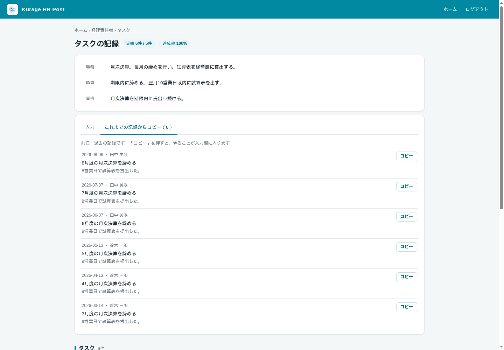

名古屋でシステム開発をしている、株式会社エクスブリッジの小嶋です。

「あの仕事は○○さんしか分からない」という状態、いわゆる属人化は、どの会社にもあります。困るのは、その人が休んだとき、異動したとき、辞めるときです。慌てて引き継ぎ書を書いてもらっても、出てくるのは数ページの箇条書きで、後任が実際に手を動かし始めると「これはどうしていたのか」が次々に出てきます。この記事では、属人化を解消するときにどこから手を付けると続くのかを、職務分掌・業務マニュアル・業務引き継ぎの順に、当社が業務システムを開発するときに考えてきたことをもとにまとめます。

## 属人化が起きるのは、記録が「人」にぶら下がっているから

属人化の原因として「マニュアルが無い」「教える時間が無い」がよく挙げられますが、もう一段手前に、記録の置き場所の問題があります。日報は書いた人ごとに、メールはその人の受信箱に、作業のファイルはその人のフォルダに入っています。どれも「誰が書いたか」で整理されているので、その人が抜けた瞬間に、記録の所属先ごと見えなくなります。

ですから、属人化の解消でまず変えたいのは、記録の主語です。「山田さんの仕事」ではなく「経理責任者の仕事」「品質管理責任者の仕事」として残す。人ではなく職（ポジション）に記録をぶら下げておけば、担当者が代わっても記録は職に残り、後任は前任が何をどうしていたかをそのまま読めます。このあと説明する3つの段取りは、どれもこの考え方の上に乗っています。

## 1. 職務分掌で、先に「職」を決める

職務分掌というと、部署ごとの権限を細かく並べた規程を思い浮かべる方が多いと思います。属人化の解消のために最初に要るのは、そこまで大がかりなものではありません。会社の中にある「職」に名前を付けて、その職が何をする職なのかを書き出すところからで十分です。

書き出すのは3つです。その職がする仕事（職務）、その仕事で何に責任を持つのか（職責）、そして何ができていれば果たしたと言えるのか（目標）です。たとえば経理責任者なら、職務は「月次決算。毎月の締めを行い、試算表を経営層に提出する」、職責は「期限内に締める。翌月10営業日以内に試算表を出す」、目標は「月次決算を期限内に提出し続ける」と書けます。これは当社の業務システムのデモに入れている見本の書き方ですが、このくらいの短さで構いません。

ここで大事なのは、職を人より先に置くことです。職は担当者がいなくても存在します。品質管理責任者や個人情報保護管理者、安全衛生推進者のように、ISO や法令の関係で「置いておかなければならない職」は特にそうで、前任が異動したあと後任が決まらないまま、気づいたら誰もいなかった、ということが起きます。職を先に台帳に載せておけば、担当者がいない職、つまり空席がひと目で分かります。

## 2. 業務マニュアルの作り方：白紙から書かせない

業務マニュアルの作り方を調べると、目次の立て方や、手順を書く粒度、図の入れ方といった話がたくさん出てきます。どれも正しいのですが、実際の現場でマニュアルが止まる理由は、書き方よりも「書く手間」のほうです。普段の仕事をしながら、別の文書を一から書き起こす時間はなかなか取れません。目標管理のシートを表計算で配ったのに、期末には誰も更新していなかった、というのも同じ理由です。

そこで、マニュアルを別に書くのではなく、日々の記録がそのままマニュアルになる形を考えます。職務・職責・目標の下に、その職で「やること」と「やったこと」を1件ずつ残していきます。「8月度の月次決算を締める」「8営業日で試算表を提出した」のように、短くて構いません。半年分たまれば、その職で毎月何をしているのか、どのくらいの期間で終わっているのかが、記録の並びから読み取れます。

もう一つの工夫は、前の記録を写して直すだけで済むようにすることです。毎月同じような仕事なら、先月の記録を呼び出して、違うところだけ書き換えれば終わります。後任が書くときも、前任の書き方をそのまま写せるので、書き方がぶれません。手順書としての体裁は、そのあとで必要な部分だけ整えれば十分です。

## 3. 業務引き継ぎは、後任が前任の記録を読めれば済む

業務引き継ぎというと、引き継ぎ書を作って、口頭で説明して、しばらく一緒に仕事をして、という流れが普通です。ただ、引き継ぎ書は退職や異動のときだけ書く特別な文書なので、日々の仕事とつながっていません。しかも書き手はいちばん忙しい時期で、普段は意識せずにやっていることほど書かれません。

1と2ができていれば、引き継ぎの中身はほとんど出来上がっています。後任はその職の職務・職責・目標を読み、前任がこれまで残してきた「やること・やったこと」を日付と記録者つきで読めばいいからです。引き継ぎのために新しく書くものは、記録に残っていない例外の扱いくらいになります。担当を代えるときに管理者がすることも、「いつから誰がその職に就くか」を記録するだけで済みます。

上の画面は、当社の業務システムのデモで、経理責任者の職に前任と後任の記録が並んでいるところです。後任は前任の「5月度の月次決算を締める」「9営業日で試算表を提出した」といった記録を読み、そのまま写して自分の記録を付け始められます。

## 続けるために、評価の数字は決まった計算で出す

職ごとに目標を置くと、「どのくらい達成できているか」を数字で見たくなります。このとき、数字の出し方が人によって違ったり、見るたびに変わったりすると、すぐに信用されなくなります。目標に件数の目標値を置き、「やったこと」が書かれた件数を実績として、実績を目標値で割る、というように決まった計算にしておくと、同じ記録からいつ見ても同じ数字が出ます。評価に使う数字ほど、計算のしかたを単純にしておくほうが長く使えます。

## 職の記録を残す業務システム「Kurage HR Post」

ここまでの進め方は、表計算や共有フォルダでも始められます。ただ、ファイルが人ごとのフォルダに散ったり、様式が人によって変わったりして、続けるのが難しくなりがちです。当社では、この進め方をそのまま形にした業務システム「Kurage HR Post」を開発し、Kurage App Store で提供しています。

記録の主語を職に置き、職務・職責・目標と日々のタスクを職に紐づけて残します。登録画面は「入力」と「これまでの記録からコピー」のタブに分かれていて、前任を含む過去の記録が日付・記録者つきで並び、コピーを押せば入力欄に入ります。必要な人数に対して担当者が足りない職は空席として警告が出ます。達成率は、やったことが書かれた件数を目標値で割る決まった計算で、上限120%、職のスコアは目標ごとの達成率の単純平均で、等級に変換する基準も設定で変えられます。AIに採点させることはしていません。

担当者は社員コードとパスワードでログインし、任命された自分の職についてだけ登録・編集ができます。職の作成と任命は管理者が行います。社員の台帳は持たず、外部の `employees.json` を読むだけなので、人事の台帳と二重に管理することがありません。当社の社内グループウェア（Kurage Vibe Groupware Core）をお使いなら、そのデータを指定するだけで連動します。

動作は PHP 7.0 以降と pdo_sqlite で、1ファイルの PHP と SQLite のデータベースだけなので、DBサーバーが要らず、一般的なレンタルサーバーや自社のサーバーに置けます。オンプレミスで、ソースコードごとお渡しする MIT ライセンスなので、自社の等級の決まりに合わせて改造もできます。自己テスト65項目と、Claude Code で設置や改造をするための手順書も同梱しています。なお、給与計算や勤怠の打刻、採用管理、上期・下期ごとの評価の承認の流れは、このシステムの守備範囲ではありません。

[業務引き継ぎ・属人化解消の職務管理（Kurage HR Post）の製品ページ](https://kappstore.exbridge.jp/app.php?id=56bf3ddd46b5a457#ref=vibeblog-zokujinka-kaisho)

デモには、品質管理責任者・個人情報保護管理者・空席の安全衛生推進者・前任から後任に代わった経理責任者の4つの職が入っていて、動きを確かめられます。

[Kurage HR Post のデモ](https://proto.exbridge.jp/khrpost/)

このシステムをどういう考えで今の形に絞り込んだかは、[人事システムを削り続けて、職の記録だけが残った話](https://exbridge.jp/vibeblog/2026-08-21-khrpost-kezuru.html)に書いています。引き継ぎ書がなぜ機能しにくいのかは、[業務引き継ぎと属人化対策——職務分掌を記録で残す](https://kurage.exbridge.jp/gyomu-hikitsugi-zokujinka.php)でも説明しています。

## よくある質問

**Q. 属人化を解消するには、最初に何から手を付ければいいですか？**

会社の中にある職に名前を付けて、それぞれの職務・職責・目標を短く書き出すところからです。そのうえで、日々のやったことを人ではなく職に記録していきます。マニュアル作りから始めると、書く手間で止まりやすいので、記録を先にためていくほうが続きます。

**Q. 職務分掌の規程が無い会社でも始められますか？**

始められます。部署ごとの権限を網羅した規程が無くても、「経理責任者」「品質管理責任者」のような職と、その職がすることを書き出せば足ります。規程を整えるのは、記録がたまってからでも遅くありません。

**Q. 業務マニュアルは、どのくらい細かく書けばいいですか？**

最初は細かく書こうとしないほうが続きます。毎回の「やること」と「やったこと」を1行ずつ残していけば、その職で何をしているのかは記録の並びから読み取れます。後任がつまずいたところだけ、手順を書き足していけば十分です。

**Q. 担当者が決まっていない職も管理できますか？**

できます。Kurage HR Post では職は担当者がいなくても存在し、必要な人数に対して担当者が足りない職は空席として警告が出ます。前任が残した記録も職に残るので、後任が決まったらそのまま読めます。

**Q. 今使っている人事の台帳と二重管理になりませんか？**

Kurage HR Post は社員の台帳を持たず、外部の `employees.json` を読むだけです。退職した方も台帳から消さずに状態を変えるだけなので、過去の記録の記録者名も残ります。今の台帳から JSON を書き出す方法は、お使いの台帳に合わせて決めていただけます。
