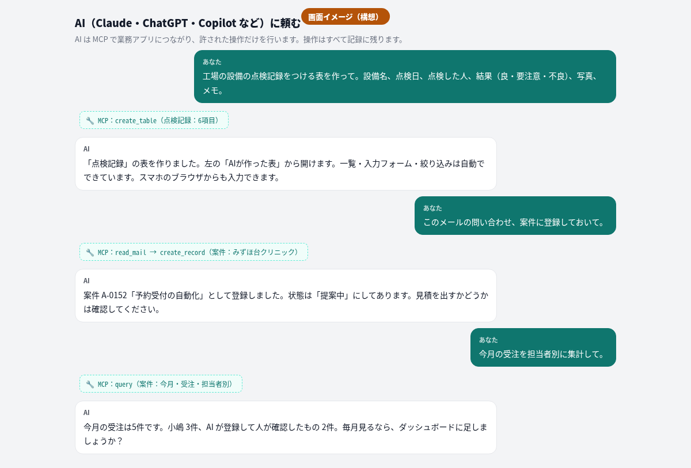
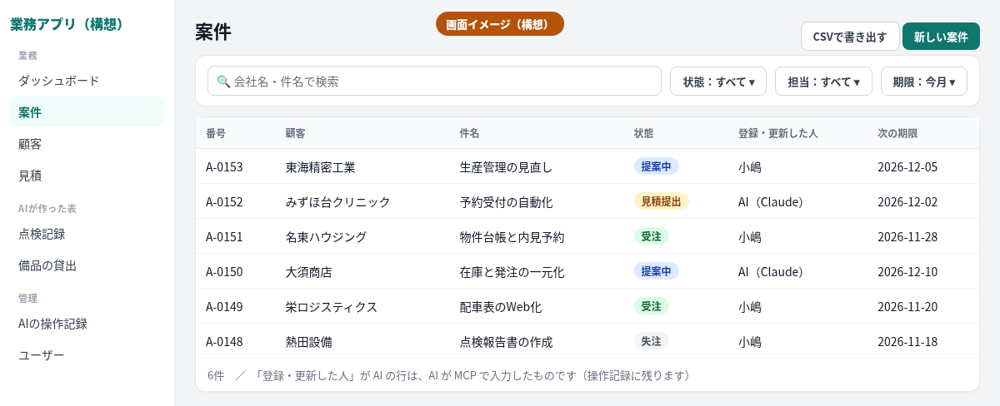
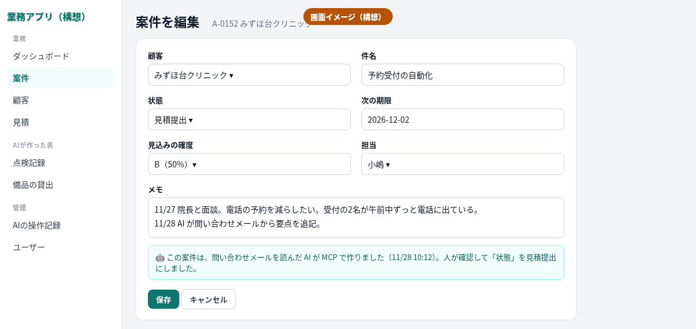
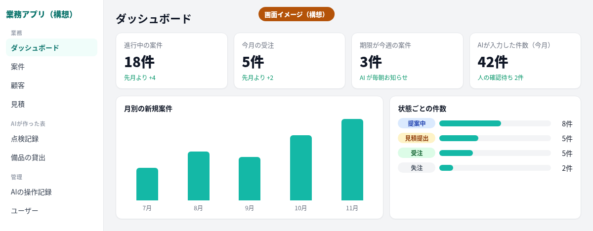
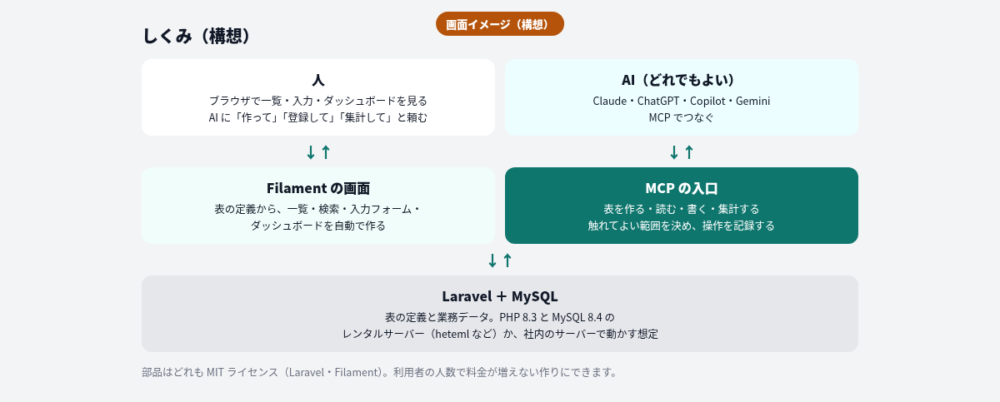

名古屋でシステム開発をしている小嶋です。

表計算のデータから、プログラムを書かずに業務アプリを作れる AppSheet は便利です。kintone も同じ考え方の製品です。ただ、相談を受けていると、次の声をよく聞きます。

- 利用する人数に応じて料金がかかるので、全員に使わせにくい
- 業務のデータを、外のクラウドに置くことになる
- 結局、画面を組み立てる人が社内に要る

そこで、オープンソースの部品で同じような業務アプリの土台を作り、さらに AI がつながって操作できる形を考えました。**この記事はまだ作っていない構想です。画面はすべて「こうなる」という画面イメージで、実際の製品の画面ではありません。**

## 何ができるか：AIに頼むと、業務アプリができる

一番の違いは、画面を組み立てる人が要らないことです。AI（Claude・ChatGPT・Copilot・Gemini など、どれでも）に頼むと、AI が MCP という共通のつなぎ方で業務アプリを操作します。

- **表を作る**：「設備の点検記録をつける表を作って。設備名、点検日、点検した人、結果、写真、メモ」と頼むと、AI が表と項目を定義します。一覧・入力フォーム・絞り込みの画面は自動でできます
- **入力する**：「このメールの問い合わせを案件に登録して」と頼むと、AI がメールを読んで、案件として登録します。人が画面に打ち込む手間が、AppSheet でも一番かかるところです
- **集計する**：「今月の受注を担当者別に集計して」と頼むと、AI が表を読んで答えます。毎月見る集計は、ダッシュボードに足せます

AI がしたことは、すべて記録に残します。触れてよい表や操作も、先に決めておきます。

## 人が使う画面：一覧・入力・ダッシュボード

人は、ブラウザで普通の業務アプリとして使います。画面は Filament という部品が、表の定義から自動で作ります。

一覧では、検索・絞り込み・並べ替え・CSV の書き出しができます。AI が登録した行は、だれが登録したかが分かるようにします。

入力フォームでは、AI が作った案件を人が確かめて、状態を変えたり書き足したりします。AI に任せるところと、人が判断するところを分けておく形です。

ダッシュボードには、数字のカードとグラフを並べます。決まった数字を毎日見る、という BI の役目はここで足ります。その場の疑問を調べるのは AI の役目です。

## しくみ

- **Laravel**：PHP の定番の土台です。表の定義と業務データを MySQL に持ちます
- **Filament**：Laravel の上で、一覧・入力フォーム・ダッシュボードを作る部品です。今も活発に開発が続いています
- **MCP の入口**：AI が表を作る・読む・書く・集計するための入口です。触れてよい範囲を決め、操作を記録します
- **置き場所**：PHP 8.3 と MySQL 8.4 のレンタルサーバーや、社内のサーバーで動かす想定です

Laravel も Filament も MIT ライセンスなので、作ったものを社内で使うのも、製品として配るのも、ソースコードの公開などの縛りがありません。

## AppSheet・kintone との違い

| | AppSheet・kintone | この構想 |
|---|---|---|
| 料金の考え方 | 利用する人数に応じてかかる | 人数で増えない作りにできる |
| データの置き場所 | 提供元のクラウド | 自社のサーバーやレンタルサーバー |
| 画面を作る人 | 社内の担当者が組み立てる | AIに頼む |
| つながるAI | それぞれの製品のAI | Claude・ChatGPT・Copilot・Gemini など、どれでも |

AppSheet には Gemini、Power Apps には Copilot が付いていて、AIで作る機能は大手も持っています。違いは、データが手元に残ること、人数で料金が増えないこと、AIを選ばないことです。

## できないこと・割り切ること

正直に書いておきます。

- **画面で表を組み立てる編集画面は、最初は作りません**。表を作るのは AI に任せる前提です。作り込むと大きな仕事になるためです
- **専用のスマホアプリや、電波の無い場所での入力は弱い**です。スマホのブラウザで使う形になります
- **自由な分析は BI 専用の道具にかないません**。集計の軸を画面で自由に変えるような使い方は、AI に頼むか、Metabase などを足します

## AIシステム基盤の部品として

この業務アプリは、[AIで業務自動化するには「AIシステム基盤」が要る](https://exbridge.jp/vibeblog/2026-11-28-ai-system-kiban-gyomu-jidoka.html#ref=vibeblog-filament-mcp)で書いた、AI が操作できる業務システムと、その入口の2つを1つでまかなうものです。業務を次々に AI が扱える形にしていくための土台になります。

当社では、AI-IT顧問契約の中で、こうした業務システムを御社の業務に合わせて作っていきます。

- [AI-IT顧問](https://exbridge.jp/ai-it-komon.html#ref=vibeblog-filament-mcp)

## よくある質問

### AppSheet のようなものを、オープンソースで作れますか？

作れます。PHP の Laravel と、管理画面を作る部品の Filament を使えば、一覧・入力フォーム・ダッシュボードのある業務アプリを、表の定義から作れます。どちらも MIT ライセンスです。

### MCP とは何ですか？

AI が外のシステムを操作するための、共通のつなぎ方です。Claude・ChatGPT・Copilot などが対応し始めています。業務アプリに MCP の入口を付けると、AI がその業務アプリの表を作ったり、データを登録・集計したりできます。

### レンタルサーバーでも動きますか？

Laravel と Filament は、PHP 8.2 以上と MySQL で動きます。この構想では、PHP 8.3 と MySQL 8.4 が使えるレンタルサーバーで動かすことを想定しています。実際に動くかは、作るときに最初に確かめます。

### もう使えますか？

まだ構想の段階です。この記事の画面は、すべて画面イメージです。
