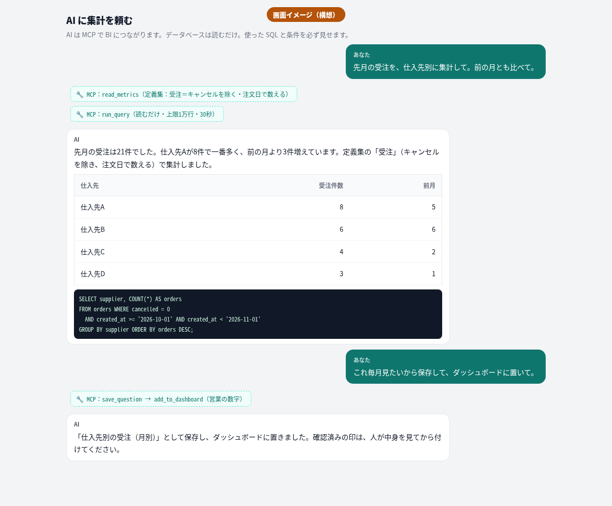
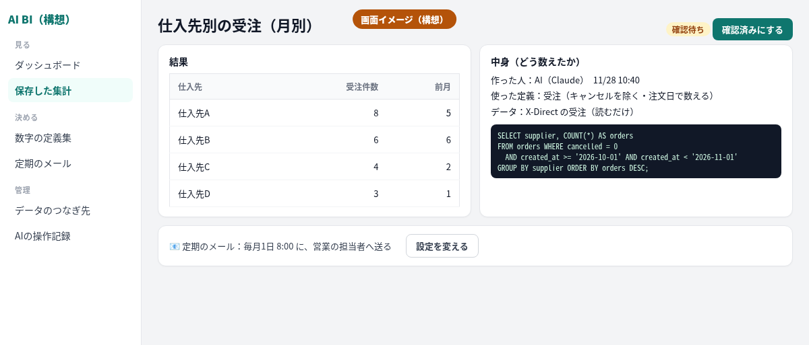
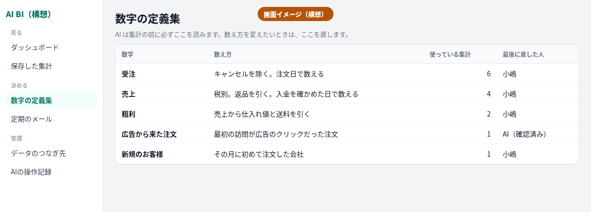
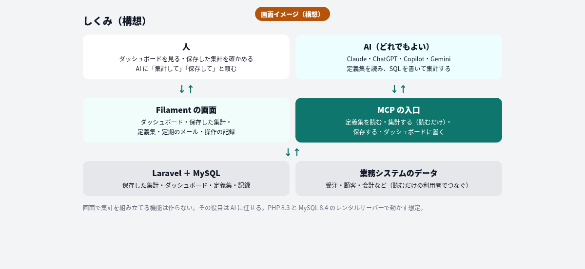

名古屋でシステム開発をしている小嶋です。

売上や受注の数字を見るために、BI ツールを入れたいという相談があります。オープンソースなら Metabase が定番で、データベースをつなぐと、画面の操作で集計表やグラフ、ダッシュボードが作れます。

ただ、Metabase の一番の売りは「SQL を書けない人でも、画面の操作で集計できる」ことです。この役目は、今は AI に任せられます。そう考えると、BI ツールを別に入れる意味はかなり薄くなります。

そこで、AI が集計を作り、PHP の Laravel と Filament が保存・表示・共有を受け持つ BI を考えました。**この記事はまだ作っていない構想です。画面はすべて画面イメージで、実際の製品の画面ではありません。**

## AIに頼むと、集計してグラフにする

1. 「先月の受注を、仕入先別に集計して。前の月とも比べて」と AI に頼む
2. AI が数字の定義集を読み、データベースを読むだけの権限で集計する
3. 結果の表と一緒に、使った SQL と条件を見せる
4. 「毎月見たいから保存して、ダッシュボードに置いて」と頼むと、保存される

AI は Claude・ChatGPT・Copilot・Gemini のどれでも構いません。MCP という共通のつなぎ方で、BI につながります。

## 人が見る画面：ダッシュボード

保存した集計は、ダッシュボードにカードやグラフとして並びます。期間や担当者で絞り込めます。毎朝見る数字、毎月の報告に使う数字は、ここを開くだけで見られます。

## 保存した集計：どう数えたかを必ず見せる

AI が作った集計は、最初は「確認待ち」です。人が中身（使った定義・データ・SQL）を見て、正しければ「確認済み」にします。毎月1日にメールで送る、といった定期の送信もここで決めます。

## 数字の定義集：AIは集計の前に必ず読む

AI に集計を任せるうえで一番大事なのが、数字の定義です。「売上」は税込か税別か、返品を引くか。「受注」はキャンセルを除くか、どの日で数えるか。ここがあいまいだと、AI は聞くたびに違う数え方をして、数字が合わなくなります。

そこで、数え方を定義集にまとめ、AI は集計の前に必ず読むようにします。数え方を変えたいときは、定義集を直します。

## しくみ

- **Filament の画面**：ダッシュボード、保存した集計、定義集、定期のメール、AI の操作の記録
- **MCP の入口**：定義集を読む・集計する（読むだけ）・保存する・ダッシュボードに置く
- **Laravel ＋ MySQL**：保存した集計・ダッシュボード・定義集・記録を持つ
- **業務システムのデータ**：受注・顧客・会計などに、読むだけの利用者でつなぐ

安全のために、次の決まりを入れます。

- 集計に使うデータベースの利用者は、読むだけにする
- 実行できるのは、データを読む SQL だけにする。件数と時間にも上限を付ける
- 結果には、使った SQL と条件を必ず付ける
- AI の操作は、すべて記録する

PHP 8.3 と MySQL 8.4 のレンタルサーバーで動かす想定です。Metabase のように、Java のプログラムを常に動かしておくサーバーは要りません。

## Metabase と比べて、作らないもの

| | Metabase | この構想 |
|---|---|---|
| 集計を作る | 画面の操作で組み立てる | AIに頼む |
| 数え方をそろえる | モデルや指標を画面で定義 | 数字の定義集をAIが読む |
| 置き場所 | Javaのプログラムを動かすサーバー | PHPのレンタルサーバーでも |
| 使える人 | 画面の操作を覚えた人 | AIに頼める人なら誰でも |

画面の操作で集計を組み立てる機能や、グラフを押して掘り下げる機能は作りません。その役目は AI に任せます。分析担当者が自分で深く掘りたい会社は、Metabase を足すほうが合います。

## BIは、業務システムの一部でいい

この BI は、別の製品として入れるものではないと考えています。業務システムを Laravel ＋ Filament の型で作っていれば、ダッシュボード・保存した集計・定義集は、その中に最初から持たせられます。

[AIで業務自動化するには「AIシステム基盤」が要る](https://exbridge.jp/vibeblog/2026-11-28-ai-system-kiban-gyomu-jidoka.html#ref=vibeblog-ai-bi)で書いた「③ AI駆動経営（AIが数字を見て調整する）」は、この形で実現します。同じ日に書いた [AppSheet の代わりの構想](https://exbridge.jp/vibeblog/2026-11-28-appsheet-laravel-filament-mcp.html#ref=vibeblog-ai-bi)と同じ土台です。

当社では、AI-IT顧問契約の中で、こうした業務システムを御社の業務に合わせて作っていきます。

- [AI-IT顧問](https://exbridge.jp/ai-it-komon.html#ref=vibeblog-ai-bi)

## よくある質問

### BIツールは、中小企業にも必要ですか？

毎日・毎月見る数字が決まっているなら、業務システムのダッシュボードで足ります。その場の疑問は AI に聞けば、BI ツールを別に入れなくても多くは足ります。分析担当者が自分で深く掘りたい場合は、Metabase などを足します。

### AIに集計を任せて、数字は合いますか？

数え方を「数字の定義集」にまとめ、AI が集計の前に必ず読むようにします。結果には使った SQL と条件を付け、よく使う集計は人が確かめてから保存します。こうすれば、毎回同じ数え方で数字が出ます。

### AIがデータを書き換えてしまう心配はありませんか？

集計に使うデータベースの利用者を、読むだけの権限にします。実行できるのもデータを読む SQL だけにし、操作はすべて記録します。

### Metabase はレンタルサーバーで動きますか？

Metabase は Java のプログラムを常に動かしておく必要があるので、PHP しか動かない共有のレンタルサーバーでは動きません。この構想は、PHP と MySQL のレンタルサーバーで動かす想定です。

### もう使えますか？

まだ構想の段階です。この記事の画面は、すべて画面イメージです。
