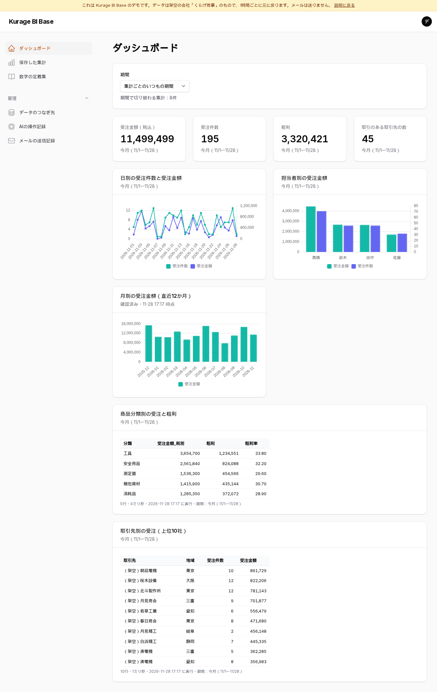
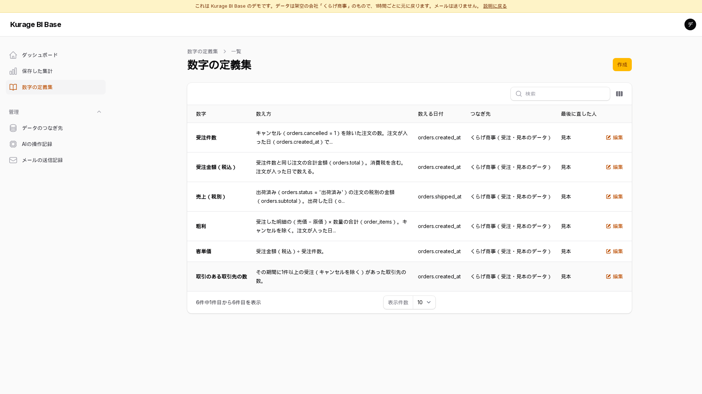
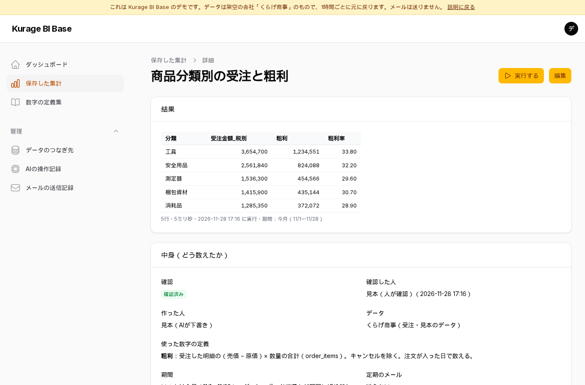
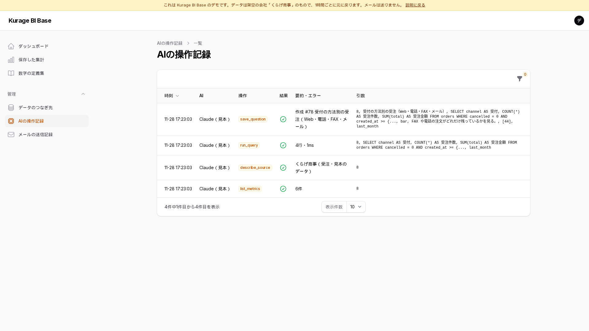

名古屋でシステム開発をしている小嶋です。

今日の午前中に、[BIツールは要る？｜Metabaseの代わりに、AIが集計する BI を考えた](https://exbridge.jp/vibeblog/2026-11-28-bi-tool-ai-laravel-filament.html#ref=vibeblog-kbibase)という構想を書きました。そのあと実際に作り、当社の通販サイトの受注データにつないで動かし、製品として出しました。**Kurage BI Base** です。

- [Kurage BI Base のデモ（架空の会社のデータで触れます）](https://proto.exbridge.jp/kbibase/#ref=vibeblog-kbibase)
- [Kurage BI Base の販売ページ（Kurage App Store）](https://kappstore.exbridge.jp/app.php?id=c96057eb101e86e2#ref=vibeblog-kbibase)

40秒ほどの紹介動画です（音声が出ます）。

  <video src="https://kurage.exbridge.jp/pv/kbibase-pv-40s.mp4" poster="https://kurage.exbridge.jp/pv/kbibase-pv-poster.jpg" controls playsinline preload="none" style="display:block;width:100%;height:auto"></video>

## 何をするシステムか

BI ツールの役目は、大きく「集計を作る」と「数字を共有する」の2つです。Kurage BI Base は、**集計を作るのは AI、数え方を決めて確かめるのは人、共有はシステム** と分けています。

1. **数字の定義集**に、受注・売上・粗利などの数え方を書いておく
2. AI（Claude・ChatGPT・Copilot など）が MCP でつながり、定義集と表の形を読んで、**データを読むだけで**集計する
3. AI が保存した集計は「**確認待ち**」で入る。人が中身を見て「確認済みにする」を押す
4. 確認済みの集計だけが、**ダッシュボード**に並び、決まった時刻に**メール**で届く

ダッシュボードの上の「期間」で、今月・先月・直近30日・今年・日付の指定などに切り替えると、確認済みの集計がまとめて切り替わります。

## AI に集計を任せるときに困ること

AI にそのまま「先月の売上を出して」と頼むと、だいたい答えは返ってきます。困るのは次のようなことです。

- 聞くたびに数え方が変わる。キャンセルを含めたり、税込と税別が混ざったりする
- どう数えたかが分からないまま、数字だけが会議資料に貼られる
- AI がデータを書き換えたり、見せたくない個人情報まで読んだりしないか心配

Kurage BI Base は、この3つに次のように答えています。

### 数え方は「数字の定義集」に

「受注はキャンセルを除き、注文の日で数える」「粗利は（売価−原価）×数量」のように、数え方を1か所にまとめます。AI は集計の前に必ず読むので、聞くたびに数え方が変わりません。数え方を変えたいときは、定義集を直します。

### どう数えたかを、必ず見せる

保存した集計には、結果の表と一緒に、確認した人・作った人・使った数字の定義・SQL が並びます。定期のメールにも、同じ「どう数えたか」が付きます。

### AI は読むだけ。操作はすべて記録

- 集計するデータは読み取り専用で開きます。実行できるのは、データを読む SQL の1文だけです
- 「見せない列」に指定した列（電話番号・メールアドレスなど）は、AI からも見えません
- AI が保存した集計は、人が確認するまでダッシュボードにもメールにも出ません。SQL を変えると、確認済みの印は外れます

AI が何を読み、何を集計し、何を保存したかは「AIの操作記録」にすべて残ります。

## 実際に使ってみて

当社の通販サイトの受注データにつなぎ、Claude Code から MCP で「支払い方法別の受注」を集計して保存し、毎時の定期のメールで届くところまで動かしています。お客様の名前・住所・電話番号などの列は、見せない列にしています。

作る途中で困ったのは、レンタルサーバーの WAF（不正な通信を止める仕組み）です。SQL を含む通信は攻撃と見なされて止められるため、AI は HTTP ではなく SSH でサーバーに入って集計する形にしました。画面の編集でも SQL は表示だけにしています。SQL を作るのは AI の役目なので、使い方としてはむしろ素直になりました。

## できないこと

- 集計するデータは SQLite のファイルです。MySQL などに直接つなぐ機能は、この版には入っていません
- 画面の操作で集計を組み立てる機能や、グラフを押して掘り下げる機能はありません。その役目は AI に任せています
- AI の利用料金は含みません。MCP に対応した AI が別に必要です

## デモを触る

[Kurage BI Base のデモ](https://proto.exbridge.jp/kbibase/#ref=vibeblog-kbibase)には、架空の会社「くらげ商事」（工具・消耗品の卸）の約2年分の受注データが入っています。ログインはデモのページに書いてあります。デモのデータは1時間ごとに元に戻り、メールは送りません。

- 「保存した集計」の「受付の方法別の受注」は、AI（見本）が MCP で作った確認待ちの集計です。中身を見て「確認済みにする」を押してみてください
- 「AIの操作記録」で、AI が定義を読み、集計し、保存した流れが見られます

## AIシステム基盤の一部として

この BI は、[AIで業務自動化するには「AIシステム基盤」が要る](https://exbridge.jp/vibeblog/2026-11-28-ai-system-kiban-gyomu-jidoka.html#ref=vibeblog-kbibase)で書いた「AI が数字を見て調整する」ための部品です。業務システムのデータを AI が読める形にしておけば、数字の確認と共有はこの BI で受け持てます。

当社では、AI-IT顧問契約の中で、こうした業務システムを御社の業務に合わせて作っていきます。

- [AI-IT顧問](https://exbridge.jp/ai-it-komon.html#ref=vibeblog-kbibase)
- [Kurage BI Base の販売ページ（ソースコード一式・MIT ライセンス）](https://kappstore.exbridge.jp/app.php?id=c96057eb101e86e2#ref=vibeblog-kbibase)

## よくある質問

### Kurage BI Base は、どんな BI ツールですか？

AI が数字の定義集を読んで集計し、人が確かめた集計だけをダッシュボードと定期のメールで共有する BI です。Claude・ChatGPT・Copilot などの AI と MCP でつながります。

### AI がデータを書き換えてしまう心配はありませんか？

集計するデータは読み取り専用で開き、実行できるのはデータを読む SQL の1文だけです。見せない列は AI からも見えず、AI の操作はすべて記録に残ります。

### レンタルサーバーで動きますか？

PHP 8.3 と SQLite が使える共有レンタルサーバーで動きます。Java や Node.js のサーバーを常に動かしておく必要はありません。

### Metabase とは何が違いますか？

Metabase は、画面の操作で集計を組み立てる BI です。Kurage BI Base は、集計を作るのを AI に任せ、数え方の定義と人の確認、共有を受け持ちます。分析担当者が自分で深く掘りたい会社には、Metabase のほうが合います。
